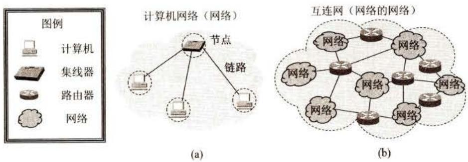
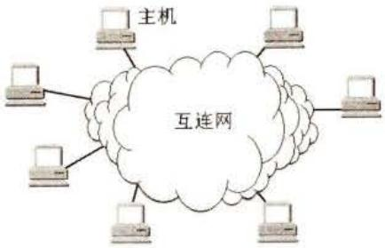

# 1.2.1 网络的网络

## 1.2 互联网概述

起源于美国的互联网 $^{①}$ 现已发展成为世界上最大的覆盖全球的计算机网络。

我们先给出关于网络、互连网、互联网（因特网）的一些最基本的概念。

> ① 注：1994 年全国自然科学名词审定委员会公布的名词中，interconnection 是 “互连”，interconnection network 是 “互连网络”，internetworking 是 “网际互连” [MINGCI94]。但 1997 年 8 月全国科学技术名词审定委员会在其推荐名（一）中，将 internet, internetwork, interconnection network 的译名均推荐为 “互联网”，而在注释中说 “又称互连网”，即 “互联网” 与 “互连网” 这两个名词均可使用，但请注意，“联” 和 “连” 并不是同义字。术语 “互连” 一定不能用 “互联” 代替。“连接” 也一定不能用 “联接” 代替。

> 图 1-1 简单的网络(a)和由网络构成的互连网(b)（教材第 4 页）

请读者注意：为了方便，在本书中，“网络”往往就是“计算机网络”的简称，而不是表示电信网或有线电视网。

计算机网络（简称为网络）由若干节点(node) $^{①}$ 和连接这些节点的链路(link)组成。网络中的节点可以是计算机、集线器、交换机或路由器等（在后续的两章我们将会介绍集线器、交换机和路由器等设备的作用）。图 1-1(a)给出了一个具有四个节点和三条链路的网络。我们看到，有三台计算机通过三条链路连接到一个集线器上。这是一个非常简单的计算机网络（可简称为网络）。又如，在图 1-1(b)中，有多个网络通过一些路由器相互连接起来，构成了一个覆盖范围更大的计算机网络。这样的网络称为互连网(internetwork或internet)。因此互连网是“网络的网络”(network of networks)。用一朵云表示一个网络的好处，就是可以先不考虑每一个网络中的细节，而是集中精力讨论与这个互连网有关的一些问题。

请读者注意，当我们使用一朵云来表示网络时，可能会有两种不同的情况。一种情况如图 1-1(a) 所示，用云表示的网络已经包含了网络中的计算机。但有时为了讨论问题的方便（例如，要讨论几个计算机之间如何进行通信），也可以把有关的计算机画在云的外面，如图 1-2 所示。习惯上，与网络相连的计算机常称为主机(host)。在互连网中不可缺少的路由器，是一种特殊的计算机（有中央处理器、存储器、操作系统等），但不能称为主机。

> 图 1-2 互连网与所连接的主机（教材第 4 页）

这样，我们初步建立了下面的基本概念：

网络把许多计算机连接在一起，而互连网则把许多网络通过一些路由器连接在一起。与网络相连的计算机常称为主机。

> ① 注：根据[MINGCI94]第112页，名词node的标准译名是：节点08.078，结点12.023。再查一下12.023这一节是计算机网络，因此，在计算机网络领域，node显然应当译为结点，而不是节点。但不知由于何种原因，在网络领域中，标准译名“结点”一直未得到推广。考虑到与大多数中文资料中的node译名保持一致，本书从第8版起也采用“节点”这个非标准译名。

还有一点也必须注意：网络互连并不仅仅是把计算机简单地在物理上连接起来，因为这样做并不能达到计算机之间能够相互交换信息的目的。我们还必须在计算机上安装许多使计算机能够交换信息的软件才行。因此当我们谈到网络互连时，就隐含地表示在这些计算机上已经安装了可正常工作的适当软件，在计算机之间可以通过网络交换信息。

现在使用智能手机上网已非常普遍。由于智能手机包含中央处理器、存储器以及操作系统，因此，从计算机网络的角度看，连接在计算机网络上的智能手机也相当于一个主机。实际上，智能手机已远远不是个单一功能的设备，它既是电话机，同时也是计算机、照相机、摄像机、电视机、导航仪等综合多种功能于一体的智能机器。同理，连接在计算机网络上的智能电视机，也是计算机网络上的主机。
