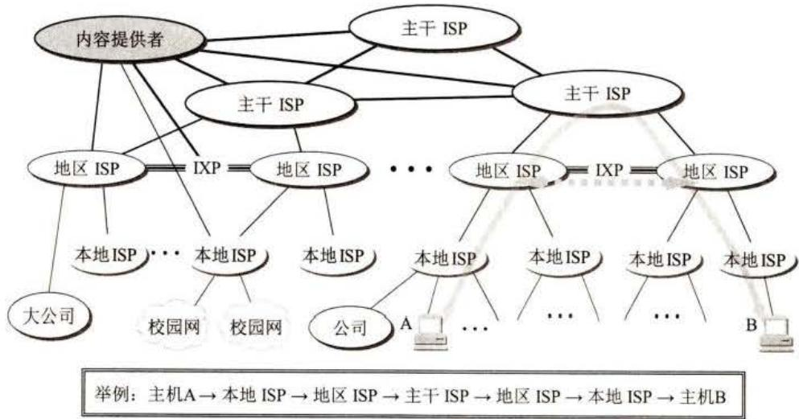

# 1.2.2 互联网基础结构发展的三个阶段

互联网的基础结构大体上经历了三个阶段的演进。但这三个阶段在时间划分上并非截然分开而是有部分重叠的，这是因为网络的演进是逐步的，而并非在某个日期发生了突变。

第一阶段是从单个网络 ARPANET 向互连网发展的过程。1969 年美国国防部创建的第一个分组交换网 ARPANET 最初只是一个单个的分组交换网（并不是一个互连的网络）。所有要连接在 ARPANET 上的主机都直接与就近的节点交换机相连。但到了 20 世纪 70 年代中期，人们已认识到不可能仅使用一个单独的网络来满足所有的通信需求。于是 ARPA 开始研究多种网络（如分组无线电网络）互连的技术，这就导致了互连网络的出现，成为现今互联网(Internet)的雏形。1983 年 TCP/IP 协议成为 ARPANET 上的标准协议，使得所有使用 TCP/IP 协议的计算机都能利用互连网相互通信，因而人们就把 1983 年作为互联网的诞生时间。1990 年 ARPANET 正式宣布关闭，因为它的实验任务已经完成。

请读者注意以下两个意思相差很大的名词 internet 和 Internet [RFC 1208]:

以小写字母 i 开始的 internet（互连网）是一个通用名词，它泛指由多个计算机网络互连而成的计算机网络。在这些网络之间的通信协议（即通信规则）可以任意选择，不一定非要使用 TCP/IP 协议。

以大写字母 I 开始的 Internet（互联网，或因特网）则是一个专用名词，它指当前全球最大的、开放的、由众多网络相互连接而成的特定互连网，它采用 TCP/IP 协议族作为通信的规则，且其前身是美国的 ARPANET。

可见，任意把几个计算机网络互连起来（不管采用什么协议），并能够相互通信，这样构成的是一个互连网(internet)，而不是互联网(Internet)。

第二阶段的特点是建成了三级结构的互联网。从 1985 年起，美国国家科学基金会 NSF (National Science Foundation) 就围绕六个大型计算机中心建设计算机网络，即国家科学基金网 NSFNET。它是一个三级计算机网络，分为主干网、地区网和校园网（或企业网）。这种三级计算机网络覆盖了全美国主要的大学和研究所，并且成为互联网中的主要组成部分。1991 年，NSF 和美国的其他政府机构开始认识到，互联网必将扩大其使用范围，不应仅限于大学和研究机构。世界上的许多公司纷纷接入到互联网，网络上的通信量急剧增大，使互联网的容量已满足不了需要。于是美国政府决定把互联网的主干网转交给私人公司来经营，并开始对接入互联网的单位收费。1992 年互联网上的主机超过 100 万台。1993 年互联网主干网的速率提高到 45 Mbit/s（T3 速率）。

为什么要使用这种三级结构呢？这是因为互联网必须能够让连接到互联网的所有用户都可以相互通信。但是一个普通的校园网或企业网单靠本身力量并不可能做到这一点，因为要实现如此多的连接需要巨大的投资。于是就出现了上面两层的地区网和主干网。地区网可以完成本地区管辖范围内各校园网或企业网之间的相互通信，而主干网可以使不同地区之间的用户相互通信。

第三阶段的特点是逐渐形成了全球范围的多层次 ISP 结构的互联网。从 1993 年开始，由美国政府资助的 NSFNET 逐渐被若干个商用的互联网主干网替代，而政府机构不再负责互联网的运营。这样就出现了一个新的名词：互联网服务提供者 ISP (Internet Service Provider)。在许多情况下，互联网服务提供者 ISP 就是一个进行商业活动的公司，因此 ISP 又常译为互联网服务提供商。例如，中国电信、中国联通和中国移动等公司都是我国最有名的 ISP。

互联网服务提供者 ISP 可以从互联网管理机构申请到很多 IP 地址（互联网上的主机都必须有 IP 地址才能上网，这一概念我们将在第 4 章的 4.2.2 节详细讨论），同时拥有通信线路（大 ISP 自己建造通信线路，小 ISP 则向电信公司租用通信线路）以及路由器等连网设备，因此任何机构和个人只要向某个 ISP 交纳规定的费用，就可从该 ISP 获取所需 IP 地址的租用权，并可通过该 ISP 接入互联网。所谓“上网”就是指“（通过某 ISP 获得的 IP 地址）接入互联网”。IP 地址的管理机构不会把单个的 IP 地址零星地分配给单个用户，而是把整块的 IP 地址有偿租赁给经审查合格的 ISP。由此可见，现在的互联网已不是某个单个组织所拥有而是全世界无数大大小小的 ISP 所共同拥有的，这就是互联网也称为“网络的网络”的原因。

根据提供服务的覆盖面积大小以及所拥有的 IP 地址数目的不同，ISP 也分为不同层次的 ISP：主干 ISP、地区 ISP 和本地 ISP。目前已经覆盖全球的互联网，其主干 ISP 只有十几个，但本地 ISP 有好几十万个。

主干 ISP 由几个专门的公司创建和维护，服务面积最大（一般都能够覆盖国家范围），并且还拥有高速主干网（例如 10 Gbit/s 或更高）。不同的网络运营商都有自己的主干 ISP 网络，并且可以彼此互通。

地区 ISP 是一些较小的 ISP。这些地区 ISP 通过一个或多个主干 ISP 连接起来。它们位于等级中的第二层，数据率也低一些。

本地 ISP 给用户提供直接的服务（这些用户有时也称为端用户，强调是末端的用户）。本地 ISP 可以连接到地区 ISP，也可直接连接到主干 ISP。绝大多数的用户都是连接到本地 ISP 的。本地 ISP 可以是一个仅仅提供互联网服务的公司，也可以是一个拥有网络并向自己的雇员提供服务的企业，或者是一个运行自己的网络的非营利机构（如学院或大学）。

图 1-3 是具有三层 ISP 结构的互联网的概念示意图，但这种示意图并不表示各 ISP 的地理位置关系。图中给出了主机 A 经过许多不同层次的 ISP 与主机 B 通信的示意图。

随着互联网上数据流量的急剧增长，人们开始研究如何更快地转发分组，以及如何更加有效和更加经济地利用网络资源。于是，互联网交换点 IXP (Internet eXchange Point) 就应运而生了。

> 图 1-3 具有三层 ISP 结构的互联网的概念示意图（教材第 7 页）

互联网交换点 IXP 的主要作用就是允许两个网络直接相连并交换分组，而不需要再通过第三个网络来转发分组。例如，在图 1-3 中右方的两个地区 ISP 通过一个 IXP 连接起来了。这样，主机 A 和主机 B 交换分组时，就不必再经过最上层的主干 ISP，而是直接在两个地区 ISP 之间用高速链路对等地交换分组。这样就使互联网上的数据流量分布更加合理，同时也减少了分组转发的迟延时间，降低了分组转发的费用。现在许多 IXP 在进行对等交换分组时，都互相不收费。但本地 ISP 或地区 ISP 通过 IXP 向高层的 IXP 转发分组时，则需要交纳一定的费用。IXP 的结构非常复杂。典型的 IXP 由一个或多个网络交换机组成，许多 ISP 再连接到这些网络交换机的相关端口上。IXP 常采用工作在数据链路层的网络交换机，这些网络交换机都用局域网互连起来。

据[W-PCH]2020年8月的统计，全球已经有1064个IXP，其中我国拥有32个（北京6个，上海5个，广州4个，香港9个，台湾8个）。现在世界上较大的IXP的峰值吞吐量都在Tbit/s的量级。例如建造在德国的法兰克福的名为DE-CIX的IXP，是互联网在欧洲的枢纽，2020年8月统计的峰值吞吐量就已达到7.72Tbit/s。

这里特别要指出的是，当前互联网上最主要的流量就是视频文件的传送。图 1-3 中左上角所示的内容提供者(content provider)是在互联网上向所有用户提供视频文件的公司。这种公司和前面提到的 ISP 不同，因为他们并不向用户提供互联网的转接服务，而是提供视频内容的服务。由于传送视频文件产生的流量非常大，为了提高数据传送的效率，这些公司都有独立于互联网的专门网络（仅承载出入该公司的服务器的流量），并且能够和各级 ISP 以及 IXP 相连。这就使得互联网上的所有用户能够更加方便地观看网上的各种视频节目。现在许多 ISP 已不仅向用户提供互联网的接入服务，而且还提供信息服务和一些增值服务。

互联网已经成为世界上规模最大和增长速度最快的计算机网络，没有人能够准确说出互联网究竟有多大。互联网的迅猛发展始于20世纪90年代。由欧洲原子核研究组织CERN开发的万维网WWW(World Wide Web)被广泛使用在互联网上，大大方便了广大非网络专业人员对网络的使用，成为互联网的这种指数级增长的主要驱动力。万维网的站点数目也急剧增长。互联网上准确的通信量是很难估计的，但有文献介绍，互联网上的数据通信量每月约增加 10%。在 2005 年互联网的用户数超过了 10 亿，在 2010 年超过了 20 亿，在 2014 年已接近 30 亿，截止到 2019 年 3 月底，互联网的用户数已超过了 43.8 亿。
