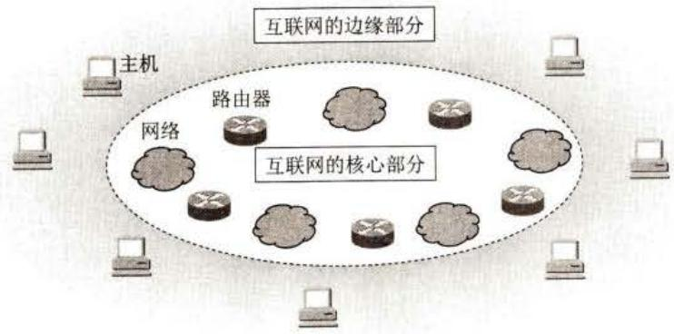
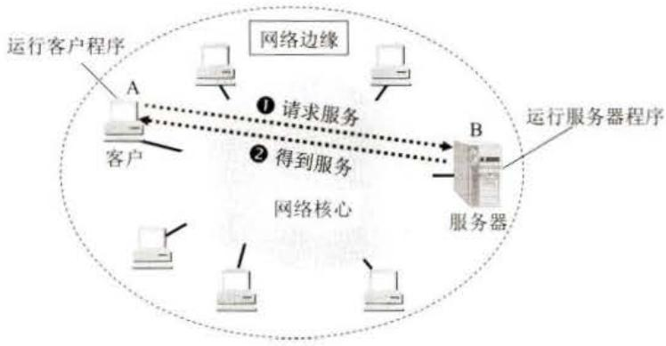
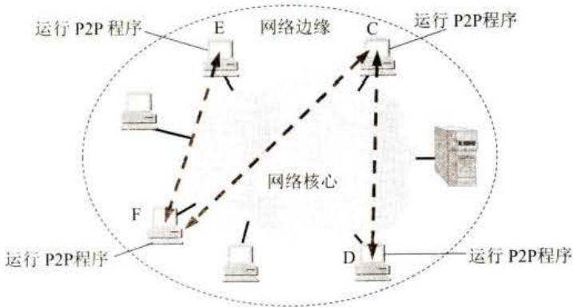

# 1.3.1 互联网的边缘部分

## 1.3 互联网的组成

互联网的拓扑结构虽然非常复杂，并且在地理上覆盖了全球，但从其工作方式上看，可以划分为以下两大块：

(1) 边缘部分 由所有连接在互联网上的主机组成。这部分是用户直接使用的，用来进行通信（传送数据、音频或视频）和资源共享。

(2) 核心部分 由大量网络和连接这些网络的路由器组成。这部分是为边缘部分提供服务的（提供连通性和交换）。

图 1-4 给出了这两部分的示意图。下面分别讨论这两部分的作用和工作方式。

> 图 1-4 互联网的边缘部分与核心部分（教材第 10 页）

处在互联网边缘的部分就是连接在互联网上的所有的主机。这些主机又称为端系统(end system), “端”就是“末端”的意思（即互联网的末端）。端系统在功能上可能有很大的差别，小的端系统可以是一台普通个人电脑（包括笔记本电脑或平板电脑）和具有上网功能的智能手机，甚至是一个很小的网络摄像头（可监视当地的天气或交通情况，并在互联网上实时发布），而大的端系统则可以是一台非常昂贵的大型计算机（这样的计算机通常称为服务器 server）。端系统的拥有者可以是个人，也可以是单位（如学校、企业、政府机关等），当然也可以是某个 ISP（即 ISP 不仅仅是向端系统提供服务，它也可以拥有一些端系统）。边缘部分利用核心部分所提供的服务，使众多主机之间能够互相通信并交换或共享信息。值得注意的是，现今大部分能够向网民提供信息检索、万维网浏览以及视频播放等功能的服务器，都不再是一个孤立的服务器，而是属于某个大型数据中心。例如，谷歌公司(Google)拥有上百个数据中心，而其中的 15 个大型数据中心的每一个都拥有 10 万台以上的服务器。又如，我国的百度公司在山西阳泉建造的数据中心拥有 16 万台服务器。

我们先要明确下面的概念。我们说：“主机 A 和主机 B 进行通信”，实际上是指：“运行在主机 A 上的某个程序和运行在主机 B 上的另一个程序进行通信”。由于“进程”就是“运行着的程序”，因此这也就是指：“主机 A 的某个进程和主机 B 上的另一个进程进行通信”。这种比较严密的说法通常可以简称为“计算机之间通信”。

在网络边缘的端系统之间的通信方式通常可划分为两大类：客户-服务器方式（C/S 方式）和对等方式（P2P 方式） $^{①}$ 。下面分别对这两种方式进行介绍。

## 1. 客户-服务器方式

这种方式在互联网上是最常用的，也是传统的方式。我们在上网发送电子邮件或在网站上查找资料时，都使用客户-服务器方式（有时写为客户/服务器方式）。

当我们打电话时，电话机的振铃声使被叫用户知道现在有一个电话呼叫。计算机通信的对象是应用层中的应用进程，显然不能用响铃的办法来通知所要找的对方的应用进程。然而采用客户-服务器方式可以使两个应用进程能够进行通信。

> ① 注：C/S 方式表示 Client/Server 方式，P2P 方式表示 Peer-to-Peer 方式。有时还可看到另外一种叫作浏览器-服务器方式，即 B/S 方式（Browser/Server 方式），但这仍然是 C/S 方式的一种特例。

客户(client)和服务器(server)都是指通信中所涉及的两个应用进程。客户-服务器方式所描述的是进程之间服务和被服务的关系。在图1-5中，主机A运行客户程序而主机B运行服务器程序。在这种情况下，A是客户而B是服务器。客户A向服务器B发出请求服务，而服务器B向客户A提供服务。这里最主要的特征就是：

客户是服务请求方，服务器是服务提供方。

服务请求方和服务提供方都要使用网络核心部分所提供的服务。

> 图 1-5 客户-服务器工作方式（教材第 11 页）

## 客户程序：

(1) 被用户调用后运行，在通信时主动向远地服务器发起通信（请求服务）。因此，客户程序必须知道服务器程序的地址。

(2) 不需要特殊的硬件和很复杂的操作系统。

## 服务器程序：

(1) 是一种专门用来提供某种服务的程序，可同时处理多个远地或本地客户的请求。

(2) 系统启动后即一直不断地运行着，被动地等待并接受来自各地的客户的通信请求。因此，服务器程序不需要知道客户程序的地址。

(3) 一般需要有强大的硬件和高级的操作系统支持。

客户与服务器的通信关系建立后，通信可以是双向的，客户和服务器都可发送和接收数据。

顺便要说一下，上面所说的客户和服务器本来都指的是计算机进程（软件）。使用计算机的人是计算机的“用户”(user)而不是“客户”(client)。但在许多国外文献中，经常也把运行客户程序的机器称为 client（在这种情况下也可把 client 译为“客户机”），把运行服务器程序的机器也称为 server。因此我们应当根据上下文来判断 client 或 server 是指软件还是硬件。在本书中，在表示机器时，我们也使用“客户端”（或“客户机”）或“服务器端”（或服务器）来表示“运行客户程序的机器”或“运行服务器程序的机器”。

## 2. 对等连接方式

对等连接（peer-to-peer，简写为 P2P。这里使用数字 2 是因为英文的 2 是 two，其读音与 to 同，因此英文的 to 常写为数字 2）是指两台主机在通信时，并不区分哪一个是服务请求方和哪一个是服务提供方。只要两台主机都运行了对等连接软件（P2P 软件），它们就可以进行平等的对等连接通信。这时，双方都可以下载对方已经存储在硬盘中的共享文档。因此这种工作方式也称为 P2P 方式。在图 1-6 中，主机 C, D, E 和 F 都运行了 P2P 程序，因此这几台主机都可进行对等通信（如 C 和 D, E 和 F，以及 C 和 F）。实际上，对等连接方式从本质上看仍然使用客户-服务器方式，只是对等连接中的每一台主机既是客户同时又是服务器。例如主机 C，当 C 请求 D 的服务时，C 是客户，D 是服务器。但如果 C 又同时向 F 提供服务，那么 C 又同时起着服务器的作用。

> 图 1-6 对等连接工作方式（P2P 方式）（教材第 12 页）

对等连接工作方式可支持大量对等用户（如上百万个）同时工作。关于这种工作方式我们将在后面第6章的6.9节进一步讨论。
