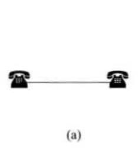
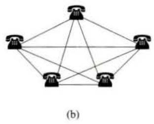
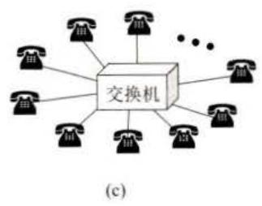
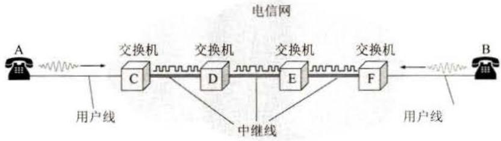
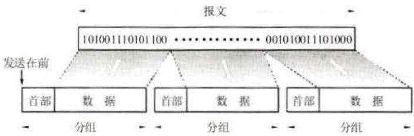
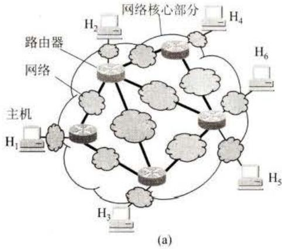
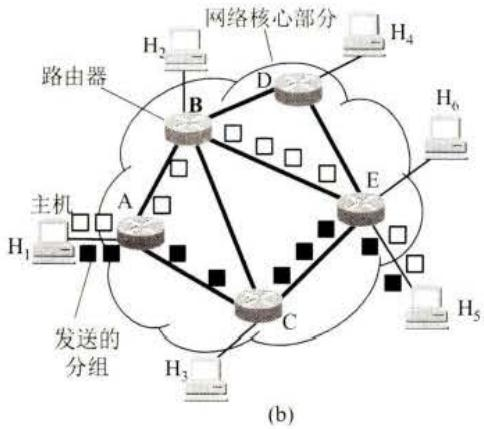
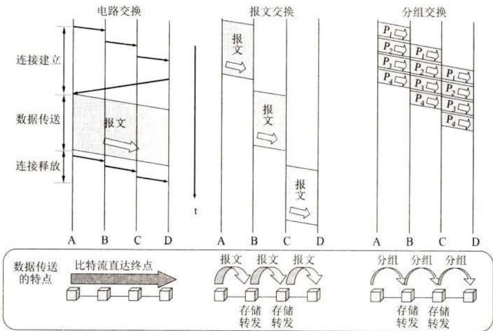

# 1.3.2 互联网的核心部分

网络核心部分是互联网中最复杂的部分，因为网络中的核心部分要向网络边缘部分中的大量主机提供连通性，使边缘部分中的任何一台主机都能够与其他主机通信。

在网络核心部分起特殊作用的是路由器（router），它是一种专用计算机（但不叫作主机）。路由器是实现分组交换（packet switching）的关键构件，其任务是转发收到的分组，这是网络核心部分最重要的功能。为了弄清分组交换，下面先介绍电路交换的基本概念。

## 1. 电路交换的主要特点

在电话问世后不久，人们就发现，要让所有的电话机都两两相连接是不现实的。图1-7(a)表示两部电话只需要用一对电线就能够互相连接起来。但若有5部电话要两两相连，则需要10对电线，如图1-7(b)所示。显然，若 $N$ 部电话要两两相连，就需要 $N(N - 1) / 2$ 对电线。当电话机的数量很大时，这种连接方法需要的电线数量就太大了（与电话机的数量的平方成正比）。于是人们认识到，要使得每一部电话能够很方便地和另一部电话进行通信，就应当使用电话交换机将这些电话连接起来，如图1-7(c)所示。每一部电话都连接到交换机上，而交换机使用交换的方法，让电话用户彼此之间可以很方便地通信。电话发明后的一百多年来，电话交换机虽然经过多次更新换代，但交换的方式一直都是电路交换(circuit switching)。

> (a) 两部电话直接相连（教材第 13 页）

> (b) 5 部电话两两直接相连（教材第 13 页）

> (c) 用交换机连接许多部电话 图 1-7 电话机的不同连接方法（教材第 13 页）

当电话机的数量增多时，就要使用很多彼此连接起来的交换机来完成全网的交换任务。用这样的方法，就构成了覆盖全世界的电信网。

从通信资源的分配角度来看，交换(switching)就是按照某种方式动态地分配传输线路的资源。在使用电路交换打电话之前，必须先拨号请求建立连接。当被叫用户听到交换机送来的振铃音并摘机后，从主叫端到被叫端就建立了一条连接，也就是一条专用的物理通路。这条连接保证了双方通话时所需的通信资源，而这些资源在双方通信时不会被其他用户占用。此后主叫和被叫双方就能互相通电话。通话完毕挂机后，交换机释放刚才使用的这条专用的物理通路（即把刚才占用的所有通信资源归还给电信网）。这种必须经过“建立连接（占用通信资源）→通话（一直占用通信资源）→释放连接（归还通信资源）”三个步骤的交换方式称为电路交换 $^{①}$ 。如果用户在拨号呼叫时电信网的资源已不足以支持这次的呼叫，则主叫用户会听到忙音，表示电信网不接受用户的呼叫，用户必须挂机，等待一段时间后再重新拨号。

图 1-8 为电路交换的示意图。为简单起见，图中没有区分市话交换机和长途电话交换机。应当注意的是，用户线是电话用户到所连接的市话交换机的连接线路，是用户独占的传送模拟信号的专用线路，而交换机之间拥有大量话路的中继线（这些传输线路早已都数字化了）则是许多用户共享的，正在通话的用户只占用了中继线里面的一个话路。电路交换的一个重要特点就是在通话的全部时间内，通话的两个用户始终占用端到端的通信资源。

> 图 1-8 电路交换的用户始终占用端到端的通信资源（教材第 13 页）

当使用电路交换来传送计算机数据时，其线路的传输效率往往很低。这是因为计算机数据是突发式地出现在传输线路上的，因此线路上真正用来传送数据的时间往往不到 10% 甚至 1%。已被用户占用的通信线路资源在绝大部分时间里都是空闲的。例如，当用户阅读终端屏幕上的信息或用键盘输入和编辑一份文件时，或计算机正在进行处理而结果尚未返回时，宝贵的通信线路资源并未被利用而是被白白浪费了。

> ① 注：电路交换最初指的是连接电话机的双绞线对在交换机上进行的交换（交换机有人工的、步进的和程控的，等等）。后来随着技术的进步，采用了多路复用技术，出现了频分多路、时分多路、码分多路等，这时电路交换的概念就扩展到在双绞线、铜缆、光纤、无线媒体中多路信号中的某一路（某个频率、某个时隙、某个码序等）和另一路的交换。

## 2. 分组交换的主要特点

分组交换则采用存储转发技术 $^{①}$ 。图 1-9 表示把一个报文划分为几个分组后再进行传送。通常我们把要发送的整块数据称为一个报文(message)。在发送报文之前，先把较长的报文划分为一个个更小的等长数据段，例如，

每个数据段为 1024 bit $^{②}$ 。在每一个数据段前面，加上一些必要的控制信息组成的首部(header)后，就构成了一个分组(packet)。分组又称为“包”，而分组的首部也可称为“包头”。分组是在互联网中传送的数据单元。分组中的“首部”是非常重要的，正是由于分组的首部包含了诸如目的地址和源地址等重要控制信息，每一个分组才能在互联网中独立地选择传输路径，并被正确地交付到分组传输的终点。

> 图 1-9 以分组为基本单位在网络中传送（教材第 14 页）

图 1-10(a) 强调互联网的核心部分是由许多网络和把它们互连起来的路由器组成的，而主机处在互联网的边缘部分。在互联网核心部分的路由器之间一般都用高速链路相连接，而在网络边缘部分的主机接入到核心部分则通常以相对较低速率的链路相连接。

位于网络边缘部分的主机和位于网络核心部分的路由器都是计算机，但它们的作用却很不一样。主机是为用户进行信息处理的，并且可以和其他主机通过网络交换信息。路由器则用来转发分组，即进行分组交换。路由器收到一个分组，先暂时存储一下，检查其首部，查找转发表，按照首部中的目的地址，找到合适的接口转发出去，把分组交给下一个路由器。这样一步一步地（有时会经过几十个不同的路由器）以存储转发的方式，把分组交付最终的目的主机。各路由器之间必须经常交换彼此掌握的路由信息，以便创建和动态维护路由器中的转发表，使得转发表能够在整个网络拓扑发生变化时及时更新。

> ① 注：存储转发的概念最初是于 1964 年 8 月由巴兰(Baran)在美国兰德(Rand)公司的“论分布式通信”的研究报告中提出的。在 1962—1965 年间，美国国防部远景研究规划局 DARPA 和英国国家物理实验室 NPL 都在对新型的计算机通信网进行研究。1966 年 6 月，NPL 的戴维斯(Davies)首次提出“分组”(packet)这一名词[DAVI86]。1969 年 12 月，美国的分组交换网 ARPANET（当时仅有 4 个节点）投入运行。从此，计算机网络的发展就进入了一个崭新的纪元。1973 年英国国家物理实验室 NPL 也开通了分组交换试验网。现在大家都公认 ARPANET 为分组交换网之父。除英美两国外，法国也在 1973 年开通其分组交换网 CYCLADES。

> ② 注：在本书中，bit 表示 “比特”。在计算机领域中，bit 常译为 “位”。在许多情况下，“比特” 和 “位” 可以通用。在使用 “位” 作为单位时，请根据上下文特别注意是二进制的 “位” 还是十进制的 “位”。请注意，bit 在表示信息量（比特）或信息传输速率（比特/秒）时不能译为 “位”。

> (a) 核心部分中的路由器把许多网络互连起来（教材第 15 页）

> (b) 核心部分中的网络可用一条链路表示 图 1-10 分组交换的示意图（教材第 15 页）

当我们讨论互联网的核心部分中的路由器转发分组的过程时，往往把单个的网络简化成一条链路，而路由器成为核心部分的节点，如图 1-10(b) 所示。这种简化图看起来可以更加突出重点，因为在转发分组时最重要的就是要知道路由器之间是怎样连接起来的。

现在假定图 1-10(b) 中的主机 $H_{1}$ 向主机 $H_{5}$ 发送数据。主机 $H_{1}$ 先将分组逐个地发往与它直接相连的路由器 A。此时，除链路 $H_{1}-A$ 外，其他通信链路并不被目前通信的双方所占用。需要注意的是，即使是链路 $H_{1}-A$ ，也只是当分组正在此链路上传送时才被占用。在各分组传送之间的空闲时间，链路 $H_{1}-A$ 仍可为其他主机发送的分组使用。

路由器 A 把主机 $H_{1}$ 发来的分组放入缓存。假定从路由器 A 的转发表中查出应把该分组转发到链路 A-C。于是分组就传送到路由器 C。当分组正在链路 A-C 传送时，该分组并不占用网络其他部分的资源。

路由器 C 继续按上述方式查找转发表，假定查出应转发到路由器 E。当分组到达路由器 E 后，路由器 E 就最后把分组直接交给主机 $H_{5}$ 。

假定在某一个分组的传送过程中，链路 A-C 的通信量太大，那么路由器 A 可以把分组沿另一个路由传送，即先转发到路由器 B，再转发到路由器 E，最后把分组送到主机 $H_{5}$ 。在网络中可同时有多台主机进行通信，如主机 $H_{2}$ 也可以经过路由器 B 和 E 与主机 $H_{6}$ 通信。

这里要注意，路由器暂时存储的是一个个短分组，而不是整个的长报文。短分组是暂存在路由器的存储器（即内存）中而不是存储在磁盘中的。这就保证了较高的交换速率。

在图中只画了一对主机 $H_{1}$ 和 $H_{5}$ 在进行通信。实际上，互联网可以容许非常多的主机同时进行通信，而一台主机中的多个进程（即正在运行中的多道程序）也可以各自和不同主机中的不同进程进行通信。

应当注意，分组交换在传送数据之前不必先占用一条端到端的通信资源。分组在哪段链路上传送才占用那段链路的通信资源。分组到达一个路由器后，先暂时存储下来，查找转发表，然后从另一条合适的链路转发出去。分组在传输时就这样逐段地断续占用通信资源，而且还省去了建立连接和释放连接的开销，因而数据的传输效率更高。

互联网采取了专门的措施，保证了数据的传送具有非常高的可靠性（在第5章5.4节介绍运输层协议时要着重讨论这个问题）。当网络中的某些节点或链路突然出故障时，在各路由器中运行的路由选择协议(protocol)能够自动找到转发分组最合适的路径。这些将在第4章4.5节中详细讨论。

从以上所述可知，采用存储转发的分组交换，实质上是采用了在数据通信的过程中断续（或动态）分配传输带宽的策略（关于带宽的进一步讨论见后面的1.6.1节）。这对传送突发式的计算机数据非常合适，使得通信线路的利用率大大提高了。

为了提高分组交换网的可靠性，互联网的核心部分常采用网状拓扑结构，使得当发生网络拥塞或少数节点、链路出现故障时，路由器可灵活地改变转发路由而不致引起通信的中断或全网的瘫痪。此外，通信网络的主干线路往往由一些高速链路构成，这样就可以较高的数据率迅速地传送计算机数据。

综上所述，分组交换的主要优点可归纳如表 1-1 所示。

> 表 1-1 分组交换的优点（教材第 16 页）

| 优点 | 所采用的手段 |
| --- | --- |
| 高效 | 在分组传输的过程中动态分配传输带宽,对通信链路逐段占用 |
| 灵活 | 为每一个分组独立地选择最合适的转发路由 |
| 迅速 | 以分组作为传送单位,不先建立连接就能向其他主机发送分组 |
| 可靠 | 保证可靠性的网络协议:分布式多路由的分组交换网,使网络有很好的生存性 |

分组交换也带来一些新的问题。例如，分组在各路由器存储转发时需要排队，这就会造成一定的时延。因此，必须尽量设法减少这种时延。此外，由于分组交换不像电路交换那样通过建立连接来保证通信时所需的各种资源，因而无法确保通信时端到端所需的带宽。

分组交换带来的另一个问题是各分组必须携带的控制信息也造成了一定的开销(overhead)。整个分组交换网还需要专门的管理和控制机制。

应当指出，从本质上讲，这种断续分配传输带宽的存储转发原理并非是全新的概念。自古代就有的邮政通信，就其本质来说也属于存储转发方式。而在20世纪40年代，电报通信也采用了基于存储转发原理的报文交换(message switching)。在报文交换中心，一份份电报被接收下来，并穿成纸带。操作员以每份报文为单位，撕下纸带，根据报文的目的站地址，拿到相应的发报机转发出去。这种报文交换的时延较长，从几分钟到几小时不等。现在报文交换已不使用了。分组交换虽然也采用存储转发原理，但由于使用了计算机进行处理，因此分组的转发非常迅速。例如，ARPANET建网初期的经验表明，在正常的网络负荷下，当时横跨美国东西海岸的端到端平均时延小于0.1秒。这样，分组交换虽然采用了某些古老的交换原理，但实际上已变成了一种崭新的交换技术。

图 1-11 显示了电路交换、报文交换和分组交换的主要区别。图中的 A 和 D 分别是源点和终点，而 B 和 C 是在 A 和 D 之间的中间节点。图的最下方归纳了三种交换方式在数据传送阶段的主要特点：

电路交换——整个报文的比特流连续地从源点直达终点，好像在一个管道中传送。

报文交换——整个报文先传送到相邻节点，全部存储下来后查找转发表，转发到下一个节点。

分组交换——单个分组（这只是整个报文的一部分）传送到相邻节点，存储下来后查找转发表，转发到下一个节点。

> 图 1-11 三种交换的比较。电路交换、报文交换、分组交换， $P_{1} \sim P_{4}$ 表示 4 个分组（教材第 17 页）

从图 1-11 可看出，若要连续传送大量的数据，且其传送时间远大于连接建立时间，则电路交换的传输速率较快。报文交换和分组交换不需要预先分配传输带宽，在传送突发数据时可提高整个网络的信道 $^{①}$ 利用率。由于一个分组的长度往往远小于整个报文的长度，因此分组交换比报文交换的时延小，同时也具有更好的灵活性。

在过去很长的时期，人们都有这样的概念：电路交换适合于话音通信，而分组交换则适合于数据通信。然而随着蜂窝移动通信的发展，这种概念已经发生了根本的变化。从第四代蜂窝移动通信网开始，无论是话音通信还是数据通信，都要采用分组交换（见第9章9.3节有关蜂窝移动通信网的讨论）。
