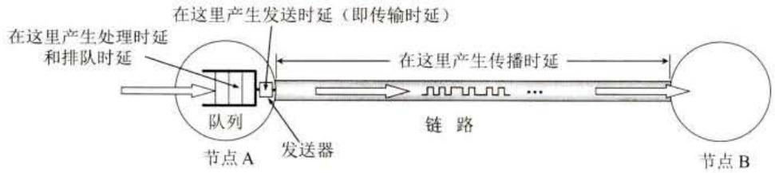
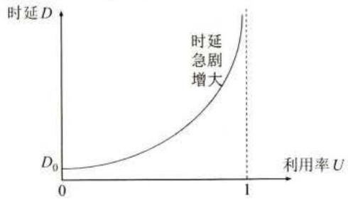

# 1.6.1 计算机网络的性能指标

计算机网络的性能一般是指它的几个重要的性能指标。但除了这些重要的性能指标，还有一些非性能特征（nonperformance characteristics）也对计算机网络的性能有很大的影响。本节将讨论这两个方面的问题。

性能指标从不同的方面来度量计算机网络的性能。下面介绍常用的7个性能指标。

## 1. 速率

我们知道，计算机发送的信号都是数字形式的。比特（bit）来源于 binary digit，意思是一个“二进制数字”，因此一个比特就是二进制数字中的一个 1 或 0。比特也是信息论中使用的信息量的单位。网络技术中的速率指的是数据的传送速率，它也称为数据率(data rate)或比特率(bit rate)。速率是计算机网络中最重要的一个性能指标。速率的单位是 bit/s（比特每秒）（或 b/s，有时也写为 bps，即 bit per second）。当数据率较高时，就常常在 bit/s 的前面加上一个字母。例如，k (kilo) = $10^{3}$ = 千，M (Mega) = $10^{6}$ = 兆，G (Giga) = $10^{9}$ = 吉，T (Tera) = $10^{12}$ = 太，P (Peta) = $10^{15}$ = 拍，E (Exa) = $10^{18}$ = 艾，Z (Zetta) = $10^{21}$ = 泽，Y (Yotta) = $10^{24}$ = 尧 $^{①}$ 。这样， $4 \times 10^{10}$ bit/s 的数据率就记为 40 Gbit/s。现在人们在谈到网络速率时，常省略速率单位中应有的 bit/s，而使用不太正确的说法，如“40 G 的速率”。另外要注意的是，当提到网络的速率时，往往指的是额定速率或标称速率，而并非网络实际上运行的速率。

## 2. 带宽

“带宽”(bandwidth)有以下两种不同的意义：

(1) 带宽本来是指某个信号具有的频带宽度。信号的带宽是指该信号所包含的各种不同频率成分所占据的频率范围。例如，在传统的通信线路上传送的电话信号的标准带宽是 3.1 kHz（从 300 Hz 到 3.4 kHz，即话音的主要成分的频率范围）。这种意义的带宽的单位是赫（或千赫、兆赫、吉赫等）。在过去很长的一段时间，通信的主干线路传送的是模拟信号（即连续变化的信号）。因此，表示某信道允许通过的信号频带范围就称为该信道的带宽（或通频带）。

(2) 在计算机网络中, 带宽用来表示网络中某通道传送数据的能力, 因此网络带宽表示在单位时间内网络中的某信道所能通过的 “最高数据率”。在本书中提到 “带宽” 时, 主要是指这个意思。这种意义的带宽的单位就是数据率的单位 bit/s, 是 “比特每秒”。

> $= \mathrm{K} = 2^{10} = 1024,$

> $= \mathbf{M} = 2^{20}$

> $= G = 2^{30}$

> =T=

> $2^{40}$

> $= \mathrm{P} = 2^{50}$

> $= \mathrm{E} = 2^{60}$

> byte)

> $= Z = 2^{70}$

> 1 B = 8 bit

> $= \mathrm{Y} = 2^{80}$

> $10^{9}$ bit/s

> $15 \times 2^{30} \times 8$

> ① 注：在计算机领域，数的计算使用二进制。因此习惯上，千 = K = 2 $^{10}$ = 1024，兆 = M = 2 $^{20}$ ，吉 = G = 2 $^{30}$ ，太 = T = 2 $^{40}$ ，拍 = P = 2 $^{50}$ ，艾 = E = 2 $^{60}$ ，泽 = Z = 2 $^{70}$ ，尧 = Y = 2 $^{80}$ 。此外，计算机中的数据量往往用字节 B 作为度量的单位（B 代表 byte）。通常 1 B = 8 bit。例如，15 GB 数据块的大小是 15 × 2 $^{30}$ × 8 bit，而不是 15 × 10 $^{9}$ × 8 bit。但 10 Gbit/s 的速率则表示 10 × 10 $^{9}$ bit/s。在计算机领域中，所有的这些单位都使用大写字母，但在通信领域中，只有“1000”使用小写“k”，其余的也都用大写。请注意，也有的书不这样严格区分，大写 K 既可表示 1000，又可表示 1024，因此这时要特别小心，不要弄错。

> $15 \times 10^{9} \times 8$ bit.

> “k”.

> 10 ×

在 “带宽” 的上述两种表述中，前者为频域称谓，而后者为时域称谓，其本质是相同的。也就是说，一条通信链路的 “带宽” 越宽，其所能传输的 “最高数据率” 也越高。

## 3. 吞吐量

吞吐量(throughput)表示在单位时间内通过某个网络（或信道、接口）的实际数据量。吞吐量更经常地用于对现实世界中的网络的一种测量，以便知道实际上到底有多少数据量能够通过网络。显然，吞吐量受网络带宽或网络额定速率的限制。例如，对于一个1 Gbit/s的以太网，就是说其额定速率是1 Gbit/s，那么这个数值也是该以太网的吞吐量的绝对上限值。因此，对1 Gbit/s的以太网，其实际的吞吐量可能只有100 Mbit/s，甚至更低，并没有达到其额定速率。请注意，有时吞吐量还可用每秒传送的字节数或帧数来表示。

接入到互联网的主机的实际吞吐量，取决于互联网的具体情况。假定主机 A 和服务器 B 接入到互联网的链路速率分别是 100 Mbit/s 和 1 Gbit/s。如果互联网的各链路的容量都足够大，那么当 A 和 B 交换数据时，其吞吐量显然应当是 100 Mbit/s。这是因为，尽管服务器 B 能够以超过 100 Mbit/s 的速率发送数据，但主机 A 最高只能以 100 Mbit/s 的速率接收数据。现在假定有 100 个用户同时连接到服务器 B（例如，同时观看服务器 B 发送的视频节目）。在这种情况下，服务器 B 连接到互联网的链路容量被 100 个用户平分，每个用户平均只能分到 10 Mbit/s 的带宽。这时，主机 A 连接到服务器 B 的吞吐量就只有 10 Mbit/s 了。

最糟糕的情况就是如果互联网的某处发生了严重的拥塞，则可能导致主机 A 暂时收不到服务器发来的视频数据，因而使主机 A 的吞吐量下降到零！主机 A 的用户或许会想，我已经向运营商的 ISP 交了速率为 100 Mbit/s 的宽带接入费用，怎么现在不能保证这个速率呢？其实你交的宽带费用，只是保证了从你家里到运营商 ISP 的某个路由器之间的数据传输速率。再往后的速率就取决于整个互联网的流量分布了，这是任何单个用户都无法控制的。了解这一点，对理解互联网的吞吐量是有帮助的。

## 4. 时延

时延(delay 或 latency)是指数据（一个报文或分组，甚至比特）从网络（或链路）的一端传送到另一端所需的时间。时延是个很重要的性能指标，它有时也称为延迟或迟延。

需要注意的是，网络中的时延是由以下几个不同的部分组成的：

(1) 发送时延 发送时延(transmission delay)是主机或路由器发送数据帧所需要的时间,也就是从发送数据帧的第一个比特算起,到该帧的最后一个比特发送完毕所需的时间。因此发送时延也叫作传输时延（我们尽量不采用传输时延这个名词,因为它很容易和下面要讲到的传播时延弄混）。发送时延的计算公式是:

$$ \text { 发送时延 } = \frac {\text { 数据帧长度(bit) }}{\text { 发送速率(bit / s) }}\tag{1-1} $$

由此可见，对于一定的网络，发送时延并非固定不变，而是与发送的帧长（单位是比特）成正比，与发送速率成反比。

(2) 传播时延传播时延(propagation delay)是电磁波在信道中传播一定的距离需要花

费的时间。传播时延的计算公式是：

$$ \mathrm{传播时延} = \frac {\mathrm{信道长度(m)}}{\mathrm{电磁波在信道上的传播速率(m/s)}}\tag{1-2} $$

电磁波在自由空间的传播速率是光速，即 $3.0 \times 10^{5}$ km/s。电磁波在网络传输媒体中的传播速率比在自由空间要略低一些：在铜线电缆中的传播速率约为 $2.3 \times 10^{5}$ km/s，在光纤中的传播速率约为 $2.0 \times 10^{5}$ km/s。例如，1000 km 长的光纤线路产生的传播时延大约为 5 ms。

以上两种时延有本质上的不同。但只要理解这两种时延发生的地方就不会把它们弄混。发送时延发生在机器内部的发送器中（一般就是发生在网络适配器中，见第3章3.3.1节），与传输信道的长度（或信号传送的距离）没有任何关系。但传播时延则发生在机器外部的传输信道媒体上，而与信号的发送速率无关。信号传送的距离越远，传播时延就越大。可以用一个简单的比喻来说明。假定有10辆车按顺序从公路收费站入口出发到相距50公里的目的地。再假定每一辆车过收费站要花费6秒，而车速是每小时100公里。现在可以算出这10辆车从收费站到目的地总共要花费的时间：发车时间共需60秒（相当于网络中的发送时延），在公路上的行车时间需要30分钟（相当于网络中的传播时延）。因此从第一辆车到收费站开始计算，到最后一辆车到达目的地为止，总共花费的时间是二者之和，即31分钟。

下面还有两种时延也需要考虑，但比较容易理解。

(3) 处理时延 主机或路由器在收到分组时要花费一定的时间进行处理，例如分析分组的首部、从分组中提取数据部分、进行差错检验或查找转发表等，这就产生了处理时延。

(4) 排队时延 分组在经过网络传输时，要经过许多路由器。但分组在进入路由器后要先在输入队列中排队等待处理。在路由器确定了转发接口后，还要在输出队列中排队等待转发。这就产生了排队时延。排队时延的长短往往取决于网络当时的通信量。当网络的通信量很大时会发生队列溢出，使分组丢失，这相当于排队时延为无穷大。

这样，数据在网络中经历的总时延就是以上四种时延之和：

$$ \text { 总时延 } = \text { 发送时延 } + \text { 传播时延 } + \text { 处理时延 } + \text { 排队时延 }\tag{1-3} $$

一般说来，小时延的网络要优于大时延的网络。在某些情况下，一个低速率、小时延的网络很可能要优于一个高速率但大时延的网络。

图 1-12 画出了这几种时延所产生的地方，希望读者能够更好地分清这几种时延。

> 图 1-12 几种时延产生的地方不一样（教材第 23 页）

必须指出，在总时延中，究竟是哪一种时延占主导地位，必须具体分析。下面举个例子。

现在我们暂时忽略处理时延和排队时延 $^{①}$ 。假定有一个长度为 100 MB 的数据块（这里的 M 显然不是指 $10^{6}$ 而是指 $2^{20}$ 。B 是字节，1 字节 = 8 比特）。在带宽为 1 Mbit/s 的信道上（这里的 M 显然是 $10^{6}$ ）连续发送（即发送速率为 1 Mbit/s），其发送时延是

$$ 1 0 0 \times 2 ^ {2 0} \times 8 \div 1 0 ^ {6} = 8 3 8. 9 \mathrm{s} $$

现在把这个数据块用光纤传送到 1000 km 远的计算机。由于在 1000 km 的光纤上的传播时延约为 5 ms，因此在这种情况下，发送 100 MB 的数据块的总时延 = 838.9 + 0.005 ≈ 838.9 s。可见对于这种情况，发送时延决定了总时延的数值。

如果我们把发送速率提高到 100 倍，即提高到 100 Mbit/s，那么总时延就变为 8.389 + 0.005 = 8.394 s，缩小到原有数值的 1/100。

但是，并非在任何情况下，提高发送速率就能减小总时延。例如，要传送的数据仅有1个字节（如键盘上键入的一个字符，共8 bit）。当发送速率为1 Mbit/s时，发送时延是

$$ 8 \div 1 0 ^ {6} = 8 \times 1 0 ^ {- 6} \mathrm{s} = 8 \mu \mathrm{s} $$

若传播时延仍为 5 ms，则总时延为 5.008 ms。在这种情况下，传播时延决定了总时延。如果我们把数据率提高到 1000 倍（即将数据的发送速率提高到 1 Gbit/s），不难算出，总时延基本上仍是 5 ms，并没有明显减小。这个例子告诉我们，不能笼统地认为：“数据的发送速率越高，其传送的总时延就越小”。这是因为数据传送的总时延是由公式(1-3)右端的四项时延组成的，不能仅考虑发送时延一项。

如果上述概念没有弄清楚，就很容易产生这样错误的概念：“在高速链路（或高带宽链路）上，比特会传送得更快些”。但这是不对的。我们知道，汽车在路面质量很好的高速公路上可明显地提高行驶速率。然而对于高速网络链路，我们提高的仅仅是数据的发送速率而不是比特在链路上的传播速率。荷载信息的电磁波在通信线路上的传播速率（这是光速的数量级）取决于通信线路的介质材料，而与数据的发送速率并无关系。提高数据的发送速率只是减小了数据的发送时延。还有一点也应当注意，就是数据的发送速率的单位是每秒发送多少个比特，这是指在某个点或某个接口上的发送速率。而传播速率的单位是每秒传播多少公里，是指在某一段传输线路上比特的传播速率。因此，通常所说的“光纤信道的传输速率高”是指可以用很高的速率向光纤信道发送数据，而光纤信道的传播速率实际上还要比铜线的传播速率略低一点。这是因为经过测量得知，光在光纤中的传播速率约为每秒20.5万公里，它比电磁波在铜线（如5类线）中的传播速率（每秒23.1万公里）略低一些。

上述的重要概念请读者务必弄清。

## 5. 时延带宽积

把以上讨论的网络性能的两个度量——传播时延和带宽——相乘，就得到另一个很有用的度量：传播时延带宽积，即

$$ \mathrm{时延带宽积} = \mathrm{传播时延} \times \mathrm{带宽}\tag{1-4} $$

> ① 注：当计算机网络中的通信量过大时，网络中的许多路由器的处理时延和排队时延将会大大增加，因而处理时延和排队时延有可能在总时延中占据主要成分。这时整个网络的性能就变差了。

我们可以用图 1-13 的示意图来表示时延带宽积。这是一个代表链路的圆柱形管道，管道的长度是链路的传播时延（请注意，现在以时间作为单位来表示链路长度），而管道的截面积是链路的带宽。因此时延带宽积就表示这个管道的体积，表示这样的链路可容纳多少个比特。例如，设某段链路的传播时延为 20 ms，带宽为 10 Mbit/s，算出

$$ \mathrm{时延带宽积} = 2 0 \times 1 0 ^ {- 3} \times 1 0 \times 1 0 ^ {6} = 2 \times 1 0 ^ {5} \mathrm{bit} $$

这就表明，若发送端连续发送数据，则在发送的第一个比特即将到达终点时，发送端就已经发送了20万个比特，而这20万个比特都正在链路上向前移动。因此，链路的时延带宽积又称为以比特为单位的链路长度。

> 图 1-13 链路像一条空心管道（教材第 25 页）

不难看出，管道中的比特数表示从发送端发出但尚未到达接收端的比特数。对于一条正在传送数据的链路，只有在代表链路的管道都充满比特时，链路才得到最充分的利用。

## 6. 往返时间 RTT

在计算机网络中，往返时间 RTT (Round-Trip Time) 也是一个重要的性能指标。这是因为在许多情况下，互联网上的信息不仅仅单方向传输而是双向交互的。因此，我们有时很需要知道双向交互一次所需的时间。例如，A 向 B 发送数据。如果数据长度是 100 MB，发送速率是 100 Mbit/s，那么

$$ \mathrm{发送时间} = \frac {\mathrm{数据长度}}{\mathrm{发送速率}} = \frac {1 0 0 \times 2 ^ {2 0} \times 8}{1 0 0 \times 1 0 ^ {6}} \approx 8. 3 9 \mathrm{s} $$

假定 B 正确收完 100 MB 的数据后，就立即向 A 发送确认。再假定 A 只有在收到 B 的确认信息后，才能继续向 B 发送数据。显然，这就要等待一个往返时间 RTT（这里假定确认信息很短，可忽略 B 发送确认的发送时延）。如果 RTT = 2s，那么可以算出 A 向 B 发送数据的有效数据率。

$$ \mathrm{有效数据率} = \frac {\mathrm{数据长度}}{\mathrm{发送时间} + \mathrm{RTT}} = \frac {1 0 0 \times 2 ^ {2 0} \times 8}{8 . 3 9 + 2} \approx 8 0. 7 \times 1 0 ^ {6} \mathrm{bit/s} \approx 8 0. 7 \mathrm{Mbit/s} $$

比原来的数据率 100 Mbit/s 小不少。

在互联网中，往返时间还包括各中间节点的处理时延、排队时延以及转发数据时的发送时延。当使用卫星通信时，往返时间 RTT 相对较长，是很重要的一个性能指标。

顺便指出，在计算机网络的文献中，也有把RTT称为往返时延(Round-Trip Time delay)的，强调发送方至少要经过这样多的时间，才能知道自己所发送的数据是否被对方接收了。还有的文献把带宽时延积定义为带宽与RTT的乘积。这样定义的数值就比前面(1-4)式定义的数值大了一倍。这样定义的带宽时延积表示，如果发送方以最高发送速率连续发送数据，而接收方一收到数据就立即发送对收到数据的确认，那么发送方在收到这个确认时，已经发送出的数据量就是按这种定义的带宽时延积。

## 7. 利用率

利用率有信道利用率和网络利用率两种。信道利用率指出某信道有百分之几的时间是被利用的（有数据通过）。完全空闲的信道的利用率是零。网络利用率则是全网络的信道利用率的加权平均值。信道利用率并非越高越好。这是因为，根据排队论的理论，当某信道的利用率增大时，该信道引起的时延也就迅速增加。这和高速公路的情况有些相似。当高速公路上的车流量很大时，由于在公路上的某些地方会出现堵塞，因此行车所需的时间就会变长。网络也有类似的情况。当网络的通信量很少时，网络产生的时延并不大。但在网络通信量不断增大的情况下，由于分组在网络节点（路由器或节点交换机）进行处理时需要排队等候，因此网络引起的时延就会增大。如果令 $D_{0}$ 表示网络空闲时的时延，D表示网络当前的时延（设现在的网络利用率为U），那么在适当的假定条件下，可以用下面的简单公式(1-5)来表示D与 $D_{0}$ 以及利用率U之间的关系：

$$ D = \frac {D _ {0}}{1 - U}\tag{1-5} $$

这里 U 是网络利用率，数值在 0 到 1 之间。当网络利用率达到其容量的 1/2 时，时延就要加倍。特别值得注意的就是：当网络利用率接近最大值 1 时，网络产生的时延就趋于无穷大。因此我们必须有这样的概念：信道利用率或网络利用率过高就会产生非常大的时延。图 1-14 给出了上述概念的示意图。因此，一些拥有较大主干网的 ISP 通常控制信道利用率不超过 50%。如果超过了就要准备扩容，增大线路的带宽。

> 图1-14 时延与利用率的关系（教材第 26 页）
