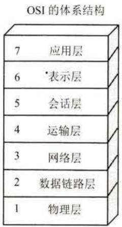
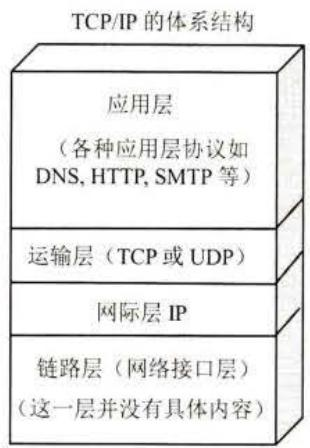
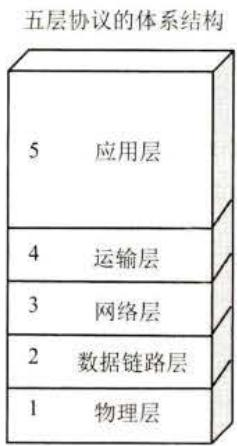
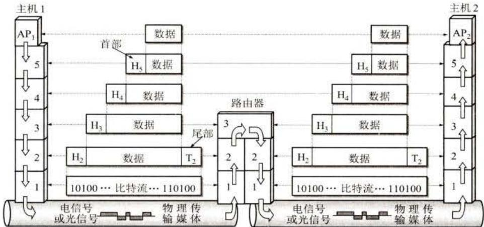

# 1.7.3 具有五层协议的体系结构

OSI 的七层协议体系结构（如图 1-16(a) 所示）的概念清楚，理论也较完整，但它既复杂又不实用。TCP/IP 体系结构则不同，它现在得到了非常广泛的应用。TCP/IP 是一个四层的体系结构（如图 1-16(b) 所示），它包含

应用层、运输层、网际层和链路层（网络接口层）。用网际层这个名字是强调本层解决不同网络的互连问题。在互联网的标准文档[RFC 1122, STD3]中，体系结构中的底层叫作链路层，但接着又说明了链路层就是媒体接入层。但也有把链路层称为网络接口层的[COME06]或子网层的[PETE12]。从实质上讲，TCP/IP 只有最上面的三层，因为最下面的链路层并没有属于 TCP/IP 体系的具体协议。链路层所使用的各种局域网标准，并非由 IETF 而是由 IEEE 的 802 委员会下属的各工作组负责制定的。在讲授计算机网络原理时往往采取另外的办法，即综合 OSI 和 TCP/IP 的优点，采用如图 1-16(c) 所示的五层协议的体系结构，这对阐述计算机网络的原理是十分方便的。

> (a) OSI的七层协议（教材第 31 页）

> (b) TCP/IP的四层协议（教材第 31 页）

> (c) 讲述原理的五层协议 图 1-16 计算机网络体系结构（教材第 31 页）

现在结合互联网的情况，自上而下地、非常简要地介绍一下各层的主要功能。实际上，只有认真学习完本书各章的协议后才能真正弄清各层的作用。

## (1) 应用层(application layer)

应用层是体系结构中的最高层。应用层的任务是通过应用进程间的交互来完成特定网络应用。应用层协议定义的是应用进程间通信和交互的规则。这里的进程就是指主机中正在运行的程序。对于不同的网络应用需要有不同的应用层协议。互联网中的应用层协议很多，如域名系统 DNS、支持万维网应用的 HTTP 协议、支持电子邮件的 SMTP 协议，等等。我们把应用层交互的数据单元称为报文(message)。

## (2) 运输层(transport layer)

运输层的任务就是负责向两台主机中进程之间的通信提供通用的数据传输服务。应用进程利用该服务传送应用层报文。所谓“通用的”，是指并不针对某个特定网络应用，而是多种应用可以使用同一个运输层服务。由于一台主机可同时运行多个进程，因此运输层有复用和分用的功能。复用就是多个应用层进程可同时使用下面运输层的服务，分用和复用相反，是运输层把收到的信息分别交付上面应用层中的相应进程。

运输层主要使用以下两种协议：

\- 传输控制协议 TCP (Transmission Control Protocol)——提供面向连接的、可靠的数据传输服务，其数据传输的单位是报文段(segment)。

\- 用户数据报协议 UDP (User Datagram Protocol)——提供无连接的尽最大努力 (best-effort)的数据传输服务（不保证数据传输的可靠性），其数据传输的单位是用户数据报。

顺便指出，有人愿意把运输层称为传输层，理由是这一层使用的 TCP 协议就叫作传输控制协议。从意思上看，传输和运输差别也不大。但 OSI 定义的第 4 层使用的是 Transport，而不是 Transmission。这两个词的含义还是有些差别的。因此，使用运输层这个译名较为准确。

## (3) 网络层(network layer)

网络层负责为分组交换网上的不同主机提供通信服务。在发送数据时，网络层把运输层产生的报文段或用户数据报封装成分组或包进行传送。在 TCP/IP 体系中，由于网络层使用 IP 协议，因此分组也叫作 IP 数据报，或简称为数据报。本书把 “分组” 和 “数据报” 作为同义词使用。

请注意：不要将运输层的“用户数据报协议 UDP”和网络层的“IP 数据报”弄混。此外，无论在哪一层传送的数据单元，都可笼统地用“分组”来表示。

网络层的具体任务有两个。第一个任务是通过一定的算法，在互联网中的每一个路由器上生成一个用来转发分组的转发表。第二个任务较为简单，就是每一个路由器在接收到一个分组时，依据转发表中指明的路径把分组转发到下一个路由器。这样就可以使源主机运输层所传下来的分组，能够通过合适的路由最终到达目的主机。

这里要强调指出，网络层中的“网络”二字，已不是我们通常谈到的具体网络，而是在计算机网络体系结构模型中的第3层的名称。

互联网是由大量的异构(heterogeneous)网络通过路由器(router)相互连接起来的。互联网使用的网络层协议是无连接的网际协议 IP (Internet Protocol)和许多种路由选择协议，因此互联网的网络层也叫作网际层或 IP 层。在本书中，网络层、网际层和 IP 层都是同义语。

## (4) 数据链路层(data link layer)

数据链路层常简称为链路层。我们知道，两台主机之间的数据传输，总是在一段一段的链路上传送的，这就需要使用专门的链路层的协议。在两个相邻节点之间传送数据时，数据链路层将网络层交下来的 IP 数据报组装成帧（framing），在两个相邻节点间的链路上传送帧（frame）。每一帧包括数据和必要的控制信息（如同步信息、地址信息、差错控制等）。

在接收数据时，控制信息使接收端能够知道一个帧从哪个比特开始和到哪个比特结束。这样，数据链路层在收到一个帧后，就可从中提取出数据部分，上交给网络层。

控制信息还使接收端能够检测到所收到的帧中有无差错。如发现有差错，数据链路层就简单地丢弃这个出了差错的帧，以免继续在网络中传送下去白白浪费网络资源。如果需要改正数据在数据链路层传输时出现的差错（这就是说，数据链路层不仅要检错，而且要纠错），那么就要采用可靠传输协议来纠正出现的差错。这种方法会使数据链路层的协议复杂些。

## (5) 物理层(physical layer)

在物理层上所传数据的单位是比特。发送方发送 1（或 0）时，接收方应当收到 1（或 0）而不是 0（或 1）。因此物理层要考虑用多大的电压代表“1”或“0”，以及接收方如何识别出发送方所发送的比特。物理层还要确定连接电缆的插头应当有多少根引脚以及各引脚应如何连接。当然，解释比特代表的意思，不是物理层的任务。请注意，传递信息所利用的一些物理传输媒体，如双绞线、同轴电缆、光缆、无线信道等，并不在物理层协议之内，而是在物理层协议的下面。因此也有人把物理层下面的物理传输媒体当作第 0 层。

在互联网所使用的各种协议中，最重要的和最著名的就是 TCP 和 IP 两个协议。现在人们经常提到的 TCP/IP 并不一定是单指 TCP 和 IP 这两个具体的协议，而往往是表示互联网所使用的整个 TCP/IP 协议族(protocol suite) $^{①}$ 。

图 1-17 说明的是应用进程的数据在各层之间的传递过程中所经历的变化。这里为简单起见，假定两台主机通过一台路由器连接起来。

> 图 1-17 数据在各层之间的传递过程（教材第 33 页）

假定主机 1 的应用进程 $AP_{1}$ 向主机 2 的应用进程 $AP_{2}$ 传送数据。 $AP_{1}$ 先将其数据交给本主机的第 5 层（应用层）。第 5 层加上必要的控制信息 $H_{5}$ 就变成了下一层的数据单元。第 4 层（运输层）收到这个数据单元后，加上本层的控制信息 $H_{4}$ ，再交给第 3 层（网络层），成为第 3 层的数据单元。依此类推。不过到了第 2 层（数据链路层）后，控制信息被分成两部分，分别加到本层数据单元的首部（ $H_{2}$ ）和尾部（ $T_{2}$ ）；而第 1 层（物理层）由于是比特流的传送，所以不再加上控制信息。请注意，传送比特流时应从首部开始传送。

OSI 参考模型把对等层次之间传送的数据单位称为该层的协议数据单元 PDU (Protocol Data Unit)。这个名词现已被许多非 OSI 标准采用。

当这一串的比特流离开主机 1 经网络的物理传输媒体传送到路由器时，就从路由器的第 1 层依次上升到第 3 层。每一层都根据控制信息进行必要的操作，然后将控制信息剥去，将该层剩下的数据单元上交给更高的一层。当分组上升到了第3层网络层时，就根据首部中的目的地址查找路由器中的转发表，找出转发分组的接口，然后往下传送到第2层，加上新的首部和尾部后，再到最下面的第1层，然后在物理传输媒体上把每一个比特发送出去。

> ① 注：请注意 suite 这个词的特殊读音/swiːt/，不要读错。

当这一串的比特流离开路由器到达目的站主机 2 时，就从主机 2 的第 1 层按照上面讲过的方式，依次上升到第 5 层。最后，把应用进程 $AP_{1}$ 发送的数据交给目的站的应用进程 $AP_{2}$ 。

可以用一个简单例子来比喻上述过程。有一封信从最高层向下传。每经过一层就包上一个新的信封，写上必要的地址信息。包有多个信封的信件传送到目的站后，从第1层起，每层拆开一个信封后就把信封中的信交给它的上一层。传到最高层后，取出发信人所发的信交给收信人。

虽然应用进程数据要经过如图 1-17 所示的复杂过程才能送到终点的应用进程，但这些复杂过程对用户屏蔽掉了，以致应用进程 $AP_{1}$ 觉得好像是直接把数据交给了应用进程 $AP_{2}$ 。同理，任何两个同样的层次（例如在两个系统的第 4 层）之间，也好像如同图 1-17 中的水平虚线所示的那样，把数据（即数据单元加上控制信息）通过水平虚线直接传递给对方。这就是所谓的“对等层”(peer layers)之间的通信。我们以前经常提到的各层协议，实际上就是在各个对等层之间传递数据时的各项规定。

在文献中也还可以见到术语 “协议栈” (protocol stack)。这是因为几个层次画在一起很像一个栈(stack)的结构。
