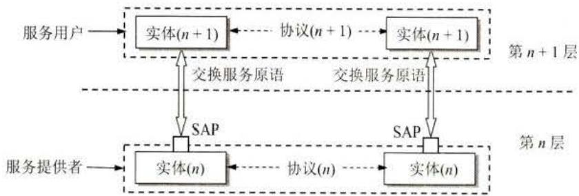
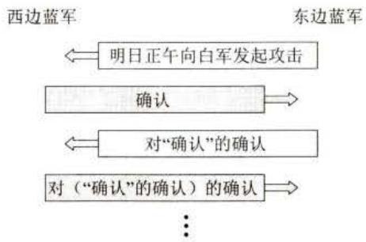

# 1.7.4 实体、协议、服务和服务访问点

当研究开放系统中的信息交换时，往往使用实体(entity)这一较为抽象的名词表示任何可发送或接收信息的硬件或软件进程。在许多情况下，实体就是一个特定的软件模块。

协议是控制两个对等实体（或多个实体）进行通信的规则的集合。协议的语法方面的规则定义了所交换的信息的格式，而协议的语义方面的规则就定义了发送者或接收者所要完成的操作，例如，在何种条件下，数据必须重传或丢弃。

在协议的控制下，两个对等实体间的通信使得本层能够向上一层提供服务。要实现本层协议，还需要使用下面一层所提供的服务。

一定要弄清楚，协议和服务在概念上是很不一样的。

首先，协议的实现保证了能够向上一层提供服务。使用本层服务的实体只能看见服务而无法看见下面的协议。也就是说，下面的协议对上面的实体是透明的。

其次，协议是“水平的”，即协议是控制对等实体之间通信的规则。但服务是“垂直的”，即服务是由下层向上层通过层间接口提供的。另外，并非在一个层内完成的全部功能都称为服务。只有那些能够被高一层实体“看得见”的功能才能称之为“服务”。上层使用下层所提供的服务必须通过与下层交换一些命令，这些命令在 OSI 中称为服务原语。

在同一系统中相邻两层的实体进行交互（即交换信息）的地方，通常称为服务访问点SAP (Service Access Point)。服务访问点SAP是一个抽象的概念，它实际上就是一个逻辑接口，有点像邮政信箱（可以把邮件放入信箱和从信箱中取走邮件），但这种层间接口和两个设备之间的硬件接口（并行的或串行的）并不一样。OSI把层与层之间交换的数据的单位称为服务数据单元SDU (Service Data Unit)，它可以与PDU不一样。例如，可以是多个SDU合成为一个PDU，也可以是一个SDU划分为几个PDU。

这样，在任何相邻两层之间的关系均可概括为图1-18所示的那样。这里要注意的是，第 $n$ 层的两个“实体 $(n)$ ”之间通过“协议 $(n)$ ”进行通信，而第 $n + 1$ 层的两个“实体 $(n + 1)$ ”之间则通过另外的“协议 $(n + 1)$ ”进行通信（每一层都使用不同的协议）。第 $n$ 层向上面的第 $n + 1$ 层所提供的服务实际上已包括了在它以下各层所提供的服务。第 $n$ 层的实体对第 $n + 1$ 层的实体就相当于一个服务提供者。在服务提供者的上一层的实体又称为“服务用户”，因为它使用下层服务提供者所提供的服务。

> 图 1-18 相邻两层之间的关系（教材第 35 页）

计算机网络的协议还有一个很重要的特点，就是协议必须把所有不利的条件事先都估计到，而不能假定一切都是正常的和非常理想的。例如，两个朋友在电话中约好，下午3时在某公园门口碰头，并且约定“不见不散”。这就是一个很不科学的协议，因为任何一方临时有急事来不了而又无法通知对方时（如对方的电话或手机都无法接通），则另一方按照协议就必须永远等待下去。因此，看一个计算机网络协议是否正确，不能只看在正常情况下是否正确，还必须非常仔细地检查协议能否应付任何一种出现概率极小的异常情况。

下面是一个有关网络协议的非常著名的例子。

【例 1-1】占据东、西两个山顶的蓝军 1 和蓝军 2 与驻扎在山谷的白军作战。其力量对比是：单独的蓝军 1 或蓝军 2 打不过白军，但蓝军 1 和蓝军 2 协同作战则可战胜白军。现蓝军 1 拟于次日正午向白军发起攻击。于是用计算机发送电文给蓝军 2。但通信线路很不好，电文出错或丢失的可能性较大（没有电话可使用）。因此要求收到电文的友军必须送回一个确认电文。但此确认电文也可能出错或丢失。试问能否设计出一种协议使得蓝军 1 和蓝军 2 能够实现协同作战因而一定（即 100% 而不是 99.999…%）取得胜利？

【解】蓝军1先发送：“拟于明日正午向白军发起攻击。请协同作战和确认。”

假定蓝军 2 收到电文后发回了确认。

然而现在蓝军 1 和蓝军 2 都不敢下决心进攻。因为，蓝军 2 不知道此确认电文对方是否正确地收到了。如未正确收到，则蓝军 1 必定不敢贸然进攻。在此情况下，自己单方面发起进攻就肯定要失败。因此，必须等待蓝军 1 发送“对确认的确认”。

假定蓝军 2 收到了蓝军 1 发来的确认。但蓝军 1 同样关心自己发出的确认是否已被对方正确地收到。因此还要等待蓝军 2 的 “对确认的确认的确认”。

这样无限循环下去，蓝军 1 和蓝军 2 都始终无法确定自己最后发出的电文对方是否已经收到（如图 1-19 所示）。因此，在本例题给出的条件下，没有一种协议可以使蓝军 1 和蓝军 2 能够 100% 地确保胜利。

> 图 1-19 无限循环的协议（教材第 36 页）

这个例子告诉我们，看似非常简单的协议，设计起来要考虑的问题还是比较多的。
