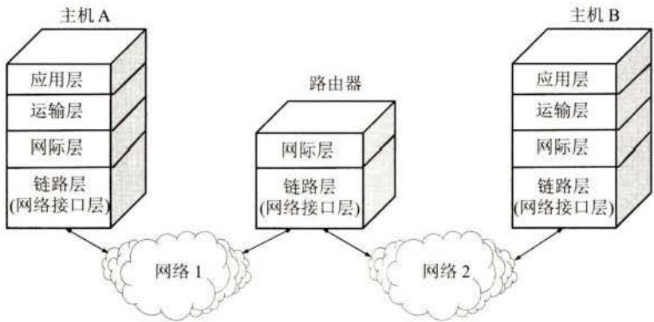
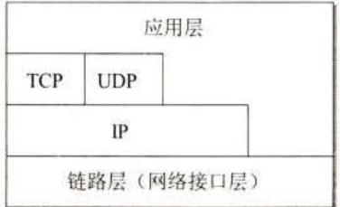
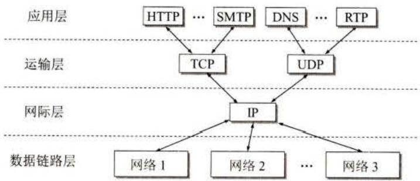
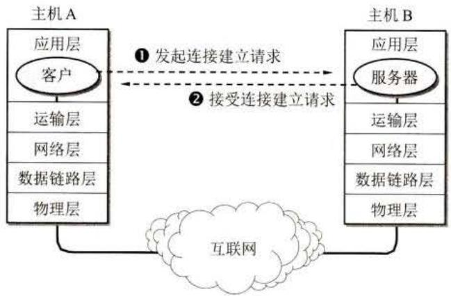
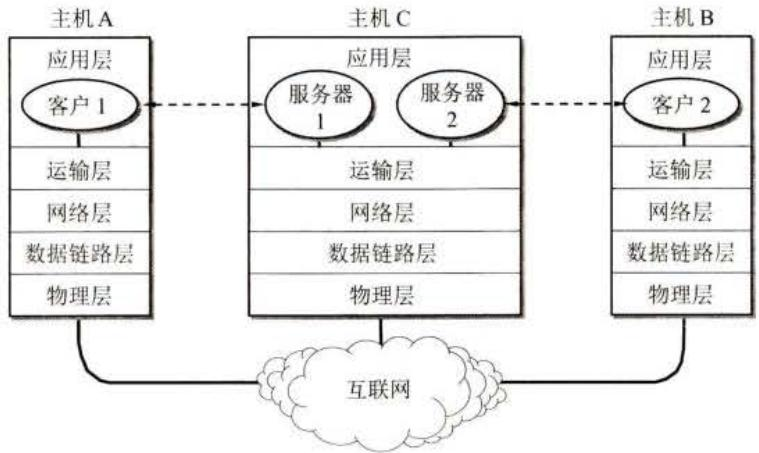

# 1.7.5 TCP/IP的体系结构

前面已经说过，TCP/IP 的体系结构比较简单，它只有四层。图 1-20 给出了这种四层协议表示方法的例子。

> 图 1-20 TCP/IP 四层协议的表示方法举例（教材第 36 页）

应当指出，技术的发展并不遵循严格的 OSI 分层概念。实际上现在的互联网使用的 TCP/IP 体系结构有时已经演变成为图 1-21 所示的那样，即某些应用程序可以直接使用 IP 层，或直接使用最下面的链路层[PETE12]。虽然 TCP/IP 协议族得到了非常广泛的应用，但对 TCP/IP 体系结构的批评意见也有不少。例如，这个体系结构没有清晰地阐明区分开服务、接口和协议之间的关系，而链路层并非真正的一个层次，而仅仅是强调了 IP 层需要这样一个与网络的接口。这个体系结构没有把重要的物理层和链路层的内容包含进来。

> 图 1-21 TCP/IP 体系结构的另一种表示方法（教材第 36 页）

还有另一种方法用来表示 TCP/IP 协议族（如图 1-22 所示），它的特点是上下两头大而中间小：应用层和网络接口层都有多种协议，而中间的 IP 层很小，上层的各种协议都向下汇聚到一个 IP 协议中。这种很像沙漏计时器形状的 TCP/IP 协议族表明：IP 层可以支持多种运输层协议（虽然这里只画出了最主要的两种），而不同的运输层协议上面又可以有多种应用层协议（所谓的 everything over IP），同时 IP 协议也可以在多种类型的网络上运行（所谓的 IP over everything）。正因为如此，互联网才会发展到今天的这种全球规模。从图 1-22 不难看出 IP 协议在互联网中的核心作用。

> 图 1-22 沙漏计时器形状的 TCP/IP 协议族示意（教材第 37 页）

实际上，图 1-22 还反映出互联网的一个十分重要的设计理念，这就是网络的核心部分越简单越好，把一切复杂的部分让网络的边缘部分去实现。

【例 1-2】利用协议栈的概念，说明在互联网中常用的客户-服务器工作方式。

【解】图 1-23 中的主机 A 和主机 B 都各有自己的协议栈。主机 A 中的应用进程（即客户进程）的位置在最高的应用层。这个客户进程向主机 B 应用层的服务器进程发出请求，请求建立连接（图中的①）。然后，主机 B 中的服务器进程接受 A 的客户进程发来的请求（图中的②）。所有这些通信，实际上都需要使用下面各层所提供的服务。但若仅仅考虑客户进程和服务器进程的交互，则可把它们之间的交互看成是图 1-23 中的水平虚线所示的那样。

> 图 1-23 在应用层的客户进程和服务器进程的交互（教材第 37 页）

图 1-24 画出了三台主机的协议栈。主机 C 的应用层中同时有两个服务器进程在通信。服务器 1 在和主机 A 中的客户 1 通信，而服务器 2 在和主机 B 中的客户 2 通信。有的服务器进程可以同时向几百个或更多的客户进程提供服务。

> 图 1-24 主机 C 的两个服务器进程分别向 A 和 B 的客户进程提供服务（教材第 38 页）
