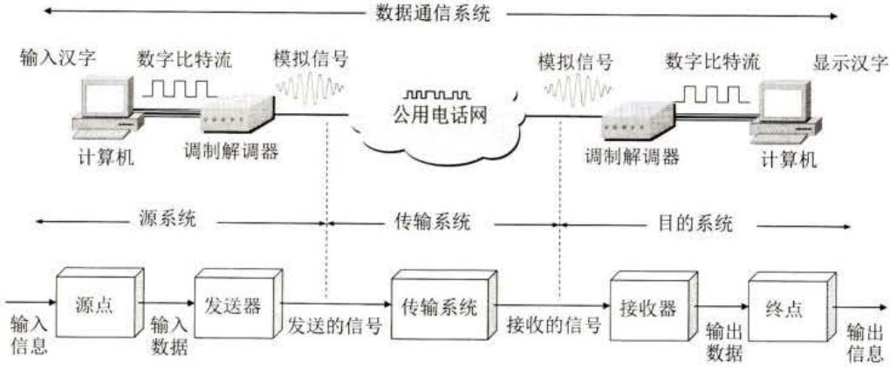

# 2.2.1 数据通信系统的模型

## 2.2 数据通信的基础知识

下面我们通过一个最简单的例子来说明数据通信系统的模型。这个例子就是两台计算机经过普通电话机的连线，再经过公用电话网进行通信。

如图 2-1 所示，一个数据通信系统可划分为三大部分，即源系统（或发送端、发送方）、传输系统（或传输网络）和目的系统（或接收端、接收方）。

> 图 2-1 数据通信系统的模型（教材第 43 页）

源系统一般包括以下两个部分：

\- 源点(source) 源点设备产生要传输的数据，例如，从计算机的键盘输入汉字，计算机产生输出的数字比特流。源点又称为源站或信源。

\- 发送器 通常源点生成的数字比特流要通过发送器编码后才能够在传输系统中进行传输。典型的发送器就是调制器。现在很多计算机使用内置的调制解调器（包含调制器和解调器），用户在计算机外面看不见调制解调器。

目的系统一般也包括以下两个部分：

\- 接收器 接收传输系统传送过来的信号，并把它转换为能够被目的设备处理的信息。典型的接收器就是解调器，它把来自传输线路上的模拟信号进行解调，提取出在发送端置入的消息，还原出发送端产生的数字比特流。

\- 终点(destination) 终点设备从接收器获取传送来的数字比特流，然后把信息输出（例如，把汉字在计算机屏幕上显示出来）。终点又称为目的站或信宿。

在源系统和目的系统之间的传输系统可以是简单的传输线，也可以是连接在源系统和目的系统之间的复杂网络系统。

图 2-1 所示的数据通信系统，也可以说是计算机网络。这里我们使用数据通信系统这个名词，主要是为了从通信的角度来介绍数据通信系统中的一些要素，而有些数据通信系统的要素在计算机网络中可能就不去讨论它们了。

下面我们先介绍一些常用术语。

通信的目的是传送消息(message)。话音、文字、图像、视频等都是消息。数据(data)是运送消息的实体。根据 RFC 4949 给出的定义，数据是使用特定方式表示的信息，通常是有意义的符号序列。这种信息的表示可用计算机或其他机器（或人）处理或产生。信号(signal)则是数据的电气或电磁的表现。

根据信号中代表消息的参数的取值方式不同，信号可分为以下两大类：

(1) 模拟信号，或连续信号——代表消息的参数的取值是连续的。例如在图 2-1 中，用户家中的调制解调器到电话端局之间的用户线上传送的就是模拟信号。

(2) 数字信号, 或离散信号——代表消息的参数的取值是离散的。例如在图 2-1 中, 用户家中的计算机到调制解调器之间或在电话网中继线上传送的就是数字信号。在使用时间域 (或简称为时域) 的波形表示数字信号时, 代表不同离散数值的基本波形就称为码元 $^{①}$ 。在使用二进制编码时, 只有两种不同的码元, 一种代表 0 状态而另一种代表 1 状态。

下面我们介绍有关信道的几个基本概念。
