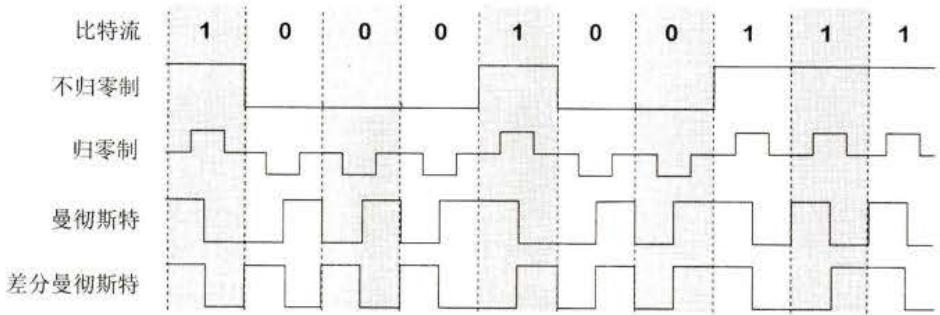
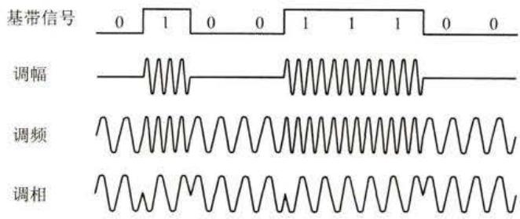

# 2.2.2 有关信道的几个基本概念

在许多情况下，我们要使用“信道(channel)”这一名词。信道和电路并不等同。信道一般都是用来表示向某一个方向传送信息的媒体。因此，一条通信电路往往包含一条发送信道和一条接收信道。

从通信的双方信息交互的方式来看，可以有以下三种基本方式：

(1) 单向通信 又称为单工通信，即只能有一个方向的通信而没有反方向的交互。无线电广播或有线电广播以及电视广播就属于这种类型。

(2) 双向交替通信 又称为半双工通信，即通信的双方都可以发送信息，但不能双方同时发送（当然也就不能同时接收）。这种通信方式是一方发送另一方接收，过一段时间后可以再反过来。

(3) 双向同时通信又称为全双工通信，即通信的双方可以同时发送和接收信息。

单向通信只需要一条信道，而双向交替通信或双向同时通信则都需要两条信道（每个方向各一条）。显然，双向同时通信的传输效率最高。

这里要提醒读者注意，有时人们也常用“单工”这个名词表示“双向交替通信”。如常说的“单工电台”并不是只能进行单向通信。正因为如此，ITU-T才不采用“单工”“半双工”和“全双工”这些容易弄混的术语作为正式的名词。

来自信源的信号常称为基带信号（即基本频带信号）。像计算机输出的代表各种文字或图像文件的数据信号都属于基带信号。基带信号往往包含较多的低频分量，甚至有直流分量，而许多信道并不能传输这种低频分量或直流分量。为了解决这一问题，就必须对基带信号进行调制(modulation)。

调制可分为两大类。一类是仅仅对基带信号的波形进行变换，使它能够与信道特性相适应。变换后的信号仍然是基带信号。这类调制称为基带调制。由于这种基带调制是把数字信号转换为另一种形式的数字信号，因此大家更愿意把这种过程称为编码(coding)。另一类调制则需要使用载波(carrier)进行调制，把基带信号的频率范围搬移到较高的频段，并转换为模拟信号，这样就能够更好地在模拟信道中传输。经过载波调制后的信号称为带通信号（即仅在一段频率范围内能够通过信道），而使用载波的调制称为带通调制。

> ① 注：一个码元所携带的信息量不是固定的，而是由调制方式和编码方式决定的。

## (1) 常用编码方式

常用编码方式如图 2-2 所示。

> 图 2-2 数字信号常用的编码方法（教材第 45 页）

\- 不归零制：正电平代表1，负电平代表0。

\- 归零制：正脉冲代表1，负脉冲代表0。

\- 曼彻斯特编码：位周期中心的向上跳变代表 0，位周期中心的向下跳变代表 1。但也可反过来定义。

\- 差分曼彻斯特编码：在每一位的中心处始终都有跳变。位开始边界有跳变代表 0，而位开始边界没有跳变代表 1。

从信号波形中可以看出，曼彻斯特(Manchester)编码产生的信号频率比不归零制高。从自同步能力来看，不归零制不能从信号波形本身中提取信号时钟频率（这叫作没有自同步能力），而曼彻斯特编码具有自同步能力。

## (2) 基本的带通调制方法

图 2-3 给出了最基本的调制方法。

> 图 2-3 最基本的三种调制方法（教材第 45 页）

\- 调幅(AM)，即载波的振幅随基带数字信号而变化。例如，0 或 1 分别对应于无载波或有载波输出。

\- 调频(FM)，即载波的频率随基带数字信号而变化。例如，0 或 1 分别对应于频率 $f_{1}$ 或 $f_{2}$ 。

\- 调相(PM)，即载波的初始相位随基带数字信号而变化。例如，0 或 1 分别对应于相位 0 度或 180 度。

为了达到更高的信息传输速率，必须采用技术上更为复杂的多元制的振幅相位混合调制方法。例如，正交振幅调制 QAM (Quadrature Amplitude Modulation)。

有了上述的一些基本概念之后，我们再讨论信道的极限容量。
