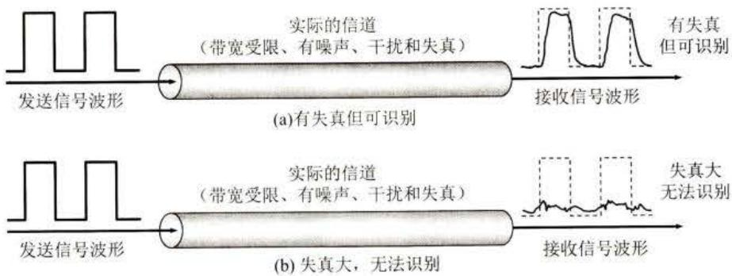

# 2.2.3 信道的极限容量

几十年来，通信领域的学者一直在努力寻找提高数据传输速率的途径。这个问题很复杂，因为任何实际的信道都不是理想的，都不可能以任意高的速率进行传送。我们知道，数字通信的优点就是：虽然信号在信道上传

输时会不可避免地产生失真，但在接收端只要我们从失真的波形中能够识别出原来的信号，那么这种失真对通信质量就可视为无影响。例如，图 2-4(a) 表示信号通过实际的信道传输后虽然有失真，但在接收端还可识别并恢复出原来的码元。但图 2-4(b) 就不同了，这时信号的失真已很严重，在接收端无法识别码元是 1 还是 0。码元传输的速率越高、信号传输的距离越远、噪声干扰越大或传输媒体质量越差，在接收端的波形的失真就越严重。

> 图 2-4 数字信号通过实际的信道（教材第 46 页）

从概念上讲，限制码元在信道上的传输速率的因素有以下两个。

## (1) 信道能够通过的频率范围

具体的信道所能通过的频率范围总是有限的。信号中的许多高频分量往往不能通过信道。像图2-4所示的发送信号是一种典型的矩形脉冲信号，它包含很丰富的高频分量。如果信号中的高频分量在传输时受到衰减，那么在接收端收到的波形前沿和后沿就变得不那么陡峭了，每一个码元所占的时间界限也不再是很明确的，而是前后都拖了“尾巴”。这样，在接收端收到的信号波形就失去了码元之间的清晰界限。这种现象叫作码间串扰。严重的码间串扰使得本来分得很清楚的一串码元变得模糊而无法识别。早在1924年，奈奎斯特(Nyquist)就推导出了著名的奈氏准则。他给出了在假定的理想条件下，为了避免码间串扰，码元的传输速率的上限值。奈氏准则的推导已超出本书的范围，这可在通信原理教科书中查阅到。这里我们只需要知道奈氏准则的结论，这就是：在带宽为 $W(\mathrm{Hz})$ 的低通信道中，若不考虑噪声影响，则码元传输的最高速率是 $2W(\text{码元/秒})$ 。传输速率超过此上限，就会出现严重的码间串扰的问题，使接收端对码元的判决（即识别）成为不可能。例如，信道的带宽为 $4000\mathrm{Hz}$ ，那么最高码元传输速率就是每秒8000个码元。

实际的信道都是有噪声的，因此我们还必须知道信道的信噪比数值。

## (2) 信噪比

噪声存在于所有的电子设备和通信信道中。由于噪声是随机产生的，它的瞬时值有时会很大，因此噪声会使接收端对码元的判决产生错误（1误判为0或0误判为1）。但噪声的影响是相对的。如果信号相对较强，那么噪声的影响就相对较小。因此，信噪比就很重要。所谓信噪比就是信号的平均功率和噪声的平均功率之比，常记为S/N。但通常大家都是使用

分贝(dB)作为度量单位。即：

$$ \mathrm{信噪比(dB)} = 1 0 \log_ {1 0} (S / N) (\mathrm{dB})\tag{2-1} $$

例如，当 S/N = 10 时，信噪比为 10 dB，而当 S/N = 1000 时，信噪比为 30 dB。

在 1948 年，信息论的创始人香农(Shannon)推导出了著名的香农公式。香农公式指出：信道的极限信息传输速率 C 是

$$ C = W \log_ {2} (1 + S / N) (\mathrm{bit/s})\tag{2-2} $$

式中，W 为信道的带宽（以 Hz 为单位），S 为信道内所传信号的平均功率，N 为信道内部的高斯噪声功率。香农公式的推导可在通信原理教科书中找到。这里只给出其结果。

香农公式表明，信道的带宽或信道中的信噪比越大，信息的极限传输速率就越高。香农公式指出了信息传输速率的上限。香农公式的意义在于：只要信息传输速率低于信道的极限信息传输速率，就一定存在某种办法来实现无差错的传输。不过，香农没有告诉我们具体的实现方法。这要由研究通信的专家去寻找。

从以上所讲的不难看出，对于频带宽度已确定的信道，如果信噪比也不能再提高了，并且码元传输速率也达到了上限值，那么还有什么办法提高信息的传输速率呢？这就是用编码的方法让每一个码元携带更多比特的信息量。我们可以用个简单的例子来说明这个问题。

假定我们的基带信号是：

## 101011000110111010...

如果直接传送，则每一个码元所携带的信息量是 1 bit。现将信号中的每 3 个比特编为一个组，即 101,011,000,110,111,010,…。3 个比特共有 8 种不同的排列。我们可以用不同的调制方法来表示这样的信号。例如，用 8 种不同的振幅、8 种不同的频率或 8 种不同的相位进行调制。假定我们采用相位调制，用相位 $\varphi_{0}$ 表示 000, $\varphi_{1}$ 表示 001, $\varphi_{2}$ 表示 010,…, $\varphi_{7}$ 表示 111。这样，原来的 18 个码元的信号就转换为由 6 个新的码元（即由原来的每三个 bit 构成一个新的码元）组成的信号：

$$ 1 0 1 0 1 1 0 0 0 1 1 0 1 1 1 0 1 0 \dots = \varphi_ {5} \varphi_ {3} \varphi_ {0} \varphi_ {6} \varphi_ {7} \varphi_ {2} \dots $$

也就是说，若以同样的速率发送码元，则同样时间所传送的信息量就提高到了3倍。设想把信号中的每8个比特编为一组，即原来的8个码元的信号转换为1个新的码元。这样，数据传输速率可提高到8倍。但是我们要注意，8个比特共有256种不同的排列。也就是说，在接收端必须能够从收到的有噪声干扰的信号中，准确地判断这是256种码元中的哪一个。这种解码技术难度很大，并且还必须使信噪比达到相应的数值（有时甚至无法做到）。因此不能简单地认为，为了提高数据传输速率，可以让每一个码元表示任意多个比特。

请注意，奈氏准则和香农公式的意义是不同的。奈氏准则激励工程人员不断探索更加先进的编码技术，使每一个码元携带更多比特的信息量。香农公式则告诫工程人员，在有噪声的实际信道上，不论采用多么复杂的编码技术，都不可能突破公式(2-2)给出的信息传输速率的绝对极限。由此可看出香农公式的重要意义。

自从香农公式发表后，各种新的信号处理和调制方法不断出现，其目的都是为了尽可能地接近香农公式给出的传输速率极限。在实际信道上能够达到的信息传输速率要比香农公式中的极限传输速率低不少。这是因为在实际信道中，信号还要受到其他一些损伤，如各种脉冲干扰和在传输中产生的失真等。这些因素在香农公式的推导过程中并未考虑。
