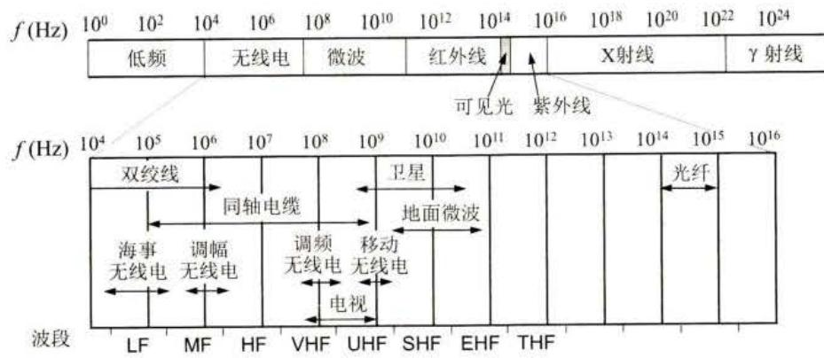
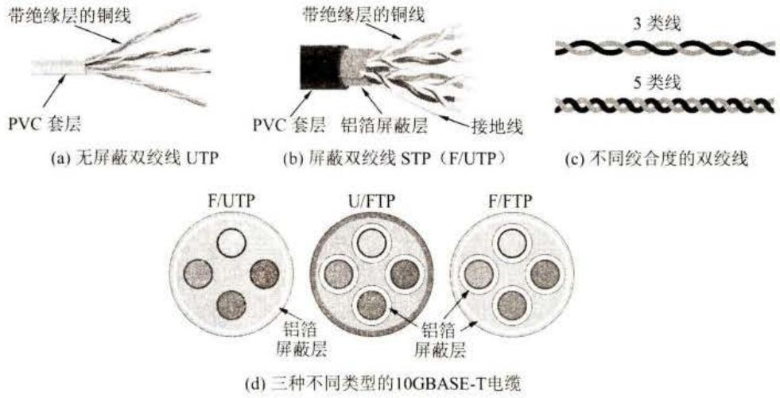
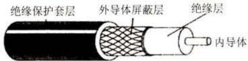
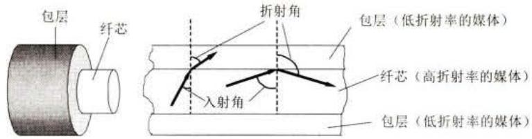
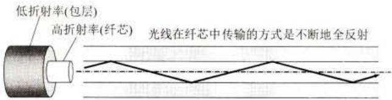
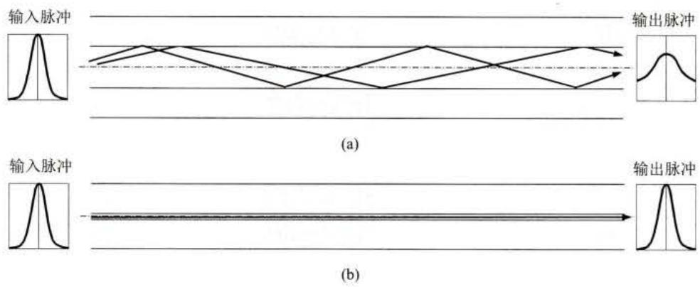
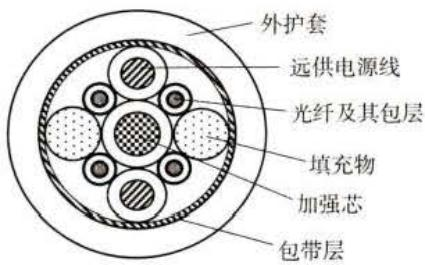

# 2.3.1 导引型传输媒体

## 2.3 物理层下面的传输媒体

传输媒体也称为传输介质或传输媒介，它就是数据传输系统中在发送器和接收器之间的物理通路。传输媒体可分为两大类，即导引型传输媒体和非导引型传输媒体（这里的“导引型”的英文就是 guided，也可译为“导向传输媒体”）。在导引型传输媒体中，电磁波被导引沿着固体媒体（铜线或光纤）传播；而非导引型传输媒体就是指自由空间，在非导引型传输媒体中电磁波的传输常称为无线传输。图 2-5 是电信领域使用的电磁波的频谱。

> 图 2-5 电信领域使用的电磁波的频谱（教材第 48 页）

## 1. 双绞线

双绞线也称为双扭线，是最古老但又是最常用的传输媒体。把两根互相绝缘的铜导线并排放在一起，然后用规则的方法绞合(twist)起来就构成了双绞线。绞合可减少对相邻导线的电磁干扰。使用双绞线最多的地方就是到处都有的电话系统。几乎所有的电话都用双绞线连接到电话交换机。这段从用户电话机到交换机的双绞线称为用户线或用户环路(subscriber loop)。通常将一定数量的这种双绞线捆成电缆，在其外面包上护套。现在的以太网（主流的计算机局域网）基本上也是使用各种类型的双绞线电缆进行连接的。

在电话系统中使用的双绞线，其通信距离一般为几公里。如果使用较粗的导线，则传输距离也可以达到十几公里。距离太长时就要加放大器以便将衰减了的信号放大到合适的数值（对于模拟传输），或者加上中继器以便对失真了的数字信号进行整形（对于数字传输）。导线越粗，其通信距离就越远，但价格也越高。

当局域网问世后，人们就研究怎样把原来用于传送话音信号的双绞线用来传送计算机网络中的高速数据。在传送高速数据的情况下，为了提高双绞线抗电磁干扰的能力以及减少电缆内不同双绞线对之间的串扰，可以采用增加双绞线的绞合度以及增加电磁屏蔽的方法。于是在市场上就陆续出现了多种不同类型的双绞线，可以使用在各种不同的情况。

无屏蔽双绞线 UTP (Unshielded Twisted Pair)（如图 2-6(a) 所示）的价格较便宜。当数据的传送速率增高时，可以采用屏蔽双绞线（Shielded Twisted Pair，简称为 STP）。如果是对整条双绞线电缆进行屏蔽，则标记为 x/UTP。若 x 为 F (Foiled)，则表明采用铝箔屏蔽层（图 2-6(b)）；若 x 为 S (braid Screen)，则表明采用金属编织层进行屏蔽（这种电缆的弹性较好，便于弯曲，通常使用铜编织层）；若 x 为 SF，则表明在铝箔屏蔽层外面再加上金属编织层进行屏蔽。更好的办法是给电缆中的每一对双绞线都加上铝箔屏蔽层（记为 FTP 或 U/FTP，U 表明对整条电缆不另增加屏蔽层）。如果在此基础上再对整条电缆添加屏蔽层，则有 F/FTP（整条电缆再加上铝箔屏蔽层）或 S/FTP（整条电缆再加上金属编织层进行屏蔽）。所有的屏蔽双绞线都必须有接地线。图 2-6(c) 表示 5 类线具有比 3 类线更高的绞合度（3 类线的绞合长度是 7.5～10 cm，而 5 类线的绞合长度则是 0.6～0.85 cm）。绞合度越高的双绞线能够用越高的数据率传送数据。图 2-6(d) 所示的是三种 10GBASE-T 电缆，在抗干扰能力上，U/FTP 比 F/UTP 好，而 F/FTP 则是最好的。

> 图2-6 几种不同的双绞线（教材第 49 页）

1991 年，美国电子工业协会 EIA (Electronic Industries Association) 和电信行业协会 TIA (Telecommunications Industries Association) 联合发布了标准 EIA/TIA-568，其名称是 “商用建筑物电信布线标准” (Commercial Building Telecommunications Cabling Standard)。这个标准规定了用于室内以及在建筑物之间传送数据的各种电缆的有关标准。有时，在标准的制定单位前面还加上美国国家标准协会 ANSI (American National Standards Institute)。为了适应技术的发展，每隔数年就要更新一次标准。2017 年颁布的新标准是 ANSI/EIA-568-D，新的标准还包括了连接局域网所用的光缆。在 5 类线问世后就不断研制出具有更高绞合度的双绞线。现在最新的 8 类线的带宽已达到 2000 MHz，可用于 40 吉比特以太网的连接。表 2-1 给出了常用的绞合线的类别、带宽和典型应用。

> 表 2-1 常用的绞合线的类别、带宽和典型应用（教材第 49 页）

| 绞合线类别 | 带宽 | 线缆特点 | 典型应用 |
| --- | --- | --- | --- |
| 3 | 16 MHz | 2对4芯双绞线 | 模拟电话:传统以太网(10 Mbit/s) |
| 5 | 100 MHz | 与3类相比增加了绞合度 | 传输速率100 Mbit/s(距离100 m) |
| 5E(超5类) | 125 MHz | 与5类相比衰减更小 | 传输速率1 Gbit/s(距离100 m) |
| 6 | 250 MHz | 改善了串扰等性能,可使用屏蔽双绞线 | 传输速率10 Gbit/s(距离35~55 m) |
| 6A | 500 MHz | 改善了串扰等性能,可使用屏蔽双绞线 | 传输速率10 Gbit/s(距离100 m) |
| 7 | 600 MHz | 必须使用屏蔽双绞线 | 传输速率超过10 Gbit/s,距离100 m |
| 8 | 2000 MHz | 必须使用屏蔽双绞线 | 传输速率25 Gbit/s或40 Gbit/s,距离30 m |

无论是哪种类别的双绞线，衰减都随频率的升高而增大。使用更粗的导线可以减小衰减，但却增加了导线的重量和价格。信号应当有足够大的振幅，以便在噪声干扰下能够在接收端正确地被检测出来。双绞线的最高速率还与数字信号的编码方法有很大的关系。

## 2. 同轴电缆

同轴电缆由内导体铜质芯线（单股实心线或多股绞合线）、绝缘层、网状编织的外导体屏蔽层（也可以是单股的）以及绝缘保护套层所组成（如图 2-7 所示）。由于外导体屏蔽层的作用，同轴电缆具有很好的抗干扰特性，被广泛用于传输较高速率的数据。

> 图 2-7 同轴电缆的结构（教材第 50 页）

在局域网发展的初期曾广泛地使用同轴电缆作为传输媒体。但随着技术的进步，在局域网领域基本上都采用双绞线作为传输媒体。目前同轴电缆主要用在有线电视网的居民小区中。同轴电缆的带宽取决于电缆的质量。目前高质量的同轴电缆的带宽已接近1 GHz。

## 3. 光缆

从 20 世纪 70 年代到现在，通信和计算机都发展得非常快。据统计，计算机的运行速度大约每 10 年提高 10 倍。在通信领域里，信息的传输速率则提高得更快，从 20 世纪 70 年代的 56 kbit/s（使用铜线）提高到现在的数百 Gbit/s（使用光纤），并且这个速率还在继续提高。因此，光纤通信成为现代通信技术中的一个十分重要的领域。

光纤通信就是利用光导纤维（以下简称为光纤）传递光脉冲来进行通信的。有光脉冲相当于1，而没有光脉冲相当于0。由于可见光的频率非常高，约为 $10^{8}$ MHz的量级，因此一个光纤通信系统的传输带宽远远大于目前其他各种传输媒体的带宽。

光纤是光纤通信的传输媒体。在发送端有光源，可以采用发光二极管或半导体激光器，它们在电脉冲的作用下能产生出光脉冲。在接收端利用光电二极管做成光检测器，在检测到光脉冲时可还原出电脉冲。

光纤通常由非常透明的石英玻璃拉成细丝，主要由纤芯和包层构成双层通信圆柱体。纤芯很细，其直径只有 $8 \sim 100 \mu \mathrm{m}$ （ $1 \mu \mathrm{m} = 10^{-6} \mathrm{~m}$ ）。光波正是通过纤芯进行传导的。包层较纤芯有较低的折射率。当光线从高折射率的媒体射向低折射率的媒体时，其折射角将大于入射角（如图2-8所示）。因此，如果入射角足够大，就会出现全反射，即光线碰到包层时就会折射回纤芯。这个过程不断重复，光也就沿着光纤传输下去。

> 图 2-8 光线在光纤中的折射（教材第 51 页）

图 2-9 画出了光波在纤芯中传输的示意图。现代的生产工艺可以制造出超低损耗的光纤，即做到光线在纤芯中传输数公里而基本上没有什么衰耗。这一点乃是光纤通信得到飞速发展的最关键因素。

> 图 2-9 光波在纤芯中的传输（教材第 51 页）

图 2-9 中只画了一条光线。实际上，只要从纤芯中射到纤芯表面的光线的入射角大于某个临界角度，就可产生全反射。因此，可以存在多条不同角度入射的光线在一条光纤中传输。这种光纤就称为多模光纤（如图 2-10(a) 所示）。光脉冲在多模光纤中传输时会逐渐展宽，造成失真。因此多模光纤只适合于近距离传输。若光纤的直径减小到只有一个光的波长，则光纤就像一根波导那样，可使光线一直向前传播，而不会产生多次反射。这样的光纤称为单模光纤（如图 2-10(b) 所示）。单模光纤的纤芯很细，其直径只有几个微米，制造起来成本较高。同时单模光纤的光源要使用昂贵的半导体激光器，而不能使用较便宜的发光二极管。但单模光纤的衰耗较小，在 100 Gbit/s 的高速率下可传输 100 公里而不必采用中继器。

> 图 2-10 多模光纤(a)和单模光纤(b)的比较（教材第 51 页）

在光纤通信中常用的三个波段的中心分别位于 850 nm, 1300 nm 和 1550 nm $^{①}$ 。后两种情况的衰减都较小。850 nm 波段的衰减较大，但在此波段的其他特性均较好。所有这三个波段都具有 25000\~30000 GHz 的带宽，可见光纤的通信容量非常大。

> ① 注：单位 nm 是 “纳米”，即 $10^{-9}$ 米。 $1310 \, nm = 1.31 \, \mu m$ 。

由于光纤非常细，连包层一起的直径也不到 0.2 mm。因此必须将光纤做成很结实的光缆。一根光缆少则只有一根光纤，多则可包括数十至数百根光纤，再加上加强芯和填充物就可以大大提高其机械强度。必要时还可放入远供电源线。最后加上包带层和外护套，就可以使抗拉强度达到几公斤，完全可以满足工程施工的强度要求。图 2-11 为四芯光缆剖面的示意图。

> 图 2-11 四芯光缆剖面的示意图（教材第 52 页）

光纤不仅具有通信容量非常大的优点，而且还具有其他的一些特点：

(1) 传输损耗小，中继距离长，对远距离传输特别经济。

(2) 抗雷电和电磁干扰性能好。这在有大电流脉冲干扰的环境下尤为重要。

(3) 无串音干扰，保密性好，也不易被窃听或截取数据。

(4) 体积小, 重量轻。这在现有电缆管道已拥塞不堪的情况下特别有利。例如, $1 \mathrm{~km}$ 长的 1000 对双绞线电缆约重 $8000 \mathrm{~kg}$ , 而同样长度但容量大得多的一对两芯光缆仅重 $100 \mathrm{~kg}$ 。但要把两根光纤精确地连接起来, 需要使用专用设备。

由于生产工艺的进步，光纤的价格不断降低，因此现在已经非常广泛地应用在计算机网络、电信网络和有线电视网络的主干网络中。光纤提供了很高的带宽，而且性价比很高，在高速局域网中也使用得很多。例如，2016年问世的OM5光纤（宽带多模光纤）使用短波分复用SWDM(Short WDM)，可支持40 Gbit/s和100 Gbit/s的数据传输。

最后要提一下，在导引型传输媒体中，还有一种是架空明线（铜线或铁线）。这是在20世纪初就已大量使用的方法——在电线杆上架设的互相绝缘的明线。架空明线安装简单，但通信质量差，受气候环境等影响较大。许多国家现在都已停止了铺设架空明线。目前在我国的一些农村和边远地区的通信仍使用架空明线。
