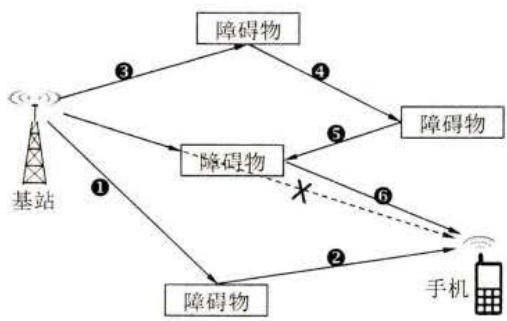
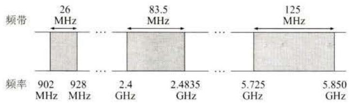

# 2.3.2 非导引型传输媒体

前面介绍了三种导引型传输媒体。但是，若通信线路要通过一些高山或岛屿，有时就很难施工。即使是在城市中，挖开马路敷设电缆也不是一件很容易的事。当通信距离很远时，敷设电缆既昂贵又费时。但利用无线

电波在自由空间的传播就可较快地实现多种通信。由于这种通信方式不使用上一节所介绍的各种导引型传输媒体，因此就将自由空间称为“非导引型传输媒体”。

特别要指出的是，由于信息技术的发展，社会各方面的节奏变快了。人们不仅要求能够在运动中进行电话通信（即移动电话通信），而且还要求能够在运动中进行计算机数据通信（俗称上网）。因此在最近几十年无线电通信发展得特别快。

无线传输可使用的频段很广。从前面给出的图 2-5 可以看出，人们现在已经利用了好几个波段进行通信。紫外线和更高的波段目前还不能用于通信。图 2-5 的最下面一行还给出了 ITU 对波段取的正式名称。例如，LF 波段的波长是从 1 km \~ 10 km（对应于 30 kHz \~ 300 kHz）。LF, MF 和 HF 的中文名字分别是低频、中频(300 kHz \~ 3 MHz)和高频(3 MHz \~ 30 MHz)。更高的频段中的 V, U, S 和 E 分别对应于 Very, Ultra, Super 和 Extremely，相应的频段的中文名字分别是甚高频(30 MHz \~ 300 MHz)、特高频(300 MHz \~ 3 GHz)、超高频(3 GHz \~ 30 GHz)和极高频(30 GHz \~ 300 GHz)，最高的一个频段中的 T 是 Tremendously，目前尚无标准译名。在低频 LF 的下面其实还有几个更低的频段，如甚低频 VLF、特低频 ULF、超低频 SLF 和极低频 ELF 等，因不用于一般的通信，故未画在图中。

无线电微波通信在当前的数据通信中占有特殊重要的地位。微波的频率范围为 300 MHz\~300 GHz（波长 1 m \~ 1 mm），但主要使用 2 GHz \~ 40 GHz 的频率范围。微波在空间主要是直线传播，由于地球表面是个曲面，因此其传播距离受到限制，一般只有 50 km 左右。但若采用 100 m 高的天线塔，则传播距离可增大到 100 km。微波会穿透电离层而进入宇宙空间，因此它不像短波那样可以经电离层反射传播到地面上很远的地方。

在使用微波频段的无线蜂窝通信系统中，有时基站向手机发送的信号被障碍物阻挡了（如图2-12中的虚线所示），无法直接到达手机。但基站发出的信号可以经过多个障碍物的数次反射到达手机，如图中所示的①→②和③→④→⑤→⑥这样的两条路径。多条路径的信号

叠加后一般都会产生很大的失真，这就是所谓的多径效应，必须设法解决（见第9章的9.3.1节）。

短波通信（即高频通信）主要靠电离层的反射。但电离层的不稳定所产生的衰落现象，以及电离层反射所产生的多径效应，使得短波信道的通信质量较差。

当利用无线信道传送数字信号时，必须使误码率（即比特错误率）不大于可容许的范围。图 2-13 中的曲线是根据通信理论计算出的，我们这里只需知道有关的三个基本概念。

> 图 2-12 多径效应的影响（教材第 53 页）

(1) 对于给定的调制方式和数据率，信噪比越大，误码率就越低。这个结论的得出是符合直觉的。当我们在嘈杂的餐厅用餐时，同桌的人可能听不清你说的话。提高嗓门会使说话的效果好些，但太大声说话也会影响周围顾客正常用餐。手机的情况也相似。若提高手机的发射功率，固然可以提高信噪比，但这必将缩短电池的使用时间。若增大电池的体积和重量，又会使手机携带不方便。过大的发射功率，还会干扰临近手机的正常通信，或影响人体健康。可见，如何提高信噪比需要综合考虑。

(2) 对于同样的信噪比, 具有更高数据率的调制技术的误码率也更高。例如, 当信噪比为 $10 \mathrm{~dB}$ 时, 若采用 $1 \mathrm{Mbit} / \mathrm{s}$ 数据率的二进制相移键控 BPSK 调制技术, 则误码率小于 $10^{-7}$ 。但若采用 $4 \mathrm{Mbit} / \mathrm{s}$ 数据率的正交振幅调制 16QAM, 则误码率为 $10^{-1}$ , 已经无法使用了。又如, 当信噪比为 $20 \mathrm{~dB}$ 时, 若采用 $4 \mathrm{Mbit} / \mathrm{s}$ 数据率的正交振幅调制 16QAM, 则误码率小于 $10^{-7}$ 。但若采用 $1 \mathrm{Mbit} / \mathrm{s}$ 数据率的二进制相移键控 BPSK, 则误码率变得非常小, 从图中的曲线已无法查到其数值。

(3) 如果移动用户在进行通信时还在不断改变自己的地理位置，就会引起无线信道特性的改变，因而信噪比和误码率都会发生变化。因此，用户的移动设备的物理层应当有一定的自适应能力，可以根据所处的环境特性选择最合适的调制和编码技术，以便在保证容许的误码率的条件下，获得尽可能高的数据传输速率。

为实现远距离通信必须在一条微波通信信道的两个终端之间建立若干个中继站。中继站把前一站送来的信号经过放大后再发送到下一站，这种通信方式称为“微波接力”。大多数长途电话业务使用4 GHz\~6 GHz的频率范围。

微波接力通信可传输电话、电报、图像、数据等信息。其主要特点是：

(1) 微波波段频率很高，其频段范围也很宽，因此其通信信道的容量很大。

(2) 因为工业干扰和天电干扰的主要频谱成分比微波频率低得多，对微波通信的危害比对短波和米波（即甚高频）通信小得多，因而微波传输质量较高。

(3) 与相同容量和长度的电缆载波通信比较，微波接力通信建设投资少，见效快，易于跨越山区、江河。

当然，微波接力通信也存在如下的一些缺点：

(1) 相邻站之间必须直视（常称为视距 LOS (Line Of Sight)），不能有障碍物。有时一个天线发射出的信号也会分成几条略有差别的路径到达接收天线，因而造成失真。

(2) 微波的传播有时也会受到恶劣气候的影响。

(3) 与电缆通信系统比较，微波通信的隐蔽性和保密性较差。

(4) 对大量中继站的使用和维护要耗费较多的人力和物力。

常用的卫星通信方法是在地球站之间利用位于约 3 万 6 千公里高空的人造同步地球卫星作为中继器的一种微波接力通信。对地静止通信卫星就是在太空的无人值守的微波通信的中继站。可见卫星通信的主要优缺点大体上应当和地面微波通信差不多。

卫星通信的最大特点是通信距离远，且通信费用与通信距离无关。同步地球卫星发射出的电磁波能辐射到地球上的通信覆盖区的跨度达1万8千多公里，面积约占全球的三分之一。只要在地球赤道上空的同步轨道上，等距离地放置3颗相隔120度的卫星，就能基本上实现全球的通信。

和微波接力通信相似，卫星通信的频带很宽，通信容量很大，信号所受到的干扰也较小，通信比较稳定。为了避免产生干扰，卫星之间相隔如果不小于2度，那么整个赤道上空只能放置 180 个同步卫星。好在人们发现可以在卫星上使用不同的频段来进行通信。因此总的通信容量资源还是很大的。

卫星通信的另一特点就是具有较大的传播时延。由于各地球站的天线仰角并不相同，因此不管两个地球站之间的地面距离是多少（相隔一条街或相隔上万公里），从一个地球站经卫星到另一地球站的传播时延均在250\~300 ms之间。一般可取为270 ms。这和其他的通信有较大差别（请注意：这和两个地球站之间的距离没有什么关系）。对比之下，地面微波接力通信链路的传播时延一般取为3.3 μs/km。

请注意，“卫星信道的传播时延较大”并不等于“用卫星信道传送数据的时延较大”。这是因为传送数据的总时延除了传播时延，还有发送时延、处理时延和排队时延等部分。传播时延在总时延中所占的比例有多大，取决于具体情况。但利用卫星信道进行交互式的网上游戏显然是不合适的。

在十分偏远的地方，或在离大陆很远的海洋中，要进行通信就几乎完全要依赖于卫星通信。卫星通信还非常适合于广播通信，因为它的覆盖面很广。但从安全方面考虑，卫星通信系统的保密性则相对较差。

通信卫星本身和发射卫星的火箭造价都较高。受电源和元器件寿命的限制，同步卫星的使用寿命一般为 10～15 年。卫星地球站的技术较复杂，价格还比较贵。这就使得卫星通信的费用较高。

除上述的同步卫星外，低轨道卫星通信系统（卫星高度在2000公里以下）已开始使用。低轨道卫星相对于地球不是静止的，而是不停地围绕地球旋转。目前，大功率、大容量、低轨道宽带卫星已开始在空间部署，并构成了空间高速链路。由于低轨道卫星离地球很近，因此轻便的手持通信设备都能够利用卫星进行通信。这里值得一提的就是美国太空探索技术公司SpaceX在2015年1月提出的“星链”（Starlink）计划。这个计划是要把约1.2万颗通信卫星发射到轨道，并从2020年开始工作。在2019年5月23日，“猎鹰9”运载火箭已成功将“星链”首批60颗卫星送入轨道。2016年11月2日，中国航天科技集团公司宣布将在2020年建成“鸿雁卫星星座通信系统”。2018年12月29日，“鸿雁”星座首发星，在我国酒泉卫星发射中心由长征二号丁运载火箭发射成功，并进入预定轨道，标志着“鸿雁”星座的建设全面启动。

从 20 世纪 90 年代起，无线移动通信和互联网一样，得到了飞速的发展。与此同时，使用无线信道的计算机局域网也获得了越来越广泛的应用。我们知道，要使用某一段无线电频谱进行通信，通常必须得到本国政府有关无线电频谱管理机构的许可证。但是，也有一些无线电频段是可以自由使用的（只要不干扰他人在这个频段中的通信），这正好满足计算机无线局域网的需求。图 2-14 给出了美国的 ISM 频段，现在的无线局域网就使用其中的 2.4 GHz 和 5.8 GHz 频段。ISM 是 Industrial, Scientific, and Medical（工业、科学与医药）的缩写，即所谓的“工、科、医频段”。各国的 ISM 标准有可能略有差别。

> 图 2-14 无线局域网使用的 ISM 频段（教材第 55 页）

红外通信、激光通信也使用非导引型媒体，可用于近距离的笔记本电脑相互传送数据。
