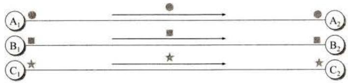
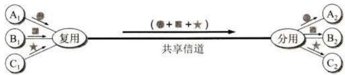
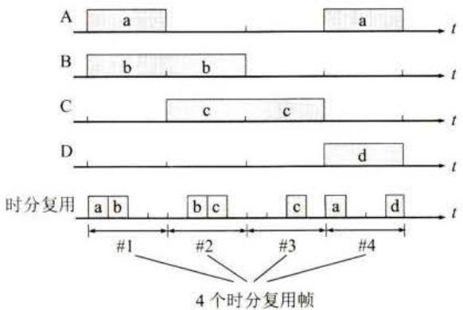
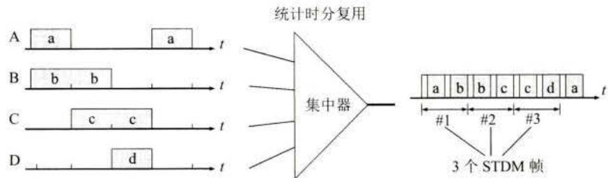

# 2.4.1 频分复用、时分复用和统计时分复用

## 2.4 信道复用技术

复用(multiplexing)是通信技术中的基本概念。计算机网络中的信道广泛地使用各种复用技术。下面对信道复用技术进行简单的介绍。

图 2-15(a) 表示 A₁, B₁ 和 C₁ 分别使用一个单独的信道与 A₂, B₂ 和 C₂ 进行通信，总共需要 3 个信道。但如果在发送端使用一个复用器，就可以用一个共享信道传送原来的 3 路信号。在接收端使用分用器，把合起来传输的信息分别送到相应的终点。图 2-15(b) 是复用的示意图。当然，复用要付出一定代价（共享信道由于带宽较大因而费用也较高，再加上复用器和分用器）。但如果复用的信道数量较大，那么在经济上还是合算的。

> (a) 使用单独的信道 (b) 利用复用技术使用共享信道 图2-15 复用的示意图（教材第 56 页）

最基本的复用就是频分复用 FDM (Frequency Division Multiplexing) 和时分复用 TDM (Time Division Multiplexing)。频分复用的概念是这样的。例如，有 N 路信号要在一个信道中传送。可以使用调制的方法，把各路信号分别搬移到适当的频率位置，使彼此不产生干扰，如图 2-16(a) 所示。各路信号就在自己所分配到的信道中传送。可见频分复用的各路信号在同样的时间占用不同的带宽资源（请注意，这里的“带宽”是频率带宽而不是数据的发送速率）。而时分复用则是将时间划分为一段段等长的时分复用帧（即 TDM 帧）。每一路信号在每一个 TDM 帧中占用固定序号的时隙。为简单起见，在图 2-16(b) 中只画出了 4 路信号 A, B, C 和 D。每一路信号所占用的时隙周期性地出现（其周期就是 TDM 帧的长度）。因此 TDM 信号也称为等时(isochronous)信号。可以看出，时分复用的所有用户是在不同的时间占用同样的频带宽度。这两种复用方法的优点是技术比较成熟，但缺点是不够灵活。时分复用则更有利于数字信号的传输。

使用 FDM 或 TDM 的复用技术，可以让多个用户（可以处在不同地点）共享信道资源。例如在图 2-16(a) 中的频分信道，可让 N 个用户各使用一个频带，或让更多的用户轮流使用这 N 个频带。这种方式称为频分多址接入 FDMA (Frequency Division Multiple Access)，简称为频分多址。在图 2-16(b) 中的时分信道，则可让 4 个用户各使用一个时隙，或让更多的用户轮流使用这 4 个时隙。这种方式称为时分多址接入 TDMA (Time Division Multiple Access)，简称为时分多址。请注意：FDMA 或 TDMA 中的 “MA” 表明 “多址”，意思是强调这种复用信道可以让多个用户（可以在不同地点）接入进来。而 “FD” 或 “TD” 则表示所使用的复用技术是 “频分复用” 或 “时分复用”。但术语 FDM 或 TDM 则说明是在频域还是在时域进行复用，而并不强调复用的信道是用于多个用户还是一个用户。

在使用频分复用时，若每个用户占用的带宽不变，则当复用的用户数增加时，复用后的信道的总带宽就跟着变宽。例如，传统的电话通信中每个标准话路的带宽是 4 kHz（即通信用的 3.1 kHz 加上两边的保护频带），那么若有 1000 个用户进行频分复用，则复用后的总带宽就是 4 MHz。但在使用时分复用时，每个时分复用帧的长度是不变的，始终是 125 μs。若有 1000 个用户进行时分复用，则每一个用户分配到的时隙宽度就是 125 μs 的千分之一，即 0.125 μs，时隙宽度变得非常窄。我们应注意到，时隙宽度非常窄的脉冲信号所占的频谱范围也是非常宽的。

在进行通信时，复用器(multiplexer)总是和分用器(demultiplexer)成对地使用。在复用器和分用器之间是用户共享的高速信道。分用器的作用正好和复用器的相反，它把高速信道传送过来的数据进行分用，分别送交到相应的用户。

当使用时分复用系统传送计算机数据时，由于计算机数据的突发性质，一个用户对已经分配到的子信道的利用率一般是不高的。当用户在某一段时间暂时无数据传输时（例如用户正在键盘上输入数据或正在浏览屏幕上的信息），那就只能让已经分配到手的子信道空闲着，而其他用户也无法使用这个暂时空闲的线路资源。图2-17说明了这一概念。这里假定有4个用户A，B，C和D进行时分复用。复用器按 $\mathrm{A}\rightarrow \mathrm{B}\rightarrow \mathrm{C}\rightarrow \mathrm{D}$ 的顺序依次对用户的时隙进行扫描，然后构成一个个时分复用帧。图中共画出了4个时分复用帧，每个时分复用帧有4个时隙。请注意，在时分复用帧中，每一个用户所分配到的时隙长度缩短了，在本例中，只有原来的 $1 / 4$ 。可以看出，当某用户暂时无数据发送时，在时分复用帧中分配给该用户的时隙只能处于空闲状态，其他用户即使一直有数据要发送，也不能使用这些空闲的时隙。这就导致复用后的信道利用率不高。

> 图 2-17 时分复用可能会造成线路资源的浪费（教材第 58 页）

统计时分复用 STDM (Statistic TDM) 是一种改进的时分复用，它能明显地提高信道的利用率。集中器(concentrator) 常使用这种统计时分复用。图 2-18 是统计时分复用的原理图。一个使用统计时分复用的集中器连接 4 个低速用户，然后将其数据集中起来通过高速线路发送到一个远地计算机。

> 图 2-18 统计时分复用的工作原理（教材第 58 页）

统计时分复用使用 STDM 帧来传送复用的数据。但每一个 STDM 帧中的时隙数小于连接在集中器上的用户数。各用户有了数据就随时发往集中器的输入缓存，然后集中器按顺序依次扫描输入缓存，把缓存中的输入数据放入 STDM 帧中。对没有数据的缓存就跳过去。当一个帧的数据放满了，就发送出去。可以看出，STDM 帧不是固定分配时隙，而是按需动态地分配时隙。因此，统计时分复用可以提高线路的利用率。我们还可看出，在输出线路上，某一个用户所占用的时隙并不是周期性地出现的。因此，统计时分复用又称为异步时分复用，而普通的时分复用称为同步时分复用。这里应注意的是，虽然统计时分复用的输出线路上的数据率小于各输入线路数据率的总和，但从平均的角度来看，这二者是平衡的。假定所有的用户都不间断地向集中器发送数据，那么集中器肯定无法应付，它内部设置的缓存都将溢出，所以集中器能够正常工作的前提是假定各用户都是间歇地工作的。

由于 STDM 帧中的时隙并不是固定地分配给某个用户的，因此在每个时隙中还必须有用户的地址信息，这是统计时分复用必须有的和不可避免的一些开销。图 2-18 中输出线路上每个时隙之前的短时隙（白色）就用于放入这样的地址信息。使用统计时分复用的集中器也叫作智能复用器，它能提供对整个报文的存储转发能力（但大多数复用器一次只能存储一个字符或一个比特），通过排队方式使各用户更合理地共享信道。此外，许多集中器还可能具有路由选择、数据压缩、前向纠错等功能。

最后要强调一下，TDM 帧和 STDM 帧都是在物理层传送的比特流中所划分的帧。这种

“帧”和我们以后要讨论的数据链路层的“帧”是完全不同的概念，不可弄混。
