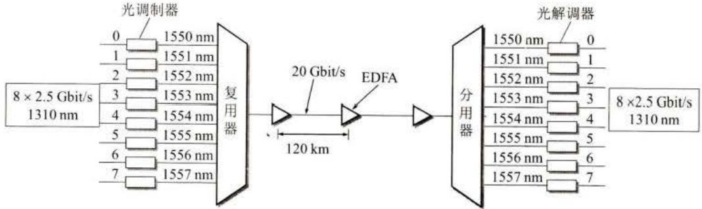

# 2.4.2 波分复用

波分复用 WDM (Wavelength Division Multiplexing) 就是光的频分复用。光纤技术的应用使得数据的传输速率空前提高。现在人们借用传统的载波电话的频分复用的概念，就能做到使用一根光纤来同时传输多个频率很接近的光载波信号。这样就可使光纤的传输能力成倍地提高。由于光载波的频率很高，因此习惯上用波长而不用频率来表示所使用的光载波。这样就产生了波分复用这一名词。最初，人们只能在一根光纤上复用两路光载波信号。这种复用方式称为波分复用 WDM。随着技术的发展，在一根光纤上复用的光载波信号的路数越来越多。现在已能做到在一根光纤上复用几十路或更多路数的光载波信号。于是就使用了密集波分复用 DWDM (Dense Wavelength Division Multiplexing) 这一名词。例如，每一路的数据率是 40 Gbit/s，使用 DWDM 后，如果在一根光纤上复用 64 路，就能够获得 2.56 Tbit/s 的数据率。图 2-19 给出了波分复用的概念。

> 图 2-19 波分复用的概念（教材第 59 页）

图 2-19 表示 8 路传输速率均为 2.5 Gbit/s 的光载波（其波长均为 1310 nm），经光的调制后，分别将波长变换到 1550\~1557 nm，每个光载波相隔 1 nm（这里只是为了说明问题的方便。实际上，对于密集波分复用，光载波的间隔一般是 0.8 nm 或 1.6 nm）。这 8 个波长很接近的光载波经过光复用器（波分复用的复用器又称为合波器）后，就在一根光纤中传输。因此，在一根光纤上数据传输的总速率就达到了 $8 \times 2.5 \, Gbit/s = 20 \, Gbit/s$ 。但光信号传输了一段距离后就会衰减，因此必须对衰减了的光信号进行放大才能继续传输。现在已经有了很好的掺铒光纤放大器 EDFA (Erbium Doped Fiber Amplifier)。它是一种光放大器，不需要像以前那样复杂，先把光信号转换成电信号，经过电放大器放大后，再转换成为光信号。EDFA 不需要进行光电转换而直接对光信号进行放大，并且在 1550 nm 波长附近有 35 nm（即 4.2 THz）频带范围提供较均匀的、最高可达 40\~50 dB 的增益。两个光纤放大器之间的光缆线路长度可达 120 km，而光复用器和光分用器（波分复用的分用器又称为分波器）之间的无光电转换的距离可达 600 km（只需放入 4 个 EDFA 光纤放大器）。

在地下铺设光缆是耗资很大的工程。因此人们总是在一根光缆中放入尽可能多的光纤（例如，放入100根以上的光纤），然后对每一根光纤使用密集波分复用技术。因此，对于具有100根速率为2.5 Gbit/s光纤的光缆，采用16倍的密集波分复用，得到一根光缆的总数据率为 $100 \times 40$ Gbit/s或4 Tbit/s。这里的T为 $10^{12}$ ，中文名词是“太”，即“兆兆”。

现在光纤通信的容量和传输距离还在不断增长。例如，一条从美国弗吉尼亚州横跨大西洋到西班牙的长达 6600 公里的海底光缆 MAREA，在 2018 年 2 月已投入商业运营。这根光缆共有 8 个光纤对，每根光纤的传输速率可达到 26.2 Tbit/s。
