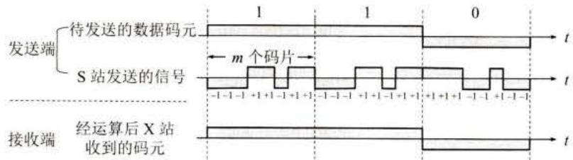

# 2.4.3 码分复用

码分复用 CDM (Code Division Multiplexing) 是另一种共享信道的方法。当码分复用信道为多个不同地址的用户所共享时，就称为码分多址 CDMA (Code Division Multiple Access)。每一个用户可以在同样的时间使用同样的

频带进行通信。由于各用户使用经过特殊挑选的不同码型，因此各用户之间不会造成干扰。码分复用最初用于军事通信，因为这种系统发送的信号有很强的抗干扰能力，其频谱类似于白噪声，不易被敌人发现。随着技术的进步，CDMA 设备的价格大幅度下降，体积大幅度缩小，因而现在已广泛使用在民用的移动通信中，特别是在无线局域网中。采用 CDMA 可提高通信的话音质量和数据传输的可靠性，减少干扰对通信的影响，增大通信系统的容量（是使用 GSM 的 4\~5 倍 $^{①}$ ），降低手机的平均发射功率，等等。下面简述其工作原理。

在 CDMA 中，每一个比特时间再划分为 m 个短的间隔，称为码片(chip)。通常 m 的值是 64 或 128。在下面的原理性说明中，为了画图简单起见，我们设 m 为 8。

使用 CDMA 的每一个站被指派一个唯一的 m bit 码片序列 (chip sequence)。一个站如果要发送比特 1，则发送它自己的 m bit 码片序列。如果要发送比特 0，则发送该码片序列的二进制反码。例如，指派给 S 站的 8 bit 码片序列是 00011011。当 S 发送比特 1 时，它就发送序列 00011011，而当 S 发送比特 0 时，就发送 11100100。为了方便，我们按惯例将码片中的 0 记为 -1，将 1 记为 +1。因此 S 站的码片序列是 $(-1 - 1 - 1 + 1 + 1 - 1 + 1 + 1)$ 。

现假定 S 站要发送信息的数据率为 b bit/s。由于每一个比特要转换成 m 个比特的码片，因此 S 站实际上发送的数据率提高到 mb bit/s，同时 S 站所占用的频带宽度也提高到原来数值的 m 倍。这种通信方式是扩频(spread spectrum)通信中的一种。扩频通信通常有两大类。一种是直接序列扩频 DSSS (Direct Sequence Spread Spectrum)，如上面讲的使用码片序列就是这一类。另一种是跳频扩频 FHSS (Frequency Hopping Spread Spectrum)。

CDMA 系统的一个重要特点就是这种体制给每一个站分配的码片序列不仅必须各不相同，并且还必须互相正交(orthogonal)。在实用的系统中是使用伪随机码序列。

用数学公式可以很清楚地表示码片序列的这种正交关系。令向量 S 表示站 S 的码片向量，再令 T 表示其他任何站的码片向量。两个不同站的码片序列正交，就是向量 S 和 T 的规格化内积(inner product)都是 0:

$$ \boldsymbol {S} \bullet \boldsymbol {T} \equiv \frac {1}{m} \sum_ {i = 1} ^ {m} S _ {i} T _ {i} = 0\tag{2-3} $$

例如，向量 S 为 $(-1-1-1+1+1-1+1+1)$ ，同时设向量 T 为 $(-1-1+1-1+1+1+1-1)$ ，这相当于 T 站的码片序列为 00101110。将向量 S 和 T 的各分量值代入 (2-3) 式就可看出这两个码片序列是正交的。不仅如此，向量 S 和各站码片反码的向量的内积也是 0。另外一点也很重要，即任何一个码片向量和该码片向量自己的规格化内积都是 1：

> ① 注：GSM (Global System for Mobile) 即全球移动通信系统，是欧洲和我国现在广泛使用的移动通信体制。

$$ \boldsymbol {S} \bullet \boldsymbol {S} = \frac {1}{m} \sum_ {i = 1} ^ {m} S _ {i} S _ {i} = \frac {1}{m} \sum_ {i = 1} ^ {m} S _ {i} ^ {2} = \frac {1}{m} \sum_ {i = 1} ^ {m} (\pm 1) ^ {2} = 1\tag{2-4} $$

而一个码片向量和该码片反码的向量的规格化内积值是 -1。这从(2-4)式可以很清楚地看出，因为求和的各项都变成了-1。

现在假定在一个 CDMA 系统中有很多站都在相互通信，每一个站所发送的是数据比特和本站的码片序列的乘积，因而是本站的码片序列（相当于发送比特 1）和该码片序列的二进制反码（相当于发送比特 0）的组合序列，或什么也不发送（相当于没有数据发送）。我们还假定所有的站所发送的码片序列都是同步的，即所有的码片序列都在同一个时刻开始。利用全球定位系统 GPS 就不难做到这点。

现假定有一个 X 站要接收 S 站发送的数据。X 站就必须知道 S 站所特有的码片序列。X 站使用它得到的码片向量 S 与接收到的未知信号进行求内积的运算。X 站接收到的信号是各个站发送的码片序列之和。根据上面的公式(2-3)和(2-4)，再根据叠加原理（假定各种信号经过信道到达接收端是叠加的关系），那么求内积得到的结果是：所有其他站的信号都被过滤掉（其内积的相关项都是 0），而只剩下 S 站发送的信号。当 S 站发送比特 1 时，在 X 站计算内积的结果是 +1，当 S 站发送比特 0 时，内积的结果是 -1。

图 2-20 是 CDMA 的工作原理。设 S 站要发送的数据是 110 三个码元。再设 CDMA 将每一个码元扩展为 8 个码片，而 S 站选择的码片序列为 $(-1 - 1 - 1 + 1 + 1 - 1 + 1 + 1)$ 。S 站发送的扩频信号为 $S_{x}$ 。我们应当注意到，S 站发送的扩频信号 $S_{x}$ 中，只包含互为反码的两种码片序列。T 站选择的码片序列为 $(-1 - 1 + 1 - 1 + 1 + 1 + 1 - 1)$ ，T 站也发送 110 三个码元，而 T 站的扩频信号为 $T_{x}$ 。因所有的站都使用相同的频率，因此每一个站都能够收到所有的站发送的扩频信号。对于我们的例子，所有的站收到的都是叠加的信号 $S_{x} + T_{x}$ 。

> 图 2-20 CDMA 的工作原理（教材第 61 页）

当接收站打算收 S 站发送的信号时，就用 S 站的码片序列与收到的信号求规格化内积。这相当于分别计算 $S \cdot S_{x}$ 和 $S \cdot T_{x}$ 。显然， $S \cdot S_{x}$ 就是 S 站发送的数据比特，因为在计算规格化内积时，按(2-3)式相加的各项，或者都是+1，或者都是-1；而 $S \cdot T_{x}$ 一定是零，因为相加的 8 项中的+1 和 -1 各占一半，因此总和一定是零。
