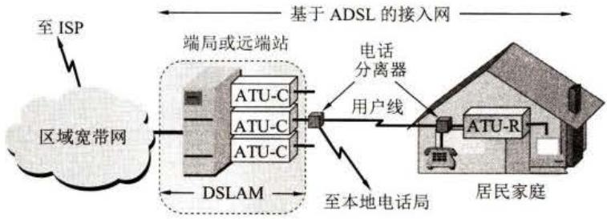

# 2.6.1 ADSL技术

## 2.6 宽带接入技术

在第 1 章中已讲过，用户要连接到互联网，必须先连接到某个 ISP，以便获得上网所需的 IP 地址。在互联网的发展初期，用户都是利用电话的用户线通过调制解调器连接到 ISP 的，经过多年的努力，从电话的用户线接入到互联网的速率最高只能达到 56 kbit/s。为了提高用户的上网速率，近年来已经有多种宽带技术进入用户的家庭。然而目前“宽带”尚无统一的定义。很早以前，有人认为只要接入到互联网的速率远大于 56 kbit/s 就是宽带。后来美国联邦通信委员会 FCC 认为只要双向速率之和超过 200 kbit/s 就是宽带。以后，宽带的标准也不断提高。2015 年 1 月，美国联邦通信委员会 FCC 又对接入网的“宽带”进行了重新定义，将原定的宽带下行速率调整至 25 Mbit/s，原定的宽带上行速率调整至 3 Mbit/s。

从宽带接入的媒体来看，可以划分为两大类。一类是有线宽带接入，而另一类是无线宽带接入。由于无线宽带接入比较复杂，我们将在第9章中讨论这个问题。下面我们只限于讨论有线宽带接入。

非对称数字用户线 ADSL (Asymmetric Digital Subscriber Line) 技术是用数字技术对现有模拟电话的用户线进行改造，使它能够承载宽带数字业务。虽然标准模拟电话信号的频带被限制在 300～3400 Hz 的范围内（这是电话局的交换机设置的标准话路频带），但用户线本身实际可通过的信号频率却超过 1 MHz。ADSL 技术把 0～4 kHz 低端频谱留给传统电话使用，而把原来没有被利用的高端频谱留给用户上网使用。ADSL 的 ITU 的标准是 G.992.1（或称 G.dmt，表示它使用 DMT 技术，见后面的介绍）。由于用户当时上网主要是从互联网下载各种文档，而向互联网发送的信息量一般都不太大，因此 ADSL 的下行（从 ISP 到用户）带宽都远远大于上行（从用户到 ISP）带宽。“非对称”这个名词就是这样得出的。

ADSL 的传输距离取决于数据率和用户线的线径（用户线越细，信号传输时的衰减就越大）。例如，0.5 mm 线径的用户线，传输速率为 1.5～2.0 Mbit/s 时可传送 5.5 km；但当传输速率提高到 6.1 Mbit/s 时，传输距离就缩短为 3.7 km。如果把用户线的线径减小到 0.4 mm，那么在 6.1 Mbit/s 的传输速率下就只能传送 2.7 km。此外，ADSL 所能得到的最高数据传输速率还与实际的用户线上的信噪比密切相关。

ADSL 在用户线（铜线）的两端各安装一个 ADSL 调制解调器。这种调制解调器的实现方案有许多种。我国采用的方案是离散多音调 DMT（Discrete Multi-Tone）调制技术。这里的“多音调”就是“多载波”或“多子信道”的意思。DMT 调制技术采用频分复用的方法，把 40 kHz 以上一直到 1.1 MHz 的高端频谱划分为许多子信道，其中 25 个子信道用于上行信道，而 249 个子信道用于下行信道，并使用不同的载波（即不同的音调）进行数字调制。这种做法相当于在一对用户线上使用许多小的调制解调器并行地传送数据。由于用户线的具体条件往往相差很大（距离、线径、受到相邻用户线的干扰程度等都不同），因此 ADSL 采用自适应调制技术使用户线能够传送尽可能高的数据率。当 ADSL 启动时，用户线两端的 ADSL 调制解调器就测试可用的频率、各子信道受到的干扰情况，以及在每一段频率上测试信号的传输质量。这样就使 ADSL 能够选择合适的调制方案以获得尽可能高的数据率。可见 ADSL 不能保证固定的数据率。对于质量很差的用户线甚至无法开通 ADSL。因此电信局需要定期检查用户线的质量，以保证能够提供向用户承诺的最高的 ADSL 数据率。图 2-21 显示的是 DMT 技术的频谱分布。

基于 ADSL 的接入网由以下三大部分组成：数字用户线接入复用器 DSLAM (DSL Access Multiplexer)、用户线和用户家中的一些设施（见图 2-22）。数字用户线接入复用器包括许多 ADSL 调制解调器。ADSL 调制解调器又称为接入端接单元 ATU (Access Termination Unit)。由于 ADSL 调制解调器必须成对使用，因此把在电话端局（或远端站）和用户家中所用的 ADSL 调制解调器分别记为 ATU-C（C 代表端局(Central Office)）和 ATU-R（R 代表远端(Remote)）。用户电话通过电话分离器(Splitter)和 ATU-R 连在一起，经用户线到端局，并再次经过一个电话分离器把电话连到本地电话交换机。电话分离器是无源的，它利用低通滤波器将电话信号与数字信号分开。将电话分离器做成无源的是为了在停电时不影响传统电话的使用。一个 DSLAM 可支持多达 500～1000 个用户。若按每户 6 Mbit/s 计算，则具有 1000 个端口的 DSLAM（这就需要用 1000 个 ATU-C）应有高达 6 Gbit/s 的转发能力。由于 ATU-C 要使用数字信号处理技术，因此 DSLAM 的价格较高。

> 图 2-22 基于 ADSL 的接入网的组成（教材第 65 页）

ADSL 最大的好处就是可以利用现有电话网中的用户线（铜线），而不需要重新布线。有许多老的建筑，电话线都早已存在。但若重新铺设光纤，往往会对原有建筑产生一些损坏。从尽量少损坏原有建筑考虑，使用 ADSL 进行宽带接入就非常合适了。到 2006 年 3 月为止，全世界的 ADSL 用户已超过 1.5 亿户。

最后我们要指出，ADSL借助于在用户线两端安装的ADSL调制解调器（即ATU-R和ATU-C）对数字信号进行了调制，使得调制后的数字信号的频谱适合在原来的用户线上传输。用户线本身并没有发生变化，但给用户的感觉是：加上ADSL调制解调器的用户线好像能够直接把用户计算机产生的数字信号传送到远方的ISP。正因为这样，原来的用户线加上两端的调制解调器就变成了可以传送数字信号的数字用户线DSL。

ADSL 技术也在发展。现在 ITU-T 已颁布了更高速率的 ADSL 标准，即 G 系列标准，例如 ADSL2（G.992.3 和 G.992.4）和 ADSL2+（G.992.5），它们都称为第二代 ADSL，目前已开始被许多 ISP 采用和投入运营。第二代 ADSL 改进的地方主要是：

(1) 通过提高调制效率得到了更高的数据率。例如，ADSL2 要求至少应支持下行 8 Mbit/s、上行 800 kbit/s 的速率。而 ADSL2+ 则将频谱范围从 1.1 MHz 扩展至 2.2 MHz（相应的子信道数目也增多了），下行速率可达 16 Mbit/s（最大传输速率可达 25 Mbit/s），而上行速率可达 800 kbit/s。

(2) 采用了无缝速率自适应技术 SRA (Seamless Rate Adaptation)，可在运营中不中断通信和不产生误码的情况下，根据线路的实时状况，自适应地调整数据率。

(3) 改善了线路质量评测和故障定位功能，这对提高网络的运行维护水平具有非常重要的意义。

这里我们要强调一下，ADSL 并不适合于企业。这是因为企业往往需要使用上行信道发送大量数据给许多用户。为了满足企业的需要，ADSL 技术有几种变型。例如，对称 DSL，即 SDSL (Symmetric DSL)，它把带宽平均分配到下行和上行两个方向，很适合于企业使用，每个方向的速率分别为 384 kbit/s 或 1.5 Mbit/s，距离分别为 5.5 km 或 3 km。还有一种使用一对线或两对线的对称 DSL 叫作 HDSL (High speed DSL)，用来取代 T1 线路的高速数字用户线，数据速率可达 768 kbit/s 或 1.5 Mbit/s，距离为 2.7\~3.6 km。

还有一种比 ADSL 更快的、用于短距离传送（300\~1800 m）的 VDSL (Very high speed DSL)，即甚高速数字用户线，也很值得注意。这也就是 ADSL 的快速版本。VDSL 的下行速率达 50\~55 Mbit/s，上行速率是 1.5\~2.5 Mbit/s。2011 年 ITU-T 颁布了更高速率的 VDSL2 （即第二代的 VDSL）的标准 G.993.2。VDSL2 能够提供的上行和下行速率都能够达到 100 Mbit/s。用这样的速率能够非常流畅地观看视频节目。

以上这些不同的高速 DSL 都可记为 xDSL。

近年来，高速 DSL 技术的发展又有了新的突破。2011 年 ITU-T 成立了 G.fast 项目组。这个项目组致力于短距离超高速接入新标准的制定，目标是使用单对直径为 0.5 mm 的铜线在 100 m 距离提供 900 Mbit/s 的接入速率，而 200 m 距离的速率为 600 Mbit/s，300 m 距离的速率为 300 Mbit/s。我国的华为公司积极参加了此标准的制定工作，是该标准的主要技术贡献者之一。在龙国柱博士的领导下，华为公司于 2012 年首先研制成功 Giga DSL 样机，使用时分双工 TDD (Time Division Duplex) 和 OFDM 技术，有效地降低了辐射干扰和设备功耗，实现了超高速的 DSL 接入。现在新的建议标准 G.mgfast 已被提出（这里的 mg 表示几个吉比特 Multi-Gigabit 的高速接入），其目标是在近期商用化。

目前在欧洲，这种超高速 DSL 的接入方式很受欢迎。这是因为在欧洲，具有历史意义的古老建筑非常多，而各国政府都已制定了很严格的保护文物的法律。在受保护的古老建筑的墙上钻洞铺设光缆，在法律上是被严格禁止的（即使是在朝街面的阳台上放置空调室外机也是不允许的）。但这些国家的电话普及率很高，进入这些建筑的电话线都早已铺设好了。因此，利用现有电话线来实现高速接入，在欧洲就特别具有现实意义。

在我国，情况有些不同。在建设新的高楼时，就已经把各种电缆的管线位置预留好了。因此，高楼中的用户可以根据自己的需要选择合适的接入方式（不一定非要采用 xDSL 技术）。因此上述这种超高速的 DSL 接入方式在国内使用得还较少。
