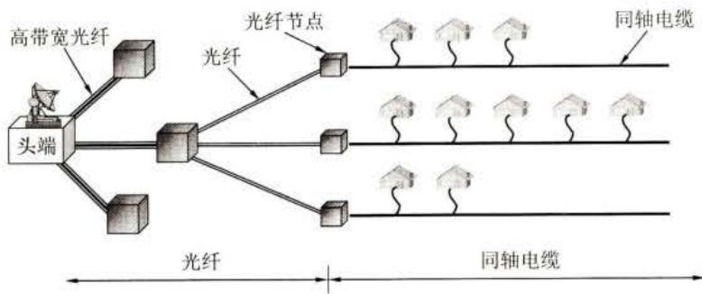
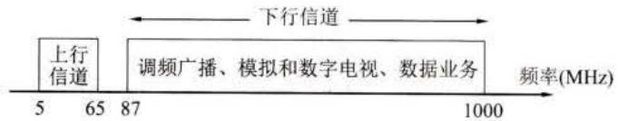

# 2.6.2 光纤同轴混合网（HFC网）

光纤同轴混合网（HFC 网，HFC 是 Hybrid Fiber Coax 的缩写）是在目前覆盖面很广的有线电视网的基础上开发的一种居民宽带接入网，除可传送电视节目外，还能提供电话、数据和其他宽带交互型业务。最早的有线电视网是树形拓扑结构的同轴电缆网络，它采用模拟技术的频分复用对电视节目进行单向广播传输。但以后有线电视网进行了改造，变成了现在的光纤同轴混合网（HFC 网）。

为了提高传输的可靠性和电视信号的质量，HFC网把原有线电视网中的同轴电缆主干部分改换为光纤（如图2-23所示）。光纤从头端连接到光纤节点(fiber node)。在光纤节点光信号被转换为电信号，然后通过同轴电缆传送到每个用户家庭。从头端到用户家庭所需的放大器数目也就减少到仅4\~5个。连接到一个光纤节点的典型用户数是500左右，但不超过2000。

> 图 2-23 HFC 网的结构图（教材第 66 页）

光纤节点与头端的典型距离为 25 km，而从光纤节点到其用户的距离则不超过 2～3 km。原来的有线电视网的最高传输频率是 450 MHz，并且仅用于电视信号的下行传输。但现在的 HFC 网具有双向传输功能，而且扩展了传输频带。根据有线电视频率配置标准 GB/T

17786-1999，目前我国的 HFC 网的频带划分如图 2-24 所示。

> 图 2-24 我国的 HFC 网的频带划分（教材第 67 页）

要使现有的模拟电视机能够接收数字电视信号，需要把一个叫作机顶盒(set-top box)的设备连接在同轴电缆和用户的电视机之间。但为了使用户能够利用 HFC 网接入到互联网，以及在上行信道中传送交互数字电视所需的一些信息，我们还需要增加一个为 HFC 网使用的调制解调器，它又称为电缆调制解调器(cable modem)。电缆调制解调器可以做成一个单独的设备（类似于 ADSL 的调制解调器），也可以做成内置式的，安装在电视机的机顶盒里面。用户只要把自己的计算机连接到电缆调制解调器，就可方便地上网了。

美国的有线电视实验室 CableLabs 制定的电缆调制解调器规约 DOCSIS(Data Over Cable Service Interface Specifications)的第一个版本 DOCSIS 1.0，已在 1998 年 3 月被 ITU-T 批准为国际标准。后来又有了 2001 年的 DOCSIS 2.0 和 2006 年的 DOCSIS 3.0 等新的标准。

电缆调制解调器不需要成对使用，而只需安装在用户端。电缆调制解调器比 ADSL 使用的调制解调器复杂得多，因为它必须解决共享信道中可能出现的冲突问题。在使用 ADSL 调制解调器时，用户计算机所连接的电话用户线是该用户专用的，因此在用户线上所能达到的最高数据率是确定的，与其他 ADSL 用户是否在上网无关。但在使用 HFC 的电缆调制解调器时，在同轴电缆这一段用户所享用的最高数据率是不确定的，因为某个用户所能享用的数据率取决于这段电缆上现在有多少个用户正在传送数据。有线电视运营商往往宣传通过电缆调制解调器上网可以达到比 ADSL 更高的数据率（例如达到 10 Mbit/s 甚至 30 Mbit/s），但只有在很少几个用户上网时才可能会是这样的。然而若出现大量用户（例如几百个）同时上网，那么每个用户实际的上网速率可能会低到令人难以忍受的程度。
