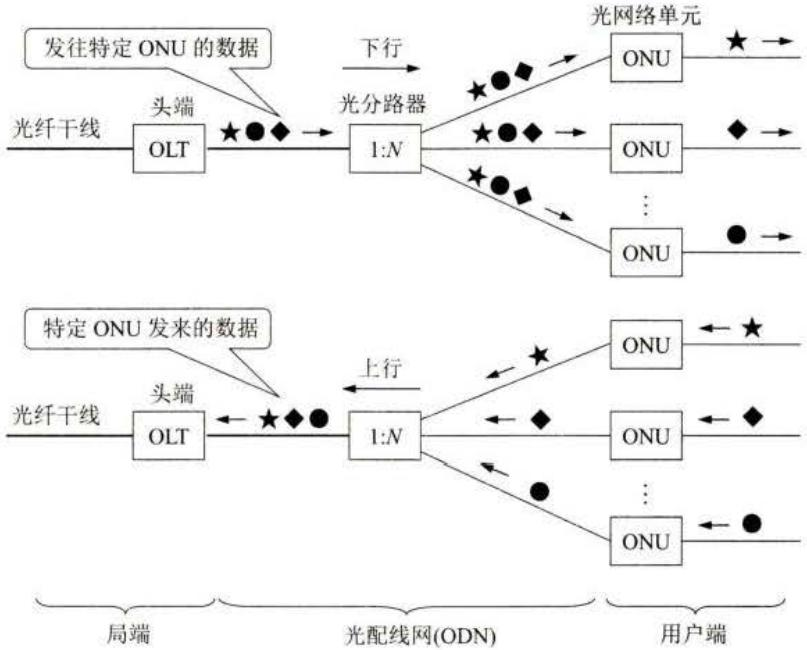

# 2.6.3 FTTx技术

由于互联网上已经有了大量的视频信息资源，因此近年来宽带上网的普及率增长得很快。但是为了更快地下载视频文件，以及更加流畅地欣赏网上的各种高清视频节目，尽快地对用户的上网速率进行升级就成为 ISP 的重要任务。从技术上讲，光纤到户 FTTH(Fiber To The Home)应当是最好的选择，这也是广大网民最终所向往的。所谓光纤到户，就是把光纤一直铺设到用户家庭。只有在光纤进入用户的家门后，才把光信号转换为电信号。这样做就可以使用户获得最高的上网速率。

现在还有多种宽带光纤接入方式，称为 FTTx，表示 Fiber To The ...。这里字母 x 可代表不同的光纤接入地点。实际上，光电进行转换的地方，可以在用户家中（这时 x 就是 H），也可以向外延伸到离用户家门口有一定距离的地方。例如，光纤到路边 FTTC（C 表示 Curb）、光纤到小区 FTTZ（Z 表示 Zone）、光纤到大楼 FTTB（B 表示 Building）、光纤到楼层 FTTF（F 表示 Floor）、光纤到办公室 FTTO（O 表示 Office）、光纤到桌面 FTTD（D 表示 Desk），等等。截至 2019 年 12 月，我国光纤接入 FTTH/O 的用户，已占互联网宽带接入用户总数的 92.9%，说明光纤接入已在我们互联网宽带接入中占绝对优势。

其实，信号在陆地上长距离的传输，现在基本上都已经实现了光纤化。在前面所介绍的 ADSL 和 HFC 宽带接入方式中，用于远距离的传输媒体也早都使用了光缆，只是到了临近用户家庭的地方，才转为铜缆（电话的用户线和同轴电缆）。我们知道，一个家庭用户远远用不了一根光纤的通信容量。为了有效地利用光纤资源，在光纤干线和广大用户之间，还需要铺设一段中间的转换装置即光配线网 ODN (Optical Distribution Network)，使得数十个家庭用户能够共享一根光纤干线。图 2-25 是现在广泛使用的无源光配线网的示意图。“无源”表明在光配线网中无须配备电源，因此基本上不用维护，其长期运营成本和管理成本都很低。无源光配线网常称为无源光网络 PON (Passive Optical Network)。

> 图 2-25 无源光配线网的组成（教材第 68 页）

在图 2-25 中，光线路终端 OLT (Optical Line Terminal) 是连接到光纤干线的终端设备。OLT 把收到的下行数据发往无源的 1:N 光分路器(splitter)，然后用广播方式向所有用户端的光网络单元 ONU (Optical Network Unit) 发送。典型的光分路器使用分路比是 1:32，有时也可以使用多级的光分路器。每个 ONU 根据特有的标识只接收发送给自己的数据，然后转换为电信号发往用户家中。每一个 ONU 到用户家中的距离可根据具体情况来设置，OLT 则给各 ONU 分配适当的光功率。如果 ONU 在用户家中，那就是光纤到户 FTTH 了。

当 ONU 发送上行数据时，先把电信号转换为光信号，光分路器把各 ONU 发来的上行数据汇总后，以 TDMA 方式发往 OLT，而发送时间和长度都由 OLT 集中控制，以便有序地共享光纤主干。

光配线网采用波分复用，上行和下行分别使用不同的波长。

无源光网络 PON 的种类很多，但最流行的有以下两种，各有其优缺点。

一种是以太网无源光网络 EPON (Ethernet PON)，已在 2004 年 6 月形成了 IEEE 的标准 802.3ah，较新的版本是 802.3ah-2008。EPON 在链路层使用以太网协议，利用 PON 的拓扑结构实现了以太网的接入。EPON 的优点是：与现有以太网的兼容性好，并且成本低，扩展性强，管理方便。在第 3 章 3.5.4 节还要讨论这个问题。

另一种是吉比特无源光网络 GPON (Gigabit PON)，其标准是 ITU 在 2003 年 1 月批准的

ITU-T G.984。之后更新多次，目前最新的是2010年的G.984.7。GPON采用通用封装方法GEM (Generic Encapsulation Method)，可承载多业务，对各种业务类型都能够提供服务质量保证，总体性能比EPON好。GPON虽成本稍高，但仍是很有潜力的宽带光纤接入技术。

采用光纤接入时，究竟把光网络单元 ONU 放在什么地方，应通过详细的预算对比才能确定。从总的趋势来看，光网络单元 ONU 越来越靠近用户的家庭，因此就有了“光进铜退”的说法。

需要注意的是，目前有些网络运营商所宣传的“光纤到户”，往往并非真正的FTTH，而是FTTx，对居民来说就是FTTB或FTTF。有的运营商把这种接入方式叫作“光纤宽带”或“光纤加局域网”，这样可能较为准确。
