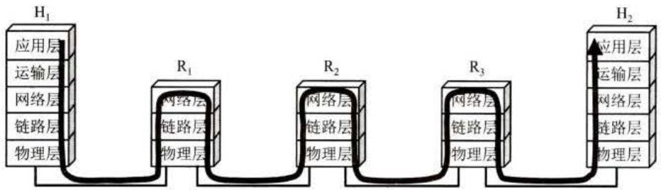
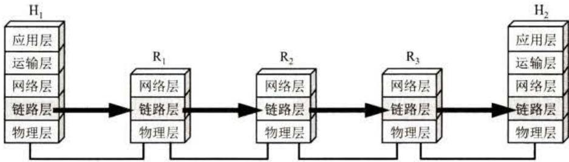

# 第3章 数据链路层

数据链路层属于计算机网络的低层。数据链路层使用的信道主要有以下两种类型：

(1) 点对点信道。这种信道使用一对一的点对点通信方式。

(2) 广播信道。这种信道使用一对多的广播通信方式，因此过程比较复杂。广播信道上连接的主机很多，因此必须使用专用的共享信道协议来协调这些主机的数据发送。

局域网虽然是个网络，但我们并不把局域网放在网络层中讨论。这是因为在网络层要讨论的问题是多个网络互连的问题，是讨论分组怎样从一个网络，通过路由器，转发到另一个网络。在本章中我们研究的是在同一个局域网中，分组怎样从一台主机传送到另一台主机，但并不经过路由器转发。从整个的互联网来看，局域网仍属于数据链路层的范围。

本章首先介绍点对点信道和在这种信道上最常用的点对点协议 PPP。然后再用较大的篇幅讨论共享信道的局域网和有关的协议。关于无线局域网的讨论将在第 9 章中进行。

本章最重要的内容是：

(1) 数据链路层的点对点信道和广播信道的特点，以及这两种信道所使用的协议（PPP 协议以及 CSMA/CD 协议）的特点。

(2) 数据链路层的三个基本问题：封装成帧、透明传输和差错检测。

(3) 以太网 MAC 层的硬件地址。

(4) 适配器、转发器、集线器、网桥、以太网交换机的作用以及使用场合。

下面看一下两台主机通过互联网进行通信时数据链路层（简称为链路层）所处的地位（如图 3-1 所示）。

> (a) 主机 $\mathrm{H}_{1}$ 向 $\mathrm{H}_{2}$ 发送数据（教材第 71 页）

> (b) 从层次上看数据的流动 图 3-1 数据链路层的地位（教材第 71 页）

图 3-1(a) 表示用户主机 $H_{1}$ 通过电话线上网，中间经过三个路由器（ $R_{1}, R_{2}$ 和 $R_{3}$ ）连接到远程主机 $H_{2}$ 。所经过的网络可以是多种的，如电话网、局域网和广域网。当主机 $H_{1}$ 向$\mathrm{H}_{2}$ 发送数据时，从协议的层次上看，数据的流动如图3-1(b)所示。主机 $\mathrm{H}_{1}$ 和 $\mathrm{H}_{2}$ 都有完整的五层协议栈，但路由器在转发分组时使用的协议栈只有下面的三层①。数据进入路由器后要先从物理层上到网络层，在转发表中找到下一跳的地址后，再下到物理层转发出去。因此，数据从主机 $\mathrm{H}_{1}$ 传送到主机 $\mathrm{H}_{2}$ 需要在路径中的各节点的协议栈向上和向下流动多次，如图中的浅灰色箭头所示。

然而当我们专门研究数据链路层的问题时，在许多情况下我们可以只关心在协议栈中水平方向的各数据链路层。于是，当主机 $H_{1}$ 向主机 $H_{2}$ 发送数据时，我们可以想象数据就是在数据链路层从左向右沿水平方向传送，如图 3-2 中从左到右的粗箭头所示，即通过以下这样的链路：

$H_{1}$ 的链路层 $\rightarrow R_{1}$ 的链路层 $\rightarrow R_{2}$ 的链路层 $\rightarrow R_{3}$ 的链路层 $\rightarrow H_{2}$ 的链路层

> 图 3-2 只考虑数据在数据链路层的流动（教材第 72 页）

图 3-2 指出，从数据链路层来看， $H_{1}$ 到 $H_{2}$ 的通信可以看成由四段不同的链路层通信组成，即： $H_{1} \rightarrow R_{1}$ ， $R_{1} \rightarrow R_{2}$ ， $R_{2} \rightarrow R_{3}$ 和 $R_{3} \rightarrow H_{2}$ 。这四段不同的链路层可能采用不同的数据链路层协议。
