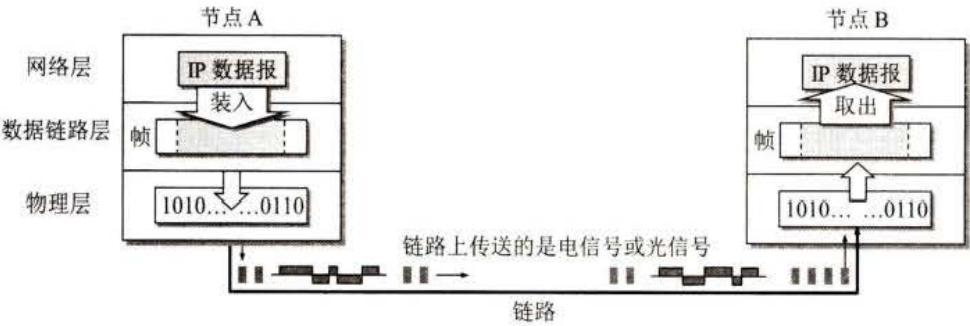

# 3.1.1 数据链路和帧

## 3.1 数据链路层的几个共同问题

本节重点讨论使用点对点信道的数据链路层的一些基本问题。其中的某些概念对广播信道也是适用的。

我们在这里要明确一下，“链路”和“数据链路”并不是一回事。

所谓链路(link)就是从一个节点到相邻节点的一段物理线路（有线或无线），而中间没有任何其他的交换节点。在进行数据通信时，两台计算机之间的通信路径往往要经过许多段这样的链路。可见链路只是一条路径的组成部分。

数据链路(data link)则是另一个概念。这是因为当需要在一条线路上传送数据时，除了必须有一条物理线路外，还必须有一些必要的通信协议来控制这些数据的传输（这将在后面几节讨论）。若把实现这些协议的硬件和软件加到链路上，就构成了数据链路。现在最常用的方法是使用网络适配器（既有硬件，也包括软件）来实现这些协议。一般的适配器都包括了数据链路层和物理层这两层的功能。

> ① 注：当路由器之间在交换路由信息时，根据所使用的路由选择协议的不同，也有可能需要使用运输层协议。见下一章的4.5节。

也有人采用另外的术语。这就是把链路分为物理链路和逻辑链路。物理链路就是上面所说的链路，而逻辑链路就是上面的数据链路，是物理链路加上必要的通信协议。

早期的数据通信协议曾叫作通信规程(procedure)。因此在数据链路层，规程和协议是同义语。

下面再介绍点对点信道的数据链路层的协议数据单元——帧。

数据链路层把网络层交下来的数据构成帧发送到链路上，以及把接收到的帧中的数据取出并上交给网络层。在互联网中，网络层协议数据单元就是 IP 数据报（或简称为数据报、分组或包）。

为了把主要精力放在点对点信道的数据链路层协议上，可以采用如图 3-3(a) 所示的三层模型。在这种三层模型中，不管在哪一段链路上的通信（主机和路由器之间或两个路由器之间），我们都看成是节点和节点的通信（如图中的节点 A 和节点 B），而每个节点只有下三层——网络层、数据链路层和物理层。

> 图 3-3(a) 三层的简化模型（教材第 73 页）

> 图 3-3(b) 只考虑数据链路层（教材第 73 页）

点对点信道的数据链路层在进行通信时的主要步骤如下：

(1) 节点 A 的数据链路层把网络层交下来的 IP 数据报添加首部和尾部封装成帧。

(2) 节点 A 把封装好的帧发送给节点 B 的数据链路层。

(3) 若节点 B 的数据链路层收到的帧无差错，则从收到的帧中提取出 IP 数据报交给上面的网络层；否则丢弃这个帧。

数据链路层不必考虑物理层如何实现比特传输的细节。我们甚至还可以更简单地设想好像是沿着两个数据链路层之间的水平方向把帧直接发送到对方，如图 3-3(b) 所示。
