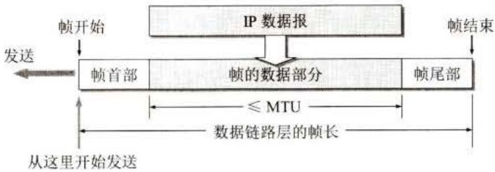
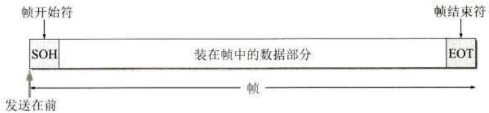
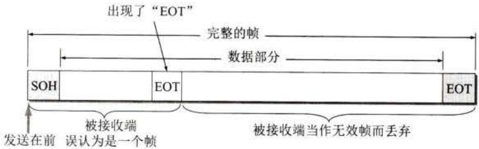
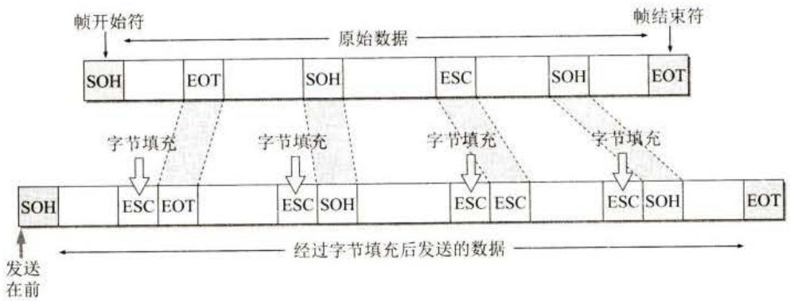
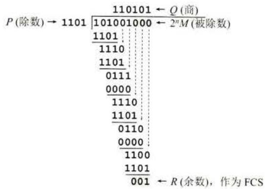

# 3.1.2 三个基本问题

数据链路层协议有许多种，但有三个基本问题则是共同的。这三个基本问题是：封装成帧、透明传输和差错检测。下面分别讨论这三个基本问题。

## 1. 封装成帧

封装成帧(framing)就是在一段数据的前后分别添加首部和尾部，这样就构成了一个帧。接收端在收到物理层上交的比特流后，就能根据首部和尾部的标记，从收到的比特流中识别帧的开始和结束。图3-4表示用帧首部和帧尾部封装成帧的一般概念。我们知道，分组交换的一个重要概念就是：所有在互联网上传送的数据都以分组（即IP数据报）为传送单位。网络层的IP数据报传送到数据链路层就成为帧的数据部分。在帧的数据部分的前面和后面分别添加上首部和尾部，构成了一个完整的帧。这样的帧就是数据链路层的数据传送单元。一个帧的帧长等于帧的数据部分长度加上帧首部和帧尾部的长度。首部和尾部的一个重要作用就是进行帧定界（即确定帧的界限）。此外，首部和尾部还包括许多必要的控制信息。在发送帧时，是从帧首部开始发送的。各种数据链路层协议都对帧首部和帧尾部的格式有明确的规定。显然，为了提高帧的传输效率，应当使帧的数据部分长度尽可能地大于首部和尾部的长度。但是，每一种链路层协议都规定了所能传送的帧的数据部分长度上限——最大传送单元MTU(Maximum Transfer Unit)。图3-4给出了帧的首部和尾部的位置，以及帧的数据部分与MTU的关系。

> 图 3-4 用帧首部和帧尾部封装成帧（教材第 74 页）

当数据是由可打印的 ASCII 码组成的文本文件时，帧定界可以使用特殊的帧定界符。我们知道，ASCII 码是 7 位编码，一共可组合成 128 个不同的 ASCII 码，其中可打印的有 95 个 $^{①}$ ，而不可打印的控制字符有 33 个。图 3-5 的例子可说明帧定界的概念。控制字符 SOH (Start Of Header) 放在一帧的最前面，表示帧的首部开始。另一个控制字符 EOT (End Of Transmission) 表示帧的结束。请注意，SOH 和 EOT 都是控制字符的名称。它们的十六进制编码分别是 01（二进制是 00000001）和 04（二进制是 00000100）。SOH（或 EOT）并不是 S, O, H（或 E, O, T）三个字符。此外，为了强调帧定界符的作用，与帧定界符无关的控制信息在图 3-5 中都省略了。

> 图 3-5 用控制字符进行帧定界的方法举例（教材第 74 页）

> ① 注：“可打印的字符”就是“可以从键盘上输入的字符”（因而也是可打印出的）。我们使用的标准键盘有47个键可输入94个字符（包括使用Shift键），加上空格键，一共可输入95个可打印字符。

当数据在传输中出现差错时，帧定界符的作用更加明显。假定发送端在尚未发送完一个帧时突然出故障，中断了发送。但随后很快又恢复正常，于是重新从头开始发送刚才未发送完的帧。由于使用了帧定界符，接收端就知道前面收到的数据是个不完整的帧（只有首部开始符 SOH 而没有传输结束符 EOT），必须丢弃。而后面收到的数据有明确的帧定界符（SOH 和 EOT），因此这是一个完整的帧，应当收下。

## 2. 透明传输

由于帧的开始和结束的标记使用专门指明的控制字符，因此，所传输的数据中的任何 8 比特的组合一定不允许和用作帧定界的控制字符的比特编码一样，否则就会出现帧定界的错误。

当传送的帧是用文本文件组成的帧时（文本文件中的字符都是从键盘上输入的），其数据部分显然不会出现像 SOH 或 EOT 这样的帧定界控制字符。可见不管从键盘上输入什么字符都可以放在这样的帧中传输过去，因此这样的传输就是透明传输。

但当数据部分是非 ASCII 码的文本文件时（如二进制代码的计算机程序或图像等），情况就不同了。如果数据中的某个字节的二进制代码恰好和 SOH 或 EOT 这种控制字符一样（如图 3-6 所示），数据链路层就会错误地“找到帧的边界”，把部分帧收下（误认为是个完整的帧），而把剩下的那部分数据丢弃（这部分找不到帧定界控制字符 SOH）。

> 图 3-6 数据部分恰好出现与 EOT 一样的代码（教材第 75 页）

像图 3-6 所示的帧的传输显然就不是 “透明传输”，因为当遇到数据中碰巧出现字符 “EOT” 时就传不过去了。数据中的 “EOT” 将被接收端错误地解释为 “传输结束” 的控制字符，而在其后面的数据因找不到 “SOH” 被接收端当作无效帧而丢弃。但实际上在数据中出现的字符 “EOT” 并非控制字符而仅仅是二进制数据 00000100。

前面提到的“透明”是一个很重要的术语。它表示：某一个实际存在的事物看起来却好像不存在一样（例如，你看不见在你前面有块 $100\%$ 透明的玻璃的存在）。“在数据链路层透明传送数据”表示无论什么样的比特组合的数据，都能够按照原样没有差错地通过这个数据链路层。因此，对所传送的数据来说，这些数据就“看不见”数据链路层有什么妨碍数据传输的东西。或者说，数据链路层对这些数据来说是透明的。

为了解决透明传输问题，就必须设法使数据中可能出现的控制字符“SOH”和“EOT”在接收端不被解释为控制字符。具体的方法是：发送端的数据链路层在数据中出现控制字符“SOH”或“EOT”的前面插入一个转义字符“ESC”（其十六进制编码是1B，二进制是00011011）。而在接收端的数据链路层在把数据送往网络层之前删除这个插入的转义字符。这种方法称为字节填充(byte stuffing)或字符填充(character stuffing)。如果转义字符也出现在数据当中，那么解决方法仍然是在转义字符的前面插入一个转义字符。因此，当接收端收到连续的两个转义字符时，就删除其中前面的一个。图3-7表示用字节填充法解决透明传输的问题。

> 图 3-7 用字节填充法解决透明传输的问题（教材第 76 页）

## 3. 差错检测

现实的通信链路都不会是理想的。这就是说，比特在传输过程中可能会产生差错：1 可能会变成 0，而 0 也可能变成 1。这就叫作比特差错。比特差错是传输差错中的一种。本小节所说的“差错”，如无特殊说明，就是指“比特差错”。在一段时间内，传输错误的比特占所传输比特总数的比率称为误码率 BER (Bit Error Rate)。例如，误码率为 $10^{-10}$ 时，表示平均每传送 $10^{10}$ 个比特就会出现一个比特的差错。误码率与信噪比有很大的关系。如果设法提高信噪比，就可以使误码率减小。实际的通信链路并非是理想的，它不可能使误码率下降到零。因此，为了保证数据传输的可靠性，在计算机网络传输数据时，必须采用各种差错检测措施。目前在数据链路层广泛使用了循环冗余检验 CRC (Cyclic Redundancy Check) 的检错技术。

下面我们通过一个简单的例子来说明循环冗余检验的原理。

在发送端，先把数据划分为组，假定每组 k 个比特。现假定待传送的数据 M = 101001 (k = 6)。CRC 运算就是在数据 M 的后面添加供差错检测用的 n 位冗余码，然后构成一个帧发送出去，一共发送 $(k + n)$ 位。在所要发送的数据后面增加 n 位的冗余码，虽然增大了数据传输的开销，但却可以进行差错检测。当传输可能出现差错时，付出这种代价往往是很值得的。

这 n 位冗余码可用以下方法得出。用二进制的模 2 运算 $^{①}$ 进行 $2^{n}$ 乘 M 的运算，这相当于在 M 后面添加 n 个 0。得到的 $(k + n)$ 位的数除以收发双方事先商定的长度为 $(n + 1)$ 位的除数 P，得出商是 Q 而余数是 R（n 位，比 P 少一位）。关于除数 P 下面还要介绍。在图 3-8 所示的例子中，M = 101001（即 k = 6）。假定除数 P = 1101（即 n = 3）。经模 2 除法运算后的结果是：商 Q = 110101（这个商并没有什么用处），而余数 R = 001。这个余数 R 就作为冗余码拼接在数据 M 的后面发送出去。这种为了进行检错而添加的冗余码常称为帧检验序列 FCS (Frame Check Sequence)。因此加上 FCS 后发送的帧是 101001001（即 $2^{n}M + FCS$ ），共有 $(k + n)$ 位。

顺便说一下，循环冗余检验 CRC 和帧检验序列 FCS 并不是同一个概念。CRC 是一种检错方法，而 FCS 是添加在数据后面的冗余码，在检错方法上可以选用 CRC，但也可不选用 CRC。

> ① 注：用模2运算进行加法时不进位，例如， $1111 + 1010 = 0101$ 。减法和加法一样，按加法规则计算。

> 图 3-8 说明循环冗余检验原理的例子（教材第 77 页）

在接收端把接收到的数据以帧为单位进行 CRC 检验：把收到的每一个帧都除以同样的除数 P（模 2 运算），然后检查得到的余数 R。

如果在传输过程中无差错，那么经过 CRC 检验后得出的余数 R 肯定是 0（读者可以自己验算一下。被除数现在是 101001001，而除数是 P=1101，看余数 R 是否为 0）。

但如果出现误码，那么余数 R 仍等于零的概率是非常非常小的（这可以通过不太复杂的概率计算得出，例如，可参考[TANE11]）。

总之，在接收端对收到的每一帧经过 CRC 检验后，有以下两种情况：

(1) 若得出的余数 R=0，则判定这个帧没有差错，就接受(accept)。

(2) 若余数 $R \neq 0$ ，则判定这个帧有差错（但无法确定究竟是哪一位或哪几位出现了差错），就丢弃。

一种较方便的方法是用多项式来表示循环冗余检验过程。在上面的例子中，用多项式 $P(X)=X^{3}+X^{2}+1$ 表示上面的除数P=1101（最高位对应于 $X^{3}$ ，最低位对应于 $X^{0}$ ）。多项式 $P(X)$ 称为生成多项式。现在广泛使用的生成多项式 $P(X)$ 有以下几种：

$$ \mathrm{CRC-16} = X ^ {1 6} + X ^ {1 5} + X ^ {2} + 1 $$

$$ \mathrm{CRC-CCITT} = X ^ {1 6} + X ^ {1 2} + X ^ {5} + 1 $$

$$ C R C - 3 2 = X ^ {3 2} + X ^ {2 6} + X ^ {2 3} + X ^ {2 2} + X ^ {1 6} + X ^ {1 2} + X ^ {1 1} + X ^ {1 0} + X ^ {8} + X ^ {7} + X ^ {5} + X ^ {4} + X ^ {2} + X + 1 $$

在数据链路层，发送端帧检验序列 FCS 的生成和接收端的 CRC 检验都是用硬件完成的，处理很迅速，因此并不会延误数据的传输。

从以上的讨论不难看出，如果我们在传送数据时不以帧为单位来传送，那么就无法加入冗余码以进行差错检验。因此，如果要在数据链路层进行差错检验，就必须把数据划分为帧，每一帧都加上冗余码，一帧接一帧地传送，然后在接收方逐帧进行差错检验。

最后再强调一下，在数据链路层若仅仅使用循环冗余检验 CRC 差错检测技术，则只能做到对帧的无差错接受，即：“凡是接收端数据链路层接受的帧，我们都能以非常接近于 1 的概率认为这些帧在传输过程中没有产生差错”。接收端丢弃的帧虽然曾收到了，但最终还是因为有差错被丢弃，即没有被接受。以上所述的可以近似地表述为（通常都是这样认为）：“凡是接收端数据链路层接受的帧均无差错”。

请注意，我们现在并没有要求数据链路层向网络层提供“可靠传输”的服务。所谓“可靠传输”就是：数据链路层的发送端发送什么，在接收端就收到什么。传输差错可分为两大类：一类就是前面所说的最基本的比特差错，而另一类传输差错则更复杂些，这就是收到的帧并没有出现比特差错，但却出现了帧丢失、帧重复或帧失序。例如，发送方连续传送三个帧：[#1]-[#2]-[#3]。假定接收端收到的每一个帧都没有比特差错，但却出现下面的几种情况：

帧丢失：收到[#1]-[#3]（丢失[#2]）。

帧重复：收到[#1]-[#2]-[#2]-[#3]（收到两个[#2]）。

帧失序：收到[#1]-[#3]-[#2]（后发送的帧反而先到达了接收端，这与一般数据链路层的传输概念不一样）。

以上三种情况都属于“出现传输差错”，但都不是这些帧里有“比特差错”。帧丢失很容易理解。但出现帧重复和帧失序的情况则较为复杂，对这些问题我们现在不展开讨论。在学完第5章的5.4节后，我们就会知道在什么情况下接收端可能会出现帧重复或帧失序。

总之，我们应当明确，“无比特差错”与“无传输差错”并不是同样的概念。在数据链路层使用CRC检验，能够实现无比特差错的传输，但这还不是可靠传输。

我们知道，过去 OSI 的观点是：必须让数据链路层向上提供可靠传输。因此在 CRC 检错的基础上，增加了帧编号、确认和重传机制。收到正确的帧就要向发送端发送确认。发送端在一定的期限内若没有收到对方的确认，就认为出现了差错，因而就进行重传，直到收到对方的确认为止。这种方法在历史上曾经起到很好的作用。但现在的通信线路的质量已经大大提高了，由通信链路质量不好引起差错的概率已经大大降低。因此，现在互联网就采取了区别对待的方法：

对于通信质量良好的有线传输链路，数据链路层协议不使用确认和重传机制，即不要求数据链路层向上提供可靠传输的服务。如果在数据链路层传输数据时出现了差错并且需要进行改正，那么改正差错的任务就由上层协议（例如，运输层的 TCP 协议）来完成。

对于通信质量较差的无线传输链路，数据链路层协议使用确认和重传机制，数据链路层向上提供可靠传输的服务（见第9章）。

实践证明，这样做可以提高通信效率。

可靠传输协议将在第 5 章中讨论。本章介绍的数据链路层协议都不是可靠传输的协议。
