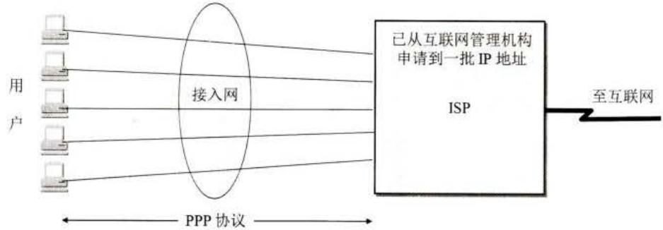

# 3.2.1 PPP协议的特点

## 3.2 点对点协议 PPP

在通信线路质量较差的年代，在数据链路层使用可靠传输协议曾经是一种好办法。因此，能实现可靠传输的高级数据链路控制 HDLC (High-level Data Link Control) 就成为当时比较流行的数据链路层协议。但现在 HDLC 已很少使用了。对于点对点的链路，简单得多的点对点协议 PPP (Point-to-Point Protocol) 则是目前使用得最广泛的数据链路层协议。

我们知道，互联网用户通常都要连接到某个 ISP 才能接入到互联网。PPP 协议就是用户计算机和 ISP 进行通信时所使用的数据链路层协议（如图 3-9 所示）。

> 图 3-9 用户到 ISP 的链路使用 PPP 协议（教材第 79 页）

PPP 协议是 IETF 在 1992 年制定的。经过 1993 年和 1994 年的修订，现在的 PPP 协议在 1994 年就已成为互联网的正式标准[RFC 1661, STD51]。

## 1. PPP 协议应满足的需求

IETF 认为，在设计 PPP 协议时必须考虑以下多方面的需求[RFC 1547]:

(1) 简单 IETF 在设计互联网体系结构时把其中最复杂的部分放在 TCP 协议中，而网际协议 IP 则相对比较简单，它提供的是不可靠的数据报服务。在这种情况下，数据链路层没有必要提供比 IP 协议更多的功能。因此，对数据链路层的帧，不需要纠错，不需要序号，也不需要流量控制。IETF 把 “简单” 作为首要的需求。

简单的设计还可使协议在实现时不容易出错，从而使不同厂商在协议的不同实现上的互操作性提高了。我们知道，协议标准化的一个主要目的就是提高协议的互操作性。

总之，这种数据链路层的协议非常简单：接收方每收到一个帧，就进行 CRC 检验。如 CRC 检验正确，就收下这个帧；反之，就丢弃这个帧，其他什么也不做。

(2) 封装成帧 PPP 协议必须规定特殊的字符作为帧定界符（即标志一个帧的开始和结束的字符），以便使接收端从收到的比特流中能准确地找出帧的开始和结束位置。

(3) 透明性 PPP 协议必须保证数据传输的透明性。这就是说，如果数据中碰巧出现了和帧定界符一样的比特组合时，就要采取有效的措施来解决这个问题（见 3.2.2 节）。

(4) 多种网络层协议 PPP 协议必须能够在同一条物理链路上同时支持多种网络层协议（如 IP 和 IPX 等）的运行。当点对点链路所连接的是局域网或路由器时，PPP 协议必须同时支持在链路所连接的局域网或路由器上运行的各种网络层协议。

(5) 多种类型链路 除了要支持多种网络层的协议外，PPP 还必须能够在多种类型的链路上运行。例如，串行的（一次只发送一个比特）或并行的（一次并行地发送多个比特），同步的或异步的，低速的或高速的，电的或光的，交换的（动态的）或非交换的（静态的）点对点链路。

这里特别要提到的是在 1999 年公布的在以太网上运行的 PPP，即 PPP over Ethernet，简称为 PPPoE [RFC 2516]，这是 PPP 协议能够适应多种类型链路的一个典型例子。PPPoE 是为宽带上网的主机使用的链路层协议。这个协议把 PPP 帧再封装在以太网帧中（当然还要增加一些能够识别各用户的功能）。宽带上网时由于数据传输速率较高，因此可以让多个连接在以太网上的用户共享一条到 ISP 的宽带链路。现在，即使只有一个用户利用 ADSL 进行宽带上网（并不和其他人共享到 ISP 的宽带链路），也是使用 PPPoE 协议，见后面的 3.5.4 节的讨论。

(6) 差错检测(error detection) PPP 协议必须能够对接收端收到的帧进行检测，并立即丢弃有差错的帧。若在数据链路层不进行差错检测，那么已出现差错的无用帧就还要在网络中继续向前转发，因而会白白浪费许多的网络资源。

(7) 检测连接状态 PPP 协议必须具有一种机制能够及时（不超过几分钟）自动检测出链路是否处于正常工作状态。当出现故障的链路隔了一段时间后又重新恢复正常工作时，就特别需要有这种及时检测功能。

(8) 最大传送单元 PPP 协议必须对每一种类型的点对点链路设置最大传送单元 MTU 的标准默认值 $^{①}$ 。这样做是为了促进各种实现之间的互操作性。如果高层协议发送的分组过长并超过 MTU 的数值，PPP 就要丢弃这样的帧，并返回差错。需要强调的是，MTU 是数据链路层的帧可以载荷的数据部分的最大长度，而不是帧的总长度。

(9) 网络层地址协商 PPP 协议必须提供一种机制使通信的两个网络层（例如，两个 IP 层）的实体能够通过协商知道或能够配置彼此的网络层地址。协商的算法应尽可能简单，并且能够在所有的情况下得出协商结果。这对拨号连接的链路特别重要，因为如果仅仅在链路层建立了连接而不知道对方网络层地址，则还不能够保证网络层可以传送分组。

(10) 数据压缩协商 PPP 协议必须提供一种方法来协商使用数据压缩算法。但 PPP 协议并不要求将数据压缩算法进行标准化。

在 TCP/IP 协议族中，可靠传输由运输层的 TCP 协议负责，因此数据链路层的 PPP 协议不需要进行纠错，不需要设置序号，也不需要进行流量控制。PPP 协议不支持多点线路（即一个主站轮流和链路上的多个从站进行通信），而只支持点对点的链路通信。此外，PPP 协议只支持全双工链路。

## 2. PPP 协议的组成

PPP 协议有三个组成部分:

(1) 一个将 IP 数据报封装到串行链路的方法。PPP 既支持异步链路（无奇偶检验的 8 比特数据），也支持面向比特的同步链路。IP 数据报在 PPP 帧中就是其信息部分。这个信息部分的长度受最大传送单元 MTU 的限制。

(2) 一个用来建立、配置和测试数据链路连接的链路控制协议 LCP (Link Control Protocol)。通信的双方可协商一些选项。在 RFC 1661 中定义了 11 种类型的 LCP 分组。

(3) 一套网络控制协议 NCP (Network Control Protocol) $^{②}$ ，其中的每一个协议支持不同的网络层协议，如 IP、OSI 的网络层、DECnet 和 AppleTalk 等。
