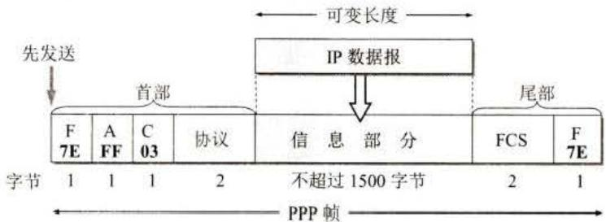
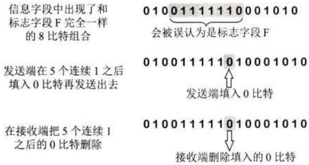

# 3.2.2 PPP协议的帧格式

## 1. 各字段的意义

PPP 的帧格式如图 3-10 所示。PPP 帧的首部和尾部分别为四个字段和两个字段。

首部的第一个字段和尾部的第二个字段都是标志字段 F (Flag)，规定为 0x7E（符号 “0x” 表示它后面的字符是用十六进制表示的。十六进制的 7E 的二进制表示是 01111110）。标志字段表示一个帧的开始或结束。因此标志字段就是 PPP 帧的定界符。连续两帧之间只需要用一个标志字段。如果出现连续两个标志字段，就表示这是一个空帧，应当丢弃。

> ① 注：MTU 的默认值是 1500 字节。在 RFC 1661 中，MTU 叫作最大接收单元 MRU (Maximum Receive Unit)。

> ② 注：TCP 的早期版本也叫作 NCP，但它和这里所讨论的 NCP 没有关系。

首部中的地址字段 A 规定为 0xFF（即 11111111），控制字段 C 规定为 0x03（即 00000011）。最初曾考虑以后再对这两个字段的值进行其他定义，但至今也没有给出。可见这两个字段实际上并没有携带 PPP 帧的信息。

> 图3-10 PPP帧的格式（教材第 81 页）

PPP 首部的第四个字段是 2 字节的协议字段。当协议字段为 0x0021 时，PPP 帧的信息字段就是 IP 数据报。若为 0xC021，则信息字段是 PPP 链路控制协议 LCP 的数据，而 0x8021 表示这是网络层的控制数据。

信息字段的长度是可变的，不超过 1500 字节。

尾部中的第一个字段（2 字节）是使用 CRC 的帧检验序列 FCS。

## 2. 字节填充

当信息字段中出现和标志字段一样的比特(0x7E)组合时，就必须采取一些措施使这种形式上和标志字段一样的比特组合不出现在信息字段中。

当 PPP 使用异步传输时，它把转义符定义为 0x7D（即 01111101），并使用字节填充，RFC 1662 规定了如下所述的填充方法：

(1) 把信息字段中出现的每一个 0x7E 字节转变成为 2 字节序列 (0x7D, 0x5E)。

(2) 若信息字段中出现一个 0x7D 的字节（即出现了和转义字符一样的比特组合），则把 0x7D 转变成为 2 字节序列 (0x7D, 0x5D)。

(3) 若信息字段中出现 ASCII 码的控制字符（即数值小于 0x20 的字符），则在该字符前面要加入一个 0x7D 字节，同时将该字符的编码加以改变。例如，出现 0x03（在控制字符中是“传输结束”ETX）就要把它转变为 2 字节序列 (0x7D, 0x23)。

由于在发送端进行了字节填充，因此在链路上传送的信息字节数就超过了原来的信息字节数。但接收端在收到数据后再进行与发送端字节填充相反的变换，就可以正确地恢复出原来的信息。

## 3. 零比特填充

PPP 协议用在 SONET/SDH 链路时，使用同步传输（一连串的比特连续传送）而不是异步传输（逐个字符地传送）。在这种情况下，PPP 协议采用零比特填充方法来实现透明传输。

零比特填充的具体做法是：在发送端，先扫描整个信息字段（通常用硬件实现，但也可用软件实现，只是会慢些）。只要发现有5个连续1，则立即填入一个0。因此经过这种零比特填充后的数据，就可以保证在信息字段中不会出现6个连续1。接收端在收到一个帧时，先找到标志字段 F 以确定一个帧的边界，接着再用硬件对其中的比特流进行扫描。每当发现 5 个连续 1 时，就把这 5 个连续 1 后的一个 0 删除，以还原成原来的信息比特流（如图 3-11 所示）。这样就保证了透明传输：在所传送的数据比特流中可以传送任意组合的比特流，而不会引起对帧边界的错误判断。

> 图 3-11 零比特的填充与删除（教材第 82 页）
