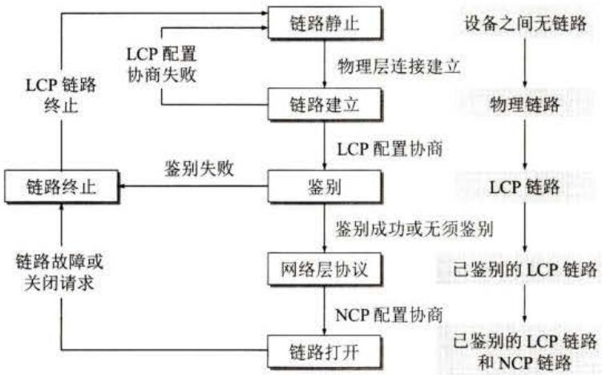

# 3.2.3 PPP协议的工作状态

上一节我们通过 PPP 帧的格式讨论了 PPP 帧是怎样组成的。但 PPP 链路一开始是怎样被初始化的？当用户拨号接入 ISP 后，就建立了一条从用户个人电脑到 ISP 的物理连接。这时，用户个人电脑向 ISP 发送一系列的链路

控制协议 LCP 分组（封装成多个 PPP 帧），以便建立 LCP 连接。这些分组及其响应选择了将要使用的一些 PPP 参数。接着还要进行网络层配置，网络控制协议 NCP 给新接入的用户个人电脑分配一个临时的 IP 地址。这样，用户个人电脑就成为互联网上的一个有 IP 地址的主机了。

当用户通信完毕时，NCP 释放网络层连接，收回原来分配出去的 IP 地址。接着，LCP 释放数据链路层连接。最后释放的是物理层的连接。

上述过程可用如图 3-12 所示的状态图来描述。

PPP 链路的起始和终止状态永远是图 3-12 中的 “链路静止” (Link Dead) 状态，这时在用户个人电脑和 ISP 的路由器之间并不存在物理层的连接。

> 图 3-12 PPP 协议的状态图（教材第 82 页）

当用户个人电脑通过调制解调器呼叫路由器时（通常是在屏幕上用鼠标点击一个连接按钮），路由器就能够检测到调制解调器发出的载波信号。在双方建立了物理层连接后，PPP 就进入 “链路建立” (Link Establish) 状态，其目的是建立链路层的 LCP 连接。

这时 LCP 开始协商一些配置选项，即发送 LCP 的配置请求帧 (Configure-Request)。这是个 PPP 帧，其协议字段置为 LCP 对应的代码，而信息字段包含特定的配置请求。链路的另一端可以发送以下几种响应中的一种：

(1) 配置确认帧 (Configure-Ack): 所有选项都接受。

(2) 配置否认帧 (Configure-Nak): 所有选项都理解但不能接受。

(3) 配置拒绝帧 (Configure-Reject): 选项有的无法识别或不能接受, 需要协商。

LCP 配置选项包括链路上的最大帧长、所使用的鉴别协议(Authentication Protocol)的规约（如果有的话），以及不使用 PPP 帧中的地址和控制字段（因为这两个字段的值是固定的，没有任何信息量，可以在 PPP 帧的首部中省略这两个字节）。

协商结束后双方就建立了 LCP 链路，接着就进入“鉴别”(Authenticate)状态。在这一状态，只允许传送 LCP 协议的分组、鉴别协议的分组以及监测链路质量的分组。若使用口令鉴别协议 PAP (Password Authentication Protocol)，则需要发起通信的一方发送身份标识符和口令。系统可允许用户重试若干次。如果需要有更好的安全性，则可使用更加复杂的口令握手鉴别协议 CHAP (Challenge-Handshake Authentication Protocol)。若鉴别身份失败，则转到“链路终止”(Link Terminate)状态。若鉴别成功，则进入“网络层协议”(Network-Layer Protocol)状态。

在 “网络层协议” 状态，PPP 链路两端的网络控制协议 NCP 根据网络层的不同协议互相交换网络层特定的网络控制分组。这个步骤是很重要的，因为现在的路由器都能够同时支持多种网络层协议。总之，PPP 协议两端的网络层可以运行不同的网络层协议，但仍然可使用同一个 PPP 协议进行通信。

如果在 PPP 链路上运行的是 IP 协议，则对 PPP 链路的每一端配置 IP 协议模块（如分配 IP 地址）时就要使用 NCP 中支持 IP 的协议——IP 控制协议 IPCP (IP Control Protocol)。IPCP 分组也封装成 PPP 帧（其中的协议字段为 0x8021）在 PPP 链路上传送。在低速链路上运行时，双方还可以协商使用压缩的 TCP 和 IP 首部，以减少在链路上发送的比特数。

当网络层配置完毕后，链路就进入可进行数据通信的“链路打开”(Link Open)状态。链路的两个 PPP 端点可以彼此向对方发送分组。两个 PPP 端点还可发送回送请求 LCP 分组 (Echo-Request) 和回送回答 LCP 分组 (Echo-Reply)，以检查链路的状态。

数据传输结束后，可以由链路的一端发出终止请求 LCP 分组(Terminate-Request)请求终止链路连接，在收到对方发来的终止确认 LCP 分组(Terminate-Ack)后，转到“链路终止”状态。如果链路出现故障，也会从“链路打开”状态转到“链路终止”状态。当调制解调器的载波停止后，则回到“链路静止”状态。

图 3-12 右方的灰色方框给出了对 PPP 协议的几个状态的说明。从设备之间无链路开始，到先建立物理链路，再建立链路控制协议 LCP 链路。经过鉴别后再建立网络控制协议 NCP 链路，然后才能交换数据。由此可见，PPP 协议已不是纯粹的数据链路层的协议，它还包含了物理层和网络层的内容。
