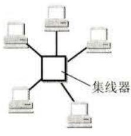
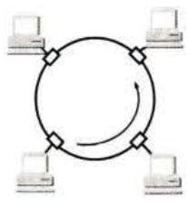
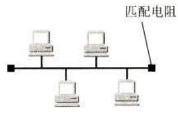
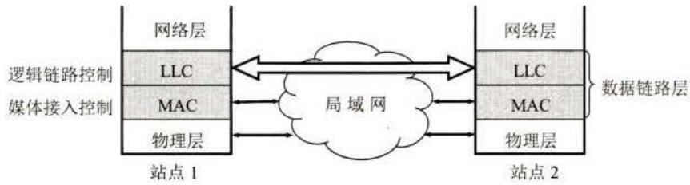
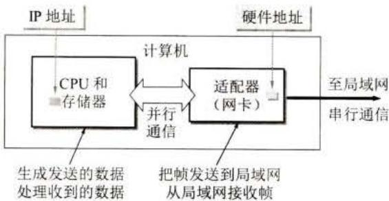

# 3.3.1 局域网的数据链路层

## 3.3 使用广播信道的数据链路层

广播信道可以进行一对多的通信。下面要讨论的局域网使用的就是广播信道。局域网是在20世纪70年代末发展起来的。局域网技术在计算机网络中占有非常重要的地位。

局域网最主要的特点是：网络为一个单位所拥有，且地理范围和站点数目均有限。在局域网刚刚出现时，局域网比广域网具有较高的数据率、较低的时延和较小的误码率。但随着光纤技术在广域网中普遍使用，现在广域网也具有很高的数据率和很低的误码率。

局域网具有如下的一些优点：

(1) 具有广播功能，从一个站点可很方便地访问全网。局域网上的主机可共享连接在局域网上的各种硬件和软件资源。

(2) 便于系统的扩展和逐渐地演变，各设备的位置可灵活调整和改变。

(3) 提高了系统的可靠性(reliability)、可用性(availability)和生存性(survivability)。

局域网可按网络拓扑进行分类。图 3-13(a) 是星形网。由于集线器(hub) 的出现和双绞线大量用于局域网中，星形以太网以及多级星形结构的以太网获得了非常广泛的应用。图 3-13(b) 是环形网，图 3-13(c) 为总线网，各站直接连在总线上。总线两端的匹配电阻吸收在总线上传播的电磁波信号的能量，避免在总线上产生有害的电磁波反射。总线网以传统以太网最为著名，但以太网后来又演变成了星形网。经过四十多年的发展，以太网的速率已大大提高。现在最常用的以太网的速率是 1 Gbit/s（家庭或中小企业）、10 Gbit/s（数据中心）和 100 Gbit/s（长距离传输），且其速率仍在继续提高。现在以太网已成为了局域网的同义词，因此本章从本节开始都是讨论以太网技术。

> (a) 星形网（教材第 84 页）

> (b) 环形网（教材第 84 页）

> (c) 总线网 图 3-13 局域网的拓扑（教材第 84 页）

局域网可使用多种传输媒体。双绞线最便宜，原来只用于低速（1\~2 Mbit/s）基带局域网。现在从 10 Mbit/s 至 10 Gbit/s 的局域网都可使用双绞线。双绞线已成为局域网中的主流传输媒体。当数据率更高时，往往需要使用光纤作为传输媒体。

必须指出，局域网工作的层次跨越了数据链路层和物理层。由于局域网技术中有关数据链路层的内容比较丰富，因此我们就把局域网的内容放在数据链路层这一章中讨论。但这并不表示局域网仅仅和数据链路层有关。

共享信道要着重考虑的一个问题就是如何使众多用户能够合理而方便地共享通信媒体资源。这在技术上有两种方法：

(1) 静态划分信道，如在第 2 章的 2.4 节中已经介绍过的频分复用、时分复用、波分复用和码分复用等。用户只要分配到了信道就不会和其他用户发生冲突。但这种划分信道的方法代价较高，不适合于局域网使用。

(2) 动态媒体接入控制，它又称为多点接入(multiple access)，其特点是信道并非在用户通信时固定分配给用户。这里又分为以下两类：

\- 随机接入 随机接入的特点是所有的用户可随机地发送信息。但如果恰巧有两个或更多的用户在同一时刻发送信息，那么在共享媒体上就要产生碰撞（即发生了冲突），使得这些用户的发送都失败。因此，必须有解决碰撞的网络协议。

\- 受控接入 受控接入的特点是用户不能随机地发送信息而必须服从一定的控制。这类的典型代表有分散控制的令牌环局域网和集中控制的多点线路探询(polling)，或称为轮询。

属于随机接入的以太网将被重点讨论。受控接入则由于目前在局域网中使用得较少，本书不再讨论。

由于以太网的数据率已演进到每秒吉比特甚至高达 400 吉比特，因此通常就用 “传统以太网” 来表示最早流行的 10 Mbit/s 速率的以太网。为了讨论原理，下面我们就从传统以太网开始。

## 1. 以太网的两个主要标准

以太网是美国施乐(Xerox)公司的 Palo Alto 研究中心（简称为 PARC）于 1975 年研制成功的。那时，以太网是一种基带总线局域网，当时的数据率为 2.94 Mbit/s。以太网用无源电缆作为总线来传送数据帧，并以曾经在历史上表示传播电磁波的以太(Ether)来命名。1976 年 7 月，Metcalfe 和 Boggs 发表他们的以太网里程碑论文[METC76]。1980 年 9 月，DEC 公司、英特尔(Intel)公司和施乐公司联合提出了 10 Mbit/s 以太网规约的第一个版本 DIX V1（DIX 是这三个公司名称的缩写）。1982 年又修改为第二版规约（实际上也就是最后的版本），即 DIX Ethernet V2，成为世界上第一个局域网产品的规约。

在此基础上，IEEE 802 委员会 $^{①}$ 的 802.3 工作组于 1983 年制定了第一个 IEEE 的以太网标准 IEEE 802.3[W-IEEE802.3]，数据率为 10 Mbit/s。802.3 局域网对以太网标准中的帧格式做了很小的一点更动，但允许基于这两种标准的硬件实现可以在同一个局域网上互操作。以太网的两个标准 DIX Ethernet V2 与 IEEE 的 802.3 标准只有很小的差别，因此很多人也常把 802.3 局域网简称为“以太网”（本书也经常不严格区分它们，虽然严格说来，“以太网”应当是指符合 DIX Ethernet V2 标准的局域网）。

出于有关厂商在商业上的激烈竞争，IEEE 802 委员会当初未能形成一个统一的、“最佳的”局域网标准，而是被迫制定了几个不同的局域网标准，如 802.4 令牌总线网、802.5 令牌环网等。为了使数据链路层能更好地适应多种局域网标准，IEEE 802 委员会就把局域网的数据链路层拆成两个子层，即逻辑链路控制 LLC (Logical Link Control) 子层和媒体接入控制 MAC (Medium Access Control) 子层。与接入到传输媒体有关的内容都放在 MAC 子层，而

> ① 注：IEEE 802 委员会[W-IEEE802]是专门制定局域网和城域网标准的机构。截至 2020 年 7 月，其下属仍在活动的工作组只有 5 个，即：802.1——高层局域网协议工作组；802.3——以太网工作组；802.11——无线局域网工作组；802.15——无线个人区域网工作组；802.19——无线共存工作组。其余的都已经暂时或完全停止了活动。

LLC 子层则与传输媒体无关，不管采用何种传输媒体和 MAC 子层的局域网对 LLC 子层来说都是透明的（如图 3-14 所示）。

> 图 3-14 局域网对 LLC 子层是透明的（教材第 86 页）

然而到了 20 世纪 90 年代后，激烈竞争的局域网市场逐渐明朗。以太网在局域网市场中已取得了垄断地位，并且几乎成为了局域网的代名词。这里不必叙述后来陆续出现的多种以太网标准的详细过程。目前使用最多的局域网只剩下 DIX Ethernet V2（简称为以太网），而不是 IEEE 802 委员会制定的几种局域网。IEEE 802 委员会制定的逻辑链路控制子层 LLC（即 IEEE 802.2 标准）的作用已经消失了，很多厂商生产的适配器上就仅装有 MAC 协议而没有 LLC 协议。本章在介绍以太网时就不再考虑 LLC 子层。这样对以太网工作原理的讨论会更加简洁。

## 2. 适配器的作用

首先我们从一般的概念上讨论一下计算机是怎样连接到局域网上的。

计算机与外界局域网的连接是通过适配器(adapter)。适配器本来是在主机箱内插入的一块网络接口板（或者是在笔记本电脑中插入一块 PCMCIA 卡——个人计算机存储器卡接口适配器）。这种接口板又称为网络接口卡 NIC (Network Interface Card)或简称为“网卡”。由于现在计算机主板上都已经嵌入了这种适配器，不再使用单独的网卡了，因此本书使用适配器这个更准确的术语。在这种通信适配器上面装有处理器和存储器（包括 RAM 和 ROM）。适配器和局域网之间的通信是通过电缆或双绞线以串行传输方式进行的，而适配器和计算机之间的通信则是通过计算机主板上的 I/O 总线以并行传输方式进行的。因此，适配器的一个重要功能就是要进行数据串行传输和并行传输的转换。由于网络上的数据率和计算机总线上的数据率并不相同，因此在适配器中必须装有对数据进行缓存的存储芯片。在主板上插入适配器时，还必须把管理该适配器的设备驱动程序安装在计算机的操作系统中。这个驱动程序以后就会告诉适配器，应当从存储器的什么位置上把多长的数据块发送到局域网，或者应当在存储器的什么位置上把局域网传送过来的数据块存储下来。适配器还要能够实现以太网协议。

请注意，虽然我们把适配器的内容放在数据链路层中讲授，但适配器所实现的功能却包含了数据链路层及物理层这两个层次的功能。现在的芯片的集成度都很高，以致很难把一个适配器的功能严格按照层次的关系精确划分开。

适配器在接收和发送各种帧时，不使用计算机的 CPU。这时计算机中的 CPU 可以处理其他任务。当适配器收到有差错的帧时，就把这个帧直接丢弃而不必通知计算机。当适配器收到正确的帧时，它就使用中断来通知该计算机，并交付协议栈中的网络层。当计算机要发送 IP 数据报时，就由协议栈把 IP 数据报向下交给适配器，组装成帧后发送到局域网。图 3-15 表示适配器的作用。我们特别要注意，计算机的硬件地址（在本章的 3.3.5 节讨论）就在适配器的 ROM 中，而计算机的软件地址——IP 地址（在第 4 章 4.2.3 节讨论），则在计算机的存储器中。

> 图 3-15 计算机通过适配器和局域网进行通信（教材第 87 页）
