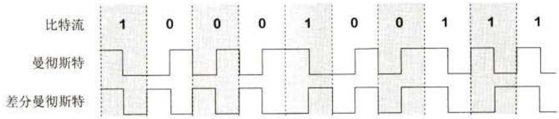
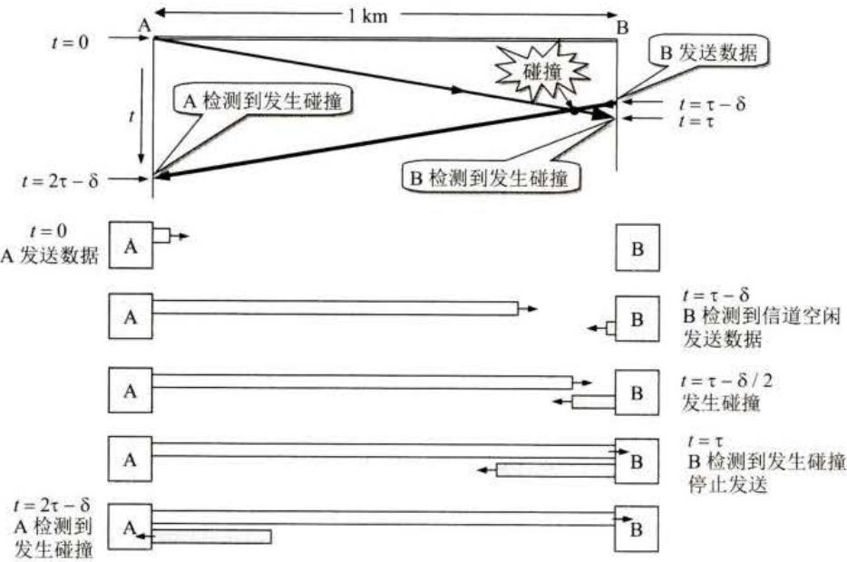
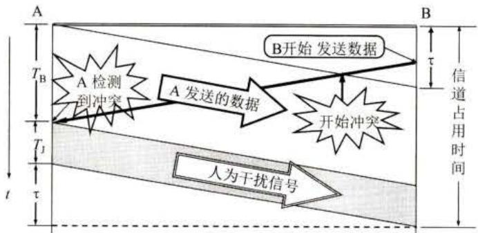

# 3.3.2 CSMA/CD协议

最早的以太网是将许多计算机都连接到一根总线上。当初认为这种连接方法既简单又可靠，因为在那个时代普遍认为：“有源器件不可靠，而无源的电缆线才是最可靠的”。

总线的特点是：当一台计算机发送数据时，总线上的所有计算机都能检测到这个数据。这种就是广播通信方式。但我们并不总是要在局域网上进行一对多的广播通信。为了在总线上实现一对一的通信，可以使每一台计算机的适配器都拥有一个与其他适配器都不同的地址。在发送数据帧时，在帧的首部写明接收站的地址。现在的电子技术可以很容易做到：仅当数据帧中的目的地址与适配器 ROM 中存放的硬件地址一致时，该适配器才能接收这个数据帧。适配器对不是发送给自己的数据帧就丢弃。这样，具有广播特性的总线上就实现了一对一的通信。

人们也常把局域网上的计算机称为“主机”“工作站”“站点”或“站”。在本书中，这几个名词都可以当成是同义词。

为了通信的简便，以太网采取了以下两种措施：

第一，采用较为灵活的无连接的工作方式，即不必先建立连接就可以直接发送数据。适配器对发送的数据帧不进行编号，也不要求对方发回确认。这样做可以使以太网工作起来非常简单，而局域网信道的质量很好，因通信质量不好产生差错的概率是很小的。因此，以太网提供的服务是尽最大努力的交付，即不可靠的交付。当目的站收到有差错的数据帧时（例如，用CRC查出有差错），就把帧丢弃，其他什么也不做。对有差错帧是否需要重传则由高层来决定。例如，如果高层使用TCP协议，那么TCP就会发现丢失了一些数据。于是经过一定的时间后，TCP就把这些数据重新传递给以太网进行重传。但以太网并不知道这是重传帧，而是当作新的数据帧来发送。

我们知道，总线上只要有一台计算机在发送数据，总线的传输资源就被占用。因此，在同一时间只能允许一台计算机发送数据，否则各计算机之间就会互相干扰，使得所发送数据被破坏。因此，如何协调总线上各计算机的工作就是以太网要解决的一个重要问题。以太网采用最简单的随机接入，但有很好的协议用来减少冲突发生的概率。这好比有一屋子的人在开讨论会，没有会议主持人控制发言。想发言的随时可发言，不需要举手示意。但我们还必须有个协议来协调大家的发言。这就是：如果你听见有人在发言，那么你就必须等别人讲完了才能发言（否则就干扰了别人的发言）。但有时碰巧两个或更多的人同时发言了，那么一旦发现冲突，大家都必须立即停止发言，等听到没有人发言了你再发言。以太网采用的协调方法和上面的办法非常像，它使用的协议是 CSMA/CD，意思是载波监听多点接入/碰撞检测(Carrier Sense Multiple Access with Collision Detection)。

第二，以太网发送的数据都使用曼彻斯特(Manchester)编码的信号。我们在第2章的2.2.2节中已经简单地介绍过曼彻斯特编码了。我们知道，二进制基带数字信号通常就是高、低电压交替出现的信号。使用这种信号的最大问题就是当出现一长串连续的1或连续的0时，接收端就无法从收到的比特流中提取位同步（即比特同步）信号。如图3-16所示，曼彻斯特编码的编码方法是把每一个码元再分成两个相等的间隔。码元1是前一个间隔为低电压而后一个间隔为高电压。码元0则正好相反，从高电压变到低电压（也可采用相反的约定，即1是“前高后低”而0是“前低后高”）。这样就保证了在每一个比特的正中间出现一次电压的转换，而接收端就利用这种电压的转换很方便地把位同步信号提取出来。但是从曼彻斯特编码的波形图也不难看出其缺点，这就是它所占的频带宽度比原始的基带信号增加了一倍（因为每秒传送的码元数加倍了）。

> 图 3-16 曼彻斯特编码（教材第 88 页）

下面介绍 CSMA/CD 协议的要点。

“多点接入”就是说明这是总线型网络，许多计算机以多点接入的方式连接在一根总线上。协议的实质是“载波监听”和“碰撞检测”。

“载波监听”也就是“边发送边监听”。这里必须指出，在通信领域，在大多数情况下，Carrier的标准译名是“载波”。但对于以太网，总线上根本没有什么“载波”。其实英语Carrier有多种意思，如“承运器”“传导管”或“运载工具”等。因此在以太网中，把Carrier译为“载体”或“媒体”可能更加准确些。考虑到“载波”这个译名已经在我国广泛流行了好几十年，本书也就继续使用这个不准确的译名。我们知道，载波监听就是不管在想要发送数据之前，还是在发送数据之中，每个站都必须不停地检测信道。在发送前检测信道，是为了避免冲突。如果检测出已经有其他站在发送，则本站就暂时不要发送数据。在发送中检测信道，是为了及时发现如果有其他站也在发送，就立即中断本站的发送。这就称为碰撞检测。

“碰撞检测”是适配器边发送数据边检测信道上的信号电压的变化情况。当两个或几个站同时在总线上发送数据时，总线上的信号电压变化幅度将会增大（互相叠加）。当适配器检测到的信号电压变化幅度超过一定的门限值时，就认为总线上至少有两个站同时在发送数据，表明产生了碰撞。所谓“碰撞”就是发生了冲突。因此“碰撞检测”也称为“冲突检测”。这时，总线上传输的信号产生了严重的失真，无法从中恢复出有用的信息来。因此，任何一个正在发送数据的站，一旦发现总线上出现了碰撞，其适配器就要立即停止发送，免得继续进行无效的发送，白白浪费网络资源，然后等待一段随机时间后再次发送。

既然每一个站在发送数据之前已经监听到信道为“空闲”，那么为什么还会出现数据在总线上的碰撞呢？这是因为电磁波在总线上总是以有限的速率传播的。这和我们开讨论会时相似。一听见会场安静，我们就立即发言，但偶尔也会发生几个人同时抢着发言而产生冲突的情况。图3-17所示的例子可以说明这种情况。设图中的局域网两端的站A和B相距 $1\mathrm{km}$ ，用同轴电缆相连。电磁波在 $1\mathrm{km}$ 电缆的传播时延约为 $5\mu \mathrm{s}$ (这个数字应当记住)。因此，A向B发出的数据，在约 $5\mu \mathrm{s}$ 后才能传送到B。换言之，B若在A发送的数据到达B之前发送自己的帧（因为这时B的载波监听检测不到A所发送的信息），则必然要在某个时间和A发送的帧发生碰撞。碰撞的结果是两个帧都变得无用。在局域网的分析中，常把总线上的单程端到端传播时延记为 $\tau$ 。发送数据的站希望尽早知道是否发生了碰撞。那么，A发送数据后，最迟要经过多长时间才能知道自己发送的数据和其他站发送的数据有没有发生碰撞？从图3-17不难看出，这个时间最多是两倍的总线端到端的传播时延 $(2\tau)$ ，或总线的端到端往返传播时延。由于局域网上任意两个站之间的传播时延有长有短，因此局域网必须按最坏情况设计，即取总线两端的两个站之间的传播时延（这两个站之间的距离最大）为端到端传播时延。

> 图 3-17 传播时延对载波监听的影响（教材第 89 页）

显然，在使用 CSMA/CD 协议时，一个站不可能同时进行发送和接收（但必须边发送边监听信道）。因此使用 CSMA/CD 协议的以太网不可能进行全双工通信而只能进行双向交替通信（半双工通信）。

下面是图 3-17 中的一些重要的时刻。

在 t=0 时，A 发送数据。B 检测到信道为空闲。

在 $t = \tau - \delta$ 时（这里 $\tau > \delta > 0$ ），A 发送的数据还没有到达 B 时，由于 B 检测到信道是空闲的，因此 B 发送数据。

经过时间 $\delta/2$ 后，即在 $t=\tau-\delta/2$ 时，A 发送的数据和 B 发送的数据发生了碰撞，但这时 A 和 B 都不知道发生了碰撞。

在 $t=\tau$ 时，B 检测到发生了碰撞，于是停止发送数据。

在 $t=2\tau-\delta$ 时，A 也检测到发生了碰撞，因而也停止发送数据。

A 和 B 发送数据均失败，它们都要推迟一段时间再重新发送。

由此可见，每一个站在自己发送数据之后的一小段时间内，存在着遭遇碰撞的可能性。这一小段时间是不确定的，它取决于另一个发送数据的站到本站的距离。因此，以太网不能保证在检测到信道空闲后的某一时间内，一定能够把自己的数据帧成功地发送出去（因为存在产生碰撞的可能）。以太网的这一特点称为发送的不确定性。如果希望在以太网上发生碰撞的机会很小，必须使整个以太网的平均通信量远小于以太网的最高数据率。

从图 3-17 可看出，最先发送数据帧的 A 站，在发送数据帧后至多经过时间 $2\tau$ 就可知道所发送的数据帧是否遭受了碰撞。这就是 $\delta \rightarrow 0$ 的情况。因此以太网的端到端往返时间 $2\tau$ 称为争用期 (contention period)，它是一个很重要的参数。争用期又称为碰撞窗口 (collision window)。这是因为一个站在发送完数据后，只有通过争用期的“考验”，即经过争用期这段时间还没有检测到碰撞，才能肯定这次发送不会发生碰撞。这时，就可以放心把这一帧数据顺利发送完毕。

以太网使用截断二进制指数退避(truncated binary exponential backoff)算法来确定碰撞后重传的时机。截断二进制指数退避算法并不复杂。这种算法让发生碰撞的站在停止发送数据后，不是等待信道变为空闲后就立即再发送数据，而是退避一个随机的时间。这点很容易理解，因为几个发生碰撞的站将会同时检测到信道变成了空闲。如果大家都同时重传，必然接连发生碰撞。如果采用退避算法，生成了最小退避时间的站将最先获发送权。以后其余的站的退避时间到了，但发送数据之前监听到信道忙，就不会马上发送数据了。

为了尽可能减小重传时再次发生冲突的概率，退避算法有如下具体的规定：

(1) 基本退避时间为争用期 $2\tau$ ，具体的争用期时间是 $51.2 \mu s$ 。对于 $10 \mathrm{Mbit} / \mathrm{s}$ 以太网，在争用期内可发送 512 比特，即 64 字节。也可以说争用期是 512 比特时间。1 比特时间就是发送 1 比特所需的时间。所以这种时间单位与数据率密切相关。为了方便，也可以直接使用比特作为争用期的单位。争用期是 512 比特，即争用期是发送 512 比特所需的时间。

(2) 从离散的整数集合 $[0,1,\cdots,(2^{k}-1)]$ 中随机取出一个数，记为r。重传应推后的时间就是r倍的争用期。上面的参数k按下面的公式(3-1)计算：

$$ k = \mathrm{Min} [ \text { 重传次数 }, 1 0 ]\tag{3-1} $$

可见当重传次数不超过 10 时，参数 k 等于重传次数；但当重传次数超过 10 时，k 就不再增大而一直等于 10。

(3) 当重传达 16 次仍不能成功时（这表明同时打算发送数据的站太多，以致连续发生冲突），则丢弃该帧，并向高层报告。

例如，在第1次重传时，k=1，随机数r从整数 $\{0,1\}$ 中选一个数。因此重传的站可选择的重传推迟时间是0或 $2\tau$ ，在这两个时间中随机选择一个。

若再发生碰撞，则在第2次重传时，k=2，随机数r就从整数 $\{0,1,2,3\}$ 中选一个数。因此重传推迟的时间是在 $0,2\tau,4\tau$ 和 $6\tau$ 这4个时间中随机地选取一个。

同样，若再发生碰撞，则重传时 $k = 3$ ，随机数 $r$ 就从整数 $\{0,1,2,3,4,5,6,7\}$ 中选一个数。依此类推。

若连续多次发生冲突，就表明可能有较多的站参与争用信道。但使用上述退避算法可使重传需要推迟的平均时间随重传次数而增大（这也称为动态退避），因而减小发生碰撞的概率，有利于整个系统的稳定。

我们还应注意到，适配器每发送一个新的帧，就要执行一次 CSMA/CD 算法。适配器对过去发生过的碰撞并无记忆功能。因此，当好几个适配器正在执行指数退避算法时，很可能有某一个适配器发送的新帧能够碰巧立即成功地插入到信道中，得到了发送权，而已经推迟好几次发送的站，有可能很不巧，还要继续执行退避算法，继续等待。

现在考虑一种情况。某个站发送了一个很短的帧，但在发送完毕之前并没有检测出碰撞。假定这个帧在继续向前传播到达目的站之前和别的站发送的帧发生了碰撞，因而目的站将收到有差错的帧（当然会把它丢弃）。可是发送站却不知道这个帧发生了碰撞，因而不会重传这个帧。这种情况显然是我们所不希望的。为了避免发生这种情况，以太网规定了一个最短帧长64字节，即512比特。如果要发送的数据非常少，那么必须加入一些填充字节，使帧长不小于64字节。对于10 Mbit/s以太网，发送512比特的时间需要 $51.2\mu \mathrm{s}$ ，也就是上面提到的争用期。

由此可见，以太网在发送数据时，如果在争用期（共发送了 64 字节）没有发生碰撞，那么后续发送的数据就一定不会发生冲突。换句话说，如果发生碰撞，就一定是在发送的前 64 字节之内。由于一检测到冲突就立即中止发送，这时已经发送出去的数据一定小于 64 字节，因此凡长度小于 64 字节的帧都是由于冲突而异常中止的无效帧。只要收到了这种无效帧，就应当立即将其丢弃。

前面已经讲过，信号在以太网上传播 1 km 大约需要 5 μs。以太网上最大的端到端时延必须小于争用期的一半（即 25.6 μs），这相当于以太网的最大端到端长度约为 5 km。实际上的以太网覆盖范围远远没有这样大。因此，实用的以太网都能在争用期 51.2 μs 内检测到可能发生的碰撞。以太网的争用期确定为 51.2 μs，不仅考虑到以太网的端到端时延，而且还包括其他的许多因素，如存在的转发器所增加的时延，以及下面要讲到的强化碰撞的干扰信号的持续时间等。

下面介绍强化碰撞的概念。这就是当发送数据的站一旦发现发生了碰撞时，除立即停止发送数据外，还要再继续发送32比特或48比特的人为干扰信号(jamming signal)，以便让所有用户都知道现在已经发生了碰撞（如图3-18所示）。对于10 Mbit/s以太网，发送32（或48）比特只需要3.2（或4.8）μs。

> 图 3-18 人为干扰信号的加入（教材第 91 页）

从图 3-18 可以看出，A 站从发送数据开始到发现碰撞并停止发送的时间间隔是 $T_{B}$ 。A 站得知碰撞已经发生时所发送的强化碰撞的干扰信号的持续时间是 $T_{J}$ 。图中的 B 站在得知发生碰撞后，也要发送人为干扰信号，但为简单起见，图 3-18 没有画出 B 站所发送的人为干扰信号。发生碰撞使 A 浪费时间 $T_{B} + T_{J}$ 。可是整个信道被占用的时间还要增加一个单程端到端的传播时延 $\tau$ 。因此总线被占用的时间是 $T_{B} + T_{J} + \tau$ 。

以太网还规定了帧间最小间隔为 $9.6 \mu s$ ，相当于 96 比特时间。这样做是为了使刚刚收到数据帧的站的接收缓存来得及清理，做好接收下一帧的准备。

根据以上所讨论的，可以把 CSMA/CD 协议的要点归纳如下：

(1) 准备发送：适配器从网络层获得一个分组，加上以太网的首部和尾部（见后面的3.4.3节），组成以太网帧，放入适配器的缓存中。但在发送之前，必须先检测信道。

(2) 检测信道：若检测到信道忙，则继续不停地检测，一直等待信道转为空闲。此时若在 96 比特时间内信道保持空闲（保证了帧间最小间隔），就发送这个帧。

(3) 在发送过程中仍不停地检测信道，即网络适配器要边发送边监听。这里只有两种可能性：

①发送成功：如果在争用期内一直未检测到碰撞，就认为发送成功（如果接收方收到了有差错的帧，就丢弃它，后续的工作由高层来处理）。发送完毕后，其他什么也不做。然后回到(1)。

②发送失败：在争用期内检测到碰撞。这时立即停止发送数据，并按规定发送人为干扰信号。适配器接着就执行指数退避算法，等待 r 倍 512 比特时间后，返回到步骤(2)，继续检测信道。但若重传达 16 次仍不能成功，则停止重传而向上报错。

以太网每发送完一帧，一定要把已发送的帧暂时保留一下。如果在争用期内检测出发生了碰撞，那么还要在推迟一段时间后再把这个暂时保留的帧重传一次。
