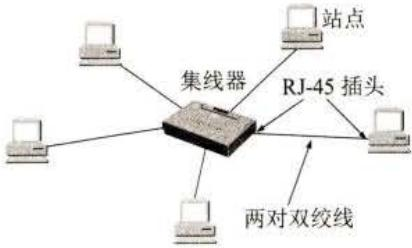
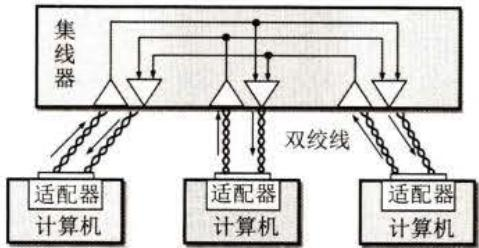

# 3.3.3 使用集线器的星形拓扑

传统以太网最初使用粗同轴电缆，后来演进到使用比较便宜的细同轴电缆，最后发展为使用更便宜和更灵活的双绞线。这种以太网采用星形拓扑，在星形的中心则增加了一种可靠性非常高的设备，叫作集线器(hub)，如图3-19所示。双绞线以太网总是和集线器配合使用的。每个站需要用两对无屏蔽双绞线（放在一根电缆内），分别用于发送和接收。双绞线的两端使用RJ-45插头。由于集线器使用了大规模集成电路芯片，因此集线器的可靠性就大大提高了。1990年IEEE制定出星形以太网10BASE-T的标准802.3i。“10”代表10 Mbit/s的数据率，BASE表示连接线上的信号是基带信号，T代表双绞线。实践证明，这比使用具有大量机械接头的无源电缆要可靠得多。由于使用双绞线电缆的以太网价格便宜和使用方便，因此粗缆和细缆以太网现在都已成为历史，并已从市场上消失了。

> 图 3-19 使用集线器的双绞线以太网（教材第 92 页）

但 10BASE-T 以太网的通信距离稍短，每个站到集线器的距离不超过 100 m。这种性价比很高的 10BASE-T 双绞线以太网的出现，是局域网发展史上的一个非常重要的里程碑，从此以太网的拓扑就从总线型变为更加方便的星形网络，而以太网也就在局域网中占据了统治地位。

使双绞线能够传送高速数据的主要措施是把双绞线的绞合度做得非常精确。这样不仅可使特性阻抗均匀以减少失真，而且大大减少了电磁波辐射和无线电频率的干扰。在多对双绞线的电缆中，还要使用更加复杂的绞合方法。

集线器的一些特点如下：

(1) 从表面上看, 使用集线器的局域网在物理上是一个星形网, 但由于集线器使用电子器件来模拟实际电缆线的工作, 因此整个系统仍像一个传统以太网那样运行。也就是说, 使用集线器的以太网在逻辑上仍是一个总线网, 各站共享逻辑上的总线, 使用的还是 CSMA/CD 协议 (更具体些说, 是各站中的适配器执行 CSMA/CD 协议)。网络中的各站必须竞争对传输媒体的控制, 并且在同一时刻至多只允许一个站发送数据。

(2) 一个集线器有许多端口 $^{①}$ ，例如，8 至 16 个，每个端口通过 RJ-45 插头（与电话机使用的插头 RJ-11 相似，但略大一些）用两对双绞线与一台计算机上的适配器相连（这种插座可连接 4 对双绞线，实际上只用 2 对，即发送和接收各使用一对双绞线）。因此，一个集线器很像一个多端口的转发器。

(3) 集线器工作在物理层，它的每个端口仅仅简单地转发比特——收到 1 就转发 1，收到 0 就转发 0，不进行碰撞检测。若两个端口同时有信号输入（即发生碰撞），那么所有的端口都将收不到正确的帧。图 3-20 是具有三个端口的集线器的示意图。

> 图 3-20 具有三个端口的集线器（教材第 93 页）

(4) 集线器采用了专门的芯片，进行自适应串音回波抵消。这样就可使端口转发出去的较强信号不致对该端口接收到的较弱信号产生干扰（这种干扰即近端串音）。每个比特在转发之前还要进行再生整形并重新定时。

集线器本身必须非常可靠。现在的堆叠式(stackable)集线器由 4\~8 个集线器堆叠起来使用。集线器一般都有少量的容错能力和网络管理功能。例如，假定在以太网中有一个适配器出了故障，不停地发送以太网帧。这时，集线器可以检测到这个问题，在内部断开与出故障的适配器的连线，使整个以太网仍然能够正常工作。模块化的机箱式智能集线器有很高的可靠性。它全部的网络功能都以模块方式实现。各模块均可进行热插拔，出故障时不断电即可更换或增加新模块。集线器上的指示灯还可显示网络上的故障情况，给网络的管理带来了很大的方便。

IEEE 802.3 标准还可使用光纤作为传输媒体，相应的标准是 10BASE-F 系列，F 代表光

> ① 注：集线器的端口(port)就是集线器和外接计算机的一个硬件接口(interface)。在运输层要经常使用软件端口(port)，它和集线器的硬件端口是两个不同的概念。本书以前曾把集线器的硬件端口称为接口，是为了避免和运输层的端口弄混。考虑到大多数文献使用的是 port，因此现在改用译名“端口”。
