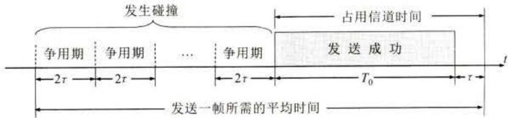

# 3.3.4 以太网的信道利用率

下面我们讨论一下以太网的信道利用率。

假定一个 10 Mbit/s 以太网同时有 10 个站在工作，那么每一个站所能发送数据的平均速率似乎应当是总数据率的 1/10（即 1Mbit/s）。其实不然，

因为多个站在以太网上同时工作就可能会发生碰撞。当发生碰撞时，信道资源实际上是被浪费了。因此，当扣除碰撞所造成的信道损失后，以太网总的信道利用率并不能达到100%。

图 3-21 的例子是以太网的信道被占用的情况。一个站在发送帧时出现了碰撞。经过一个争用期 $2\tau$ 后（ $\tau$ 是以太网单程端到端传播时延），可能又出现了碰撞。这样经过若干个争用期后，一个站就发送成功了。假定发送帧需要的时间是 $T_{0}$ 。它等于帧长(bit)除以发送速率（10 Mbit/s）。

> 图 3-21 以太网的信道被占用的情况（教材第 94 页）

我们应当注意到，成功发送一个帧需要占用信道的时间是 $T_{0} + \tau$ ，比这个帧的发送时间要多一个单程端到端时延 $\tau$ 。这是因为当一个站发送完最后一个比特时，这个比特还要在以太网上传播。在最极端的情况下，发送站在传输媒体的一端，而比特在媒体上传输到另一端所需的时间是 $\tau$ 。因此，必须在经过时间 $T_{0} + \tau$ 后以太网的媒体才完全进入空闲状态，才能允许其他站发送数据。

从图 3-21 可看出，要提高以太网的信道利用率，就必须减小 $\tau$ 与 $T_{0}$ 之比。在以太网中定义了参数 a，它是以太网单程端到端时延 $\tau$ 与帧的发送时间 $T_{0}$ 之比：

$$ a = \frac {\tau}{T _ {0}}\tag{3-2} $$

当 $a \rightarrow 0$ 时，表示只要一发生碰撞，就立即可以检测出来，并立即停止发送，因而信道资源被浪费的时间非常非常少。反之，参数 a 越大，表明争用期所占的比例越大，这就使得每发生一次碰撞就浪费了不少的信道资源，使得信道利用率明显降低。因此，以太网的参数 a 的值应当尽可能小些。从(3-2)式可看出，这就要求(3-2)式分子 $\tau$ 的数值要小些，而分母 $T_{0}$ 的数值要大些。这就是说，当数据率一定时，以太网的连线的长度受到限制（否则 $\tau$ 的数值会太大），同时以太网的帧长不能太短（否则 $T_{0}$ 的值会太小，使 a 值太大）。

现在考虑一种理想化的情况。假定以太网上的各站发送数据都不会产生碰撞（这显然已经不是 CSMA/CD，而是需要使用一种特殊的调度方法），并且能够非常有效地利用网络的传输资源，即总线一旦空闲就有某一个站立即发送数据。这样，发送一帧占用线路的时间是 $T_{0} + \tau$ ，而帧本身的发送时间是 $T_{0}$ 。于是我们可计算出极限信道利用率 $S_{max}$ 为：

$$ S _ {\max} = \frac {T _ {0}}{T _ {0} + \tau} = \frac {1}{1 + a}\tag{3-3} $$

(3-3)式的意义是：虽然实际的以太网不可能有这样高的极限信道利用率，但(3-3)式指出了只有当参数 $a$ 远小于1才能得到尽可能高的极限信道利用率。反之，若参数 $a$ 远大于1（即每发生一次碰撞，就要浪费相对较多的传输数据的时间），则极限信道利用率就远小于1，而这时实际的信道利用率就更小了。据统计，当以太网的利用率达到 $30\%$ 时就已经处于重载的情况。很多的网络容量被网上的碰撞消耗掉了。
