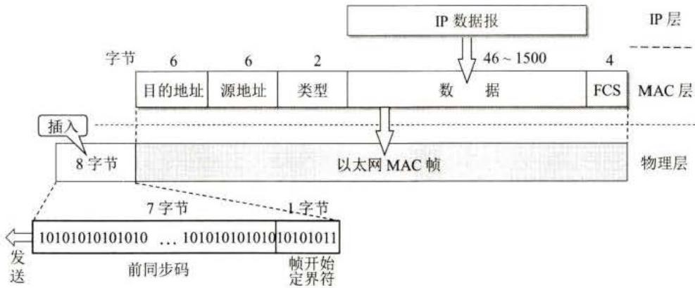

# 3.3.5 以太网的MAC层

## 1. MAC 层的硬件地址

在局域网中，硬件地址又称为物理地址或 MAC 地址（因为这种地址用在 MAC 帧中）。

大家知道，在所有计算机系统的设计中，标识系统(identification system) $^{①}$ 都是一个核心问题。在标识系统中，地址就是识别某个系统的一个非常重要的标识符。在讨论地址问题时，很多人常常引用著名文献[SHOC78]给出的如下定义：

“名字指出我们所要寻找的那个资源，地址指出那个资源在何处，路由告诉我们如何到达该处。”

这个非形式的定义固然很简单，但有时却不够准确。严格地讲，名字应当与系统的所在地无关。这就像我们每一个人的名字一样，不随我们所处的地点而改变。为此 IEEE 802 标准为局域网规定了一种 48 位的全球地址（一般都简称为“地址”），这就是局域网上的每一台计算机中固化在适配器的 ROM 中的地址。因此，请特别注意下面两点：

(1) 假定连接在局域网上的一台计算机的适配器坏了而我们更换了一个新的适配器，那么这台计算机的局域网的“地址”也就改变了，虽然这台计算机的地理位置一点也没有变化，所接入的局域网也没有任何改变。

(2) 假定我们把位于南京的某局域网上的一台笔记本电脑携带到北京，并连接在北京的某局域网上。虽然这台电脑的地理位置改变了，但只要电脑中的适配器不变，那么该电脑在北京的局域网中的“地址”仍然和它在南京的局域网中的“地址”一样。

由此可见，局域网上的某台主机的“地址”并不指明这台主机位于什么地方。因此，严格地讲，局域网的“地址”应当是每一个站的“名字”或标识符[PERL00]。不过，计算机的名字通常都是比较适合人记忆的不太长的字符串，而这种48位二进制的“地址”却很不像一般计算机的名字。但现在人们还是习惯于把这种48位的“名字”称为“地址”。本书也采用这种习惯用法，尽管这种说法并不严格。

请注意，如果连接在局域网上的主机或路由器安装有多个适配器，那么这样的主机或路由器就有多个“地址”。实际上，这种48位“地址”应当是某个接口的标识符。

> ① 注：名词 identification 原来的标准译名是“标识”[MINGCI94]。2004 年出版的《现代汉语规范词典》给出“标识”的读音是“biaozhi（读音是“志”），并且说明：现在规范词形写作“标志”。现在教育部国家语言文字工作委员会发布“第一批异形词整理表”规定今后不再使用“标识”而应当用“标志”。但[MINGCI94]又将 flag 译为“标志”。这样，若 identification 和 flag 均译为“标志”就会引起混乱。因此，本书采取这样的做法：作为动词用时，我们使用“标志”，但作为名词使用时，我们用“标识”(identification)和“标志”(flag)。请读者注意。

在制定局域网的地址标准时，首先遇到的问题就是应当用多少位来表示一个网络的地址字段。为了减少不必要的开销，地址字段的长度应当尽可能地短些。起初人们觉得用两个字节（共16位）表示地址就够了，因为这一共可表示6万多个地址。但是，由于局域网的迅速发展，而处在不同地点的局域网之间又经常需要交换信息，这就希望在各地的局域网中的站具有互不相同的物理地址。为了使用户在买到适配器并把机器连到局域网后马上就能工作，而不需要等待网络管理员给他先分配一个地址，IEEE 802标准规定MAC地址字段可采用6字节（48位）或2字节（16位）这两种中的一种。6字节地址字段对局部范围内使用的局域网的确是太长了，但是由于6字节的地址字段可使全世界所有的局域网适配器都具有不相同的地址，因此现在的局域网适配器实际上使用的都是6字节MAC地址。

现在 IEEE 的注册管理机构 RA (Registration Authority) 是局域网全球地址的法定管理机构 [W-IEEERA]，它负责分配地址字段的 6 个字节中的前三个字节（即高位 24 位）。世界上凡要生产局域网适配器的厂家都必须向 IEEE 购买由这三个字节构成的这个号（即地址块），这个号的正式名称是组织唯一标识符 OUI (Organizationally Unique Identifier)，通常也叫作公司标识符 (company\_id) [RFC 7042]。但应注意，24 位的 OUI 不能够单独用来标志一个公司，因为一个公司可能购买了几个 OUI，也可能有几个小公司合起来购买一个 OUI。例如，华为公司购买了多个 OUI，其中的一个是 A8-E5-44 $^{①}$ 。地址字段中的后三个字节（即低位 24 位）则是由厂家自行指派，称为扩展标识符 (extended identifier)，只要保证生产出的适配器没有重复地址即可。可见购买了一个 OUI，就可以生成出 2 $^{24}$ 个不同的 6 字节（48 位）MAC 地址，这种地址又称为 EUI-48，这里 EUI 表示扩展的唯一标识符 (Extended Unique Identifier)。EUI-48 的使用范围并不局限于局域网的硬件地址，而是可以用于软件接口。在生产适配器时，这种 6 字节的 MAC 地址已被固化在适配器的 ROM 中。因此，MAC 地址也叫作硬件地址 (hardware address) 或物理地址 $^{②}$ 。可见 “MAC 地址” 实际上就是适配器地址或适配器标识符 EUI-48。当这种适配器嵌入到某台计算机（或手机）后，适配器上的标识符 EUI-48 就成为这台计算机（或手机）的 MAC 地址了。

IEEE 规定地址字段的第一字节的最低有效位为 I/G 位。I/G 表示 Individual/Group。当 I/G 位为 0 时，地址字段表示一个单个站地址。当 I/G 位为 1 时表示组地址，用来进行多播（以前曾译为组播）。需要指出，有的书把上述最低有效位写为“第一位”，但“第一”的定义是含糊不清的。这是因为在地址记法中有两种标准：第一种记法是把每一字节的最低位（即最低有效位）写在最左边（第一位）。IEEE 802.3 标准就采用这种记法。例如，十进制数 11 的二进制表示是 1011，最高位写在最左边。但若使用 IEEE 802.3 标准的记法，就应当记为 1101，把最低位写在最左边。当我们阅读 802.3 标准的有关文档时，需要特别注意。第二种记法是把每一字节的最高位（即最高有效位）写在最左边（这也叫第一位）。在发送数据时，两种记法都是按照字节的顺序发送，但每一个字节中先发送哪一位则不同：第一种记法先发送最低位，但第二种记法则先发送最高位。

> ① 注：这里的 A8-E5-44 是十六进制数字在局域网地址中的一种标准记法。每 4 个二进制数字用一个十六进制数字表示，而每两个十六进制数字与它后面的两个十六进制数字之间用连字符隔开。另一种记法是在 0x 后面写上一连串的十六进制数字，如 0xA8E544。

> ② 注：地址有平面地址(flat address)和层次地址(hierarchical address)两大类。平面地址也叫作非层次地址，就是在分配地址时按顺序号一个个地挨着分配。层次地址是将整个地址再划分为几个部分，而每部分按一定的规律分配号码。像我们的电话号码就是一种层次号码，电信网中的交换机按照国家号→区号→局号→用户号的顺序可以准确地找到用户的电话。但局域网的6字节的地址是一种平面地址。适配器根据全部的48位地址决定接收或丢弃所收到的MAC帧。

IEEE 还考虑到可能有人并不愿意向 IEEE 的 RA 购买 OUI。为此，IEEE 把地址字段第一字节的最低第二位规定为 G/L 位，表示 Global/Local。当 G/L 位为 0 时是全球管理（保证在全球没有相同的地址），厂商向 IEEE 购买的 OUI 都属于全球管理。当地址字段的 G/L 位为 1 时是本地管理，这时用户可任意分配网络上的地址。采用 2 字节地址字段时全都是本地管理。但应当指出，以太网几乎不理会这个 G/L 位。

这样，在全球管理时，对每一个站的地址可用 46 位的二进制数字来表示（最低位和最低第二位均为 0 时）。剩下的 46 位组成的地址空间可以有 $2^{46}$ 个地址，已经超过 70 万亿个，可保证世界上的每一个适配器都可有一个唯一的地址。当然，非无限大的地址空间总有用完的时候。但据测算，至少在近期还不需要考虑 MAC 地址耗尽的问题。

当路由器通过适配器连接到局域网时，适配器上的硬件地址就用来标志路由器的某个接口。路由器如果同时连接到两个网络上，那么它就需要两个适配器和两个硬件地址。

我们知道适配器有过滤功能。当适配器从网络上每收到一个 MAC 帧就先用硬件检查 MAC 帧中的目的地址。如果是发往本站的帧则收下，然后再进行其他的处理。否则就将此帧丢弃，不再进行其他的处理。这样做就不浪费主机的处理机和内存资源了。这里“发往本站的帧”包括以下三种帧：

(1) 单播(unicast)帧（一对一），即收到的帧的 MAC 地址与本站的 MAC 地址相同。

(2) 广播(broadcast)帧（一对全体），即发送给本局域网上所有站点的帧（全1地址）。

(3) 多播(multicast)帧（一对多），即发送给本局域网上一部分站点的帧。

所有的适配器都至少应当能够识别前两种帧，即能够识别单播和广播地址。有的适配器可用编程方法识别多播地址。当操作系统启动时，它就把适配器初始化，使适配器能够识别某些多播地址。显然，只有目的地址才能使用广播地址和多播地址。

以太网适配器还可设置为一种特殊的工作方式，即混杂方式(promiscuous mode)。工作在混杂方式的适配器只要“听到”有帧在以太网上传输就都悄悄地接收下来，而不管这些帧发往哪个站。请注意，这样做实际上是“窃听”其他站点的通信而并不中断其他站点的通信。网络上的黑客(hacker 或 cracker)常利用这种方法非法获取网上用户的口令。因此，以太网上的用户不愿意网络上有工作在混杂方式的适配器。

但混杂方式有时却非常有用。例如，网络维护和管理人员需要用这种方式来监视和分析以太网上的流量，以便找出提高网络性能的具体措施。有一种很有用的网络工具叫作嗅探器(Sniffer)就使用了设置为混杂方式的网络适配器。此外，这种嗅探器还可帮助学习网络的人员更好地理解各种网络协议的工作原理。因此，混杂方式就像一把双刃剑，是利是弊要看你怎样使用它。

## 2. MAC 帧的格式

常用的以太网 MAC 帧格式有两种标准，一种是 DIX Ethernet V2 标准（即以太网 V2 标准），另一种是 IEEE 的 802.3 标准。这里只介绍使用得最多的以太网 V2 的 MAC 帧格式（如图 3-22 所示）。图中假定网络层使用的是 IP 协议。实际上使用其他的协议也是可以的。

> 图 3-22 以太网 V2 的 MAC 帧格式（教材第 98 页）

以太网 V2 的 MAC 帧较为简单，由五个字段组成。前两个字段分别为 6 字节长的目的地址和源地址字段。第三个字段是 2 字节的类型字段，用来标志上一层使用的是什么协议，以便把收到的 MAC 帧的数据上交给上一层的这个协议。例如，当类型字段的值是 0x0800 时，就表示上层使用的是 IP 数据报。第四个字段是数据字段，其长度在 46 到 1500 字节之间（46 字节是这样得出的：最小长度 64 字节减去 18 字节的首部和尾部就得出数据字段的最小长度）。最后一个字段是 4 字节的帧检验序列 FCS（使用 CRC 检验）。当传输媒体的误码率为 $1 \times 10^{-8}$ 时，MAC 子层可使未检测到的差错小于 $1 \times 10^{-14}$ 。FCS 检验的范围就是整个的 MAC 帧，从目的地址开始到 FCS 为止的这五个字段，但不包括物理层插入的 8 字节的前同步码和帧开始定界符。

这里我们要指出，在以太网 V2 的 MAC 帧格式中，其首部并没有一个帧长度（或数据长度）字段。那么，MAC 子层又怎样知道从接收到的以太网帧中取出多少字节的数据交付上一层协议呢？我们在前面讲述图 3-16 的曼彻斯特编码时已经讲过，这种曼彻斯特编码的一个重要特点就是：在曼彻斯特编码的每一个码元（不管码元是 1 或 0）的正中间一定有一次电压的转换（从高到低或从低到高）。当发送方把一个以太网帧发送完毕后，就不再发送其他码元了（既不发送 1，也不发送 0）。因此，发送方网络适配器的接口上的电压也就不再变化了。这样，接收方就可以很容易地找到以太网帧的结束位置。在这个位置往前数 4 字节（FCS 字段长度是 4 字节），就能确定数据字段的结束位置。

当数据字段的长度小于 46 字节时，MAC 子层就会在数据字段的后面加入一个整数字节的填充字段，以保证以太网的 MAC 帧长不小于 64 字节。我们应当注意到，MAC 帧的首部并没有指出在数据字段中是否有填充字段。接收端的 MAC 子层在剥去 MAC 帧的首部和尾部后，就把剩下的部分交给上面的 IP 层。那么 IP 层怎样知道这里有没有填充字段呢？大家知道，IP 协议的首部有一个 “总长度” 字段。如果 IP 数据报的 “总长度” 超过或等于 46 字节，那么肯定就没有填充字段。反之，如果 “总长度” 小于 46 字节，那么就很容易把填充字段计算出。例如，若 IP 数据报的总长度为 42 字节，填充字段就应当是 4 字节。当 MAC 帧把 46 字节的数据上交给 IP 层后，IP 层就把其中最后 4 字节的填充字段丢弃。

从图 3-22 可看出，在传输媒体上实际传送的要比 MAC 帧还多 8 个字节。这是因为当一个站在刚开始接收 MAC 帧时，由于适配器的时钟尚未与到达的比特流达成同步，因此 MAC 帧的最前面的若干位就无法接收，结果使整个的 MAC 成为无用的帧。为了接收端迅速实现位同步，从 MAC 子层向下传到物理层时还要在帧的前面插入 8 个字节（由硬件生成)，它由两个字段构成。第一个字段是7个字节的前同步码（1和0交替码），它的作用是使接收端的适配器在接收MAC帧时能够迅速调整其时钟频率，使它和发送端的时钟同步，也就是“实现位同步”（位同步就是比特同步的意思）。第二个字段是帧开始定界符，定义为10101011。它的前六位的作用和前同步码一样，最后的两个连续的1就是告诉接收端适配器：“MAC帧的信息马上就要来了，请适配器注意接收。”MAC帧的FCS字段的检验范围不包括前同步码和帧开始定界符。顺便指出，在使用SONET/SDH进行同步传输时则不需要用前同步码，因为在同步传输时收发双方的位同步总是一直保持着的。

还需注意，在以太网上传送数据时是以帧为单位传送的。以太网在传送帧时，各帧之间还必须有一定的间隙。因此，接收端只要找到帧开始定界符，其后面的连续到达的比特流就都属于同一个 MAC 帧。可见以太网不需要使用帧结束定界符，也不需要使用字节插入来保证透明传输。

IEEE 802.3 标准规定凡出现下列情况之一的即为无效的 MAC 帧:

(1) 帧的长度不是整数个字节；

(2) 用收到的帧检验序列 FCS 查出有差错;

(3) 收到的帧的 MAC 客户数据字段的长度不在 46～1500 字节之间。考虑到 MAC 帧首部和尾部的长度共有 18 字节，可以得出有效的 MAC 帧长度为 64～1518 字节之间。

对于检查出的无效 MAC 帧就简单地丢弃。以太网不负责重传丢弃的帧。

最后要提一下，IEEE 802.3 标准规定的 MAC 帧格式与上面所讲的以太网 V2 MAC 帧格式的区别就是以下三点。

第一，IEEE 802.3 规定的 MAC 帧的第三个字段是 “长度/类型”。由于以太网有效帧的最大长度是 1518 字节。因此当这个字段值大于 0x0600 时（相当于十进制的 1536），这个字段就表示 “类型”。这样的帧格式就和以太网 V2 MAC 帧格式完全一样。只有当这个字段值小于 0x0600 时才表示 “长度”，即 MAC 帧的数据部分长度。显然，在这种情况下，若数据字段的长度与实际的长度字段的值不一致，则该帧为无效的 MAC 帧。实际上，前面我们已经讲过，由于以太网采用了曼彻斯特编码，长度字段本来并无实际意义。

第二，当 “长度/类型” 字段值小于 0x0600 时，数据字段必须装入上面的逻辑链路控制 LLC 子层的 LLC 帧。

第三，在 802.3 标准的文档中，MAC 帧的帧格式包括了 8 字节的前同步码和帧开始定界符。有些教科书也是这样引用的。不过这并不影响我们对以太网工作原理的理解。

由于现在广泛使用的局域网只有以太网，因此 LLC 帧已经失去了原来的意义（见本章 3.3.1 节第 1 小节 “以太网的两个主要标准”）。现在市场上流行的都是以太网 V2 的 MAC 帧，但大家也常常把它称为 IEEE 802.3 标准的 MAC 帧。
