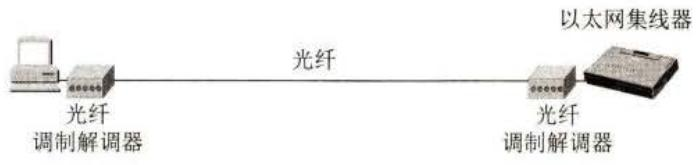
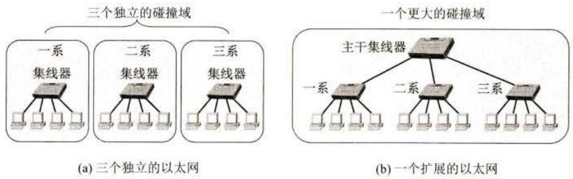

# 3.4.1 在物理层扩展以太网

## 3.4 扩展的以太网

在许多情况下，我们希望把以太网的覆盖范围扩展。本节先讨论在物理层把以太网扩

展，然后讨论在数据链路层把以太网扩展。这种扩展的以太网在网络层看来仍然是一个网络。

以太网上的主机之间的距离不能太远（例如，10BASE-T 以太网的两台主机之间的距离不超过 200 m)，否则主机发送的信号经过铜线的传输就会衰减到使 CSMA/CD 协议无法正常工作。在过去广泛使用粗缆或细缆以太网时，常使用工作在物理层的转发器来扩展以太网的地理覆盖范围。那时，两个网段可用一个转发器连接起来。IEEE 802.3 标准还规定，任意两个站之间最多可以经过三个电缆网段。但随着双绞线以太网成为以太网的主流类型，扩展以太网的覆盖范围已很少使用转发器了。

现在，扩展主机和集线器之间的距离的一种简单方法就是使用光纤（通常是一对光纤）和一对光纤调制解调器，如图 3-23 所示。

> 图 3-23 主机使用光纤和一对光纤调制解调器连接到集线器（教材第 100 页）

光纤调制解调器的作用就是进行电信号和光信号的转换。由于光纤带来的时延很小，并且带宽很宽，因此使用这种方法可以很容易地使主机和几公里以外的集线器相连接。

如果使用多个集线器，就可以连接成覆盖更大范围的多级星形结构的以太网。例如，一个学院的三个系各有一个 10BASE-T 以太网（如图 3-24(a) 所示），可通过一个主干集线器把各系的以太网连接起来，成为一个更大的以太网（如图 3-24(b) 所示）。

> 图 3-24 用多个集线器连成更大的以太网（教材第 100 页）

这样做可以有以下两个好处。第一，使这个学院不同系的以太网上的计算机能够进行跨系的通信。第二，扩大了以太网覆盖的地理范围。例如，在一个系的10BASE-T以太网中，主机与集线器的最大距离是 $100\mathrm{m}$ ，因而两台主机之间的最大距离是 $200\mathrm{m}$ 。但在通过主干集线器相连接后，不同系的主机之间的距离就可扩展了，因为集线器之间的距离可以是 $100\mathrm{m}$ （使用双绞线）或更远（如使用光纤）。

但这种多级结构的集线器以太网也带来了一些缺点。

(1) 如图 3-24(a) 所示的例子，在三个系的以太网互连起来之前，每一个系的 10BASE-T 以太网是一个独立的碰撞域 (collision domain, 又称为冲突域)，即在任一时刻，在每一个碰撞域中只能有一个站在发送数据。每一个系的以太网的最大吞吐量是 10 Mbit/s，因此三个系总的最大吞吐量是 30 Mbit/s。在三个系的以太网通过集线器互连起来后就把三个碰撞域变成一个碰撞域（范围扩大到三个系），如图 3-24(b) 所示，而这时的最大吞吐量仍然是一个系的吞吐量 10 Mbit/s。这就是说，当某个系的两个站在通信时所传送的数据会通过所有的集线器进行转发，使得其他系的内部在这时都不能通信（一发送数据就会碰撞）。

(2) 如果不同的系使用不同的以太网技术（如数据率不同），那么就不可能用集线器将它们互连起来。如果在图 3-24 中，一个系使用 10 Mbit/s 的适配器，而另外两个系使用 10/100 Mbit/s 的适配器，那么用集线器连接起来后，大家都只能工作在 10 Mbit/s 的速率。集线器基本上是个多端口（也称为接口）的转发器，它并不能把帧进行缓存。
