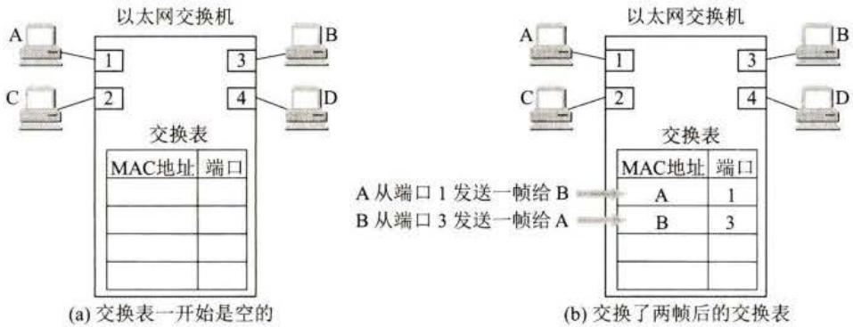
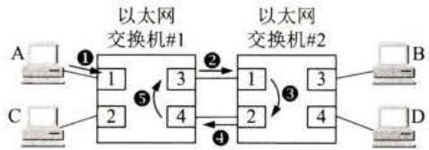

# 3.4.2 在数据链路层扩展以太网

扩展以太网更常用的方法是在数据链路层进行的。最初人们使用的是网桥(bridge)。网桥对收到的帧根据其 MAC 帧的目的地址进行转发和过滤。当网桥收到一个帧时，并不是向所有的端口转发此帧，而是根据此帧的目

的 MAC 地址，查找网桥中的地址表，然后确定将该帧转发到哪一个端口，或者是把它丢弃（即过滤）。

1990 年问世的交换式集线器(switching hub)，很快就淘汰了网桥。交换式集线器常称为以太网交换机(switch)或第二层交换机(L2 switch)，强调这种交换机工作在数据链路层。

“交换机”并无准确的定义和明确的概念。著名网络专家 Perlman 认为：“交换机”应当是一个市场名词，而交换机的出现的确使数据的转发更加快速了[PERL00]。本书也使用这个广泛被接受的名词——以太网交换机。下面简单地介绍以太网交换机的特点。

## 1. 以太网交换机的特点

以太网交换机实质上就是一个多端口的网桥，通常都有十几个或更多的端口，和工作在物理层的转发器、集线器有很大的差别。以太网交换机的每个端口都直接与一个单台主机或另一个以太网交换机相连，并且一般都工作在全双工方式。以太网交换机还具有并行性，即能同时连通多对端口，使多对主机能同时通信（而网桥只能一次分析和转发一个帧）。相互通信的主机都独占传输媒体，无碰撞地传输数据。换句话说，每一个端口和连接到端口的主机构成了一个碰撞域，具有 N 个端口的以太网交换机的碰撞域共有 N 个。

以太网交换机的端口还有存储器，能在输出端口繁忙时把到来的帧进行缓存。因此，如果连接在以太网交换机上的两台主机，同时向另一台主机发送帧，那么当这台主机的端口繁忙时，发送帧的这两台主机的端口会把收到的帧暂存一下，以后再发送出去。

以太网交换机是一种即插即用设备，其内部的帧交换表（又称为地址表）是通过自学习算法自动地逐渐建立起来的。实际上，这种交换表就是一个内容可寻址存储器 CAM (Content Addressable Memory)。以太网交换机由于使用了专用的交换结构芯片，用硬件转发收到的帧，其转发速率要比使用软件转发的网桥快很多。

以太网交换机的性能远远超过普通的集线器，而且价格也不贵，这就使工作在物理层的集线器逐渐地退出了市场。

对于传统的 10 Mbit/s 的共享式以太网，若共有 10 个用户，则每个用户占有的平均带宽只有 1 Mbit/s。若使用以太网交换机来连接这些主机，虽然在每个端口到主机的带宽还是 10 Mbit/s，但由于一个用户在通信时是独占而不是和其他网络用户共享传输媒体的带宽，因此对于拥有 10 个端口的交换机的总容量则为 100 Mbit/s。这正是交换机的最大优点。

从共享总线以太网转到交换式以太网时，所有接入设备的软件和硬件、适配器等都不需要做任何改动。

以太网交换机一般都具有多种速率的端口，例如，可以具有 10 Mbit/s, 100 Mbit/s 和 1 Gbit/s 的端口的各种组合，这就大大方便了各种不同情况的用户。

虽然许多以太网交换机对收到的帧采用存储转发方式进行转发，但也有一些交换机采用直通(cut-through)的交换方式。直通交换不必把整个数据帧先缓存后再进行处理，而是在接收数据帧的同时就立即按数据帧的目的 MAC 地址决定该帧的转发端口，因而提高了帧的转发速度。如果在这种交换机的内部采用基于硬件的交叉矩阵，交换时延就非常小。直通交换的一个缺点是它不检查差错就直接将帧转发出去，因此有可能也将一些无效帧转发给其他的站。在某些情况下，仍需要采用基于软件的存储转发方式进行交换，例如当需要进行线路速率匹配、协议转换或差错检测时。现在有的厂商已生产出能支持两种交换方式的以太网交换机。以太网交换机的发展与建筑物结构化布线系统的普及应用密切相关。在结构化布线系统中，广泛地使用了以太网交换机。

## 2. 以太网交换机的自学习功能

我们用一个简单例子来说明以太网交换机是怎样进行自学习的。

假定在图 3-25 中的以太网交换机有 4 个端口，各连接一台计算机，其 MAC 地址分别是 A, B, C 和 D。交换表最重要的就是两个项目：目的 MAC 地址和转发端口。在一开始，以太网交换机里面的交换表是空的（如图 3-25(a) 所示）。

> 图 3-25 以太网交换机中的交换表（教材第 102 页）

假定 A 先向 B 发送一帧，从端口 1 进入到交换机。交换机收到帧后，先查找交换表。现在表中没有 B 的地址。于是，交换机把此帧的源地址 A 和端口 1 写入交换表中，并向除端口 1 以外的所有端口广播这个帧（从端口 1 收到的帧显然不应再从端口 1 转发出去）。

广播发送可以保证让 B 收到这个帧，而 C 和 D 在收到帧后，因目的地址不匹配将丢弃此帧。这一过程也称为过滤。

由于在交换表中写入了项目(A, 1)，因此以后不管从哪个端口收到帧，只要其目的地址是 A，就把收到的帧从端口 1 转发出去送交 A。这样做的依据是：既然 A 发送的帧是从端口 1 进入交换机的，那么从端口 1 转发出的帧肯定到达 A。

接下来假定 B 通过端口 3 向 A 发送一帧。交换机查找交换表，发现交换表中的 MAC 地址有 A，表明凡是发给 A 的帧（即目的地址为 A 的帧）都应从端口 1 转发。显然，现在应直接把收到的帧从端口 1 转发给 A，而没有必要再广播收到的帧。交换表这时用源地址 B 写入一个项目(B,3)，表明今后如有发送给 B 的帧，应从端口 3 转发。

经过一段时间后，只要主机 C 和 D 也向其他主机发送帧，以太网交换机中的交换表就会把转发到 C 或 D 应当经过的端口号（2 或 4）写入交换表中。这样，交换表中的项目就逐渐增多了，以后再转发帧时就可以直接从交换表中找到转发的端口，而不必使用发送广播帧

的方法了。

考虑到有时可能要在交换机的端口更换主机，或者主机要更换其网络适配器，这就需要及时更改交换表中的项目。为此，当交换表中写入一个项目时就记下当时的时间，只要超过预先设定的时间（例如 300 秒），该项目就自动被删除。用这样的方法保证交换表中的数据都符合当前网络的实际状况。这就是说，图 3-25 中的交换表实际上是有三列，即 MAC 地址、端口和写入时间。

以太网交换机的这种自学习方法使得以太网交换机能够即插即用，不必人工进行配置，因此非常方便。

但有时为了增加网络的可靠性，在使用以太网交换机组网时，往往会增加一些冗余的链路。在这种情况下，自学习的过程就可能导致以太网帧在网络的某个环路中无限制地兜圈子。我们用图3-26的简单例子来说明这个问题。

在图 3-26 中，假定一开始主机 A 通过端口交换机#1 向主机 B 发送一帧①。

由于交换表目前是空的，因此交换机#1收到帧①后就向本交换机的所有其他端口进行广播发送。我们现在观察其中一个帧的走向：

离开交换机#1 端口 3 的帧②到达交换机#2 端口 1，然后向交换机#2 所有其他端口广播发送；

广播发送的帧中有一个帧③到达交换机#2端口2；

交换机#2 端口 2 把这个帧（帧④）发送到交换机#1 端口 4，接着又向交换机#1 所有其他端口广播发送帧；

广播发送的帧中有一个帧⑤到达交换机#1端口3；

......

上述过程就这样无限制地循环兜圈子（②→③→④→⑤）。显然，这就白白消耗了网络资源。

> 图 3-26 在两个交换机之间兜圈子的帧（教材第 103 页）

为了解决这种兜圈子问题，IEEE 的 802.1D 标准制定了一个生成树协议 STP (Spanning Tree Protocol)。其要点就是不改变网络的实际拓扑，但在逻辑上则切断某些链路，使得从一台主机到所有其他主机的路径是无环路的树状结构，从而消除了兜圈子现象。

## 3. 从总线以太网到星形以太网

大家知道，传统的电话网是星形结构，其中心就是电话交换机。那么在20世纪70年代中期出现的局域网，为什么不采用这种星形结构呢？这是因为在当时的技术条件下，还很难用廉价的方法制造出高可靠性的以太网交换机。所以那时的以太网就采用无源的总线结构。这种总线式以太网一问世就受到广大用户的欢迎，并获得了很快的发展。

然而随着以太网上站点数目的增多，使得总线结构以太网的可靠性下降。与此同时，大规模集成电路以及专用芯片的发展，使得星形结构的以太网交换机可以做得既便宜又可靠。在这种情况下，采用以太网交换机的星形结构就成为以太网的首选拓扑，而传统的总线以太

网也很快从市场上消失了。

总线以太网使用 CSMA/CD 协议，以半双工方式工作。但以太网交换机不使用共享总线，没有碰撞问题，因此不使用 CSMA/CD 协议，而是以全双工方式工作。既然连以太网的重要协议 CSMA/CD 都不使用了（相关的“争用期”也没有了），为什么还叫作以太网呢？原因就是它的帧结构未改变，仍然采用以太网的帧结构。
