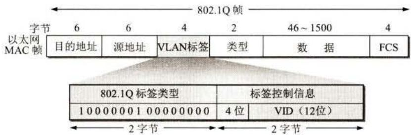
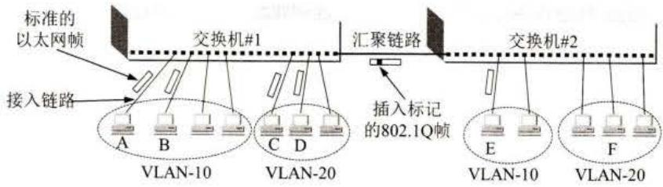

# 3.4.3 虚拟局域网

以太网交换机的问世，加速了以太网的普及应用。一个以太网交换机可以非常方便地连接几十台计算机，构成一个星形以太网。

但是，当一个以太网包含的计算机太多时，往往会带来两个缺点。

首先，一个以太网是一个广播域。在以太网上经常会出现大量的广播帧。在交换机的交换表的建立过程中要使用许多广播帧。我们经常使用的 ARP 和 DHCP 协议（这将在后面两章中讲到），也都要在以太网中传送很多的广播帧。在一个主机数量很大的以太网上传播广播帧，必然会消耗很多的网络资源。如果网络的配置出了些差错，就有可能发生广播帧在网络中无限制地兜圈子（如图 3-26 所示那样），形成了“广播风暴”，使整个的网络瘫痪。

其次，一个单位的以太网往往为好几个下属部门所共享。但有些部门的信息是需要保密的（例如，财务部门或人事部门）。许多部门共享一个局域网对信息安全不利。

如果使每一个小部门各拥有自己的较小的局域网，那么这不但可使局域网的广播域范围缩小，同时也提高了局域网的安全性。在以太网交换机出现后，我们可以很方便灵活地建立虚拟局域网 VLAN (Virtual LAN)。这样就把一个较大的局域网，分割成为一些较小的局域网，而每一个局域网是一个较小的广播域。

在 IEEE 802.1Q 标准中，对虚拟局域网 VLAN 是这样定义的：

虚拟局域网 VLAN 是由一些局域网网段构成的与物理位置无关的逻辑组，而这些网段具有某些共同的需求。每一个 VLAN 的帧都有一个明确的标识符，指明发送这个帧的计算机属于哪一个 VLAN。

虚拟局域网其实只是局域网给用户提供的一种服务，而并不是一种新型局域网。

1988 年 IEEE 批准了 802.3ac 标准，这个标准定义了以太网的帧格式的扩展，以便支持虚拟局域网。虚拟局域网协议允许在以太网的帧格式中插入一个 4 字节的标识符（如图 3-27 所示），称为 VLAN 标签(tag)，用来指明发送该帧的计算机属于哪一个虚拟局域网。插入 VLAN 标签的帧称为 802.1Q 帧。

> 图 3-27 插入 VLAN 标签后变成了 802.1Q 帧（教材第 104 页）

VLAN 标签字段的长度是 4 字节，插入在以太网 MAC 帧的源地址字段和类型字段之间。VLAN 标签的前两个字节总是设置为 0x8100（即二进制的 10000001 00000000），称为 IEEE

802.1Q 标签类型。VLAN 标签的后两个字节中，前面 4 位实际上并没有什么作用，这里不讨论，后面的 12 位是该虚拟局域网 VLAN 标识符 VID (VLAN ID)，它唯一地标志了 802.1Q 帧属于哪一个 VLAN。12 位的 VID 可识别 4096 个不同的 VLAN。插入 VLAN 标签后，802.1Q 帧最后的帧检验序列 FCS 必须重新计算。

当数据链路层检测到 MAC 帧的源地址字段后面的两个字节的值是 0x8100 时，就知道现在插入了 4 字节的 VLAN 标签。由于用于 VLAN 的以太网帧的首部增加了 4 个字节，因此以太网的最大帧长从原来的 1518 字节（1500 字节的数据加上 18 字节的首部和尾部）变为 1522 字节。

这样的 802.1Q 帧在什么地方使用呢？我们可以用图 3-28 给出的简单例子来说明。交换机#1 连接了 7 台计算机，组成了一个局域网（一个广播域）。现在把局域网划分为两个虚拟局域网 VLAN-10 和 VLAN-20。这里的 10 和 20 是虚拟局域网的编号，由交换机管理人员设定。这个编号就是图 3-27 中的 VID 字段的值。

> 图 3-28 利用以太网交换机构成虚拟局域网（教材第 105 页）

现在我们有了两个较小的广播域。每台计算机都是通过接入链路(access link)连接到以太网交换机的。管理人员划分虚拟局域网的方法有多种。例如，按交换机的端口划分，或按MAC地址划分。每台主机并不知道自己的VID值（但交换机必须知道这些信息）。这些主机通过接入链路发送到交换机的帧都是标准的以太网帧。

在一个用多个交换机连接起来的较大的局域网中，可以灵活地划分虚拟局域网，不受地理位置的限制。一个虚拟局域网的范围可以跨越不同的交换机。当然，所使用的交换机必须要能够识别和处理虚拟局域网。在图3-28中，在另外一层楼的交换机#2连接了5台计算机，并与交换机#1相连接。交换机#2中的两台计算机加入到VLAN-10，而另外3台加入到VLAN-20。这两个虚拟局域网虽然都跨越了两个交换机，但都各自是一个广播域。

连接两个交换机端口之间的链路称为汇聚链路(trunk link)或干线链路。

现在假定 A 向 B 发送帧。由于交换机#1能够根据帧首部的目的 MAC 地址，识别 B 属于本交换机管理的 VLAN-10，因此就像在普通以太网中那样直接进行帧的转发，不需要使用 VLAN 标签。这是最简单的情况。

现在假定 A 向 E 发送帧。交换机#1 查到 E 并没有连接到本交换机，因此必须从汇聚链路把帧转发到交换机#2，但在转发之前，要插入 VLAN 标签。不插入 VLAN 标签，交换机#2 就不知道应把帧转发给哪一个 VLAN。因此在汇聚链路传送的帧是 802.1Q 帧。交换机#2 在向 E 转发帧之前，要拿走已插入的 VLAN 标签，因此 E 收到的帧就是 A 发送的标准以太网帧，而不是 802.1Q 帧。图 3-28 说明了这种情况。

如果 A 向 C 发送帧，情况又怎样呢？这种情况就复杂些了，因为这是在不同网络之间的通信。虽然 A 和 C 都连接到同一个交换机，但它们已经处在不同的网络中（VLAN-10 和

VLAN-20)。这问题是互连网络中的通信问题，已经超过了本章数据链路层的范围。这要由属于上面的网络层中的路由器来解决。

不过有的交换机中嵌入了一个用专用芯片构成的转发模块，用来在不同的 VLAN 之间转发帧。这样就可以不必再使用另外的路由器，而就在交换机中实现了第 3 层的转发功能（由于使用硬件转发，转发帧的速率提高了，比使用路由器要快）。这种转发功能被称为第 3 层交换，而这种交换机常称为 L3/L2 交换机。

有了这种第 3 层交换机，连接到不同交换机的 A 和 F，都能不需要经过另外的路由器而相互通信。更详细的转发过程这里就不继续讨论了。
