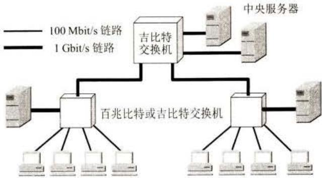

# 3.5.2 吉比特以太网

IEEE 在 1997 年通过了吉比特以太网的标准 802.3z，并在 1998 年成为正式标准。几年来，吉比特以太网迅速占领了市场，成为以太网的主流产品。

吉比特以太网的标准 IEEE 802.3z 有以下几个特点：

(1) 允许在 1 Gbit/s 下以全双工和半双工两种方式工作。

(2) 使用 IEEE 802.3 协议规定的帧格式。

(3) 在半双工方式下使用 CSMA/CD 协议，而在全双工方式不使用 CSMA/CD 协议。

(4) 与 10BASE-T 和 100BASE-T 技术向后兼容。

吉比特以太网可用作现有网络的主干网，也可在高带宽（高速率）的应用场合中（如医疗图像或 CAD 的图形等）用来连接计算机和服务器。

吉比特以太网的物理层使用两种成熟的技术：一种来自现有的以太网，另一种则是美国国家标准协会 ANSI 制定的光纤通道 FC (Fibre Channel)。采用成熟技术就能大大缩短吉比特以太网标准的开发时间。

表 3-2 是吉比特以太网的物理层的标准。

> 表 3-2 吉比特以太网物理层标准（教材第 107 页）

| 名称 | 媒体 | 网段最大长度 | 特点 |
| --- | --- | --- | --- |
| 1000BASE-SX | 光缆 | 550 m | 多模光纤(50 和 62.5 μm) |
| 1000BASE-LX | 光缆 | 5000 m | 单模光纤(10 μm)多模光纤(50 和 62.5 μm) |
| 1000BASE-CX | 铜缆 | 25 m | 使用 2 对屏蔽双绞线电缆 STP |
| 1000BASE-T | 铜缆 | 100 m | 使用 4 对 UTP 5 类线 |

现在 1000BASE-X（包括表 3-2 中的前三项）的标准是 IEEE 802.3z，而 1000BASE-T 的标准是 IEEE 802.3ab。

吉比特以太网工作在半双工方式时，就必须进行碰撞检测。由于数据率提高了，因此只有减小最大电缆长度或增大帧的最小长度，才能使参数 a 保持为较小的数值。若将吉比特以太网最大电缆长度减小到 10 m，那么网络的实际价值就大大减小。而若将最短帧长提高到 640 字节，则在发送短数据时开销又太大。因此，吉比特以太网仍然保持一个网段的最大长度为 100 m，但采用了“载波延伸”(carrier extension)的办法，使最短帧长仍为 64 字节

（这样可以保持兼容性），同时将争用期增大为 512 字节。凡发送的 MAC 帧长不足 512 字节时，就用一些特殊字符填充在帧的后面，使 MAC 帧的发送长度增大到 512 字节，这对有效载荷 $^{①}$ 并无影响。接收端在收到以太网的 MAC 帧后，要把所填充的特殊字符删除后才向高层交付。当原来仅 64 字节长的短帧填充到 512 字节时，所填充的 448 字节就造成了很大的开销。

为此，吉比特以太网还增加了一种功能称为分组突发(packet bursting)。这就是当很多短帧要发送时，第一个短帧要采用上面所说的载波延伸的方法进行填充。但随后的一些短帧则可一个接一个地发送，它们之间只需留有必要的帧间最小间隔即可。这样就形成一串分组的突发，直到达到1500字节或稍多一些为止。当吉比特以太网工作在全双工方式时（即通信双方可同时进行发送和接收数据），不使用载波延伸和分组突发。

吉比特以太网交换机可以直接与多个图形工作站相连，也可用作百兆以太网的主干网，与百兆比特或吉比特交换机相连，然后再和大型服务器连接在一起。图 3-29 是吉比特以太网的一种配置举例。

> 图 3-29 吉比特以太网的配置举例（教材第 108 页）
