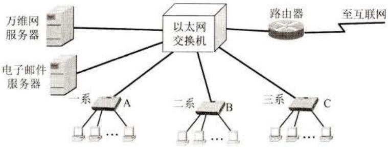
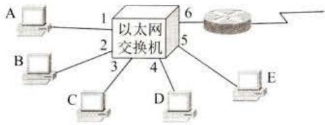

# 第3章 习题

3-01 数据链路（即逻辑链路）与链路（即物理链路）有何区别？“链路接通了”与“数据链路接通了”的区别何在？

3-02 数据链路层中的链路控制包括哪些功能？试讨论数据链路层做成可靠的链路层有哪些优点和缺点。

3-03 网络适配器的作用是什么？网络适配器工作在哪一层？

3-04 数据链路层的三个基本问题（封装成帧、透明传输和差错检测）为什么都必须加以解决？

3-06 PPP 协议的主要特点是什么？为什么 PPP 不使用帧的编号？PPP 适用于什么情况？为什么 PPP 协议不能使数据链路层实现可靠传输？

3-07 要发送的数据为 1101011011。采用 CRC 的生成多项式是 $P(X) = X^4 + X + 1$ 。试求应添加在数据后面的余数。

若要发送的数据在传输过程中最后一个 1 变成了 0，即变成了 1101011010，问接收端能否发现？

若要发送的数据在传输过程中最后两个 1 都变成了 0，即变成了 1101011000，问接收端能否发现？

采用 CRC 检验后，数据链路层的传输是否就变成了可靠的传输？

3-08 要发送的数据为 101110。采用 CRC 的生成多项式是 $P(X) = X^{3} + 1$ 。试求应添加在数据后面的余数。

3-09 一个 PPP 帧的数据部分（用十六进制写出）是 7D 5E FE 27 7D 5D 7D 5D 65 7D 5E。试问真正的数据是什么（用十六进制写出）？

3-10 PPP 协议使用同步传输技术传送比特串 0110111111111100。试问经过零比特填充后变成怎样的比特串？若接收端收到的 PPP 帧的数据部分是 0001110111110111110110，试问删除发送端加入的零比特后会变成怎样的比特串？

3-11 试分别讨论以下各种情况在什么条件下是透明传输，在什么条件下不是透明传输。（提示：请弄清什么是“透明传输”，然后考虑能否满足其条件。）(1) 普通的电话通信。(2) 互联网提供的电子邮件服务。

3-12 PPP 协议的工作状态有哪几种？当用户要使用 PPP 协议和 ISP 建立连接进行通信时，需要建立哪几种连接？每一种连接解决什么问题？

3-13 局域网的主要特点是什么？为什么局域网采用广播通信方式而广域网不采用呢？

3-14 常用的局域网的网络拓扑有哪些种类？现在最流行的是哪种结构？为什么早期的以

太网选择总线拓扑结构而不使用星形拓扑结构，但现在却改为使用星形拓扑结构呢？3-15 什么叫作传统以太网？以太网有哪两个主要标准？

3-16 数据率为 10 Mbit/s 的以太网在物理媒体上的码元传输速率（即码元/秒）是多少？

3-17 为什么 LLC 子层的标准已制定出来了但现在却很少使用？

3-18 试说明 10BASE-T 中的 “10” “BASE” 和 “T” 所代表的意思。

3-19 以太网使用的 CSMA/CD 协议是以争用方式接入到共享信道的，这与传统的时分复用 TDM 相比有何优缺点？

3-20 假定 1 km 长的 CSMA/CD 网络的数据率为 1 Gbit/s。设信号在网络上的传播速率为 200000 km/s。求能够使用此协议的最短帧长。

3-21 什么叫作比特时间？使用这种时间单位有什么好处？100 比特时间是多少微秒？

3-22 假定在使用 CSMA/CD 协议的 10 Mbit/s 以太网中某个站在发送数据时检测到碰撞，执行退避算法时选择了随机数 r = 100。试问这个站需要等待多长时间后才能再次发送数据？如果是 100 Mbit/s 的以太网呢？

3-23 公式(3-3)表示，以太网的极限信道利用率与连接在以太网上的站点数无关。能否由此推论出：以太网的利用率也与连接在以太网上的站点数无关？请说明你的理由。

3-24 假定站点 A 和 B 在同一个 10 Mbit/s 以太网网段上。这两个站点之间的传播时延为 225 比特时间。现假定 A 开始发送一帧，并且在 A 发送结束之前 B 也发送一帧。如果 A 发送的是以太网所容许的最短的帧，那么 A 在检测到和 B 发生碰撞之前能否把自己的数据发送完毕？换言之，如果 A 在发送完毕之前并没有检测到碰撞，那么能否肯定 A 所发送的帧不会和 B 发送的帧发生碰撞？（提示：在计算时应当考虑到每一个以太网帧在发送到信道上时，在 MAC 帧前面还要增加若干字节的前同步码和帧定界符。）

3-25 上题中的站点 A 和 B 在 t = 0 时同时发送了数据帧。当 t = 225 比特时间，A 和 B 同时检测到发生了碰撞，并且在 $t = 225 + 48 = 273$ 比特时间完成了干扰信号的传输。A 和 B 在 CSMA/CD 算法中选择不同的 r 值退避。假定 A 和 B 选择的随机数分别是 $r_{A} = 0$ 和 $r_{B} = 1$ 。试问 A 和 B 各在什么时间开始重传其数据帧？A 重传的数据帧在什么时间到达 B？A 重传的数据会不会和 B 重传的数据再次发生碰撞？B 会不会在预定的重传时间停止发送数据？

3-26 以太网上只有两个站，它们同时发送数据，产生了碰撞。于是按截断二进制指数退避算法进行重传。重传次数记为 $i, i = 1,2,3,\dots$ 。试计算第1次重传失败的概率、第2次重传失败的概率、第3次重传失败的概率，以及一个站成功发送数据之前的平均重传次数 $I$ 。

3-27 有 10 个站连接到以太网上。试计算以下三种情况下每一个站所能得到的带宽。

(1) 10 个站都连接到一个 10 Mbit/s 以太网集线器；

(2) 10 个站都连接到一个 100 Mbit/s 以太网集线器；

(3) 10 个站都连接到一个 10 Mbit/s 以太网交换机。

3-28 10 Mbit/s 以太网升级到 100 Mbit/s、1 Gbit/s 和 10 Gbit/s 时，都需要解决哪些技术问题？为什么以太网能够在发展的过程中淘汰掉自己的竞争对手，并使自己的应用范围从局域网一直扩展到城域网和广域网？

3-29 以太网交换机有何特点？用它怎样组成虚拟局域网？

3-30 在图 3-30 中，某学院的以太网交换机有三个端口分别和学院三个系的以太网相连，另外三个端口分别和电子邮件服务器、万维网服务器以及一个连接互联网的路由器相连。图中的 A, B 和 C 都是 100 Mbit/s 以太网交换机。假定所有的链路的速率都是 100 Mbit/s，并且图中的 9 台主机中的任何一个都可以和任何一个服务器或主机通信。试计算这 9 台主机和两个服务器产生的总的吞吐量的最大值。为什么？

> 图3-30 习题3-30的图（教材第 114 页）

3-31 假定图 3-30 中的所有链路的速率仍然为 100 Mbit/s，但三个系的以太网交换机都换成为 100 Mbit/s 的集线器。试计算这 9 台主机和两个服务器产生的总的吞吐量的最大值。为什么？

3-32 假定图 3-30 中的所有链路的速率仍然为 100 Mbit/s，但所有的以太网交换机都换成为 100 Mbit/s 的集线器。试计算这 9 台主机和两个服务器产生的总的吞吐量的最大值。为什么？

3-33 在图 3-31 中，以太网交换机有 6 个端口，分别接到 5 台主机和一个路由器。

> 图3-31 习题3-33的图（教材第 114 页）

> 在下面表中的“动作”一栏中，表示先后发送了4个帧。假定在开始时，以太网交换机的交换表是空的。试把该表中其他的栏目都填写完。（教材第 114 页）

| 动作 | 交换表的状态 | 向哪些端口转发帧 | 说明 |
| --- | --- | --- | --- |
| A 发送帧给 D |  |  |  |
| D 发送帧给 A |  |  |  |
| E 发送帧给 A |  |  |  |
| A 发送帧给 E |  |  |  |
