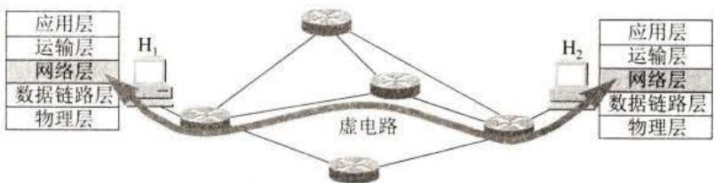
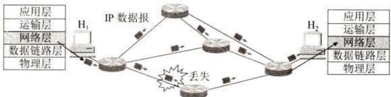
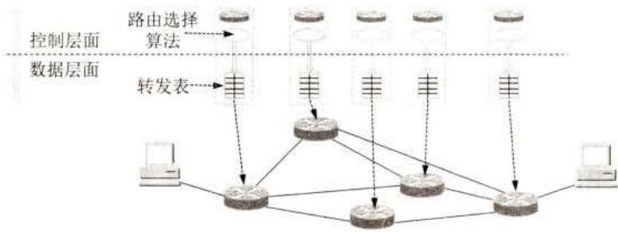
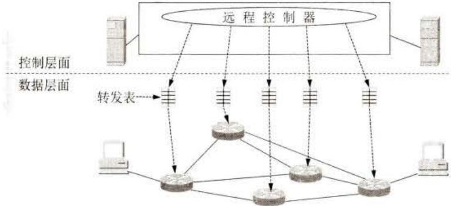

# 4.1 网络层的几个重要概念

## 第 4 章 网络层

本章讨论网络互连问题。在介绍网络层提供的两种服务和两个层面后，就进入本章的核心内容——网际协议 IP，这是本书的一个重点内容。只有深入地掌握了协议 IP 的主要内容，才能理解互联网是怎样工作的。本章还要讨论网际控制报文协议 ICMP、几种常用的路由选择协议、IPv6 的主要特点、IP 多播的概念等。在讨论虚拟专用网 VPN 和网络地址转换 NAT 后，最后简单介绍多协议标签交换 MPLS 和软件定义网络 SDN 的基本概念。

本章最重要的内容是：

(1) 虚拟互连网络和两种服务、两个层面的概念。

(2) IP 地址与 MAC 地址的关系。

(3) 传统分类的 IP 地址和无分类域间路由选择 CIDR（后者是重点）。

(4) 路由选择协议的工作原理。

## 4.1.1 网络层提供的两种服务

在计算机网络领域，网络层应该向运输层提供怎样的服务（“面向连接”还是“无连接”）曾引起了长期的争论。争论焦点的实质就是：在计算机通信中，可靠交付应当由谁来负责？是网络还是端系统？

有些人认为应当借助于电信网的成功经验，让网络负责可靠交付。大家知道，传统电信网的主要业务是提供电话服务。电信网使用昂贵的程控交换机（其软件也非常复杂），用面向连接的通信方式，使电信网络能够向用户（实际上就是电话机）提供可靠传输的服务。因此他们认为，计算机网络也应模仿打电话所使用的面向连接的通信方式。当两台计算机进行通信时，也应当先建立连接（但在分组交换中是建立一条虚电路 VC (Virtual Circuit) $^{①}$ ），以预留双方通信所需的一切网络资源。然后双方就沿着已建立的虚电路发送分组。这样的分组的首部不需要填写完整的目的主机地址，而只需要填写这条虚电路的编号（一个不大的整数），因而减少了分组的开销。这种通信方式如果再使用可靠传输的网络协议，就可使所发送的分组无差错按序到达终点，当然也不丢失、不重复。在通信结束后要释放建立的虚电路。图 4-1(a) 是网络提供虚电路服务的示意图。主机 $H_{1}$ 和 $H_{2}$ 之间交换的分组都必须在事先建立的虚电路上传送。

但互联网的先驱者却提出一种崭新的网络设计思路。他们认为，电信网提供的端到端可靠传输的服务对传统的电话业务无疑是很合适的，因为那时电信网的终端（电话机）非常简单，没有智能，更没有差错处理能力。因此电信网必须负责把用户电话机话筒产生的话音信号可靠地传送到对方的电话机，使其耳机发出的声音符合话音质量的技术规范要求。但计算机网络的端系统是有智能的计算机。计算机有很强的差错处理能力（这点和传统的电话机有本质上的差别）。因此，互联网在设计上就采用了和电信网完全不同的思路。

> ① 注：虚电路表示这只是一条逻辑上的连接，分组都沿着这条逻辑连接（好像是一条物理连接）按照存储转发方式传送，而并不是真正建立了一条物理连接。请注意，电路交换的电话通信是先建立了一条真正的连接。因此分组交换的虚连接和电路交换的连接只是类似而已，并不完全一样。

互联网采用的设计思路是这样的：网络层要设计得尽量简单，向其上层只提供简单灵活的、无连接的、尽最大努力交付的数据报服务 $^{①}$ 。这里的“数据报”(datagram)是互联网的设计者最初使用的名词，其实数据报（或IP数据报）就是我们经常使用的“分组”。在本书中，IP数据报和IP分组是同义词，可以混用。

网络在发送分组时不需要先建立连接。每一个分组（也就是 IP 数据报）独立发送，与其前后的分组无关（不进行编号）。网络层不提供服务质量的承诺。也就是说，所传送的分组可能出错、丢失、重复和失序（即不按序到达终点），当然也不保证分组交付的时限。由于传输网络不提供端到端的可靠传输服务，这就使网络中的路由器比较简单，且价格低廉（与电信网的交换机相比较）。如果主机（即端系统）进程之间需要进行可靠的通信，那么就由主机中的运输层负责（包括差错处理、流量控制等）。采用这种设计思路的好处是：网络造价大大降低，运行方式灵活，能够适应多种应用。互联网能够发展到今日的规模，充分证明了当初采用这种设计思路的正确性。

图 4-1(b) 给出了网络提供数据报服务的示意图。主机 $H_{1}$ 向 $H_{2}$ 发送的分组各自独立地查找路由器中的转发表，逐跳传送到目的主机。在分组传送的过程中有丢失的可能。

> (a) 虚电路服务（所有的数据都在此虚电路上传送）（教材第 116 页）

> (b) 数据报服务（数据传送的路径是不确定的） 图 4-1 网络层提供的两种服务（教材第 116 页）

OSI 体系的支持者曾极力主张在网络层使用可靠传输的虚电路服务，也曾推出过网络层虚电路服务的著名标准——ITU-T 的 X.25 建议书。但现在 X.25 早已成为历史文献了。

表 4-1 归纳了虚电路服务与数据报服务的主要区别。

> ① 注：尽最大努力交付(best effort delivery)当然不表示路由器可以任意丢弃分组，但这种交付方式实质上就是不可靠交付。顺便提一下，文献中也常使用“尽力而为”的译名。这个译名固然较为简洁，但似不够准确。

> 表 4-1 虚电路服务与数据报服务的对比（教材第 117 页）

| 对比的方面 | 虚电路服务 | 数据报服务 |
| --- | --- | --- |
| 思路 | 可靠通信应当由网络来保证 | 可靠通信应当由用户主机来保证 |
| 连接的建立 | 必须有 | 不需要 |
| 终点地址 | 仅在连接建立阶段使用,每个分组使用短的虚电路号 | 每个分组都有终点的完整地址,即IP地址 |
| 分组的转发 | 属于同一条虚电路的分组均按照同一路由进行转发 | 每个分组独立查找转发表进行转发 |
| 当节点出故障时 | 所有通过出故障的节点的虚电路均不能工作 | 出故障的节点可能会丢失分组,一些路由可能会发生变化 |
| 分组的顺序 | 总是按发送顺序到达终点 | 到达终点的顺序不一定按发送的顺序 |
| 端到端的差错处理和流量控制 | 可以由网络负责,也可以由用户主机负责 | 由用户主机负责 |

## 4.1.2 网络层的两个层面

在上面 4.1.1 节中，我们已经讲过，不同网络中的两个主机之间的通信，要经过若干个路由器转发分组来完成，分组查找路由器中的转发表，从指明的接口转发到下一个路由器。但转发表是怎样得出的呢？是从路由表导出的，而路由表又是由互联网中许多的路由器，按照共同选定的路由选择协议，通过许多次的相互交换路由信息而产生的。由此可见，在路由器之间传送的信息有以下两大类：

第一类是转发源主机和目的主机之间所传送的数据，把源主机所发送的分组，像接力赛跑那样从一个路由器转发到下一个路由器，最后把分组传送到目的主机。

第二类则是传送路由信息，是根据路由选择协议所使用的路由算法，彼此不断地交换路由信息分组，目的是为了在路由器中创建路由表，并由此导出为转发分组而用的转发表。这一类信息的传送是为第一类数据的传送服务的。

用图 4-2 的方法来描述，也就是把网络层抽象地划分为数据层面（或转发层面）和控制层面。这里所说的“层面(plane)”和体系结构中的“层次(layer)”很相似，都是抽象的概念。此处的 plane 目前国内尚无标准译名，也可以译为“面”。曾有人译为“平面”，但本书不采用这个译名，因为这容易联想到是几何学中的平面（其实与这种平面并无关联）。名词“层面”是目前文献中通用的抽象术语。在一个路由器实体中，显然无法看见这种抽象的层面。

> 图 4-2 网络层的数据层面和控制层面（教材第 117 页）

这两个层面的机制相差很大。在数据层面中，每一个路由器根据本路由器生成的转发表，把收到的分组，从查找到的对应接口转发出去。为了加快转发的速率，现在的路由器通常都采用硬件进行转发，转发一个分组的时间为纳秒（ $10^{-9}$ 秒）数量级。但在控制层面中的情况则不同。一个路由器不可能独自创建出路由表。路由器必须和相邻的路由器经常交换路由信息，然后才能创建出本路由器的路由表。根据路由选择协议所用的路由算法计算路由要使用软件，这就慢多了，一般是秒的数量级。从以上所述不难看出，数据层面的问题比较单纯，因为路由器在转发分组时，是独立地根据本路由器的转发表转发分组的，但控制层面就比较复杂，因为路由器要创建路由表，就必须依靠许多路由器协同动作。不同的路由选择协议定义了不同的协同动作方式。路由器的生产厂家在制造路由器时，已经在路由器内部嵌入了路由选择的通信模块，使得路由器之间能够按照路由选择算法进行相互之间的通信。

从互联网诞生之日起，路由器就是按照图 4-2 所示的模式工作的。本教材过去的几个版本在讲解路由器的结构时，虽然没有使用控制层面和数据层面的概念，但已经把路由器划分为路由选择和分组转发两大部分。其实这两部分的位置就分别处在图 4-2 所示的控制层面和数据层面之中。现在介绍网络层中控制层面和数据层面的概念，是因为最近在网络界提出的软件定义网络 SDN (Software Defined Network) $^{1}$ ，正在对这两个层面的结构进行了重大的改变。图 4-3 就是 SDN 提出的这两个层面的构成。

> 图 4-3 软件定义网络 SDN 中的控制层面和数据层面（教材第 118 页）

我们注意到，在传统的互联网中，每一个路由器中，既有转发表又有路由选择软件，因此在图 4-2 中所画的虚线长方形方框也强调了这个特点。也就是说，每个路由器中，既有数据层面也有控制层面。但在图 4-3 所示的 SDN 结构中，所有的路由器都变简单了。路由器中的路由选择软件都不存在了，因此路由器之间不再相互交换路由信息。在网络的控制层面有一个在逻辑上集中的远程控制器（但在物理上可以由不同地点的多个服务器组成）。远程控制器掌握各主机和整个网络的状态，能够为每一个分组计算出最佳的路由，然后在每一个路由器中生成其正确的转发表。路由器的工作很单纯，即收到分组，查找转发表，转发分组。

这样，网络又变成为集中控制的。本来互联网是分散控制的，为什么现在又提出集中控制呢？其实，软件定义网络 SDN 的提出，并非现在要把整个互联网都改造为如图 4-3 所示的集中控制模式，这是不现实的。然而在某些具体条件下，特别是像一些大型的专用数据中心之间的广域网，若使用 SDN 模式来建造，就可以使网络运行的效率提高，同时还可以获得更好的经济效益。因此，建议读者关注这一新动向。在本书 4.10 节将简要介绍 SDN。

下面我们仍然按照传统互联网的机制，陆续介绍属于数据层面的协议 IP，然后再讨论

> ① 注：目前文献上出现的名词 SDN 尚无公认的权威定义。而 SDN 的英文写法也还有另外一种，即 Software Defined Networking，按照这种写法，中文的译名似应为“软件定义的连网”，即突出强调了连网的方式。考虑到目前中文的文献资料都是使用“软件定义网络”，故本书也采用这样的译名。

属于控制层面的各种路由选择协议。
