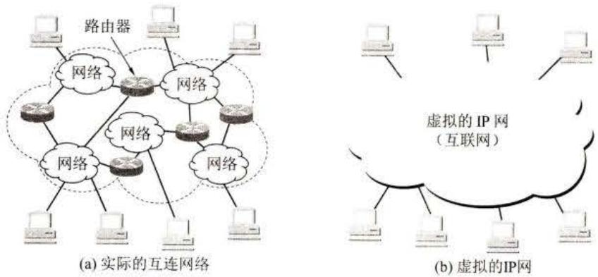
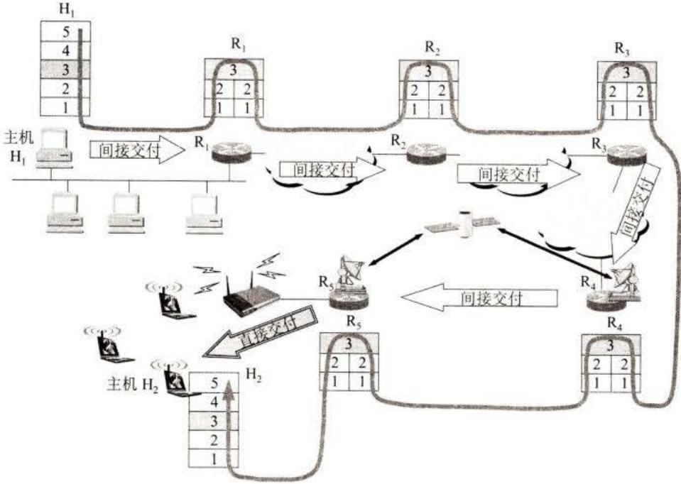
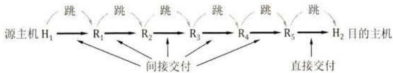

# 4.2.1 虚拟互连网络

## 4.2 网际协议 IP

网际协议 IP (Internet Protocol) 是 TCP/IP 体系中两个最主要的协议之一 [STEV94] [COME06][FORO10]，也是最重要的互联网标准协议之一 [RFC 791, STD5]。网际协议 IP 又称为 Kahn-Cerf 协议，因为这个重要协议正是 Robert Kahn 和 Vint Cerf 二人共同研发的。这两位学者在 2004 年获得图灵奖（其地位相当于计算机科学领域的“诺贝尔奖”）。严格来说，这里所讲的 IP 其实是 IP 的第 4 个版本，记为 IPv4。但在讲述协议 IP 的各种原理时，常省略 IP 后面的版本号。在后面的 4.5 节我们再介绍较新的版本 IPv6（版本 1～3 和版本 5 都未曾使用过。顺便指出，所谓的 IPv9 只不过是某些人故意的炒作而已，不值一提）。

与协议 IP 配套使用的还有三个协议：

\- 地址解析协议 ARP (Address Resolution Protocol)

\- 网际控制报文协议 ICMP (Internet Control Message Protocol)

• 网际组管理协议 IGMP (Internet Group Management Protocol)

本来还有一个协议叫作逆地址解析协议 RARP (Reverse Address Resolution Protocol)，是和协议 ARP 配合使用的，但现在已被淘汰不使用了。

图 4-4 画出了这三个协议和网际协议 IP 的关系。在这一层中，ARP 画在最下面 $^{1}$ ，因为 IP 经常要使用这个协议。ICMP 和 IGMP 画在这一层的上部，因为它们要使用协议 IP。这三个协议将在后面陆续介绍。由于网际协议 IP 是用来使互连起来的许多计算机网络能够进行通信的，因此 TCP/IP 体系中的网络层常常被称为网际层 (internet layer)，或 IP 层。使用 “网际层” 这个名词的好处

> 图 4-4 网际协议 IP 及其配套协议（教材第 119 页）

| 应用层 | 各种应用层协议(HTTP, FTP, SMTP等) |
| --- | --- |
| 运输层 | TCP, UDP |
| 网络层(网际层) | ICMP IGMPIPARP |
| 网络接口层 | 与各种网络接口 |
|  | 物理硬件 |

是强调了这是由很多网络构成的互连网络。目前比较普遍使用“网络层”这个名词。

在讨论网际协议 IP 之前，必须了解什么是虚拟互连网络。

我们知道，如果要在全世界范围内把数以百万计的网络都互连起来，并且能够互相通信，那么这样的任务一定非常复杂。其中会遇到许多需要解决的问题，如：

> ① 注：在互联网标准中，ARP 被列入链路层协议[RFC 1122, STD3]，因此有些教科书就把 ARP 放在链路层中介绍[COME06] [STEV94] [KURO17]。但是 ARP 并不知道自己是处在协议栈的哪一层。从程序调用的关系看，ARP 实际上处在链路层和网络层之间[KOZI05]，但不少著名教材都是把 ARP 放在网络层中讲授的[TANE11] [PETE12] [FORO10] [STAL10]。从教学的观点看，如果从协议的底层自下往上讲授，那么在学习链路层时就讲解 ARP 的工作原理，因涉及到 IP 地址的转换，似不易理解。编者的意见是，既然协议 ARP 实际上处于链路层和网络层之间，从教学法的角度考虑，对于自底层开始讲的教材，放在网络层讲述似较为方便。实际上，重要的是搞清 ARP 的工作原理，不必过于纠缠 ARP 究竟属于哪一层。

\- 不同的寻址方案；

\- 不同的最大分组长度：

\- 不同的网络接入机制：

\- 不同的超时控制；

\- 不同的差错恢复方法：

\- 不同的状态报告方法；

\- 不同的路由选择技术：

\- 不同的用户接入控制；

\- 不同的服务（面向连接服务和无连接服务）；

\- 不同的管理与控制方式；等等。

能不能让大家都使用相同的网络，这样可使网络互连变得比较简单。答案是不行的。因为用户的需求是多种多样的，没有一种单一的网络能够适应所有用户的需求。另外，网络技术是不断发展的，网络的制造厂家也要经常推出新的网络，在竞争中求生存。因此客观讲在市场上总是有很多种不同性能、不同网络协议的网络，供不同的用户选用。

从一般的概念来讲，将网络互相连接起来要使用一些中间设备。根据中间设备所在的层次，可以有以下四种不同的中间设备：

(1) 物理层使用的中间设备叫作转发器(repeater)。

(2) 数据链路层使用的中间设备叫作网桥或桥接器(bridge)，以及交换机(switch)。

(3) 网络层使用的中间设备叫作路由器(router) $^{①}$ 。

(4) 在网络层以上使用的中间设备叫作网关(gateway)。用网关连接两个不兼容的系统需要在高层进行协议的转换。

当中间设备是转发器或网桥时，这仅仅是把一个网络扩大了，而从网络层的角度看，这仍然是一个网络，一般并不称之为网络互连。网关由于比较复杂，目前使用得较少。因此现在我们讨论网络互连时，都是指用路由器进行网络互连和路由选择。路由器其实就是一台专用计算机，用来在互联网中进行路由选择。由于历史的原因，许多有关 TCP/IP 的文献曾经把网络层使用的路由器称为网关（本书有时也这样用），对此请读者加以注意。

图 4-5(a) 表示有许多计算机网络通过一些路由器进行互连。由于参加互连的计算机网络都使用相同的网际协议 IP (Internet Protocol)，因此可以把互连以后的计算机网络看成为如图 4-5(b) 所示的一个虚拟互连网络 (internet)。所谓虚拟互连网络也就是逻辑互连网络，它的意思就是互连起来的各种物理网络的异构性本来是客观存在的，但是我们利用协议 IP 就可以使这些性能各异的网络在网络层上看起来好像是一个统一的网络。这种使用协议 IP 的虚拟互连网络可简称为 IP 网（IP 网是虚拟的，但平常不必每次都强调“虚拟”二字）。使用 IP 网的好处是：当 IP 网上的主机进行通信时，就好像在一个单个网络上通信一样，它们看不见互连的各网络的具体异构细节（如具体的编址方案、路由选择协议，等等）。如果在这种覆盖全球的 IP 网的上层使用 TCP 协议，那么就是现在的互联网 (Internet)。

> ① 注：还有一种网桥和路由器的混合物桥路器(brouter)，它是兼有网桥和路由器的功能的产品。实际上，严格的网桥或严格的路由器产品是较少见的。不过桥路器名词用得不普遍。请注意 router 的读音是[rauter]。

> 图4-5 IP网的概念（教材第 121 页）

当很多异构网络通过路由器互连起来时，如果所有的网络都使用相同的协议 IP，那么在网络层讨论问题就显得很方便。现在用一个例子来说明。

在图 4-6 所示的互联网中的源主机 $H_{1}$ 要把一个 IP 数据报发送给目的主机 $H_{2}$ 。根据第 1 章中讲过的分组交换的存储转发概念，主机 $H_{1}$ 先要查找自己的转发表，看目的主机 $H_{2}$ 是否就在本网络上。如是，则不需要经过任何路由器而是直接交付，任务就完成了。如不是，则必须把 IP 数据报发送给某个路由器（图中的 $R_{1}$ ）。 $R_{1}$ 在查找了自己的转发表后，知道应当把数据报转发给 $R_{2}$ 进行间接交付。这样一直转发下去，最后由路由器 $R_{5}$ 知道自己是和 $H_{2}$ 连接在同一个网络上，不需要再使用别的路由器转发了，于是就把数据报直接交付目的主机 $H_{2}$ 。总之，分组从源节点 A 发送到目的节点 B，若中间必须经过一个或几个路由器（这表示 A 和 B 不在同一个网络上），则是间接交付。但若不需要经过路由器（这表示 A 和 B 在同一个网络上），则是直接交付。

> 图中的协议栈中的数字 1\~5 分别表示物理层、数据链路层、网络层、运输层和应用层 图 4-6 分组在互联网中的传送（教材第 121 页）

在图中画出了源主机、目的主机以及各路由器的协议栈。我们注意到，主机的协议栈共有五层，但路由器的协议栈只有下三层。图中还画出了数据在各协议栈中流动的方向（用黑色粗线表示）。我们还可注意到，在 $R_{4}$ 和 $R_{5}$ 之间使用了卫星链路，而 $R_{5}$ 所连接的是个无线局域网（ $R_{5}$ 和主机 $H_{2}$ 都在同一个局域网中）。在 $R_{1}$ 到 $R_{4}$ 之间的三个网络则可以是任意类型的网络。总之，这里强调的是：互联网可以由多种异构网络互连组成。

有时可以把问题简化。我们可以想象 IP 数据报就在网络层中传送，传输路径可省略路由器之间的网络以及连接在这些网络上的许多无关主机。图 4-7 表示了这样的传输路径。

> 图 4-7 源主机 $H_{1}$ 向目的主机 $H_{2}$ 发送分组（教材第 122 页）

在互联网的词汇中，分组在传送途中的每一次转发都称为一“跳(hop)”。也有人把hop译为跃点。路由器在转发分组时也常常使用“下一跳(next hop)”的说法。例如， $\mathbb{R}_1$ 的下一跳是 $\mathbb{R}_2$ ，而 $\mathbb{R}_4$ 的下一跳是 $\mathbb{R}_5$ 。对于本例， $\mathrm{H}_{1}$ 向 $\mathrm{H}_{2}$ 发送分组需要经过6跳。我们还注意到，每一跳两端的两个节点都必定直接连接在同一个网络上。例如，在图4-7中从 $\mathbb{R}_2$ 到 $\mathbb{R}_3$ 的一跳，其两端的两个节点 $\mathbb{R}_2$ 和 $\mathbb{R}_3$ 都是连接在同一个网络上的。在上面所举的例子中，前5跳都是间接交付，只有最后一跳是直接交付。
