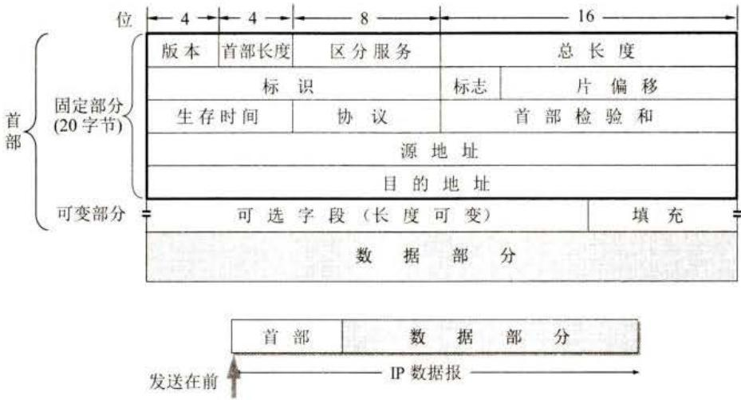
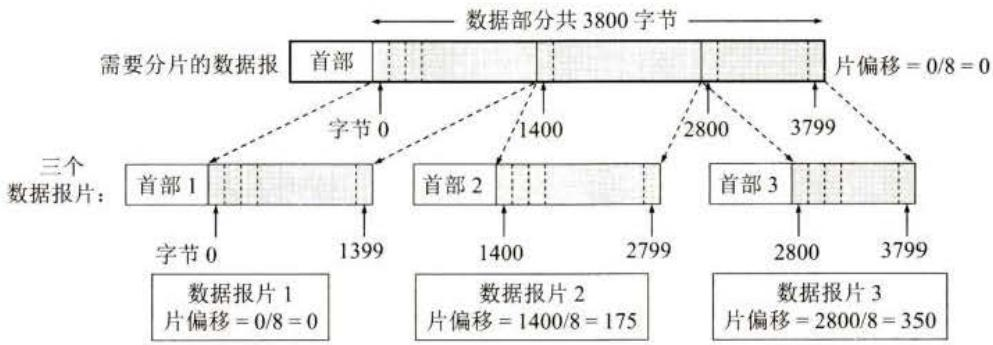
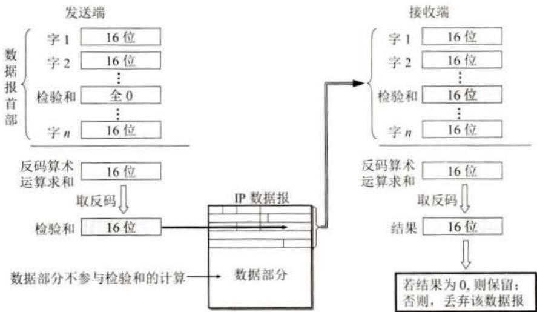

# 4.2.5 IP数据报的格式

IP 数据报的格式说明协议 IP 都具有什么功能。在协议 IP 的标准中，描述首部格式的宽度是 32 位（即 4 字节）。图 4-20 是 IP 数据报的完整格式 [RFC 791, STD5]。

> 图 4-20 IP 数据报的格式（教材第 136 页）

从图 4-20 可看出，一个 IP 数据报由首部和数据两部分组成。首部的前一部分长度是固定的，共 20 字节，是所有 IP 数据报必须具有的。在首部的固定部分的后面是一些可选字段，其长度是可变的。下面介绍首部各字段的意义。

## 1. IP 数据报首部的固定部分中的各字段

(1) 版本 占 4 位，指协议 IP 的版本。通信双方使用的协议 IP 的版本必须一致。这里讨论的协议 IP 版本号为 4（即 IPv4）。关于 IPv6（即版本 6 的协议 IP），我们将在后面的 4.5 节讨论。

(2) 首部长度 占 4 位，可表示的最大十进制数值是 15。请注意，首部长度字段所表示数的单位是 32 位字长（1 个 32 位字长是 4 字节）。因为 IP 首部的固定部分是 20 字节，因此首部长度字段的最小值是 5（即二进制表示的首部长度是 0101）。而当首部长度字段为最大值 1111 时（即十进制的 15），就表明首部长度达到最大值——15 个 32 位字长，即 60 字节。当 IP 分组的首部长度不是 4 字节的整数倍时，必须利用最后的填充字段加以填充。因此 IP 数据报的数据部分永远在 4 字节的整数倍时开始，这样在实现协议 IP 时较为方便。首部长度限制为 60 字节的缺点是有时可能不够用，但这样做是希望用户尽量减少开销。最常用的首部长度是 20 字节，不使用任何可选字段。

(3) 区分服务 占 8 位，用来获得更好的服务。这个字段在旧标准中叫作服务类型，但实际上一直没有被使用过。1998 年 IETF 把这个字段改名为区分服务 DS (Differentiated Services)。只有在使用区分服务时，这个字段才起作用（见 8.4.4 节）。在一般的情况下都不使用这个字段[RFC 2474, RFC 3168, RFC 3260]。

(4) 总长度 总长度指首部和数据之和的长度，单位为字节。总长度字段为 16 位，因此数据报的最大长度为 $2^{16} - 1 = 65535$ 字节。然而实际上传送这样长的数据报在现实中是极少遇到的。

我们知道，在 IP 层下面的每一种数据链路层协议都规定了一个数据帧中的数据字段的最大长度，这称为最大传送单元 MTU (Maximum Transfer Unit)。当一个 IP 数据报封装成链路层的帧时，此数据报的总长度（即首部加上数据部分）一定不能超过下面的数据链路层所规定的 MTU 值。例如，最常用的以太网就规定其 MTU 值是 1500 字节。若所传送的数据报长度超过数据链路层的 MTU 值，就必须把过长的数据报进行分片处理。

虽然使用尽可能长的 IP 数据报会使传输效率得到提高（这样每一个 IP 数据报中首部长度占数据报总长度的比例就会小些），但数据报短些也有好处。IP 数据报越短，路由器转发的速度就越快。为此，协议 IP 规定，在互联网中所有的主机和路由器必须能够接受长度不超过 576 字节的数据报。这是假定上层交下来的数据长度有 512 字节（合理的长度），加上最长的 IP 首部 60 字节，再加上 4 字节的富余量，就得到 576 字节。当主机需要发送长度超过 576 字节的数据报时，应当先了解一下，目的主机能否接受所要发送的数据报长度。否则，就要进行分片。

在进行分片时（见后面的“片偏移”字段），数据报首部中的“总长度”字段是指分片后的每一个分片的首部长度与该分片的数据长度的总和。

(5) 标识(identification) 占 16 位。IP 软件在存储器中维持一个计数器，每产生一个数据报，计数器就加 1，并将此值赋给标识字段。但这个“标识”并不是序号，因为 IP 是无连接服务，数据报不存在按序接收的问题。当数据报由于长度超过网络的 MTU 而必须分片时，这个标识字段的值就被复制到所有的数据报片的标识字段中。相同的标识字段的值使分片后的各数据报片最后能正确地重装成为原来的数据报。

(6) 标志(flag) 占 3 位，但目前只有两位有意义。

\- 标志字段中的最低位记为 MF (More Fragment)。MF = 1 即表示后面“还有分片”的数据报。MF = 0 表示这已是若干数据报片中的最后一个。

\- 标志字段中间的一位记为 DF (Don't Fragment)，意思是“不能分片”。只有当 DF = 0 时才允许分片。

(7) 片偏移 占 13 位。片偏移指出：较长的分组在分片后，某片在原分组中的相对位置。也就是说，相对于用户数据字段的起点，该片从何处开始。片偏移以 8 个字节为偏移单位。这就是说，除最后一个数据报片外，其他每个分片的长度一定是 8 字节（64 位）的整数倍。

下面举一个例子。

【例 4-1】一个数据报的总长度为 3820 字节，其数据部分为 3800 字节长（使用固定首部），需要分片为长度不超过 1420 字节的数据报片。因固定首部长度为 20 字节，因此每个数据报片的数据部分长度不能超过 1400 字节。于是分为 3 个数据报片，其数据部分的长度分别为 1400, 1400 和 1000 字节。原始数据报首部被复制为各数据报片的首部，但必须修改有关字段的值。图 4-21 给出分片后得出的结果（请注意片偏移的数值）。

> 图 4-21 数据报的分片举例（教材第 138 页）

表 4-5 是本例中数据报首部与分片有关的字段中的数值，其中标识字段的值是任意给定的（12345）。具有相同标识的数据报片在目的站就可无误地重装成原来的数据报。

> 表 4-5 IP 数据报首部中与分片有关的字段中的数值（教材第 138 页）

|  | 总长度 | 标识 | MF | DF | 片偏移 |
| --- | --- | --- | --- | --- | --- |
| 原始数据报 | 3820 | 12345 | 0 | 0 | 0 |
| 数据报片1 | 1420 | 12345 | 1 | 0 | 0 |
| 数据报片2 | 1420 | 12345 | 1 | 0 | 175 |
| 数据报片3 | 1020 | 12345 | 0 | 0 | 350 |

现在假定数据报片 2 经过某个网络时还需要再进行分片，即划分为数据报片 2-1（携带数据 800 字节）和数据报片 2-2（携带数据 600 字节）。那么这两个数据报片的总长度、标识、MF、DF 和片偏移分别为：820, 12345, 1, 0, 175；620, 12345, 1, 0, 275。

(8) 生存时间 占 8 位, 生存时间字段常用的英文缩写是 TTL (Time To Live), 表明这是数据报在网络中的寿命。由发出数据报的源点设置这个字段。其目的是防止无法交付的数据报无限制地在互联网中兜圈子（例如从路由器 $R_{1}$ 转发到 $R_{2}$ , 再转发到 $R_{3}$ , 然后又转发到 $R_{1}$ ), 因而白白消耗网络资源。最初的设计以秒作为 TTL 值的单位。每经过一个路由器时, 就把 TTL 减去数据报在路由器所消耗掉的一段时间。若数据报在路由器消耗的时间小于 1 秒, 就把 TTL 值减 1 。当 TTL 值减为零时, 就丢弃这个数据报。

然而随着技术的进步，路由器处理数据报所需的时间不断在缩短，一般都远远小于1秒，后来就把TTL字段的功能改为“跳数限制”（但名称不变）。路由器在每次转发数据报之前就把TTL值减1。若TTL值减小到零，就丢弃这个数据报，不再转发。因此，现在TTL的单位不再是秒，而是跳数。TTL的意义是指明数据报在互联网中至多可经过多少个路由器。显然，数据报能在互联网中经过的路由器的最大数值是255。若把TTL的初始值设置为1，就表示这个数据报只能在本局域网中传送。因为这个数据报一传送到局域网上的某个路由器，在被转发之前TTL值就减小到零，所以会被这个路由器丢弃。

(9) 协议 占 8 位，协议字段指出此数据报携带的数据使用何种协议，以便使目的主机的 IP 层知道应将数据部分上交给哪个协议进行处理。

常用的一些协议和相应的协议字段值如下[W-IANA] $^{①}$ :

| 协议名 | ICMP | IGMP | IP2 | TCP | EGP | IGP | UDP | IPv6 | ESP | AH | ICMP-IPv6 | OSPF |
| --- | --- | --- | --- | --- | --- | --- | --- | --- | --- | --- | --- | --- |
| 协议字段值 | 1 | 2 | 4 | 6 | 8 | 9 | 17 | 41 | 50 | 51 | 58 | 89 |

(10) 首部检验和 占 16 位。这个字段只检验数据报的首部，但不包括数据部分。这是因为数据报每经过一个路由器，路由器都要重新计算一下首部检验和（一些字段，如生存时间、标志、片偏移等都可能发生变化）。不检验数据部分可减少计算的工作量。为了进一步减少计算检验和的工作量，IP 首部的检验和不采用复杂的 CRC 检验码而采用下面的简单计算方法：在发送方，先把 IP 数据报首部划分为许多 16 位字的序列，并把检验和字段置零。用反码算术运算 $^{③}$ 把所有 16 位字相加后，将得到的和的反码写入检验和字段。接收方收到数据报后，把首部的所有 16 位字再使用反码算术运算相加一次。将得到的和取反码，即得出接收方检验和的计算结果。若首部未发生任何变化，则此结果必为 0，于是就保留这个数据报；否则即认为出差错，并将此数据报丢弃。图 4-22 说明了 IP 数据报首部检验和的计算过程。

> 图 4-22 IP 数据报首部检验和的计算过程（教材第 139 页）

(11) 源地址 占 32 位。发送 IP 数据报的主机的 IP 地址。

(12) 目的地址 占 32 位。接收 IP 数据报的主机的 IP 地址。

> ① 注：原来如协议字段值这样的数值都是由互联网赋号管理机构 IANA 负责指派，并公布在有关的 RFC 文档中的。IANA 由美国政府建立，开始由 Jon Postel 负责管理。由于 Jon Postel 于 1998 年去世，同时也由于互联网的商业化和国际化，许多国家希望由一个新的、私营的、非营利的国际公司——互联网名称与数字地址分配机构 ICANN [W-ICANN] 取代 IANA。但后来 ICANN 并没有取代 IANA，而是保留了 IANA，并且和 IANA 进行了分工。因此现在就出现了 IANA/ICANN 或 ICANN/IANA 这样的写法。这两个机构都负责 IP 地址和一些重要参数的管理。现在有关互联网的重要参数已经不在 RFC 文档公布[RFC 3232]，而改为在网址 www.iana.org 上查询在线的数据库。从 2016 年起，开始进行 IANA 的管理权逐步向 ICANN 转移的工作。

> ② 注：这里的 IP 表示特殊的 IP 数据报——IP 数据报再封装到 IP 数据报中（IP Encapsulation within IP）。

> ③ 注：两个数进行二进制反码求和的运算很简单。它的规则是从低位到高位逐列进行计算。0 和 0 相加是 0，0 和 1 相加是 1，1 和 1 相加是 0 但要产生一个进位 1，加到下一列。若最高位相加后产生进位，则最后得到的结果要在最低位加 1。请注意，反码（one's complement）和补码(two's complement)是不一样的。

## 2. IP 数据报首部的可变部分

IP 数据报首部的可变部分就是一个选项字段。选项字段用来支持排错、测量以及安全等措施，内容很丰富。此字段的长度可变，从 1 字节到 40 字节不等，取决于所选择的项目。某些选项项目只需要 1 字节，它只包括 1 字节的选项代码。而有些选项需要多个字节，这些选项一个个拼接起来，中间不需要有分隔符，最后用全 0 的填充字段补齐为 4 字节的整数倍。

增加首部的可变部分是为了增加 IP 数据报的功能，但这同时也使得 IP 数据报的首部长度成为可变的。这就增加了每一个路由器处理数据报的开销。实际上这些选项很少被使用。很多路由器都不考虑 IP 首部的选项字段，因此新的 IP 版本 IPv6 就把 IP 数据报的首部长度做成固定的了。这里就不讨论这些选项的细节了。有兴趣的读者可参阅 RFC 791。
