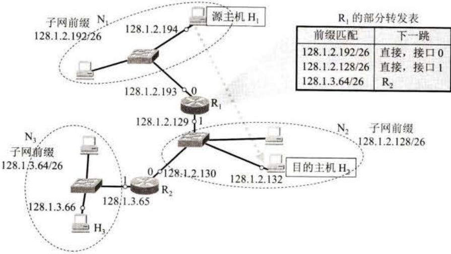
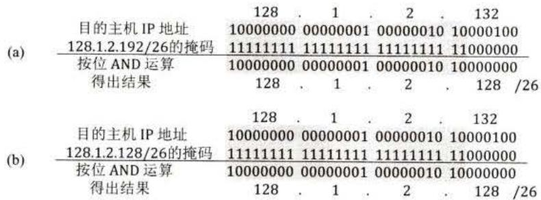

# 4.3.1 基于终点的转发

## 4.3 IP 层转发分组的过程

我们在图 4-7 中已经描述了分组在互联网中逐跳转发的概念。分组在互联网上传送和转发是基于分组首部中的目的地址的，因此这种转发方式称为基于终点的转发。

因此，分组每到达一个路由器，路由器就根据分组中的终点（目的地址）查找转发表，然后就得知下一跳应当到哪一个路由器。

但是，路由器中的转发表却不是按目的 IP 地址来直接查出下一跳路由器的。这是因为互联网中的主机数目实在太大了。如果用目的地址直接查找转发表，那么这种结构的转发表就会非常庞大，使得查找过程非常之慢。这样的转发表也就没有实用价值了。因此必须想办法压缩转发表的大小。

我们知道，32 位的 IP 地址是由两级组成的。前一部分是前缀，表示网络，后一部分表示主机。所以可以把查找目的主机的方法变通一下，即不是直接查找目的主机，而是先查找目的网络（网络前缀），在找到了目的网络之后，就把分组在这个网络上直接交付目的主机。由于互联网上的网络数远远小于主机数，这样就可以大大压缩转发表的大小，加速分组在路由器中的转发。这就是基于终点的转发过程。

读者可能还会想到一个问题，就是分组首部中没有地方可以用来指明“下一跳路由器的IP地址”，那么待转发的分组又怎样能够找到下一跳路由器呢？

当路由器收到一个待转发的分组，在从转发表得出下一跳路由器的 IP 地址后，不是把这个地址填入分组首部，而是送交数据链路层的网络接口软件。网络接口软件负责把下一跳路由器的 IP 地址转换成 MAC 地址（必须使用 ARP），并将此 MAC 地址放在链路层的 MAC 帧的首部，然后利用这个 MAC 地址传送到下一跳路由器的链路层，再取出 MAC 帧的数据部分，交给网络层。由此可见，当发送一连串的分组时，上述的这种查找转发表、调用 ARP 解析出 MAC 地址、把 MAC 地址写入 MAC 帧的首部等过程，都是必须做的（当然都是由机器自动完成的）。

那么，能不能在转发表中不使用 IP 地址而直接使用 MAC 地址呢？不行。我们一定要弄清楚，使用抽象的 IP 地址，本来就是为了隐蔽各种底层网络的复杂性而便于分析和研究问题，这样就不可避免地要付出些代价，例如在选择路由时多了一些开销。但反过来，如果在转发表中直接使用 MAC 地址，那就会带来更多的麻烦，甚至无法找到对方的机器。

下面用具体例子来说明分组的转发过程。

【例 4-2】图 4-23 中有三个子网通过两个路由器互连在一起。主机 $H_{1}$ 发送出一个分组，其目的地址是 128.1.2.132。现在源主机是 $H_{1}$ 而目的主机是 $H_{2}$ 。试讨论分组怎样从源主机传送到目的主机。

> 图 4-23 源主机 $H_{1}$ 向目的地址 $H_{2}$ 发送分组（教材第 141 页）

【解】主机 $H_{1}$ 首先必须确定：目的主机是否连接在本网络上？如果是，那么问题很简单，就直接交付，根本不需要利用路由器；如果不是，就间接交付，把分组发送给连接在本网络上的路由器，以后要做的事情都由这个路由器来处理。

主机 $H_{1}$ 先把要发送的分组的目的地址和本网络 $N_{1}$ 的子网掩码按位进行 AND 运算，得出运算结果。如果运算结果等于本网络 $N_{1}$ 的前缀，就表明目的主机连接在本网络上；否则，就必须把分组发送到路由器 $R_{1}$ ，由路由器 $R_{1}$ 完成后续的任务。

由于采用了 CIDR 记法，转发表中给出的都是网络前缀，而没有明显给出子网掩码。其实只要细心观察斜线后面的数字，就可知道相应的子网掩码。例如，/26 的子网掩码就是点分十进制的 255.255.255.192。现在，要发送的分组的目的地址是 128.1.2.132，本网络的掩码是 26 个 1，后面有 6 个 0。如图 4-24(a) 所示，按位 AND 运算的结果是 128.1.2.128，不等于本网络 $N_{1}$ 的前缀。这说明目的主机没有连接在本网络上。源主机 $H_{1}$ 必须把分组发送给路由器 $R_{1}$ ，让路由器 $R_{1}$ 根据其转发表来处理这个分组。

> 图 4-24 目的地址和本网络的子网掩码按位进行 AND 运算（教材第 141 页）

路由器 $R_{1}$ 的部分转发表已在图 4-23 右上方给出了。转发表中第 1 列就是 “前缀匹配”，这是因为查找转发表的过程就是寻找前缀匹配的过程。

现在先检查路由器 $R_{1}$ 的转发表中的第 1 行。

源主机 $H_{1}$ 要发送的分组的目的地址是 128.1.2.132。本网络 128.1.2.192/26 的前缀有 26 位，因此本网络的掩码是 26 个 1，后面是 6 个 0。目的地址和子网掩码按位 AND 运算的结果是 128.1.2.128/26（见图 4-24(a)）。很明显，AND 运算结果与转发表第 1 行的前缀不匹配。

接着检查路由器 $R_{1}$ 的转发表中的第 2 行。运算结果是 128.1.2.128/26，如图 4-24(b) 所示。这个结果和转发表第 2 行的前缀相匹配。因此按照转发表第 2 行指出的，在网络 $N_{2}$ 上进行分组的直接交付（通过路由器 $R_{1}$ 的接口 1）。这时路由器 $R_{1}$ 调用 ARP，解析出目的主机 $H_{2}$ 的 MAC 地址，再封装成链路层的帧，直接交付连接在本网络 $N_{2}$ 上的目的主机 $H_{2}$ 。

如果按照同样的方法，检查路由器 $R_{1}$ 的转发表中的第 3 行，不难得出不匹配的结果。

从以上例子可看出，查找转发表的过程就是逐行寻找前缀匹配的过程。我们再看下一个例子。
