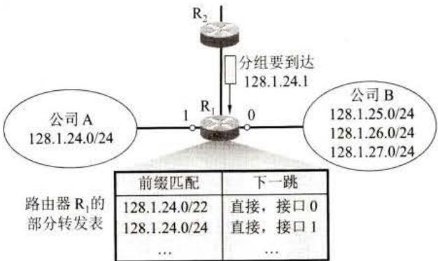
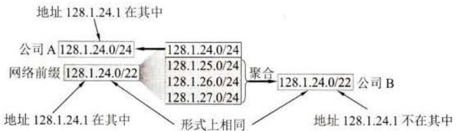

# 4.3.2 最长前缀匹配

【例 4-3】假定在图 4-25 的例子中，路由器 $R_{1}$ 收到一个目的地址为 128.1.24.1 的分组，请给出分组的转发接口。请注意，公司 B 包含三个子网，但这些网络前缀并没有出现在路由器 $R_{1}$ 的转发表中。这是因为公司 B 采用了路由聚合，把三个子网的所有地址聚合为一个网络前缀 128.1.24.0/22.

> 图 4-25 分组交给路由器 $R_{1}$ 进行转发（教材第 142 页）

【解】我们把进入路由器 $R_{1}$ 的分组的目的地址分别和路由器 $R_{1}$ 的转发表第 1 行、第 2 行子网掩码进行按位 AND 运算。运算结果都是 “匹配”（建议读者自行验算一下）。那么，哪一个结果是正确的呢？现在就来分析这个问题。

网络前缀 128.1.24.0/22 可以划分为 4 个更小的/24 前缀（图 4-26）。其中的一个前缀 128.1.24.0/24 分配给公司 A，另外 3 个前缀分配给公司 B。公司 B 把得到的 3 个前缀聚合成一个更大的前缀 128.1.24.0/22，作为路由器 $R_{1}$ 的转发表中的一个项目。请注意，这个前缀和原来的前缀在形式上是一样的，但实际的区别是很大的：在图 4-26 左边的网络前缀中包含地址 128.1.24.1，但公司 B 的聚合后的网络前缀则不包含这个地址。因此在本例中，即分组应当从接口 1 转发到公司 A。

那么为什么地址 128.1.24.1 不在公司 B 的聚合前缀 128.1.24.0/22 中，但匹配运算的结果却是匹配呢？这是因为在转发表中的项目 128.1.24.0/22 并未说明是由哪几个子网聚合而成的。

> 图 4-26 公司 A 和 B 分到的前缀（教材第 143 页）

十分明显，进入路由器 $R_{1}$ 的分组的目的地址 128.1.24.1 处于公司 A 拥有的地址范围中，而不在公司 B 的地址范围内。分组应当通过接口 1 转发到公司 A。

为了减少路由器 $\mathbb{R}_1$ 中的项目数，公司B采用了地址聚合，把三个地址块聚合为一个地址块128.1.24.0/22。这个聚合后得出的前缀和图中左边所示的前缀在形式上是一样的。这样就导致图4-26所示的出现和两个网络前缀都匹配的现象。

我们可以注意到，现在公司 B 三个地址块得出的聚合地址块是 128.1.24.0/22，但如果公司 B 只分到两个地址块 128.1.25.0/24 和 128.1.26.0/24，那么其聚合地址块仍然是 128.1.24.0/22。如果把公司 A 和公司 B 的地址块都聚合起来，得出的聚合地址块还是 128.1.24.0/22。这样的地址聚合可以发生在路由器 R2 中。

因此，在采用 CIDR 编址时，如果一个分组在转发表中可以找到多个匹配的前缀，那么就应当选择前缀最长的一个作为匹配的前缀。这个原则称为最长前缀匹配(longest prefix match)。网络前缀越长，其地址块就越小，因而路由就越具体(more specific)。为了更加迅速地查找转发表，可以按照前缀的长短，把前缀最长的排在第 1 行，然后按前缀长短的顺序往下排列。用这种方法从第 1 行前缀最长的开始查找，只要检查到匹配的，就不必再继续往下查找，可以立即结束查找。

实际的转发表有时还可能增加两种特殊的路由，就是主机路由和默认路由。

主机路由(host route)又叫作特定主机路由，这是对特定目的主机的 IP 地址专门指明的一个路由。采用特定主机路由可使网络管理人员更方便地控制网络和测试网络，同时也可在需要考虑某种安全问题时采用这种特定主机路由。在对网络的连接或转发表进行排错时，指明到某一台主机的特殊路由就十分有用。假定这个特定主机的点分十进制 IP 地址是 a.b.c.d，那么在转发表中对应于主机路由的网络前缀就是 a.b.c.d/32。我们知道，/32 表示的子网掩码是 32 个 1。实际的网络不可能使用 32 位的前缀，因为没有主机号的 IP 地址是没有实际意义的。但这个特殊的前缀却可以用在转发表中。不难看出，32 个 1 的子网掩码和 IP 地址 a.b.c.d 按位进行 AND 运算后，得出的结果必定是 a.b.c.d，也就是说，找到了匹配。这时就把收到的分组转发到转发表所指出的下一跳。主机路由在转发表中都放在最前面。

还有一种特殊路由是默认路由(default route)。这就是不管分组的最终目的网络在哪里，都由指定的路由器 R 来处理。这在网络只有很少的对外连接时非常有用。在实际的转发表中，用一个特殊前缀 0.0.0.0/0 来表示默认路由。这个前缀的掩码是全 0（/0 表示网络前缀是 0 位，因此掩码是 32 个 0）。用全 0 的掩码和任何目的地址进行按位 AND 运算，结果一定是全 0，即必然是和转发表中的 0.0.0.0/0 相匹配的。这时就按照转发表的指示，把分组送交下一跳路由器 R 来处理（即间接交付）。

综上所述，可归纳出分组转发算法如下（假定转发表按照前缀的长短排列，把前缀长的放在前面）：

(1) 从收到的分组的首部提取目的主机的 IP 地址 D（即目的地址）。

(2) 若查找到有特定主机路由（目的地址为 $D$ ），就按照这条路由的下一跳转发分组；否则从转发表中下一行（也就是前缀最长的一行）开始检查，执行(3)。

(3) 把这一行的子网掩码与目的地址 D 按位进行 AND 运算。

若运算结果与本行的前缀匹配，则查找结束，按照“下一跳”所指出的进行处理（或直接交付本网络上的目的主机，或通过指定接口发送到下一跳路由器）。

否则，若转发表还有下一行，则对下一行进行检查，重新执行(3)。

否则，执行(4)。

(4) 若转发表中有一个默认路由，则按照指明的接口，把分组传送到指明的默认路由器；否则，报告转发分组出错。

可以用一个简单的比喻来说明查找转发表和转发分组的过程。例如，从家门口开车到机场，但没有地图，不知道应当走哪条路线。好在每一个道路岔口都有一个警察可以询问。因此，每到一个岔口（相当于到了一个路由器），就问：“到机场应当朝哪个方向走？”（相当于查找转发表）。该警察并不告诉你去机场的详细路径。他仅仅指出到机场途经的下一个警察位置的方向。其回答可能是：“向左转方向走。”你左转到了下一个岔口，再询问警察，回答可能是：“直行。”这样，每到一个岔口，就询问下一步走的方向。这样，在没有地图的情况下，我们最终也可以到达目的地——机场。

顺便指出，在过去使用分类地址时，不存在最长前缀匹配的问题。在转发表中，不会出现目的地址和转发表中的两行或两行以上的网络地址匹配的情况。
