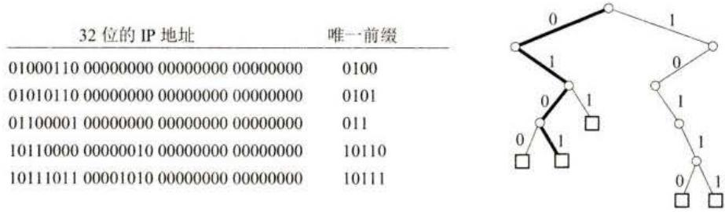

# 4.3.3 使用二叉线索查找转发表

使用 CIDR 后，由于不知道目的网络的前缀，使转发表的查找过程变得更加复杂了。当转发表的项目数很大时，怎样设法缩短转发表的查找时间就成为一个非常重要的问题。例如，连接路由器的线路的速率为 10 Gbit/s，而分组的平均长度为 2000 bit，那么路由器就应当平均每秒钟能够处理 500 万个分组（常记为 5 Mpps）。或者说，路由器处理一个分组的平均时间只有 200 ns（ $1 \text{ ns} = 10^{-9} \text{ s}$ ）。因此，查找每一个路由所需的时间是非常短的。可见在转发表中必须使用很好的数据结构和先进的快速查找算法，这一直是人们积极研究的热门课题。

对无分类编址的转发表的最简单的查找算法就是对所有可能的前缀进行循环查找，从最长的前缀开始查找。例如，给定一个目的地址。对每一个可能的网络前缀，进行目的地址和子网掩码的按位 AND 运算，得出一个网络前缀，然后逐行查找转发表中的网络前缀。所找到的最长匹配就对应于要查找的路由。

这种最简单的算法的明显缺点就是查找的次数太多。最坏的情况是转发表中没有这个路由。在这种情况下，算法仍要进行32次（第1次用32位的前缀查找转发表中所有的行，第2次用31位的前缀查找所有的行，这样一直查找下去）。

为了进行更加有效的查找，通常是把无分类编址的转发表存放在一种层次的数据结构中，然后自上而下地按层次进行查找。这里最常用的就是二叉线索(binary trie) $^{①}$ ，它是一种特殊结构的树。IP 地址中从左到右的比特值决定了从根节点逐层向下层延伸的路径，而二叉线索中的各个路径就代表转发表中存放的各个地址。

> ① 注：线索(trie)来自 retrieval（检索），读音与 “try” 相同。

图 4-27 用一个例子来说明二叉线索的结构。图中给出了 5 个 IP 地址。为了简化二叉线索的结构，可以先找出对应于每一个 IP 地址的唯一前缀(unique prefix)。所谓唯一前缀就是在表中所有的 IP 地址中，该前缀是唯一的。这样就可以用这些唯一前缀来构造二叉线索。在进行查找时，只要能够和唯一前缀相匹配就行了。

> 图4-27 用5个前缀构成的二叉线索（教材第 145 页）

从二叉线索的根节点自顶向下的深度最多有32层，每一层对应于IP地址中的一位。一个IP地址存入二叉线索的规则很简单：先检查IP地址左边的第一位，如为0，则第一层的节点就在根节点的左下方；如为1，则在右下方。然后再检查地址的第二位，构造出第二层的节点。依此类推，直到唯一前缀的最后一位。由于唯一前缀一般都小于32位，因此用唯一前缀构造的二叉线索的深度往往不到32层。图中较粗的折线就是前缀0101在这个二叉线索中的路径。二叉线索中的小圆圈是中间节点，而在路径终点的小方框是叶节点（也叫作外部节点）。每个叶节点代表一个唯一前缀。节点之间的连线旁边的数字表示这条边在唯一前缀中对应的比特是0或1。

假定有一个 IP 地址是 10011011 01111010 00000000 00000000，需要查找该地址是否在此二叉线索中。我们从最左边查起。很容易发现，查到第三个字符（即前缀 10 后面的 0）时，在二叉线索中就找不到匹配的，说明这个地址不在这个二叉线索中。

以上只是给出了二叉线索这种数据结构的用法，而并没有说明“与唯一前缀匹配”和“与网络前缀匹配”的关系。显然，要将二叉线索用于转发表中，还必须使二叉线索中的每一个叶节点包含所对应的网络前缀和子网掩码。当搜索到一个叶节点时，就必须将寻找匹配的目的地址和该叶节点的子网掩码进行按位 AND 运算，看结果是否与对应的网络前缀相匹配。若匹配，就按下一跳的接口转发该分组。否则，就丢弃该分组。

总之，二叉线索只是提供了一种可以快速在转发表中找到匹配的叶节点的机制。但这是否和网络前缀匹配，还要和子网掩码进行一次逻辑 AND 运算。

为了提高二叉线索的查找速度，广泛使用了各种压缩技术。例如，在图 4-27 中的最后两个地址，其最前面的 4 位都是 1011。因此，只要一个地址的前 4 位是 1011，就可以跳过前面 4 位（即压缩了 4 个层次）而直接从第 5 位开始比较。这样就可以减少查找的时间。当然，制作经过压缩的二叉线索需要更多的计算，但由于每一次查找转发表时都可以提高查找速度，因此这样做还是值得的。
