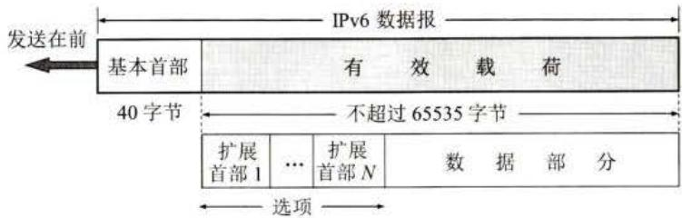
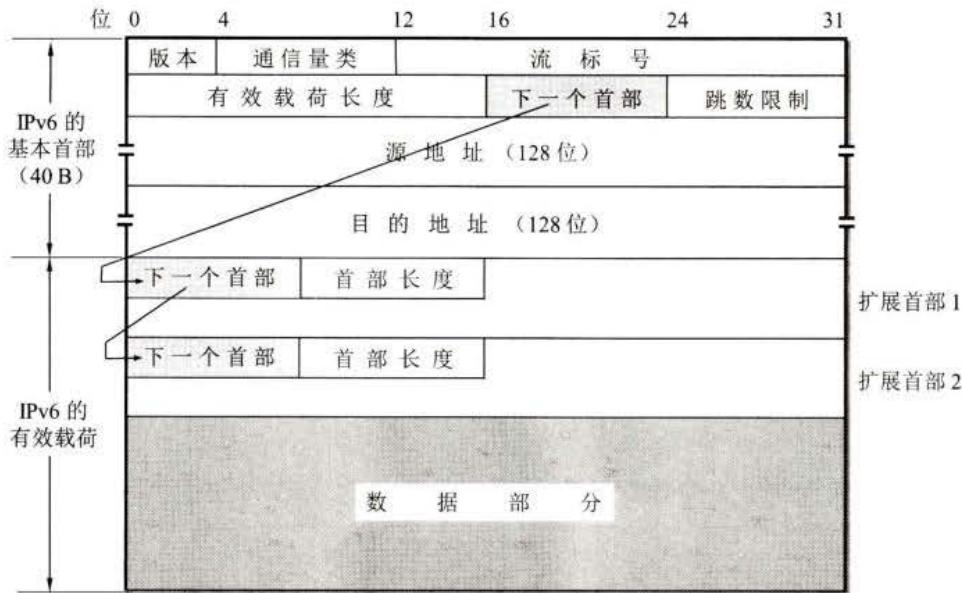

# 4.5.1 IPv6的基本首部

## 4.5 IPv6

协议 IP 是互联网的核心协议。现在使用的协议 IP（即 IPv4）是在 20 世纪 70 年代末期设计的。互联网经过几十年的飞速发展，在 2011 年 2 月 3 日，IANA 开始停止向地区互联网注册机构 RIR 分配 IPv4 地址，因为 IPv4 地址已经全部耗尽了。不久，各地区互联网地址分配机构也相继宣布地址耗尽。我国在 2014 年至 2015 年也逐步停止了向新用户和应用分配 IPv4 地址，同时全面开始商用部署 IPv6。

解决 IP 地址耗尽的根本措施就是采用具有更大地址空间的新版本的 IP，即 IPv6。经过多年的研究和试验，2017 年 7 月终于发布了 IPv6 的正式标准[RFC 8200, STD86]。

IPv6 仍支持无连接的传送，但将协议数据单元 PDU 称为分组(packet)，而不是 IPv4 的数据报(datagram)。为方便起见，本书仍采用数据报这一名词（[KURO17]和[TANE11]也是这样做的）。实际上，在本书中一直把分组和数据报看成是同义词。

IPv6 所引进的主要变化如下:

(1) 更大的地址空间。IPv6 把地址从 IPv4 的 32 位增大到 4 倍，即增大到 128 位，使地址空间增大了 $2^{96}$ 倍。这样大的地址空间在可预见的将来是不会用完的。

(2) 扩展的地址层次结构。IPv6 由于地址空间很大，因此可以划分为更多的层次。

(3) 灵活的首部格式。IPv6 数据报的首部和 IPv4 的并不兼容。IPv6 定义了许多可选的扩展首部，不仅可提供比 IPv4 更多的功能，而且还可提高路由器的处理效率，这是因为路由器对扩展首部不进行处理（除逐跳扩展首部外）。

(4) 改进的选项。IPv6 允许数据报包含有选项的控制信息，因而可以包含一些新的选项。但 IPv6 的首部长度是固定的，其选项放在有效载荷中。我们知道，IPv4 所规定的选项是固定不变的，其选项放在首部的可变部分。

(5) 允许协议继续扩充。这一点很重要，因为技术总是在不断地发展的（如网络硬件的更新），而新的应用也还会出现。但我们知道，IPv4 的功能是固定不变的。

(6) 支持即插即用（即自动配置）。因此 IPv6 不需要使用 DHCP。

(7) 支持资源的预分配。IPv6 支持实时视像等要求保证一定的带宽和时延的应用。

(8) IPv6 首部改为 8 字节对齐（即首部长度必须是 8 字节的整数倍）。原来的 IPv4 首部是 4 字节对齐。

IPv6 数据报由两大部分组成，即基本首部(base header)和后面的有效载荷(payload)。有效载荷也称为净负荷。有效载荷允许有零个或多个扩展首部(extension header)，再后面是数据部分（如图 4-32 所示）。但请注意，所有的扩展首部并不属于 IPv6 数据报的基本首部。

> 图 4-32 具有多个可选扩展首部的 IPv6 数据报的一般形式（教材第 150 页）

与 IPv4 相比，IPv6 对首部中的某些字段进行了如下的更改：

\- 取消了首部长度字段，因为它的首部长度是固定的（40字节）。

\- 取消了服务类型字段，因为优先级和流标号字段实现了服务类型字段的功能。

\- 取消了总长度字段，改用有效载荷长度字段。

\- 取消了标识、标志和片偏移字段，因为这些功能已包含在分片扩展首部中。

\- 把TTL字段改称为跳数限制字段，但作用是一样的（名称与作用更加一致）。

\- 取消了协议字段，改用下一个首部字段。

\- 取消了检验和字段，这样就加快了路由器处理数据报的速度。我们知道，在数据链路层对检测出有差错的帧就丢弃。在运输层，当使用 UDP 时，若检测出有差错的用户数据报就丢弃。当使用 TCP 时，对检测出有差错的报文段就重传，直到正确传送到目的进程为止。因此在网络层的差错检测可以精简掉。

\- 取消了选项字段，而用扩展首部来实现选项功能。

由于把首部中不必要的功能取消了，使得 IPv6 首部的字段数减少到只有 8 个（虽然首部长度增大了一倍）。

下面解释 IPv6 基本首部中各字段的作用（参见图 4-33）。

> 图 4-33 IPv6 基本首部和有效载荷（这里画出了两个扩展首部作为例子）（教材第 151 页）

(2) 通信量类(traffic class) 占 8 位。这是为了区分不同的 IPv6 数据报的类别或优先级，和 IPv4 的区分服务字段的作用相似。目前正在进行不同的通信量类性能的实验。

(3) 流标号(flow label) 占 20 位。IPv6 的一个新的机制是支持资源预分配，并且允许路由器把每一个数据报与一个给定的资源分配相联系。IPv6 提出流(flow)的抽象概念。所谓“流”就是互联网络上从特定源点到特定终点（单播或多播）的一系列数据报（如实时音频或视频传输），而在这个“流”所经过的路径上的路由器都保证指明的服务质量。所有属于同一个流的数据报都具有同样的流标号。因此，流标号对实时音频/视频数据的传送特别有用。对于传统的电子邮件或非实时数据，流标号则没有用处，把它置为 0 即可。关于流标号的规约可参考建议标准[RFC 6437]。

(4) 有效载荷长度(payload length) 占 16 位。它指明 IPv6 数据报除基本首部以外的字节数（所有扩展首部都算在有效载荷之内）。这个字段的最大值是 64 KB（65535 字节）。

(5) 下一个首部(next header) 占 8 位。它相当于 IPv4 的协议字段或可选字段。

\- 当 IPv6 数据报没有扩展首部时，下一个首部字段的作用和 IPv4 的协议字段一样，它的值指出了基本首部后面的数据应交付 IP 层上面的哪一个高层协议（例如：6 或 17 分别表示应交付运输层 TCP 或 UDP）。

\- 当出现扩展首部时，下一个首部字段的值就标识后面第一个扩展首部的类型。

(6) 跳数限制(hop limit) 占 8 位。用来防止数据报在网络中无限期地存在。和 IPv4 的生存时间字段相似。源点在每个数据报发出时即设定某个跳数限制（最大为 255 跳）。每个路由器在转发数据报时，要先把跳数限制字段中的值减 1。当跳数限制的值为零时，就要把这个数据报丢弃。

(7) 源地址 占 128 位。是数据报的发送端的 IP 地址。

(8) 目的地址 占 128 位。是数据报的接收端的 IP 地址。

下面我们简单介绍一下 IPv6 的扩展首部。

在 RFC 8200 中定义了以下六种扩展首部：（1）逐跳选项；（2）路由选择；（3）分片；（4）鉴别；（5）封装安全有效载荷；（6）目的站选项。

每一个扩展首部都由若干个字段组成，它们的长度也各不同。但所有扩展首部的第一个字段都是8位的“下一个首部”字段。此字段的值指出了在该扩展首部后面的扩展首部是什么。当使用多个扩展首部时，应按以上的先后顺序出现。高层首部总是放在最后面。

大家知道，IPv4 的数据报若在其首部中使用了选项，则在数据报转发路径中的每一个路由器，都必须检查首部中的所有选项，看是否与本路由器相关。这必然要花费相当的时间。IPv6 把原来 IPv4 首部中选项的功能都放在扩展首部中。IPv6 数据报若使用了扩展首部，则其基本首部的“下一个首部”字段会指出，在“有效载荷”字段中使用了何种扩展首部。而所有扩展首部的第一个字段都是“下一个首部”，用来指出在后面还有何种扩展首部。这就使得路由器能够迅速判断待转发的 IPv6 数据报有无需要本路由器处理的选项。
