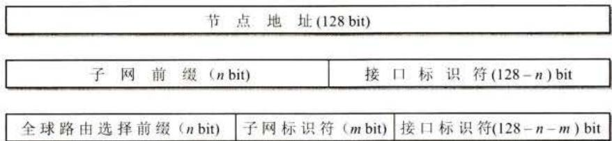

# 4.5.2 IPv6的地址

一般来讲，一个 IPv6 数据报的目的地址可以是以下三种基本类型地址之一：

(1) 单播(unicast) 单播就是传统的点对点通信。

(2) 多播(multicast) 多播是一点对多点的通信，数据报发送到一组计算机中的每一个。IPv6 没有采用广播的术语，而是将广播看作多播的一个特例。

(3) 任播(anycast) 这是 IPv6 增加的一种类型。任播的终点是一组计算机，但数据报只交付其中的一个，通常是按照路由算法得出的距离最近的一个。

IPv6 把实现 IPv6 的主机和路由器均称为节点。由于一个节点可能会使用多条链路与其他的一些节点相连，因此一个节点可能有多个与链路相连的接口。这样，IPv6 给节点的每一个接口（请注意，不是给某个节点）指派一个 IPv6 地址。一个具有多个接口的节点可以有多个单播地址，而其中任何一个地址都可当作到达该节点的目的地址。不过有时为了方便，若不会引起误解，也常说某个节点的 IPv6 地址，而把某个接口省略掉。

在 IPv6 中，每个地址占 128 位，地址空间大于 $3.4 \times 10^{38}$ 。如果整个地球表面（包括陆地和水面）都覆盖着计算机，那么 IPv6 允许每平方米拥有 $7 \times 10^{23}$ 个 IP 地址。如果地址分配速率是每微秒分配 100 万个地址，则需要 $10^{19}$ 年的时间才能将所有可能的地址分配完毕。可见在想象到的将来，IPv6 的地址空间是不可能用完的。

为了体会一下 IPv6 的地址有多大，可以看一下目前已经分配出去的最大的地址块。法国电信 France Telecom 和德国电信 Deutsche Telekom 各分配到一个/19 地址块，相当于各有 $35 \times 10^{12}$ 个地址，远远大于全部的 IPv4 地址（IPv4 地址还不到 $4.3 \times 10^{9}$ 个）。

巨大的地址范围还必须使维护互联网的人易于阅读和操纵这些地址。IPv4 所用的点分十进制记法现在也不够方便了。例如，一个用点分十进制记法的 128 位的地址为：

$$ 1 0 4. 2 3 0. 1 4 0. 1 0 0. 2 5 5. 2 5 5. 2 5 5. 2 5 5. 0. 0. 1 7. 1 2 8. 1 5 0. 1 0. 2 5 5. 2 5 5 $$

为了使地址再稍简洁些，IPv6 使用冒号十六进制记法 (colon hexadecimal notation, 简写为 colon hex)，它把每个 16 位的值用十六进制值表示，各值之间用冒号分隔。例如，如果前面所给的点分十进制数记法的值改为冒号十六进制记法，就变成了：

$$ 6 8 E 6: 8 C 6 4: F F F F: F F F F: 0: 1 1 8 0: 9 6 0 A: F F F F $$

在十六进制记法中，允许把数字前面的0省略。上面就把0000中的前三个0省略了。

冒号十六进制记法还包含两个技术使它尤其有用。首先，冒号十六进制记法可以允许零压缩(zero compression)，即一连串连续的零可以为一对冒号所取代，例如：

$$ \mathrm{FF05:0:0:0:0:0:0:B3} $$

可压缩为：

$$ \mathrm{FF05::B3} $$

为了保证零压缩有一个不含混的解释，规定在任一地址中只能使用一次零压缩。该技术对已建议的分配策略特别有用，因为会有许多地址包含较长连续的零串。

其次，冒号十六进制记法可结合使用点分十进制记法的后缀。我们下面会看到这种结合在 IPv4 向 IPv6 的转换阶段特别有用。例如，下面的串是一个合法的冒号十六进制记法：

$$ 0: 0: 0: 0: 0: 0: 1 2 8. 1 0. 2. 1 $$

请注意，在这种记法中，冒号所分隔的每个值是两个字节（16 位）的值，但点分十进制每个部分的值是一个字节（8 位）的值。再使用零压缩即可得出：

$$ \because 1 2 8. 1 0. 2. 1 $$

下面再给出几个使用零压缩的例子。

FF01:0:0:0:0:0:0:101（多播地址）记为 FF01::101

CIDR 的斜线表示法仍然可用。例如，60 位的前缀 12AB00000000CD3（十六进制表示的 15 个字符，每个字符代表 4 位二进制数字）可记为：

或 12AB::CD30:0:0:0:0/60

或 12AB:0:0:CD30::/60

但不允许记为：

12AB:0:0:CD3/60（不能把16位地址CD30块中的最后的0省略）

或 12AB::CD3/60（这表示12AB:0:0:0:0:0:0:0CD3/60）

但是，IPv6 取消了子网掩码。

斜线的意思和 IPv4 的情况相似。例如，

CIDR 记法的 2001:0DB8:0:CD30:123:4567:89AB:CDEF/60，表示

IPv6 的地址是：2001:0DB8:0:CD30:123:4567:89AB:CDEF

而其子网号是：2001:0DB8:0:CD30::/60

IPv6 的地址分类如表 4-7 所示[RFC 4291]。

> 表 4-7 IPv6 的常用地址分类（教材第 154 页）

| 地址类型 | 地址块前缀 | 前缀的CIDR记法 |
| --- | --- | --- |
| 未指明地址 | 00···0(128位) | ::/128 |
| 环回地址 | 00···1(128位) | ::1/128 |
| 多播地址 | 11111111 | FF00::/8 |
| 本地站点单播地址 | 1111111011 | FEC0::/10 |
| 本地链路单播地址 | 1111111010 | FE80::/10 |
| 全球单播地址 | 见图4-34 |  |

对表 4-7 所列举的几种常用地址简单解释如下。

未指明地址 这是 16 字节的全 0 地址，可缩写为两个冒号“::”。这个地址不能用作目的地址，而只能将某台主机当作源地址使用，条件是这台主机还没有配置到一个标准的 IP 地址。这类地址仅此一个。

环回地址 IPv6 的环回地址是 0:0:0:0:0:0:0:1，可缩写为::1。它的作用和 IPv4 的环回地址一样。这类地址也是仅此一个。

多播地址 功能和 IPv4 的一样。这类地址占 IPv6 地址总数的 1/256。

本地站点单播地址(cite-local unicast address) 有些单位的内部网络使用 TCP/IP 协议，但并没有连接到互联网上。连接在这样的内部网络上的主机都可以使用这种本地站点地址进行通信，但不能和互联网上的其他主机通信。这类地址占 IPv6 地址总数的 1/1024，其用途和和 IPv4 的专用地址是一样的。

本地链路单播地址(link-local unicast address) 这种地址是在单一链路上使用的。当一个节点启用 IPv6 时就自动生成本地链路地址（请注意，这个节点现在并没有连接在某个网络上）。当需要把分组发往单一链路的设备而不希望该分组被转发到此链路范围以外的地方时，就可以使用这种特殊地址。这类地址占 IPv6 地址总数的 1/1024。

全球单播地址 IPv6 的这一类单播地址是使用得最多的一类。曾提出过多种方案来进一步划分这 128 位的单播地址。根据 2006 年发布的草案标准 RFC 4291 的建议，IPv6 单播地址的划分方法非常灵活，可以是如图 4-34 所示的任何一种。这就是说，可把整个的 128 位都作为一个节点的地址。也可用 n 位作为子网前缀，用剩下的 $(128 - n)$ 位作为接口标识符（相当于 IPv4 的主机号）。当然也可以划分为三级，用 n 位作为全球路由选择前缀，用 m 位作为子网前缀，而用剩下的 $(128 - n - m)$ 位作为接口标识符。

> 图 4-34 IPv6 的单播地址的几种划分方法（教材第 154 页）
