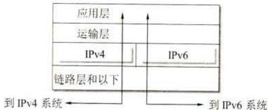
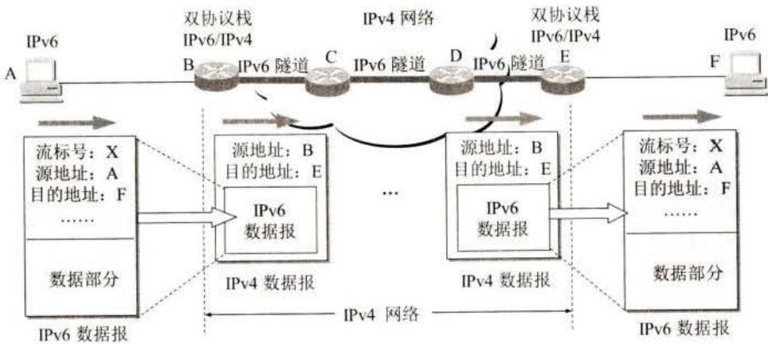

# 4.5.3 从IPv4向IPv6过渡

由于现在整个互联网的规模太大，因此，“规定一个日期，从这一天起所有的路由器一律都改用 IPv6”，显然是不可行的。这样，向 IPv6 过渡只能采用逐步演进的办法，同时，还必须使新安装的 IPv6 系统能够向后兼容。这就是说，IPv6 系统必须能够接收和转发 IPv4 分组，并且能够为 IPv4 分组选

下面介绍两种向 IPv6 过渡的策略，即使用双协议栈和使用隧道技术[RFC 2473, 2529, 3056, 4038, 4213]。

## 1. 双协议栈

双协议栈(dual stack)是指在完全过渡到 IPv6 之前，使一部分主机（或路由器）同时装有 IPv4 和 IPv6 这两种协议栈。因此双协议栈主机（或路由器）既能够和 IPv6 的系统通信，又能够和 IPv4 的系统通信。双协议栈的主机（或路由器）记为 IPv6/IPv4，表明它同时具有 IPv6 地址和 IPv4 地址（如图 4-35 所示）。

> 图 4-35 使用双协议栈进行从 IPv4 到 IPv6 的过渡（教材第 155 页）

双协议栈的主机在和 IPv6 主机通信时采用 IPv6 地址，而和 IPv4 主机通信时则采用 IPv4 地址。但双协议栈主机怎样知道目的主机是采用哪一种地址呢？它是使用域名系统 DNS 来查询的。若 DNS 返回的是 IPv4 地址，则双协议栈的源主机就使用 IPv4 地址。但当 DNS 返回的是 IPv6 地址，源主机就使用 IPv6 地址。

双协议栈需要付出的代价太大，因为要安装上两套协议。因此在过渡时期，最好采用下面的隧道技术。

## 2. 隧道技术

向 IPv6 过渡的另一种方法是隧道技术(tunneling)。图 4-36 给出了隧道技术的工作原理。这种方法的要点就是在 IPv6 数据报要进入 IPv4 网络时，把 IPv6 数据报封装成为 IPv4 数据报。现在整个的 IPv6 数据报变成了 IPv4 数据报的数据部分。这样的 IPv4 数据报从路由器 B 经过路由器 C 和 D，传送到 E，而原来的 IPv6 数据报就好像在 IPv4 网络的隧道中传输，什么都没有变化。当 IPv4 数据报离开 IPv4 网络中的隧道时，再把数据部分（即原来的 IPv6 数据报）交给主机的 IPv6 协议栈。图中的一条粗线表示在 IPv4 网络中好像有一个从 B 到 E 的 “IPv6 隧道”，路由器 B 是隧道的入口而 E 是出口。请注意，在隧道中传送的数据报的源地址是 B 而目的地址是 E。

> 图 4-36 使用隧道技术进行从 IPv4 到 IPv6 的过渡（教材第 156 页）

要使双协议栈的主机知道 IPv4 数据报里面封装的数据是一个 IPv6 数据报，就必须把 IPv4 首部的协议字段的值设置为 41（41 表示数据报的数据部分是 IPv6 数据报）。
