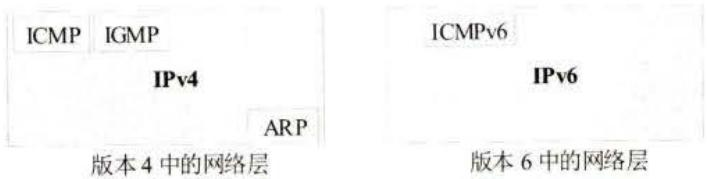

# 4.5.4 ICMPv6

和 IPv4 一样，IPv6 也不保证数据报的可靠交付，因为互联网中的路由器可能会丢弃数据报。因此 IPv6 也需要使用 ICMP 来反馈一些差错信息。新的版本称为 ICMPv6，它比 ICMPv4 要复杂得多。地址解析协议 ARP 和网际组管理协议 IGMP 的功能都已被合并到 ICMPv6 中（如图 4-37 所示）。

> 图 4-37 新旧版本中的网络层的比较（教材第 156 页）

ICMPv6 是面向报文的协议，它利用报文来报告差错，获取信息，探测邻站或管理多播通信。ICMPv6 还增加了几个定义报文功能及含义的其他协议。在对 ICMPv6 报文进行归类时，不同的文献和 RFC 文档使用了不同的策略，有的把其中的一些报文定义为 ICMPv6 报文，而把另一些报文定义为邻站发现 ND(Neighbor-Discovery)报文或多播听众交付 MLD (Multicast Listener Delivery)报文。其实所有这些报文都应当是 ICMPv6 报文，只是功能和作用不同而已。因此我们把这些报文都列入 ICMPv6 的不同类别。使用这种分类方法的原因是所有这些报文都具有相同的格式，并且所有报文类型都由 ICMPv6 协议处理。其实，像 ND 和 MLD 这样的协议都是运行在 ICMPv6 协议之下的。基于这样的考虑，可把 ICMPv6 报文分类，如图 4-38 所示。请注意，邻站发现报文和组成员关系报文分别是在 ND 协议和 MLD 协议的控制下进行发送和接收的。

> 图 4-38 ICMPv6 报文的分类（教材第 157 页）

关于 ICMPv6 的进一步讨论可参阅[FORO10]，这里从略。
