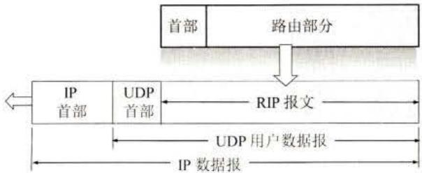
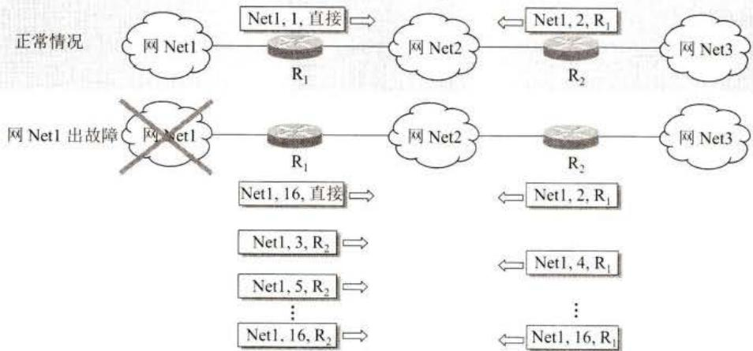

# 4.6.2 内部网关协议RIP

## 1. 协议 RIP 的工作原理

RIP (Routing Information Protocol) 是内部网关协议 IGP 中最先得到广泛使用的协议 [RFC 1058]，它的中文译名是路由信息协议。RIP 是一种分布式的基于距离向量的路由选择协议，是互联网的标准协议，其最大优点就是简单。

RIP 协议要求网络中的每一个路由器都要维护从它自己到其他每一个目的网络的距离记录（因此，这是一组距离，即“距离向量”）。协议 RIP 将“距离”定义如下：

从一路由器到直接连接的网络的距离定义为 1。从一主机到非直接连接的网络的距离定义为所经过的路由器数加 1。“加 1” 是因为到达目的网络后就进行直接交付（不需要再经过路由器），而到直接连接的网络的距离已经定义为 1。

协议 RIP 的 “距离” $^{①}$ 也称为 “跳数” (hop count)，并且每经过一个网络，跳数就加 1。RIP 认为好的路由就是它通过的网络数目少，即 “距离短”。RIP 允许一条路径最多只能包含 15 个网络。因此 “距离” 等于 16 时即相当于不可达。可见 RIP 只适用于小型互联网。

> ① 注：这里的“距离”实际上指的是“最短距离”，但为方便起见往往省略“最短”二字。

例如在前面的图 4-7 中，主机 $H_{1}$ 经过 5 个路由器连接到另一个主机 $H_{2}$ ，中间经过了 6 个网络或经过 6 跳。或者说， $H_{1}$ 到 $H_{2}$ 的距离是 6。在图中并没有画出网络。在讨论路由选择问题时，在主机和路由器之间或在路由器之间的网络，往往都用一条线段来表示。需要注意的是，到直接连接的网络的距离也可定义为 0。但这两种不同的定义对实现协议 RIP 并无影响，因为这对选择最佳路由的过程其实是一样的。

RIP 不能在两个网络之间同时使用多条路由。RIP 选择一条具有最少网络数的路由（即最短路由），哪怕还存在另一条高速（低时延）但网络数较多的路由。

本节讨论的 RIP 协议和下一节要讨论的 OSPF 协议，都是分布式路由选择协议。它们的共同特点就是每一个路由器都要不断地和其他一些路由器交换路由信息。我们一定要弄清以下三个要点，即和哪些路由器交换信息？交换什么信息？在什么时候交换信息？

协议 RIP 的特点是:

(1) 仅和相邻路由器交换信息。如果两个路由器之间的通信不需要经过另一个路由器，那么这两个路由器就是相邻的。协议 RIP 规定，不相邻的路由器不交换信息。

(2) 路由器交换的信息是当前本路由器所知道的全部信息，即自己现在的路由表。也就是说，交换的信息是：“我到本自治系统中所有网络的（最短）距离，以及到每个网络应经过的下一跳路由器”。

(3) 按固定的时间间隔交换路由信息，例如，每隔 30 秒。然后路由器根据收到的路由信息更新路由表。当网络拓扑发生变化时，路由器也及时向相邻路由器通告拓扑变化后的路由信息。网络中的主机虽然也运行协议 RIP，但只被动地接收路由器发来的路由信息。

这里要强调一点：路由器在刚刚开始工作时，它的路由表是空的。然后路由器就得出到直接相连的几个网络的距离（这些距离定义为1）。接着，每一个路由器也只和数目非常有限的相邻路由器交换并更新路由信息。但经过若干次的更新后，所有的路由器最终都会知道到达本自治系统中任何一个网络的最短距离和下一跳路由器的地址。

看起来协议 RIP 有些奇怪，因为 “我的路由表中的信息要依赖于你的，而你的信息又依赖于我的。” 然而事实证明，通过这样的方式——“我告诉别人一些信息，而别人又告诉我一些信息。我再把我知道的更新后的信息告诉别人，别人也这样把更新后的信息再告诉我”，最后在自治系统中所有的节点都得到了正确的路由选择信息。在一般情况下，协议 RIP 可以收敛，并且过程也较快。“收敛” 就是在自治系统中所有的节点都得到正确的路由选择信息的过程。

路由表中最主要的信息就是：到某个网络的距离（即最短距离），以及应经过的下一跳地址。路由表更新的原则是找出到每个目的网络的最短距离。这种更新算法又称为距离向量算法。下面就是协议 RIP 使用的距离向量算法。

## 2. 距离向量算法

对每一个相邻路由器发送过来的 RIP 报文，执行以下步骤：

(1) 对地址为 X 的相邻路由器发来的 RIP 报文，先修改此报文中的所有项目：把 “下一跳” 字段中的地址都改为 X，并把所有的 “距离” 字段的值加 1（见后面的解释 1）。每一个项目都有三个关键数据，即：到目的网络 Net，距离是 d，下一跳路由器是 X。

(2) 对修改后的 RIP 报文中的每一个项目，进行以下步骤：

若原来的路由表中没有目的网络 Net，则把该项目添加到路由表中（见解释 2）。

否则（即在路由表中有目的网络 Net，这时就再查看下一跳路由器地址）。

若下一跳路由器地址是 X，则把收到的项目替换原路由表中的项目（见解释 3）。

否则（即这个项目是：到目的网络 Net，但下一跳路由器不是 X）。

若收到的项目中的距离 d 小于路由表中的距离，则进行更新（见解释 4），否则什么也不做（见解释 5）。

(3) 若 3 分钟还没有收到相邻路由器的更新路由表，则把此相邻路由器记为不可达的路由器，即把距离置为 16（距离为 16 表示不可达）。

(4) 返回。

上面给出的距离向量算法的基础就是 Bellman-Ford 算法（或 Ford-Fulkerson 算法）。这种算法的要点是这样的：

设 X 是节点 A 到 B 的最短路径上的一个节点。若把路径 A→B 拆成两段路径 A→X 和 X→B，则每一段路径 A→X 和 X→B 也都分别是节点 A 到 X 和节点 X 到 B 的最短路径。

下面是对上述距离向量算法的五点解释。

解释 1：这样做是为了便于进行本路由表的更新。假设从位于地址 X 的相邻路由器发来的 RIP 报文的某一个项目是：“Net2, 3, Y”，意思是“我经过路由器 Y 到网络 Net2 的距离是 3”，那么本路由器就可推断出：“我经过 X 到网络 Net2 的距离应为 $3 + 1 = 4$ ”。于是，本路由器就把收到的 RIP 报文的这一个项目修改为 “Net2, 4, X”，作为下一步和路由表中原有项目进行比较时使用（只有比较后才能知道是否需要更新）。读者可注意到，收到的项目中的 Y 对本路由器是没有用的，因为 Y 不是本路由器的下一跳路由器地址。

解释 2：表明这是新的目的网络，应当加入到路由表中。例如，本路由表中没有到目的网络 Net2 的路由，那么在路由表中就要加入新的项目 “Net2, 4, X”。

解释 3：为什么要替换呢？因为这是最新的消息，要以最新的消息为准。到目的网络的距离有可能增大或减小，但也可能没有改变。例如，不管原来路由表中的项目是 “Net2, 3, X” 还是 “Net2, 5, X”，都要更新为现在的 “Net2, 4, X”。

解释 4：例如，若路由表中已有项目 “Net2, 5, P”，就要更新为 “Net2, 4, X”。因为到网络 Net2 的距离原来是 5，现在减到 4，更短了。

解释 5: 若距离更大了, 显然不应更新。若距离不变, 更新后得不到好处, 因此也不更新。

【例 4-4】已知路由器 $R_{6}$ 有表 4-8(a) 所示的路由表。现在收到相邻路由器 $R_{4}$ 发来的路由更新信息，如表 4-8(b) 所示。试更新路由器 $R_{6}$ 的路由表。

> 表 4-8(a) 路由器 ${\mathrm{R}}_{6}$ 的路由表（教材第 161 页）

| 目的网络 | 距离 | 下一跳路由器 |
| --- | --- | --- |
| Net2 | 3 | $R_{4}$ |
| Net3 | 4 | $R_{5}$ |
| ... | ... | ... |

> 表 4-8(b) ${\mathrm{R}}_{4}$ 发来的路由更新信息（教材第 161 页）

| 目的网络 | 距离 | 下一跳路由器 |
| --- | --- | --- |
| Net1 | 3 | $R_1$ |
| Net2 | 4 | $R_2$ |
| Net3 | 1 | 直接交付 |

【解】如同路由器一样，我们不需要知道该网络的拓扑。

先把表 4-8(b) 中的距离都加 1，并把下一跳路由器都改为 $R_{4}$ ，得出表 4-8(c)。

> 表 4-8(c) 修改后的表 4-8(b)（教材第 162 页）

| 目的网络 | 距离 | 下一跳路由器 |
| --- | --- | --- |
| Net1 | 4 | $R_{4}$ |
| Net2 | 5 | $R_{4}$ |
| Net3 | 2 | $R_{4}$ |

把这个表的每一行和表 4-8(a) 进行比较。

第一行在表 4-8(a) 中没有，因此要把这一行添加到表 4-8(a) 中。

第二行的 Net2 在表 4-8(a) 中有，且下一跳路由器也是 $R_{4}$ 。因此要更新（距离增大了）。

第三行的 Net3 在表 4-8(a) 中有，但下一跳路由器不同。于是就要比较距离。新的路由信息的距离是 2，小于原来表中的 4，因此要更新。

这样，得出更新后的 $R_{6}$ 的路由表如表 4-8(d) 所示。

> 表 4-8(d) 路由器 ${\mathrm{R}}_{6}$ 更新后的路由表（教材第 162 页）

| 目的网络 | 距离 | 下一跳路由器 |
| --- | --- | --- |
| Net1 | 4 | $R_{4}$ |
| Net2 | 5 | $R_{4}$ |
| Net3 | 2 | $R_{4}$ |
| ... | ... | ... |

协议 RIP 让一个自治系统中的所有路由器都和自己的相邻路由器定期交换路由信息，并不断更新其路由表，使得从每一个路由器到每一个目的网络的路由都是最短的（即跳数最少）。这里还应注意：虽然所有的路由器最终都拥有了整个自治系统的全局路由信息，但由于每一个路由器的位置不同，它们的路由表当然也应当是不同的。

现在较新的 RIP 版本是 1998 年 11 月公布的 RIP2 [RFC 2453, STD57]，新版本协议本身并无多大变化，但性能上有些改进。RIP2 可以支持无分类域间路由选择 CIDR。此外，RIP2 还提供简单的鉴别过程支持多播。

图 4-40 表明 RIP 报文作为运输层用户数据报 UDP 的数据部分进行传送（使用 UDP 的端口 520。端口的意义见 5.2.2 节）。

> 图 4-40 RIP2 的报文用 UDP 用户数据报传送（教材第 162 页）

RIP 报文由首部和路由部分组成。在路由部分要填入自治系统号 ASN (Autonomous

System Number) $^{①}$ ，这是考虑使 RIP 有可能收到本自治系统以外的路由选择信息。还要指出目的网络地址（包括网络的子网掩码）、下一跳路由器地址以及到此网络的距离。一个 RIP 报文最多可包括 25 个路由。如超过，必须再用一个 RIP 报文来传送。

## 3. 坏消息传播得慢

RIP 存在的一个问题是当网络出现故障时，要经过比较长的时间才能将此信息传送到所有的路由器。我们可以用图 4-41 的简单例子来说明。设三个网络通过两个路由器互连起来，并且都已建立了各自的路由表。图中路由器交换的信息只给出了我们感兴趣的一行内容。路由器 $R_{1}$ 中的 “Net1, 1, 直接” 表示 “到网 Net1 的距离是 1, 直接交付”。路由器 $R_{2}$ 中的 “Net1, 2, $R_{1}$ ” 表示 “到网 Net1 的距离是 2, 下一跳经过 $R_{1}$ ”。

> 图 4-41 协议 RIP 的缺点：坏消息传播得慢（教材第 163 页）

现在假定路由器 $R_{1}$ 到网 Net1 的链路出了故障， $R_{1}$ 无法到达网 Net1。于是路由器 $R_{1}$ 把到网 Net1 的距离改为 16，表示不可达，因而在 $R_{1}$ 的路由表中的相应项目变为 “Net1, 16, 直接”。但是，很可能要经过 30 秒钟后 $R_{1}$ 才把更新信息发送给 $R_{2}$ 。然而 $R_{2}$ 可能已经先把自己的路由表发送给了 $R_{1}$ ，其中有 “Net1, 2, $R_{1}$ ” 这一项。

$R_{1}$ 收到 $R_{2}$ 的更新报文后，误认为可经过 $R_{2}$ 到达网 Net1，于是把收到的路由信息 “Net1, 2, $R_{1}$ ” 修改为：“Net1, 3, $R_{2}$ ”，表明 “我到网 Net1 的距离是 3，下一跳经过 $R_{2}$ ”，并把更新后的信息发送给 $R_{2}$ 。

同理， $R_{2}$ 接着又更新自己的路由表为 “Net1, 4, $R_{1}$ ”，以为 “我到网 Net1 距离是 4，下一跳经过 $R_{1}$ ”。

这样的更新一直继续下去，直到 $R_{1}$ 和 $R_{2}$ 到网 Net1 的距离都增大到 16 时， $R_{1}$ 和 $R_{2}$ 才知道原来网 Net1 是不可达的。协议 RIP 的这一特点叫作：好消息传播得快，而坏消息传播得慢。网络出故障的传播时间往往较长（例如数分钟）。这是 RIP 的一个主要缺点。

但如果一个路由器发现了更短的路由，那么这种更新信息就传播得很快。

> ① 注：自治系统号 ASN 原来规定为一个 16 位的号码（最大的号码是 65535），由 IANA 分配，具体的号码指派范围相当复杂，可从网上查出 [W-ASN]。现在已经把 ASN 扩展到 32 位 [RFC 6793]。自 2007 年 1 月起，32 位自治系统号 ASN 在全球互联网开始分配和使用。为了便于书写，在 32 位 ASN 中使用两段点分十进制记法，把 65535 在第 1 段中记为 1，例如，ASN 131074 可以记为 ASN 2.4。

为了使坏消息传播得更快些，可以采取多种措施。例如，让路由器记录收到某特定路由信息的接口，而不让同一路由信息再通过此接口向反方向传送。

总之，协议 RIP 最大的优点就是实现简单，开销较小。但协议 RIP 的缺点也较多。首先，RIP 限制了网络的规模，它能使用的最大距离为 15（16 表示不可达）。其次，路由器之间交换的路由信息是路由器中的完整路由表，因而随着网络规模的扩大，开销也就增加。最后，“坏消息传播得慢”，使更新过程的收敛时间过长。因此，对于规模较大的网络就应当使用下一节所述的 OSPF 协议。然而目前在规模较小的网络中，使用协议 RIP 的仍占多数。
