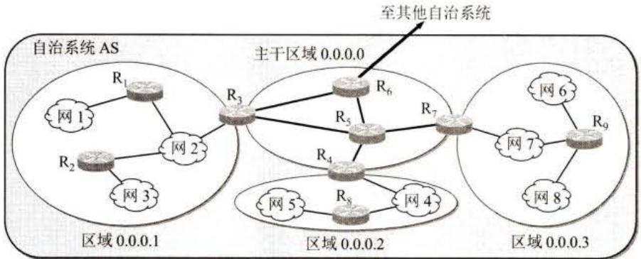
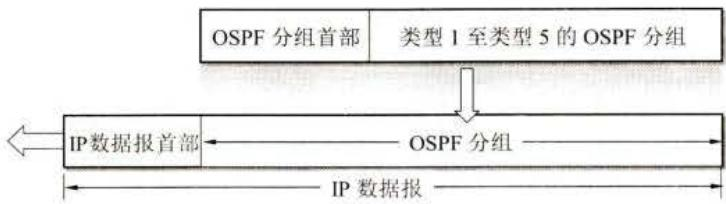
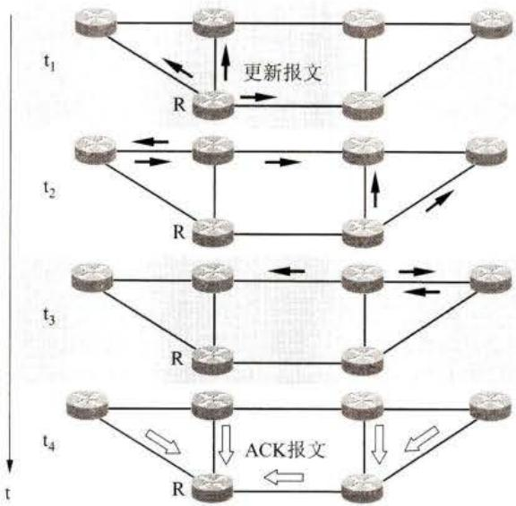

# 4.6.3 内部网关协议OSPF

## 1. 协议 OSPF 的基本特点

这个协议的名字是开放最短路径优先 OSPF (Open Shortest Path First)。它是为克服 RIP 的缺点在 1989 年开发出来的。OSPF 的原理很简单，但实

现起来却较复杂。“开放”表明 OSPF 协议不是受某一家厂商控制，而是公开发表的。“最短路径优先”是因为使用了 Dijkstra 提出的最短路径算法 SPF。现在使用的协议 OSPF 是第二个版本 OSPFv2 [RFC 2328, STD54]。关于 OSPF 可参阅专著[MOY98], [HUIT95]。

请注意：OSPF 只是一个协议的名字，它并不表示其他的路由选择协议不是“最短路径优先”。实际上，所有的在自治系统内部使用的路由选择协议（包括协议 RIP）都是要寻找一条最短的路径。

OSPF 最主要的特征就是使用链路状态协议(link state protocol)，而不是像 RIP 那样的距离向量协议。协议 OSPF 的特点是：

(1) 向本自治系统中所有路由器发送信息。这里使用的方法是洪泛法(flooding)，这就是路由器通过所有输出端口向所有相邻的路由器发送信息。而每一个相邻路由器又再将此信息发往其所有的相邻路由器（但不再发送给刚刚发来信息的那个路由器）。这样，最终整个区域中所有的路由器都得到了这个信息的一个副本。更具体的做法后面还要讨论。我们应注意，协议 RIP 是仅仅向自己相邻的几个路由器发送信息。

(2) 发送的信息就是与本路由器相邻的所有路由器的链路状态，但这只是路由器所知道的部分信息。所谓“链路状态”就是说明本路由器都和哪些路由器相邻 $^{①}$ ，以及该链路的“度量”(metric)。OSPF 将这个“度量”用来表示费用、距离、时延、带宽，等等。这些都由网络管理人员来决定，因此较为灵活。有时为了方便就称这个度量为“代价”。我们应注意，对于协议 RIP，发送的信息是：“到所有网络的距离和下一跳路由器”。

(3) 当链路状态发生变化或每隔一段时间（如 30 分钟），路由器向所有路由器用洪泛法发送链路状态信息。

从上述的前两点可以看出，OSPF 和 RIP 的工作原理相差较大。

由于各路由器之间频繁地交换链路状态信息，因此所有的路由器最终都能建立一个链路状态数据库(link-state database)，这个数据库实际上就是全网的拓扑结构图。这个拓扑结构图在全网范围内是一致的（这称为链路状态数据库的同步）。因此，每一个路由器都知道全网共有多少个路由器，以及哪些路由器是相连的，其代价是多少，等等。每一个路由器使用链路状态数据库中的数据，构造出自己的路由表（例如，使用 Dijkstra 的最短路径路由算法）。我们注意到，协议 RIP 的每一个路由器虽然知道到所有的网络的距离以及下一跳路由器，但却不知道全网的拓扑结构（只有到了下一跳路由器，才能知道再下一跳应当怎样走）。

> ① 注：在前面我们已经说过，在讨论路由器之间是如何交换路由信息时，最好将路由器之间的网络简化为一条链路。OSPF 的 “链路状态” 中的 “链路” 实际上就是指 “和这两个路由器都有接口的网络”。

OSPF 的链路状态数据库能较快地进行更新，使各个路由器能及时更新其路由表。OSPF 的更新过程收敛得快是其重要优点。

为了使 OSPF 能够用于规模很大的网络，OSPF 将一个自治系统再划分为若干个更小的范围，叫作区域(area)。图 4-42 就表示一个自治系统划分为四个区域。每一个区域都有一个 32 位的区域标识符（用点分十进制形式表示）。当然，一个区域也不能太大，在一个区域内的路由器最好不超过 200 个。

划分区域的好处就是把利用洪泛法交换链路状态信息的范围局限于每一个区域而不是整个的自治系统，这就减少了整个网络上的通信量。在一个区域内部的路由器只知道本区域的完整网络拓扑，而不知道其他区域的网络拓扑的情况。为了使每一个区域能够和本区域以外的区域进行通信，OSPF 使用层次结构的区域划分。在上层的区域叫作主干区域(backbone area)。主干区域的标识符规定为 0.0.0.0。主干区域的作用是用来连通其他在下层的区域。从其他区域来的信息都由区域边界路由器(area border router)进行概括。在图 4-42 中，路由器 $R_{3}$ ， $R_{4}$ 和 $R_{7}$ 都是区域边界路由器，而显然，每一个区域至少应当有一个区域边界路由器。在主干区域内的路由器叫作主干路由器(backbone router)，如 $R_{3}$ ， $R_{4}$ ， $R_{5}$ ， $R_{6}$ 和 $R_{7}$ 。一个主干路由器可以同时是区域边界路由器，如 $R_{3}$ ， $R_{4}$ 和 $R_{7}$ 。在主干区域内还要有一个路由器专门和本自治系统外的其他自治系统交换路由信息。这样的路由器叫作自治系统边界路由器（如图 4-42 中的 $R_{6}$ ）。

> 图 4-42 OSPF 划分为两种不同的区域（教材第 165 页）

采用分层次划分区域的方法虽然使交换信息的种类增多了，同时也使 OSPF 协议更加复杂了。但这样做却能使每一个区域内部交换路由信息的通信量大大减小，因而使 OSPF 协议能够用于规模很大的自治系统中。这里，我们再一次地看到划分层次在网络设计中的重要性。

除了以上的几个基本特点外，OSPF 还具有下列的一些特点：

(1) OSPF 允许管理员给每条路由指派不同的代价。例如，高带宽的卫星链路对于非实时的业务可设置为较低的代价，但对于时延敏感的业务就可设置为非常高的代价。因此，OSPF 对于不同类型的业务可计算出不同的路由。链路的代价可以是 1 至 65535 中的任何一个无量纲的数，因此十分灵活。商用的网络在使用 OSPF 时，通常根据链路带宽来计算链路

的代价。这种灵活性是 RIP 所没有的。

(2) 如果到同一个目的网络有多条相同代价的路径，那么可以将通信量分配给这几条路径。这叫作多路径间的负载均衡(load balancing)。在代价相同的多条路径上分配通信量是通信量工程中的简单形式。RIP 只能找出到某个网络的一条路径。

(3) 所有在 OSPF 路由器之间交换的分组（例如，链路状态更新分组）都具有鉴别的功能，因而保证了仅在可信赖的路由器之间交换链路状态信息。

(4) OSPF 支持可变长度的子网划分和无分类的编址 CIDR。

(5) 由于网络中的链路状态可能经常发生变化, 因此 OSPF 让每一个链路状态都带上一个 32 位的序号, 序号越大状态就越新。OSPF 规定, 链路状态序号增长的速率不得超过每 5 秒钟 1 次。这样, 全部序号空间在 600 年内不会产生重复号。

## 2. OSPF 的五种分组类型

OSPF 共有以下五种分组类型：

(1) 类型 1, 问候 (Hello) 分组, 用来发现和维持邻站的可达性。

(2) 类型 2，数据库描述(Database Description)分组，向邻站给出自己的链路状态数据库中的所有链路状态项目的摘要信息。

(3) 类型 3，链路状态请求(Link State Request) 分组，向对方请求发送某些链路状态项目的详细信息。

(4) 类型 4，链路状态更新(Link State Update)分组，用洪泛法对全网更新链路状态。这种分组是最复杂的，也是 OSPF 协议最核心的部分。路由器使用这种分组将其链路状态通知给邻站。链路状态更新分组共有五种不同的链路状态[RFC 2328]，这里从略。

(5) 类型 5，链路状态确认(Link State Acknowledgment) 分组，对链路更新分组的确认。

OSPF 分组是作为 IP 数据报的数据部分来传送的（如图 4-43 所示）。OSPF 不用 UDP 而是直接用 IP 数据报传送（其 IP 数据报首部的协议字段值为 89）。OSPF 构成的数据报很短。这样做可减少路由信息的通信量。数据报很短的另一好处是可以不必将长的数据报分片传送。分片传送的数据报只要丢失一个，就无法组装成原来的数据报，而整个数据报就必须重传。

> 图 4-43 OSPF 分组用 IP 数据报传送（教材第 166 页）

OSPF 规定，每两个相邻路由器每隔 10 秒钟要交换一次问候分组。这样就能确知哪些邻站是可达的。对相邻路由器来说，“可达”是最基本的要求，因为只有可达邻站的链路状态信息才存入链路状态数据库（路由表就是根据链路状态数据库计算出来的）。在正常情况下，网络中传送的绝大多数 OSPF 分组都是问候分组。若有 40 秒钟没有收到某个相邻路由器发来的问候分组，则可认为该相邻路由器是不可达的，应立即修改链路状态数据库，并重新计算路由表。

其他的四种分组都是用来进行链路状态数据库的同步。所谓同步就是指不同路由器的链路状态数据库的内容是一样的。两个同步的路由器叫作“完全邻接的”(fully adjacent)路由器。不是完全邻接的路由器表明它们虽然在物理上是相邻的，但其链路状态数据库并没有达到一致。

当一个路由器刚开始工作时，它只能通过问候分组得知它有哪些相邻的路由器在工作，以及将数据发往相邻路由器所需的“代价”。如果所有的路由器都把自己的本地链路状态信息对全网进行广播，那么各路由器只要将这些链路状态信息综合起来就可得出链路状态数据库。但这样做开销太大，因此 OSPF 采用下面的办法。

OSPF 让每一个路由器用数据库描述分组和相邻路由器交换本数据库中已有的链路状态摘要信息。摘要信息主要就是指出有哪些路由器的链路状态信息（以及其序号）已经写入了数据库。经过与相邻路由器交换数据库描述分组后，路由器就使用链路状态请求分组，向对方请求发送自己所缺少的某些链路状态项目的详细信息。通过一系列的这种分组交换，全网同步的链路数据库就建立了。

在网络运行的过程中，只要一个路由器的链路状态发生变化，该路由器就要使用链路状态更新分组，用洪泛法向全网更新链路状态。OSPF 使用的是可靠的洪泛法，其要点如图 4-44 所示。设路由器 R 用洪泛法发出链路状态更新分组。图中用一些小的箭头表示更新分组。第一次先发给相邻的三个路由器。这三个路由器将收到的分组再进行转发时，要将其上游路由器除外。可靠的洪泛法是在收到更新分组后要发送确认（收到重复的更新分组只需要发送一次确认）。图中的空心箭头表示确认分组。

> 图 4-44 用可靠的洪泛法发送更新分组（教材第 167 页）

为了确保链路状态数据库与全网的状态保持一致，OSPF 还规定每隔一段时间，如 30 分钟，要刷新一次数据库中的链路状态。

由于一个路由器的链路状态只涉及与相邻路由器的连通状态，因而与整个互联网的规模并无直接关系。因此当互联网规模很大时，OSPF 协议要比距离向量协议 RIP 好得多。由于 OSPF 没有 “坏消息传播得慢” 的问题，据统计，其响应网络变化的时间小于 100 ms。

若 N 个路由器连接在一个以太网上，则每个路由器要向其他 $(N - 1)$ 个路由器发送链路状态信息，因而共有 $N(N - 1)$ 个链路状态要在这个以太网上传送。OSPF 协议对这种多点接入的局域网采用了指定的路由器(designated router)的方法，使广播的信息量大大减少。指定的路由器代表该局域网上所有的链路向连接到该网络上的各路由器发送状态信息。
