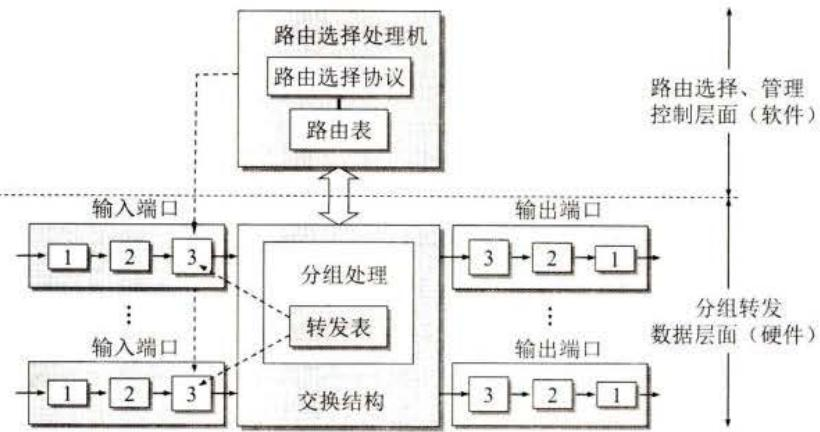
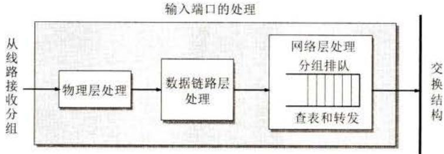
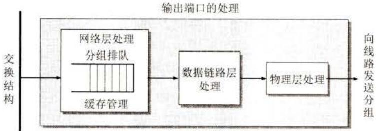
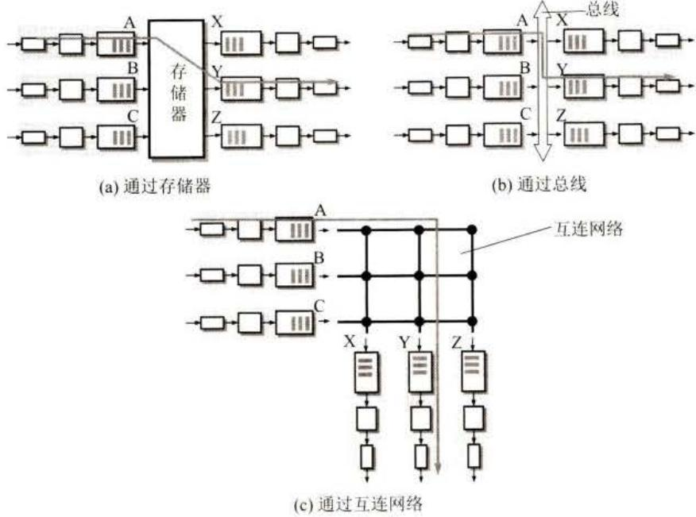

# 4.6.5 路由器的构成

## 1. 路由器的结构

路由器是一种具有多个输入端口和多个输出端口的专用计算机，其任务是转发分组。从路由器某个输入端口收到的分组，按照分组要去的目的

地（即目的网络），把该分组从路由器的某个合适的输出端口转发给下一跳路由器。下一跳路由器也按照这种方法处理分组，直到该分组到达终点为止。路由器的转发分组正是网络层的主要工作。图4-54给出了一种典型的路由器的构成框图。

> 图 4-54 典型的路由器的结构（图中的数字 1～3 表示相应层次的构件）（教材第 175 页）

从图 4-54 可以看出，整个的路由器结构可划分为两大部分：路由选择部分和分组转发部分。

路由选择部分也叫作控制部分，或控制层面，其核心构件是路由选择处理机。路由选择处理机的任务是根据所选定的路由选择协议构造出路由表，同时经常或定期地和相邻路由

器交换路由信息而不断地更新和维护路由表。

分组转发部分是本节所要讨论的问题，也就是数据层面，它由三部分组成：交换结构、一组输入端口和一组输出端口（请注意：这里的端口就是硬件接口）。小型路由器的端口只有几个。但某些 ISP 使用的边缘路由器的高速 10 Gbit/s 端口，则可以有多达几百个之多。下面分别讨论每一部分的组成。例如，Juniper（瞻博网络）公司的边缘路由器 MX2020 的 10 Gbit/s 端口就有 960 个。路由器整个的系统容量为 80 Tbit/s。

交换结构(switching fabric)又称为交换组织，它的作用就是根据转发表(forwarding table)对分组进行处理，将某个输入端口进入的分组从一个合适的输出端口转发出去。交换结构本身就是一种网络，但这种网络完全包含在路由器之中，因此交换结构可看成是“在路由器中的网络”。

请注意 “转发” 和 “路由选择” 是有区别的。在互联网中，“转发” 就是路由器根据转发表把收到的 IP 数据报从路由器合适的端口转发出去。“转发” 仅仅涉及一个路由器。但 “路由选择” 则涉及很多路由器，路由表则是许多路由器协同工作的结果。这些路由器按照复杂的路由算法，得出整个网络的拓扑变化情况，因而能够动态地改变所选择的路由，并由此构造出整个的路由表。路由表一般仅包含从目的网络到下一跳（用 IP 地址表示）的映射，而转发表是从路由表得出的。转发表必须包含完成转发功能所必需的信息。这就是说，在转发表的每一行必须包含从要到达的目的网络到输出端口和某些 MAC 地址信息（如下一跳的以太网地址）的映射。将转发表和路由表用不同的数据结构实现会带来一些好处，这是因为在转发分组时，转发表的结构应当使查找过程最优化，但路由表则需要对网络拓扑变化的计算最优化。路由表总是用软件实现的，但转发表则可用特殊的硬件来实现。请读者注意，在讨论路由选择的原理时，往往不去区分转发表和路由表的区别，而可以笼统地都使用路由表这一名词。

在图 4-54 中，路由器的输入和输出端口里面都各有三个方框，用方框中的 1, 2 和 3 分别代表物理层、数据链路层和网络层的处理模块。物理层进行比特的接收。数据链路层则按照链路层协议接收传送分组的帧。在把帧的首部和尾部剥去后，分组就被送入网络层的处理模块。若接收到的分组是路由器之间交换路由信息的分组（如 RIP 或 OSPF 分组等），则把这种分组送交路由器的路由选择部分中的路由选择处理机。若接收到的是数据分组，则按照分组首部中的目的地址查找转发表，根据得出的结果，分组就经过交换结构到达合适的输出端口。一个路由器的输入端口和输出端口就做在路由器的线路接口卡上。

输入端口中的查找和转发功能在路由器的交换功能中是最重要的。为了使交换功能分散化，往往把复制的转发表放在每一个输入端口中（如图 4-54 中的虚线箭头所示）。路由选择处理机负责对各转发表的副本进行更新。这些副本常称为“影子副本”(shadow copy)。分散化交换可以避免在路由器中的某一点上出现瓶颈。

以上介绍的查找转发表和转发分组的概念虽然并不复杂，但在具体的实现中还会遇到不少困难。问题就在于路由器必须以很高的速率转发分组。最理想的情况是输入端口的处理速率能够跟上线路把分组传送到路由器的速率。这种速率称为线速（line speed 或 wire speed）。可以粗略地估算一下。设线路是 OC-48 链路，即 2.5 Gbit/s。若分组长度为 256 字节，那么线速就应当达到每秒能够处理 100 万以上的分组。现在常用 Mpps（百万分组每秒）为单位来说明一个路由器对收到的分组的处理速率有多高。在路由器的设计中，怎样提高查找转发表的速率是一个十分重要的研究课题。

当一个分组正在查找转发表时，后面又紧跟着从这个输入端口收到另一个分组。这个后到的分组就必须在队列中排队等待，因而产生了一定的时延。图 4-55 给出了在输入端口的队列中排队的分组的示意图。

> 图 4-55 输入端口对线路上收到的分组的处理（教材第 177 页）

我们再来观察在输出端口上的情况（如图 4-56 所示）。输出端口从交换结构接收分组，然后把它们发送到路由器外面的线路上。在网络层的处理模块中设有一个缓存区，实际上它就是一个队列。当交换结构传送过来的分组的速率超过输出链路的发送速率时，来不及发送的分组就必须暂时存放在这个队列中。数据链路层处理模块把分组加上链路层的首部和尾部，交给物理层后发送到外部线路。

> 图 4-56 输出端口把交换结构传送过来的分组发送到线路上（教材第 177 页）

从以上的讨论可以看出，分组在路由器的输入端口和输出端口都可能会在队列中排队等候处理。若分组处理的速率赶不上分组进入队列的速率，则队列的存储空间最终必定减少到零，这就使后面再进入队列的分组由于没有存储空间而只能被丢弃。以前我们提到过的分组丢失就是发生在路由器中的输入或输出队列产生溢出的时候。当然，设备或线路出故障也可能使分组丢失。

## 2. 交换结构

交换结构是路由器的关键构件[KURO17]。正是这个交换结构把分组从一个输入端口转移到某个合适的输出端口。实现这样的交换有多种方法，图4-57给出了三种常用的交换方法。输入端口是A,B和C，输出端口是X,Y和Z。下面简单介绍它们的特点。

最早使用的路由器就是利用普通的计算机，用计算机的 CPU 作为路由器的路由选择处理机。路由器的输入和输出端口的功能和传统的操作系统中的 I/O 设备一样。当路由器的某个输入端口收到一个分组时，就用中断方式通知路由选择处理机。然后分组就从输入端口复制到存储器中。路由器处理机从分组首部提取目的地址，查找路由表，再将分组复制到合适的输出端口的缓存中。若存储器的带宽（读或写）为每秒 M 个分组，那么路由器的交换速率（即分组从输入端口传送到输出端口的速率）一定小于 M/2。这是因为存储器对分组的读

和写需要花费的时间是同一个数量级。

> 图 4-57 三种常用的交换方法（教材第 178 页）

许多现代的路由器也通过存储器进行交换，图 4-57(a) 的示意图表示分组通过存储器进行交换。与早期的路由器的区别就是，目的地址的查找和分组在存储器中的缓存都是在输入端口中进行的。思科(Cisco) 公司的 Catalyst 8500 系列交换机（有的公司把路由器也称为交换机）就采用了共享存储器的方法。

图 4-57(b) 是通过总线进行交换的示意图。采用这种方式时，数据报从输入端口通过共享总线直接传送到合适的输出端口，而不需要路由选择处理机的干预。但是，由于总线是共享的，因此在同一时间只能有一个分组在总线上传送。当分组到达输入端口时若发现总线忙（因为总线正在传送另一个分组），则被阻塞而不能通过交换结构，并在输入端口排队等待。因为每一个要转发的分组都要通过这一条总线，因此路由器的转发带宽就受总线速率的限制。现代的技术已经可以将总线的带宽提高到能够满足小型企业网的需求。例如，思科公司的 6500 路由器用来交换分组的背板总线速率已达到 32 Gbit/s。

图 4-57(c)画的是通过纵横交换结构(crossbar switch fabric)进行交换。这种交换机构常称为互连网络(interconnection network)，它有 2N 条总线，可以使 N 个输入端口和 N 个输出端口相连接，这取决于相应的交叉节点是使水平总线和垂直总线接通还是断开。当输入端口收到一个分组时，就将它发送到与该输入端口相连的水平总线上。若通向所要转发的输出端口的垂直总线是空闲的，则在这个节点将垂直总线与水平总线接通，然后把该分组转发到这个输出端口。例如，一个分组到达输入端口 A，应转发到输出端口 Y。这时交换结构的控制器就把总线 A 和 Y 的交叉节点闭合，因此分组就从输入端口 A 传送到了输出端口 Y。请注意，如果与此同时还有一个分组要从输入端口 B 转发到输出端口 Z，那么也可同时进行，因为 A → Y 和 B → Z 的转发是使用不同的总线的转发。和前两种交换机制不同，这种纵横交换结构是一种无阻塞的交换结构，其特点是分组可以转发到任何一个输出端口，只要这个输出端口没有被别的分组占用。如果这个输出端口（即对应的垂直总线）已被占用（有另一个分组正

(a) 单播

在转发到同一个输出端口)，那么后到达的分组就必须在输入端口排队等待。采用这种交换方式的路由器例子如思科公司的12000系列交换路由器，其互连网络的速率达60 Gbit/s。
