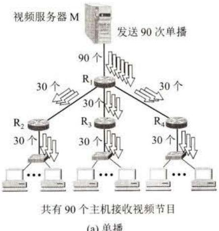
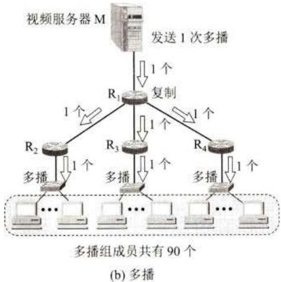

# 4.7.1 IP多播的基本概念

## 4.7 IP多播

1988 年 Steve Deering 首次在其博士学位论文中提出 IP 多播的概念。1992 年 3 月 IETF 在互联网范围首次试验 IETF 会议声音的多播，当时有 20 个网点可同时听到会议的声音。IP 多播是需要在互联网上增加更多的智能才能提供的一种服务。现在 IP 多播（multicast，以前曾译为组播）已成为互联网的一个热门课题。这是由于有许多的应用需要由一个源点发送到许多个终点，即一对多的通信。例如，实时信息的交付（如新闻、股市行情等）、软件更新、交互式会议等。随着互联网的用户数目的急剧增加，以及多媒体通信的开展，有更多的业务需要多播来支持。

与单播相比，在一对多的通信中，多播可大大节约网络资源。图 4-58(a) 是视频服务器用单播方式向 90 台主机传送同样的视频节目。为此，需要发送 90 个单播，即同一个视频分组要发送 90 个副本。图 4-58(b) 是视频服务器用多播方式向属于同一个多播组的 90 个成员传送节目。这时，视频服务器只需把视频分组当作多播数据报来发送，并且只需发送一次。路由器 $R_{1}$ 在转发分组时，需要把收到的分组复制成 3 个副本，分别向 $R_{2}, R_{3}$ 和 $R_{4}$ 各转发 1 个副本。当分组到达目的局域网时，由于局域网具有硬件多播功能，因此不需要复制分组，在局域网上的多播组成员都能收到这个视频分组。

> 图4-58 单播与多播的比较（教材第 179 页）

当多播组的主机数很大时（如成千上万个），采用多播方式就可明显地减轻网络中各种资源的消耗。在互联网范围的多播要靠路由器来实现，这些路由器必须增加一些能够识别多播数据报的软件。能够运行多播协议的路由器称为多播路由器(multicast router)。多播路由器当然也可以转发普通的单播IP数据报。

为了适应交互式音频和视频信息的多播，从 1992 年起，在互联网上开始试验虚拟的多播主干网 MBONE (Multicast Backbone On the InterNEt)。MBONE 可把分组传播给地点分散但属于一个组的许多台主机。现在多播主干网已经有了相当大的规模。

在互联网上进行多播就叫作 IP 多播。IP 多播所传送的分组需要使用多播 IP 地址。

我们知道，在互联网中每一台主机必须有一个全球唯一的 IP 地址。如果某台主机现在想接收某个特定多播组的分组，那么怎样才能使这个多播数据报传送到这台主机？

显然，这个多播数据报的目的地址一定不能写入这台主机的 IP 地址。这是因为在同一时间可能有成千上万台主机加入到同一个多播组。多播数据报不可能在其首部写入这样多的主机的 IP 地址。在多播数据报的目的地址写入的是多播组的标识符，然后设法让加入到这个多播组的主机的 IP 地址与多播组的标识符关联起来。

其实多播组的标识符就是 IP 地址中的 D 类地址。D 类 IP 地址的前四位是 1110，因此 D 类地址范围是 224.0.0.0 到 239.255.255.255。我们就用每一个 D 类地址标志一个多播组。这样，D 类地址共可标志 $2^{28}$ 个多播组，也就是说，在同一时间可以允许有超过 2.6 亿的多播组在互联网上运行。多播数据报也是“尽最大努力交付”，不保证一定能够交付多播组内的所有成员。因此，多播数据报和一般的 IP 数据报的区别就是它使用 D 类 IP 地址作为目的地址，并且首部中的协议字段值是 2，表明使用网际组管理协议 IGMP。

显然，多播地址只能用于目的地址，而不能用于源地址。此外，对多播数据报不产生 ICMP 差错报文。因此，若在 PING 命令后面键入多播地址，将永远不会收到响应。

IP 多播可以分为两种。一种是只在本局域网上进行硬件多播，另一种则是在互联网的范围进行多播。前一种虽然比较简单，但很重要，因为现在大部分主机都是通过局域网接入到互联网的。在互联网上进行多播的最后阶段，还是要把多播数据报在局域网上用硬件多播交付多播组的所有成员（如图 4-58(b) 所示）。下面就先讨论这种硬件多播。
