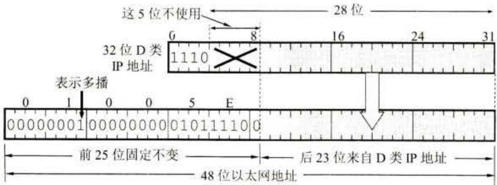

# 4.7.2 在局域网上进行硬件多播

互联网号码指派管理局 IANA 拥有的以太网地址块的高 24 位为 00-00-5E，因此 TCP/IP 协议使用的以太网地址块的范围是从 00-00-5E-00-00-00 到 00-00-5E-FF-FF-FF。在第 3 章 3.3.5 节已讲过，以太网 MAC 地址字段中的第 1 字节的最低位为 1 时即为多播地址，这种多播地址数占 IANA 分配到的地址数的一半。但 IANA 只拿出 $2^{23}$ 个地址，即 01-00-5E-00-00-00 到 01-00-5E-7F-FF-FF 的地址作为以太网多播地址。或者说，在 48 位的多播地址中，前 25 位都固定不变，只有后 23 位可用作多播。但 D 类 IP 地址可供分配的有 28 位。这 28 位中只有后 23 位才映射以太网多播地址中的后 23 位，因此是多对一的映射关系（如图 4-59 所示），即 28 位中的前 5 位不能用来构成以太网多播地址。例如，IP 多播地址 224.128.64.32（即 E0-80-40-20）和另一个 IP 多播地址 224.0.64.32（即 E0-00-40-20）转换成以太网的多播地址都是 01-00-5E-00-40-20。因此收到多播数据报的主机，还要在 IP 层利用 IP 数据报首部的 IP 地址进行过滤，把不是本主机要接收的数据报丢弃。

> 图 4-59 D 类 IP 地址与以太网多播地址的映射关系（教材第 180 页）

下面就讨论进行 IP 多播所需要的协议。
